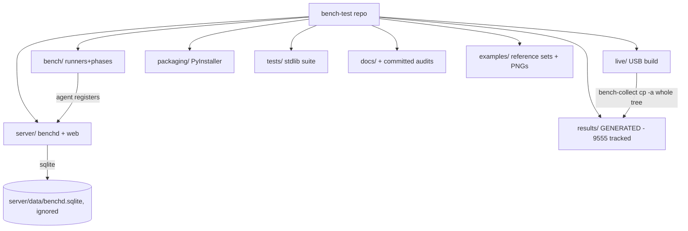

# 01_repository_inventory — Prompt 01 - Comprehensive Repository Inventory

- Run: `bench-test-20261013-0819-full-main-b916709`
- Target: `bench-test` @ `b916709` (branch `main`)
- Domain: `01_repository_inventory.md` (area INV, prompt)

## Verification Performed

# Comprehensive Repository Inventory

## Audit Metadata

- Audit name: repo-deep-dive
- Run: 20261013-1430-main-b916709
- Repository: `C:\temp\bench-test`
- Branch: `main`
- Commit SHA: `b9167095b08c2f45a814e88e09d88decbd0ea885`
- Generated at: 2026-10-13
- Auditor: domain subagent (01_repository_inventory)
- Area code: INV
- Output path: `docs/audits/repo-deep-dive/20261013-1430-main-b916709/01_repository_inventory.md`
- Scope limitations: read-only audit from the repository tree only; no control plane was started, no lab was used, no network calls were made, and no secret values were read or printed. `results/` was inventoried by path/count/size, not read in full.

## Scope

Reviewed: repository state (branch/HEAD/dirty), root configs (`.gitignore`, `.gitattributes`, `VERSION`, `LICENSE`, launchers, `README.md`, `AGENTS.md`), package/workspace files (none found — see findings), applications/runtimes (`bench/`, `server/`, `packaging/`), API services (`server/benchd.py` + `server/web/`), workers/agents (`bench/agent.py`, `server/bench-agent.service`), shared code (Python modules under `bench/`), database/migrations (SQLite handled in `server/benchd.py`; no migration files), GitHub metadata (`.github/workflows/`), tests (`tests/`), docs (`docs/`), assets (`examples/`, `live/keys/`), generated artifacts (`results/`, `dist/`, `tools/`, committed audit run), Docker/deploy/infra (none found), environment examples (`server/benchd.conf.example`, `live/airootfs/etc/bench-agent.conf.example`).

Not reviewed in depth: the body of each PowerShell runner, the `server/web` front-end behaviour, and the contents of the 9000+ committed result files (inventoried by path/count/size only). SaaS-only surfaces called out in the brief (billing, multi-tenant SaaS, Supabase RLS, webhook delivery, mobile/PWA, analytics, database migrations) are **not applicable** to this repository — there is no web app, ORM, migration tool, or multi-tenant database layer (evidence: no `Dockerfile`/`docker-compose`/`*.tf`; no requirements/pyproject; the only datastore is SQLite created inline in `server/benchd.py`).

## Evidence Reviewed

| Evidence | Type | Why relevant | Notes |
|---|---|---|---|
| `git rev-parse HEAD` / `git branch` / `git status --porcelain` | command | repo state for the run manifest | HEAD `b9167095…`, branch `main`, clean tree |
| `git ls-files` (9811 files), `--ignored` | command | source vs generated vs ignored split | 9555 tracked files live under `results/` |
| `.gitignore`, `.gitattributes`, `VERSION` | config | ignore policy and line-ending/exec policy | `results/` and `*.log` ignored; `sys-info.log` **not** tracked |
| `README.md` (367 lines) | doc | primary description, version, layout, security | claims v1.1.0; baked-token disclosure |
| `AGENTS.md` (root of target) | doc | contributor instructions | versioned contributor guidance |
| `.github/workflows/{release,build-app,build-iso}.yml` | CI | release/tagging and secret baking | release derives version from git tag |
| `tests/{run_all.py,harness.py,test_*.py}` | tests | stdlib suite entry point | custom harness (not pytest) |
| `docs/{METHODOLOGY,CONTROL_PLANE,DATA,PHASE_TIMINGS,FUTURE_WORK}.md` | docs | operator/agent docs | present |
| `server/benchd.conf.example`, `live/airootfs/etc/bench-agent.conf.example` | env examples | token/config contract | `BENCHD_TOKEN=change-me` |
| `live/airootfs/usr/local/bin/bench-collect` | infra script | result collection mechanism | `cp -a` of whole results tree (root cause of nesting) |
| `bench/bootstrap.py` | code | dependency policy | `BASE_PACKAGES` explicit, unpinned |
| `docs/audits/repo-deep-dive/20261007-1731-main-4ecee97/*` | generated | committed audit run | pinned to `4ecee97` |
| `Get-ChildItem tools/`, `dist/` | command | ignored build/download outputs present on disk | LibreHardwareMonitor + PyInstaller bundles |

## Verification Performed

| Evidence | Type | Why relevant | Notes |
|---|---|---|---|
| `git rev-parse HEAD`; `git status --porcelain` | command | confirm clean tree at audited commit | empty porcelain output |
| `git ls-files 'results/*' \| Measure` | command | count committed generated files | **9555** tracked files under `results/` |
| tracked-results byte sum (per-file `Get-Item Length`) | command | quantify committed generated data | **55.6 MB** tracked vs **727.5 MB** on disk |
| `git tag --list 'v*' --sort=-v:refname` | command | version source of truth | top tag `v1.11.3`; 212 tags |
| `Select-String` for version literal in README/docs/code | command | README-vs-VERSION consistency | README `v1.1.0` vs VERSION `1.11.3` |
| `git ls-files` search for manifest/lockfile names | command | confirm absence of dependency manifest | no matches |
| `Select-String` for `pip install` / imports | command | identify real third-party deps | numpy, psutil, cryptography, torch, onnxruntime-directml |
| nested-directory scan under `results/` | command | detect duplicated/nested runs | 36 top-level dirs contain nested run dirs; 3 dirs under `results/results/` |
| `Get-ChildItem .github -Recurse` | command | GitHub metadata inventory | only `workflows/` present |
| largest tracked file scan (`Get-Item Length \| Sort -Desc`) | command | binary bloat | 4 PNGs 3.1–3.8 MB |
| `Get-ChildItem tools/dist/.venv` | command | present-but-ignored build inputs | LHM binaries, PyInstaller output |

**Reproduction status of headline claims**

- README "mostly git-ignored; a few runs tracked as history" → **unsupported**: `git ls-files 'results/*'` returns 9555 files (not "a few").
- README "Release v1.1.0" → **unsupported** vs `VERSION` (`1.11.3`) and tag `v1.11.3` → **contradicted by source of truth**.
- README "baked token is world-readable" → **supported** by workflow (`build-app.yml:63`) and config (`benchd.conf.example:4`).
- "results are just output" → **partially supported**: `dist/`, `tools/`, `.venv/`, root `*.log` are ignored and untracked, but `results/` was force-added.

## Executive Summary

`bench-test` is a Windows-PowerShell + Linux-Python workstation benchmarking and stress toolkit with an optional stdlib control plane (`server/benchd.py`), a bootable Arch live USB (`live/`), PyInstaller packaging (`packaging/`), three GitHub workflows, and a stdlib test suite. The tree is clean at commit `b9167095`, the source layout is coherent, docs are real, and the three CI workflows are well-scoped.

The main inventory risks are hygiene and consistency, not missing functionality:

1. **Sensitive artifact exposure (P1):** the same shared control-plane bearer token (`BENCHD_TOKEN`, described as the token for runners *and* the web UI) is baked into public app-bundle releases by CI. The README acknowledges the token is world-readable and only asks operators to rotate.
2. **Repo bloat / policy drift (P2 x2):** the repo's own `.gitignore` ignores `results/`, yet 9555 generated files (55.6 MB) are committed; the live collector copies the entire results tree into each new destination, producing recursively nested duplicate runs including a `results/results/` layer.
3. **Reproducibility (P2):** there is no dependency manifest or lockfile for a toolkit whose core benchmark value is reproducible numbers, yet it depends on numpy/psutil/cryptography and torch/onnxruntime.
4. **Doc/consistency and governance (P2/P3):** the README advertises v1.1.0 against a VERSION of 1.11.3; there is no CODEOWNERS/SECURITY/dependabot/templates/CHANGELOG; multi-MB example screenshots and a binary GPG key are committed; a prior audit run is committed and pinned to an old commit with no regeneration note.

Recommended next actions: stop baking a privileged token into public releases; make result collection idempotent and un-track `results/`; add a pinned dependency manifest; fix the README version and add governance files.

## Inventory

| Item | Path / symbol | Purpose | Current state | Risk | Notes |
|---|---|---|---|---|---|
| Root ignore policy | `.gitignore` | exclude results/logs/build | Functional; `results/` ignored but tracked anyway | Medium | tracked-but-ignored set |
| Line-ending policy | `.gitattributes` | LF for sh/py/js, CRLF for ps1/cmd | Implemented | Low | good |
| Version source | `VERSION` | release identity | `1.11.3` | Low | from git tag via `release.yml` |
| Primary doc | `README.md` | user/operator onboarding | Detailed; version stale | Medium | v1.1.0 vs 1.11.3 |
| Contributor guide | `AGENTS.md` | agent/contributor rules | Present (17 KB) | Low | |
| Launchers | `bench-gui.cmd`, `bench-tui.cmd`, `bench-agent.cmd` | Windows entry points | Present | Low | |
| Bench toolkit | `bench/` (37 files) | PowerShell runners + Python phases + dashboards + agent | Present | Low | stdlib core |
| GPU/CPU/RAM/disk/net/nvenc phases | `bench/*_bench.py` | measurement phases | Present | Medium | depend on numpy/torch, unpinned |
| Agent/worker | `bench/agent.py`, `server/bench-agent.service` | fleet runner | Present | Low | |
| Control plane | `server/benchd.py` (+ `server/web/*`) | REST+SSE+SQLite+web UI | Present | Medium | token/secret handling is CI concern |
| Importer | `server/import_results.py` | backfill results | Present | Low | |
| Live USB | `live/` (build + airootfs) | bootable Arch ISO | Present | Low | `bench-collect` copies whole tree |
| Packaging | `packaging/build_app.py`, `launcher.py` | PyInstaller bundles | Present | Low | bakes agent conf |
| Tests | `tests/run_all.py` + 10 `test_*.py` + `harness.py` | stdlib suite | Present; `RESULT: PASS` contract | Low | custom harness |
| Docs | `docs/*.md` | methodology/control-plane/data/timings/future | Present | Low | |
| Committed audit run | `docs/audits/repo-deep-dive/20261007-1731-main-4ecee97/` | prior audit outputs | Present, pinned to `4ecee97` | Low | generated |
| Results (generated) | `results/` | run output | 9555 tracked of 10385 on disk | High | 55.6 MB tracked / 727 MB disk |
| Examples | `examples/` | reference result sets | Present incl. 6 PNGs | Low | ~13 MB binaries |
| Ignored build inputs | `tools/`, `dist/`, `.venv/`, root `*.log` | downloaded/PyInstaller outputs | Present on disk, untracked | Low | correctly ignored |
| DB / migrations | (none) | persistence | SQLite created inline in `benchd.py` | N/A | no migrations — not applicable |
| Docker / IaC | (none) | deployment | none | N/A | no Dockerfile/tf/compose |
| Env examples | `server/benchd.conf.example`, `live/airootfs/etc/bench-agent.conf.example` | config contract | Present | Medium | `BENCHD_TOKEN=change-me` |

### Sensitive inventory (paths + types only; no values)

| Path | Secret type | Committed? | Notes |
|---|---|---|---|
| `server/benchd.conf.example` | shared bearer token placeholder | Yes (placeholder only) | `BENCHD_TOKEN=change-me` — real file `server/benchd.conf` is git-ignored |
| `.github/workflows/build-app.yml:63` | CI secret reference | No value in repo | `secrets.BENCH_AGENT_CONF` |
| Public app bundles (releases) | baked shared token | External artifact | README states world-readable; rotation-only mitigation |
| `live/airootfs/etc/bench-agent.conf.example` | token placeholder | Yes (placeholder) | real `live/private/bench-agent.conf` ignored |
| `live/keys/omarchy.gpg` | public signing key (not a secret) | Yes | provenance/rotation undocumented |
| `server/data/` (runtime) | SQLite db + blobs | Ignored | `.gitignore:27` |

### Generated / stale artifact table

| Artifact | Regeneration command | Bound commit | Stale? |
|---|---|---|---|
| `results/**` (9555 tracked) | runner / `bench-collect` | varies | Yes — ignored by policy yet committed |
| `results/results/**` | none (accidental) | n/a | Yes — nested duplicate |
| `docs/audits/repo-deep-dive/20261007-…/{findings,audit_manifest,deterministic-findings}.json` | not documented | `4ecee97` | Yes — HEAD is `b9167095` |
| `dist/**`, `tools/lhm/**` | build/download | n/a | Untracked (correct) |
| `PACK_DIGEST`/ledgers | n/a | n/a | Not present in target repo |

### Unknowns

| Item | Why unknown |
|---|---|
| Actual privilege scope of the baked `BENCHD_TOKEN` | Needs the live benchd config/secret; value not in repo |
| Exact chain that re-nests collected output under `results/` | Collector writes to BENCHDATA; the host-side copy-back into the repo is not documented |
| Whether any committed `results/` run is the "reference" run | No INDEX/README listing which tracked runs are canonical |
| Last real exercise of the update/ISO-write paths | Outside read-only inventory scope |

## Domain Scorecard

| Category | Score | Evidence | Gap | Recommended action |
|---|---:|---|---|---|
| Root configs | 4 | `.gitignore`, `.gitattributes`, `VERSION` all present | `results/` ignored but tracked | Reconcile ignore policy vs tracked set |
| Package/workspace files | 0 | none found | no manifest at all | Add requirements/pyproject + lock |
| Applications | 3 | `bench/`, `packaging/` | deps unpinned | Pin deps |
| API services | 3 | `server/benchd.py` + web | stdlib; secret handling via CI | Document token scopes |
| Workers | 3 | `bench/agent.py`, systemd units | none material | — |
| Shared packages | 2 | modules in `bench/` | no shared package boundary/manifest | Optional: package + version |
| Database/migrations | 1 | SQLite inline in `benchd.py` | no schema/versioning | Document schema or add version table |
| GitHub metadata | 2 | 3 workflows | no owners/SECURITY/dependabot/templates | Add governance files |
| Tests | 4 | `tests/run_all.py` + 10 modules | custom harness; no coverage/CI invocation evidence | Wire `run_all.py` into CI |
| Docs | 4 | 5 docs + README + AGENTS | README version stale | Fix version, add CHANGELOG |
| Assets/public files | 3 | `examples/` sets + PNGs | ~13 MB binaries, GPG key undocumented | Compress/attach; document key |
| Generated artifacts | 1 | 9555 tracked results, nested dups | policy drift + duplication | Untrack results, idempotent collect |

## Detailed Review

### Item: Result collection pipeline (`live/…/bench-collect` + `results/`)

- Evidence: `bench-collect:149-152`; `.gitignore:2`; `git ls-files 'results/*'`.
- What it does: copies `/opt/bench-test/results` to `$DEST/$HOST-$STAMP` on the BENCHDATA partition.
- How it appears to work: `cp -a "$SRC/." "$TARGET/"` copies the *entire* source tree, so a source that already contains collected output nests a prior tree inside the new destination.
- Dependencies: `results/` convention, upload/import flow.
- Current controls: `.gitignore` intends `results/` to stay out of git.
- Missing controls: no dedup, no "target exists" guard, no CI guard on committed results.
- Risks: recursive bloat (observed `results/results/**` and 36 nested dirs), 727 MB on disk / 55.6 MB committed.
- Recommended improvement: copy only new run dirs; un-track `results/`.
- Suggested tests: run collector twice, assert no nesting.
- Suggested docs: state which runs (if any) are canonical.

### Item: Dependency posture (`bench/bootstrap.py`, phases)

- Evidence: `bootstrap.py:38,42`; `cpu_bench.py:17`; `benchreport.py:235`; `README.md:84-86`.
- What it does: installs numpy/psutil/cryptography (+ torch or onnxruntime-directml) at run time.
- Missing controls: no manifest, no lock, no CI install contract.
- Risks: non-reproducible measurements, no SCA surface.

### Item: CI/release (`.github/workflows/*`)

- Evidence: `release.yml:45-50` (version from tags), `build-app.yml:59-64` (bakes `BENCH_AGENT_CONF`), `build-app.yml:87-90` (uploads artifacts).
- Current controls: tag-derived versioning; per-label concurrency.
- Missing controls: token-scope gate; no dependency lock in the build; no test step shown before publish.

## Scenario / Control Matrix

| ID | Scenario or control | Evidence | Current control | Gap | Severity | Recommendation |
|---|---|---|---|---|---|---|
| INV-001 | Root configs | `.gitignore:2`, `.gitattributes` | ignore + eol policy | results ignored-but-tracked | P2 | reconcile, untrack results |
| INV-002 | Package/workspace files | absence search | none | no manifest/lock | P2 | add + pin deps |
| INV-003 | Applications | `bench/`, `packaging/` | stdlib core | unpinned third-party deps | P2 | lock file |
| INV-004 | API services | `server/benchd.py` | stdlib HTTP/SSE/SQLite | token scope doc | P2 | per-runner enrolment |
| INV-005 | Workers | `bench/agent.py` | agent + systemd | none material | P3 | — |
| INV-006 | Shared packages | `bench/*.py` | flat modules | no package boundary | P3 | optional packaging |
| INV-007 | Database/migrations | `benchd.py` | inline SQLite | no schema versioning | P3 | document schema |
| INV-008 | GitHub metadata | `.github/workflows/` only | 3 workflows | no owners/security/deps | P3 | add governance files |
| INV-009 | Tests | `tests/run_all.py` | stdlib suite | CI invocation not evidenced | P2 | run in CI |
| INV-010 | Docs | `README.md`, `docs/*` | rich docs | README version stale | P2 | fix version + CHANGELOG |
| INV-011 | Assets/public files | `examples/*.png`, `live/keys/*.gpg` | examples present | multi-MB binaries | P3 | compress/document |
| INV-012 | Generated artifacts | `results/`, `docs/audits/…` | ignored/build outputs | committed results + nesting | P1/P2 | untrack + idempotent collect |

## Findings

### Finding ID: `INV-P1-001` - Shared control-plane token baked into public releases

- Severity: P1
- Confidence: Medium
- Area: INV
- Evidence:
  - `README.md:158-163`, `README.md:361-363`
  - `.github/workflows/build-app.yml:59-64`
  - `server/benchd.conf.example:4-6`
- What is happening: CI bakes the `BENCH_AGENT_CONF` secret (the same config the live USB writes to `/etc/bench-agent.conf`) into each public app bundle; that config carries `BENCHD_TOKEN`, documented as the shared bearer token for runners **and the web UI**.
- Why it matters: the token is downloadable by anyone, and if it is the operator token it grants control-plane access including remote reboot/shutdown.
- User / business impact: fleet-control exposure; trust damage from a public repository shipping credentials.
- Security / privacy / reliability impact: authentication bypass against the control plane for anyone who fetches the release.
- Recommended fix: bake only a low-privilege enrolment token; issue per-runner keys server-side; add a CI scope-check.
- Suggested validation: CI assertion that the baked token is a dedicated enrolment credential, not the operator token.
- Owner suggestion: release/control-plane maintainer.
- Effort estimate: M
- Dependencies: `server/benchd.py` auth model.
- Status: open
- Endpoint / data path: bundle → `BENCH_AGENT_CONF` → agent registration → control plane
- Attack path: download public bundle → extract token → authenticate to control plane → remote reboot/shutdown

### Finding ID: `INV-P2-001` - Generated run output committed en masse

- Severity: P2
- Confidence: High
- Area: INV
- Evidence: `.gitignore:2`; `README.md:335`; `git ls-files 'results/*'` = 9555 files / 55.6 MB tracked vs 727.5 MB on disk.
- What is happening: `results/` is ignored yet thousands of generated files are force-committed, contradicting the documented "a few runs tracked as history".
- Why it matters: repo/history bloat, noisy diffs, tracked-but-ignored confusion.
- Recommended fix: curate a small reference set under `examples/` and `git rm -r --cached results/`; add a CI guard.
- Suggested validation: CI step failing on new `results/**` additions.
- Owner suggestion: maintainer.
- Effort estimate: S
- Status: open

### Finding ID: `INV-P2-002` - Recursively nested/duplicated result trees committed

- Severity: P2
- Confidence: High
- Area: INV
- Evidence: `live/airootfs/usr/local/bin/bench-collect:149-152`; `results/results/bench-live-linux-20261011-135440/`; `results/bench-live-linux-20261013-073159/bench-live-linux-20261012-231337-logs/`; 36 top-level dirs contain nested run dirs.
- What is happening: the collector copies the whole source results tree into each new destination, so prior runs are re-copied and nested.
- Why it matters: duplicated data, ambiguous provenance, storage growth.
- Recommended fix: copy only new run dirs; guard against existing targets; CI check rejecting `results/results/` or nested runs.
- Suggested validation: collector run twice produces no nesting.
- Owner suggestion: live-USB maintainer.
- Effort estimate: S
- Status: open

### Finding ID: `INV-P2-003` - No dependency manifest or lockfile

- Severity: P2
- Confidence: High
- Area: INV
- Evidence: no manifest found; `README.md:84-86`; `bench/bootstrap.py:38,42`; `bench/cpu_bench.py:17`; `bench/benchreport.py:235`; `bench/gpu_bench.py:45`.
- What is happening: third-party deps (numpy, psutil, cryptography, torch, onnxruntime-directml) are installed ad hoc and unpinned.
- Why it matters: measurements are not reproducible; no SCA/dependency-update surface.
- Recommended fix: add `requirements.txt`/`pyproject.toml` + a constraints lock; install from it in bootstrap and CI.
- Suggested validation: CI installs from the lock and runs the suite.
- Owner suggestion: maintainer.
- Effort estimate: S
- Status: open

### Finding ID: `INV-P2-004` - README version stale vs VERSION and tags

- Severity: P2
- Confidence: High
- Area: INV
- Evidence: `README.md:12,15,17` ("v1.1.0"); `VERSION:1` (`1.11.3`); top tag `v1.11.3`; `release.yml:45-50`.
- What is happening: the README advertises a version ~10 minor releases behind the source of truth.
- Why it matters: misleads operators/evaluators; a summary artifact contradicts its source of truth.
- Recommended fix: update the README (or reference VERSION) and add a CI check.
- Suggested validation: CI fails when README version ≠ VERSION.
- Owner suggestion: maintainer.
- Effort estimate: S
- Status: open

### Finding ID: `INV-P3-001` - Missing GitHub governance metadata

- Severity: P3
- Confidence: High
- Area: INV
- Evidence: `.github/` contains only `workflows/`; search finds no CODEOWNERS/SECURITY/dependabot/templates/CHANGELOG.
- What is happening: no ownership, disclosure, dependency-update, or PR/issue templates for a repo shipping a fleet control plane.
- Recommended fix: add `.github/CODEOWNERS`, `SECURITY.md`, `.github/dependabot.yml`, PR/issue templates, CHANGELOG.
- Effort estimate: S
- Status: open

### Finding ID: `INV-P3-002` - Large committed binary assets

- Severity: P3
- Confidence: High
- Area: INV
- Evidence: 4 example PNGs of 3.1–3.8 MB; 6 tracked PNGs (~13 MB); `live/keys/omarchy.gpg`; `.git` store = 23.0 MB.
- What is happening: multi-MB screenshots and a binary GPG key are committed with no size/provenance controls.
- Recommended fix: compress/attach screenshots; document key provenance/rotation; consider Git LFS.
- Effort estimate: S
- Status: open

### Finding ID: `INV-P3-003` - Committed audit artifacts pinned to an old commit

- Severity: P3
- Confidence: Medium
- Area: INV
- Evidence: `docs/audits/repo-deep-dive/20261007-1731-main-4ecee97/INDEX.md:3` (`main @ 4ecee97`); HEAD `b9167095`; committed `findings.json`/`audit_manifest.json`/`deterministic-findings.json`.
- What is happening: generated audit outputs are in-tree, bound to `4ecee97`, with no regeneration command or staleness marker.
- Recommended fix: move prior machine-readable outputs out of tree, or document commit + regeneration + staleness.
- Effort estimate: S
- Status: open

## Risks

| Risk | Severity | Likelihood | Impact | Evidence | Mitigation |
|---|---|---|---|---|---|
| Publicly downloadable privileged control-plane token | P1 | High | Fleet control exposure | `build-app.yml:63`, `benchd.conf.example:4` | Enrolment-only token; per-runner keys |
| Repo history bloat from committed results | P2 | High (already happening) | Slow clones/reviews; unbounded growth | 9555 tracked files / 55.6 MB | Untrack `results/`; CI guard |
| Non-reproducible measurements | P2 | Medium | Invalid comparisons; support load | No manifest; `bootstrap.py:38` | Pin deps + lock |
| Misleading release identity | P2 | Medium | Operator confusion | `README.md:12` vs `VERSION` | Fix + CI check |

## Recommendations

### Immediate / Release Blocking

- Stop baking a privileged token into public bundles; switch to a scoped enrolment credential (INV-P1-001).

### This Week

- Un-track `results/` and curate a small reference set under `examples/` (INV-P2-001).
- Make `bench-collect` copy only new run dirs (INV-P2-002).
- Fix the README version and add a CI consistency check (INV-P2-004).

### This Month

- Add a pinned dependency manifest + lock and use it in bootstrap and CI (INV-P2-003).
- Add GitHub governance files (INV-P3-001) and compress/document large assets (INV-P3-002).

### Later / Platform Evolution

- Move audit machine-readable outputs out of the source tree and define a snapshot/staleness convention (INV-P3-003). Optionally formalize `bench/` as a versioned package.

## Quick Wins

| Quick win | Why it helps | Files likely involved | Validation |
|---|---|---|---|
| `git rm -r --cached results/` + CI guard | Stops bloat immediately | `.gitignore`, CI | `git ls-files 'results/*'` empty |
| Update README version | Restores consistency | `README.md` | CI/README matches `VERSION` |
| Add `requirements.txt` (pinned) | Reproducible envs | new file, `bench/bootstrap.py` | CI installs + `tests/run_all.py` PASS |
| Add `dependabot.yml` | Auto dependency updates | `.github/` | PRs opened |

## Hardening Backlog

| Backlog item | Priority | Owner suggestion | Effort | Dependency |
|---|---|---|---|---|
| Enrolment-scoped baked token | P1 | release/control-plane | M | auth model change |
| Idempotent result collection | P2 | live-USB | S | none |
| Dependency lock | P2 | maintainer | S | none |
| Untrack results + CI guard | P2 | maintainer | S | policy decision |
| Governance metadata | P3 | maintainer | S | none |
| Asset compression / LFS | P3 | maintainer | S | none |
| Audit artifact policy | P3 | maintainer | S | none |

## Suggested Tests

- **Unit/integration:** run `python tests/run_all.py` in CI on Linux + Windows and require `RESULT: PASS`.
- **Regression:** call `bench-collect` twice in a scratch dir and assert the tree does not nest (`results/results/` never appears).
- **CI/security:** a workflow step that fails if a new file is added under `results/`, and a step that fails if the baked `BENCH_AGENT_CONF` is the operator token.
- **Docs/consistency:** a check that README's advertised version equals `VERSION`.
- **Supply chain:** dependency scan against the new lock file.
- **Manual:** clone the repo and confirm clone size/history is acceptable after untracking results.

## Suggested Documentation Updates

- `README.md`: correct release version; add a short "Repository layout & generated artifacts" note (which runs, if any, are canonical).
- `docs/DATA.md`: document the results/collection pipeline and the nesting rule.
- `docs/CONTROL_PLANE.md`: document token scopes and the enrolment-vs-operator distinction.
- New `SECURITY.md`, `.github/CODEOWNERS`, `.github/dependabot.yml`, `CHANGELOG.md`.
- `docs/audits/README` or index note marking committed audit runs as point-in-time snapshots.

## Open Questions

| Question | Why it matters | Evidence needed |
|---|---|---|
| What privilege does the baked `BENCHD_TOKEN` actually have? | Determines whether INV-P1-001 is P0 or P1 | live benchd config / secret scope |
| Which tracked `results/` run, if any, is the reference? | Needed before untracking | maintainer intent / an INDEX |
| What host-side step copies the BENCHDATA tree back into `results/`? | Explains the `results/results/` nesting | host collection/upload script |
| Is `tests/run_all.py` invoked by any workflow? | Test coverage is unverified in CI | CI config (none found in `.github/workflows/`) |

## Appendix

Repository state at audit:

```
HEAD   = b9167095b08c2f45a814e88e09d88decbd0ea885
branch = main
status = clean (git status --porcelain empty)
tags   = 212 (head: v1.11.3)
.git   = 23.0 MB
```

Tracked file counts by area (excluding `results/`): `bench/` 37, `server/` 7, `live/` ~30, `tests/` 12, `docs/` 17, `examples/` ~120, `.github/workflows/` 3, root configs ~7.



## Findings

| ID | Severity | Title |
|---|---|---|
| INV-P1-001 | P1 | Shared control-plane token is baked into public app-bundle releases |
| INV-P2-001 | P2 | Generated run output is committed en masse despite results/ being git-ignored, contradicting the documented policy |
| INV-P2-002 | P2 | Recursively duplicated/nested result trees are committed (collector copies the whole results tree into itself) |
| INV-P2-003 | P2 | No dependency manifest or lockfile for a toolkit that needs numpy/psutil/cryptography plus torch or onnxruntime |
| INV-P2-004 | P2 | README headline version is stale and contradicts VERSION and the release tags |
| INV-P3-001 | P3 | No GitHub governance metadata (CODEOWNERS, SECURITY policy, dependency updates, issue/PR templates) |
| INV-P3-002 | P3 | Large committed binary assets (multi-MB result screenshots and a signing key) inflate the repository |
| INV-P3-003 | P3 | Committed audit artifacts are pinned to an old commit with no regeneration command |
