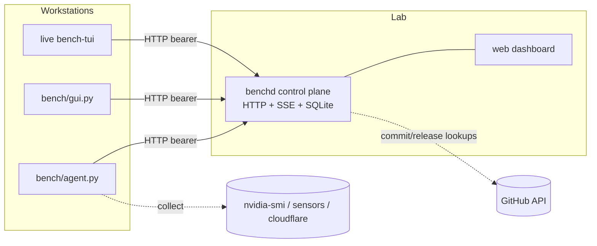
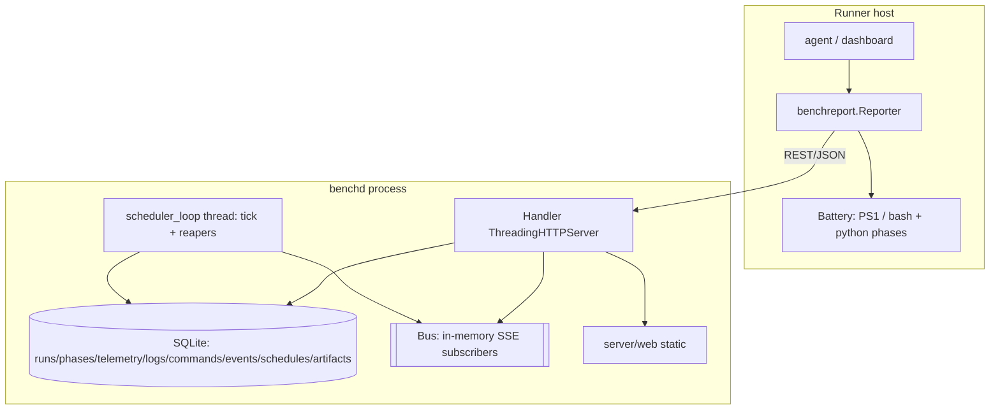
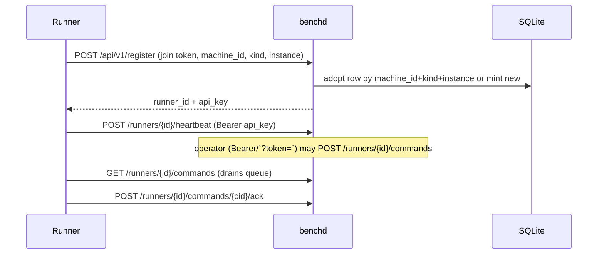
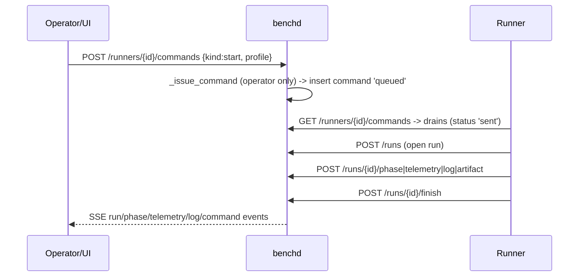
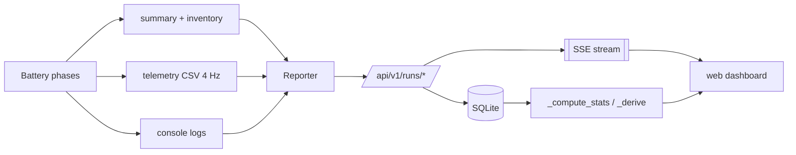
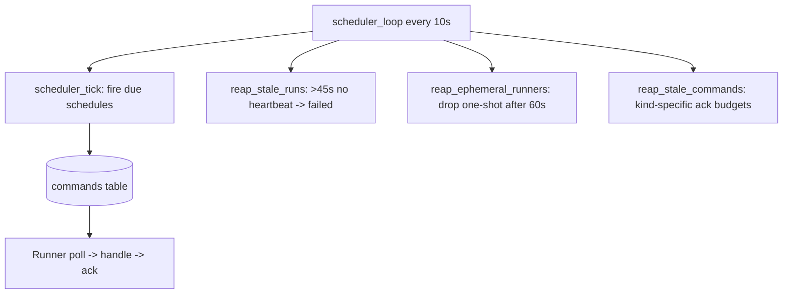

# 02_architecture_runtime_topology — Prompt 02 - Architecture and Runtime Topology Audit

- Run: `bench-test-20261013-0819-full-main-b916709`
- Target: `bench-test` @ `b916709` (branch `main`)
- Domain: `02_architecture_runtime_topology.md` (area ARCH, prompt)

## Verification Performed

# Architecture and Runtime Topology Audit

## Audit Metadata

- Audit name: repo-deep-dive (bench-test full-domain)
- Run: 20261013-bench-dive
- Repository: `C:\temp\bench-test`
- Branch: `main`
- Commit SHA: `b9167095b08c2f45a814e88e09d88decbd0ea885`
- Generated at: 2026-10-13
- Auditor: 02_architecture_runtime_topology subagent
- Area code: ARCH
- Output path: `docs/audits/{name}/{run}/02_architecture_runtime_topology.md` (this report is delivered to the run's
  `domains/` folder per the audit brief)
- Scope limitations: read-only static audit; no live control plane or lab was reachable, so
  every topology item that depends on a running system is marked **unverified** below. No
  application code was executed.

## Scope

Reviewed the runtime architecture of the toolkit and its optional control plane:

- Monorepo layout and module boundaries.
- Server (`server/benchd.py`, `server/web/`), runner/agent (`bench/agent.py`,
  `bench/benchreport.py`), dashboards (`bench/gui.py`, `bench/tui.py`), live-USB build
  (`live/`), packaging (`packaging/`), CI (`.github/workflows/`), tests (`tests/`).
- Auth/authorization, request lifecycle, data flow, background jobs, the command queue,
  realtime (SSE), external integrations, deployment topology, environment parity, error
  handling and runtime validation.

Not reviewed: the compute/benchmark phase internals (`gpu_bench.py`, `cpu_bench.py`, …) beyond
their role in the runtime topology; the telemetry field semantics (DAta domain); the full
web UI behaviour. No live deployment was contacted (see Scope limitations).

## Evidence Reviewed

| Evidence | Type | Why relevant | Notes |
|---|---|---|---|
| `server/benchd.py` (1-1416) | Source | Control-plane topology: HTTP/SSE/SQLite, auth, queue, scheduler | Read in full |
| `bench/agent.py` (1-435) | Source | Runner: register/heartbeat/poll/execute the battery | Read in full |
| `bench/benchreport.py` (340-870, 1133-1703, 1994-2149) | Source | Reporter client, identity, remote exec, update/ISO paths | Read in part |
| `bench/gui.py`, `bench/tui.py` (remote-command handlers) | Source | Dashboard runner + remote control surface | Read in part |
| `server/web/app.js` (SSE/links) | Source | Realtime client + token handling | Read in part |
| `server/benchd.service`, `server/bench-agent.service`, `server/benchd.conf.example` | Config | Deployment units / auth config | Read |
| `live/airootfs/**` (units, launchers, `bench-slot`, `bench-collect`, `bench-agent-env`) | Config/Script | Live-USB runtime topology | Read |
| `live/Build-LiveUSB.sh`, `live/ab-layout.sh`, `live/ci-build.sh` | Script | A/B stick layout + build topology | Read in part |
| `.github/workflows/build-app.yml`, `build-iso.yml`, `release.yml` | CI | Artifact build/publish + baked credentials | Read |
| `packaging/build_app.py`, `packaging/launcher.py` | Source | Bundle topology + baked config/version | Read in part |
| `docs/CONTROL_PLANE.md`, `docs/DATA.md`, `live/README.md`, `README.md` | Docs | Documented topology | Read |
| `tests/run_all.py`, `tests/test_control_plane.py` | Test | What runtime behaviour is asserted | Read in part |

## Verification Performed

| Evidence | Type | Why relevant | Notes |
|---|---|---|---|
| `git log -1 --format="%H %ci %s"` | Command | Pin the audited commit | `b9167095…` 2026-10-13 08:02:24 +0000 `chore(release): VERSION 1.11.3` |
| `git ls-files` (non-`results/`) | Command | Enumerate the monorepo | Module boundaries confirmed |
| Read `server/benchd.py` end-to-end | Read | Request lifecycle, auth, bus, queue, scheduler, reapers | See findings |
| Read `bench/agent.py` + `benchreport.Reporter` | Read | Runner lifecycle + data flow | Confirmed register→run→stream→finish |
| Read `docs/CONTROL_PLANE.md` vs `bench/gui.py`/`tui.py` | Read | Doc-vs-code check | Drift found (ARCH-P3) |
| Read `README.md` iso_write claim vs `benchreport.py:2117-2121` | Read | Doc-vs-code check | Drift found (ARCH-P3) |
| `grep` for `protocol|PROTOCOL` | Command | Realtime/wire compatibility | `PROTOCOL=1` in server+client; advisory only (web badge) |
| `grep` for `prune|retention|VACUUM|older_than` | Command | Data lifecycle | No matches (ARCH-P3) |
| `grep` for `CORS|Allow-Origin|token=|EventSource` | Command | Trust boundary | Wildcard CORS + token-in-URL confirmed (ARCH-P2) |

Live-dependent rows (running unit vs compose/systemd, actual ports in the lab, actual runner
inventory) are marked **unverified** — no read-only access to the lab was authorized for this
audit.

## Executive Summary

`bench-test` is a host-agnostic workstation benchmark toolkit with a clean, dependency-free
Python-stdlib core. The runtime topology is deliberately simple and well documented: a runner
(`bench/agent.py`, or the TUI/GUI dashboards) executes the battery on a workstation; an optional
single-node **control plane** (`server/benchd.py`) registers runners, queues operator commands,
stores history in SQLite, and serves a vanilla-JS dashboard over HTTP + SSE. The live-USB path
adds a bootable Arch image with an A/B update scheme and a systemd-managed TUI.

**Strengths.** Clear monorepo separation (`bench/ server/ live/ packaging/ tests/ docs/`); one
shared client (`benchreport.Reporter`) used by the agent and both dashboards, so they cannot
drift in the wire protocol; stdlib-only server and client; fail-soft agent (a run proceeds with
the control plane down); explicit runtime validation (`sanitise_sample`, `safe_id`,
`safe_filename`, `int_arg`); a durable command/schedule store in SQLite; and a tested lifecycle
(register, run, phase, telemetry, logs, artifacts, stats, commands, schedules, reaper, SSE).

**Major risks.**

1. **P1 — One all-powerful token, shipped in public artifacts.** The single `BENCHD_TOKEN` is
   both the runner join token and the operator credential; it authorizes remote shell execution,
   reboot/shutdown and raw disk writes, and it is baked into public app bundles and the live ISO.
   The README's 'use a limited token' advice is not implementable because no scoped credential
   exists.
2. **P2 — Single-node SPOF.** One process, one local SQLite file, an in-memory event bus, no
   backup, no failover.
3. **P2 — Best-effort realtime.** SSE drops events silently for slow/bursty subscribers and has
   no replay, so live views can diverge.
4. **P2 — Token in URLs + wildcard CORS.** The operator token leaks into logs/history and any
   origin can make authenticated cross-site reads once known.
5. **P3 — Doc drift** on dashboard command support and on `iso_write`'s BENCHDATA guard.
6. **P3 — Unbounded growth** of telemetry/logs/events in a 4 GB deployment volume.

**Recommended next actions.** Split the credential into viewer/operator/runner tiers and stop
baking the operator token into public artifacts (P1). Add a documented SQLite backup and state
the RPO/RTO (P2). Make realtime resumable and count dropped events (P2). Redact tokens from logs
and scope CORS (P2). Reconcile the two doc drifts (P3). Add retention pruning (P3).

## Inventory

| Item | Path / symbol | Purpose | Current state | Risk | Notes |
|---|---|---|---|---|---|
| Control plane | `server/benchd.py` `Handler`, `Store`, `Bus` | REST+SSE+SQLite server | Functional | Single node / SPOF | `PROTOCOL=1`, HTTP/1.0 |
| Web UI | `server/web/app.js`, `index.html` | Dashboard (Live/History/Trends/Compare/Fleet/Schedules) | Functional | Token in URL; CORS `*` | `app.js:179,1570,1571` |
| Runner agent | `bench/agent.py` `Agent` | Headless runner: register/poll/run/stream | Functional | Executes operator commands | `agent.py:242-325` |
| Reporter client | `bench/benchreport.py` `Reporter` | Shared control-plane client | Functional | — | Used by agent + GUI + TUI |
| Dashboards | `bench/gui.py`, `bench/tui.py` | Interactive runner + remote control | Functional | Also perform updates (doc drift) | `gui.py:647-653`, `tui.py:296-302` |
| Command queue | `commands` table + `Bus` | Operator→runner command delivery | Functional | In-memory notifications | `benchd.py:114-117,189-212` |
| Scheduler | `scheduler_loop` | Recurring runs + reapers | Functional | In-process thread | `benchd.py:1241-1362` |
| Auth | `BENCHD_TOKEN` + per-runner keys | Join + operator + runner auth | Functional | No scopes; operator token public | `benchd.py:556-599` |
| Live USB | `live/**` | Bootable Arch image, A/B sticks | Functional | Unsigned; baked token | `live/README.md` |
| Packaging | `packaging/build_app.py` | PyInstaller bundles w/ baked config | Functional | Bakes operator token | `build_app.py:66-84` |
| CI | `.github/workflows/*` | ISO/app bundles + auto-tag | Functional | Publishes public artifacts | 3 workflows |
| Tests | `tests/run_all.py` | Stdlib suite, in-process benchd | Functional | No HA/backup tests | `run_all.py` |

## Domain Scorecard

| Category | Score | Evidence | Gap | Recommended action |
|---|---:|---|---|---|
| Monorepo structure | 4 | `git ls-files`; `README.md:326-336` layout | No per-module dependency map | Keep layout doc current |
| Frontend/backend/worker boundaries | 4 | `bench/` vs `server/` vs `server/web/`; `doc/CONTROL_PLANE.md:27-35` | Web UI + server in one repo (fine) | — |
| Auth/session flow | 2 | `benchd.py:556-599` | One token; no scopes; token in URL/logs | Split viewer/operator/runner tiers |
| Authorization and tenant boundaries | 2 | `_may_act_as`, `_may_write_run`; `_issue_command` operator-only | No tenant model; operator token is RCE | Scoped tokens; gate destructive commands |
| Request lifecycle | 4 | `do_GET/do_POST` → `_api_*`; Runner lifecycle in `agent.py:139-226` | 500 responses echo exception text | Sanitise error bodies |
| Data flow | 4 | Reporter→`/runs`,`/phase`,`/telemetry`,`/log`,`/artifact`,`/finish` | — | — |
| Background jobs | 3 | `scheduler_loop` + reapers; agent threads | In-process only; no leader election | Document single-writer |
| Queues | 3 | `commands` table (durable) + `Bus` (volatile) | Bus drops silently | Resumable stream |
| Webhooks | N/A | none found | None needed | — |
| Realtime | 2 | SSE `_stream`; `app.js:177-191` | No replay/id; silent drops | Add `id:`/Last-Event-ID |
| Notifications | N/A | none found | — | — |
| External integrations | 3 | GitHub API (`compare`, `latest_git`, releases), `nvidia-smi`, Cloudflare, Ollama | Optional/soft-fail; no allowlist on `exec` | Note network egress |
| Deployment topology | 3 | LXC + systemd units; A/B sticks | Single node, no backup | Document RPO/RTO + backup |
| Environment parity | 3 | `run_win.py` vs `Run-LinuxBench.sh`; CSV alias tests | Windows/Linux feature skew (`fan`,`llm`) documented | — |
| Error handling | 3 | Fail-soft client (`Reporter._req`); fail-close ISO guards | Server 500 leaks exception strings | Sanitise errors |
| Runtime validation | 4 | `sanitise_sample`, `safe_id`, `safe_filename`, `int_arg`, `_safe_extract` | — | — |

## Detailed Review

### Item: Monorepo structure

- Evidence: `git ls-files`; `README.md:326-336`.
- What it does: `bench/` (runners + phases + dashboards + agent + shared client), `server/`
  (control plane + web + units + importer), `live/` (ISO build + airootfs), `packaging/`,
  `tests/`, `docs/`, `examples/`, `results/`.
- How it appears to work: single Python package rooted at `bench/`; `agent.py`, `gui.py`,
  `tui.py` do `sys.path.insert(0, BENCH)` then `from benchreport import …` (`agent.py:41-52`).
- Current controls: one shared client prevents protocol drift; tests assert preset parity.
- Risks: none material. Status: functional (score 4).

### Item: Frontend / backend / worker boundaries

- Evidence: `docs/CONTROL_PLANE.md:27-35`; `server/web/app.js`.
- What it does: the server is the backend; the vanilla-JS dashboard is the frontend; the agent
  and GUI/TUI are workers/runners.
- Dependencies: runner → `benchreport.Reporter` → HTTP → server → SQLite; server → web dir
  (static). No separate build step (stdlib only, `CONTROL_PLANE.md:24-25`).
- Risks: the frontend is served by the same process/origin as the API (no separate deploy).

### Item: Auth / session flow

- Evidence: `benchd.py:14-27` (auth model), `benchd.py:546-599` (`_bearer`,
  `_runner_from_bearer`, `_is_operator`, `_runner_ok`, `_caller`), `benchd.py:1147-1189`
  (`_register`), `bench/benchreport.py:355-374` (`save_identity`), `app.js:101,171`.
- What it does: a runner registers with the join token, receives a per-runner `api_key`, and
  persists it to `~/.config/bench-agent.json` (mode 0600). Operators use the same join token as
  a bearer, or `?token=` for SSE/downloads (headers can't be set by EventSource/links).
- See **ARCH-P1** and **ARCH-P2 (CORS/URL)**.

### Item: Authorization and tenant boundaries

- Evidence: `benchd.py:586-599` (`_may_act_as`, `_may_write_run`), `benchd.py:990-994` and
  `1009-1012` (operator-only), `benchd.py:962-967` (run-write scoping).
- What it does: runner keys are scoped to their own runner/run; the shared token acts on
  anything. There is **no tenant/org model** — a single fleet is the tenant boundary
  (not applicable to a lab tool).
- See **ARCH-P1**.

### Item: Request lifecycle

- Evidence: `benchd.py:610-677` (`do_GET`/`do_POST`/`do_DELETE`), `benchd.py:680-1145`
  (`_api_get`/`_api_post`).
- What it does: auth gate → route match → store operation → `bus.publish` → JSON response. The
  runner lifecycle is `register` → `heartbeat` → poll `/commands` → `start_run` → per-phase +
  telemetry + logs → `finish` (`agent.py:139-226`, `benchreport.py:510-598`).
- Current controls: `_send` centralises headers and `no-store`; unknown routes return 404.
- Risks: 500 handler echoes `type(exc).__name__` + message (`benchd.py:634,677`).

### Item: Data flow

- Evidence: `benchreport.py:541-598`; `benchd.py:1025-1144`; `docs/DATA.md:8-19`.
- What it does: run summary + system inventory + 4 Hz telemetry + console logs + report
  artifacts flow runner→server into `runs/phases/telemetry/logs/events/artifacts`. The server
  derives stats/energy/residency in `_compute_stats`/`_derive` (`benchd.py:801-867`).
- See the Mermaid data-flow diagram in the Appendix.

### Item: Background jobs

- Evidence: `benchd.py:1352-1362` (`scheduler_loop`), `1241-1350` (tick + reapers);
  `agent.py:162-196` (reader thread), `295-325` (update/exec threads).
- What it does: a 10 s in-process loop fires due schedules, fails stale runs (>45 s no
  heartbeat), drops ephemeral runners and fails never-acked commands with kind-specific
  budgets (`1329-1337`).
- Risks: single-threaded loop; no leader election (SPOF).

### Item: Queues

- Evidence: `commands` table (`benchd.py:114-117`), `Handler._runner_commands` (`757-770`),
  `Bus` (`189-212`).
- What it does: commands are durable rows polled and drained by the runner; SSE notifications
  are volatile.
- Risks: `Bus.publish` drops silently — see **ARCH-P2 (realtime)**.

### Item: Webhooks / Notifications / Tenant boundary map

- Evidence: `grep` found no webhook delivery, email/push notification, or tenant/org fields in
  the schema (`benchd.py:89-138`).
- Status: **Not applicable.** This is a LAN/lab fleet tool with a single operator tier; there is
  no outbound webhook surface and no multi-tenant boundary to map.

### Item: Realtime

- Evidence: `benchd.py:932-956` (`_stream`, `_sse`), `app.js:177-191`.
- See **ARCH-P2 (realtime)**.

### Item: External integrations

- Evidence: `benchd.py:280-374` (GitHub commits/compare API), `benchreport.py:1714-1780`
  (release assets), `agent.py:67-85` (`nvidia-smi`), `bench/net_bench.py` (Cloudflare),
  `Invoke-LlmBench.ps1` (Ollama).
- What it does: optional, soft-fail; `BENCH_OFFLINE=1` disables GitHub lookups.
- Risks: network egress from the server to `api.github.com` and from runners to vendor tools;
  no allowlist for the `exec` command (by design, but see ARCH-P1).

### Item: Deployment topology

- Evidence: `docs/CONTROL_PLANE.md:170-187`; `server/benchd.service`; `live/ab-layout.sh`.
- What it does: server = one unprivileged LXC running `benchd.service`; runners = workstations
  with `bench-agent.service`; live = A/B USB with `bench-tui@.service` and `bench-slot`.
- See **ARCH-P2 (SPOF)** and the deployment Mermaid diagram.

### Item: Environment parity

- Evidence: `bench/run_win.py:1-9`, `bench/Run-LinuxBench.sh`, `tests/test_presets.py`,
  `docs/DATA.md:22-36`.
- What it does: Windows and Linux emit the same summary keys; feature skew (`fan` Linux-only,
  `llm` Windows-only) is explicitly documented and accepted as flags everywhere.
- Status: functional (score 3).

### Item: Error handling

- Evidence: `Reporter._req` returns `(0, {})` on transport errors and the agent keeps running
  (`benchreport.py:487-507`, `agent.py:357-372`); ISO/update guards fail closed
  (`benchreport.py:2018-2145`).
- Risks: server 500 bodies echo exception detail (`benchd.py:634,677`).

### Item: Runtime validation

- Evidence: `sanitise_sample` (`benchd.py:65-71`), `safe_id` (`380-382`), `safe_filename`
  (`385-387`), `int_arg` (`390-396`), `_safe_extract` (`1166-1177`), `_static` path guard
  (`1225-1237`).
- Status: strong (score 4).

## Scenario / Control Matrix

| ID | Scenario or control | Evidence | Current control | Gap | Severity | Recommendation |
|---|---|---|---|---|---|---|
| ARCH-001 | Monorepo structure | `git ls-files`; README layout | Clear separation | None material | — | — |
| ARCH-002 | Frontend/backend/worker boundaries | `CONTROL_PLANE.md:27-35` | Shared Reporter client | — | — | — |
| ARCH-003 | Auth/session flow | `benchd.py:556-599` | Token + per-runner keys | No scopes; token in URL | P2 | Header/cookie auth; tier tokens |
| ARCH-004 | Authorization / tenant boundaries | `benchd.py:586-599,1191-1203` | Runner-scoped writes | Operator token = RCE; no tenant model | P1 (RCE token) / N/A (tenant) | Split tokens; N/A tenant |
| ARCH-005 | Request lifecycle | `benchd.py:610-1145` | Central dispatch | 500 leaks exception text | P3 | Sanitise errors |
| ARCH-006 | Data flow | `benchreport.py:541-598` | Reporter→REST→SQLite | — | — | — |
| ARCH-007 | Background jobs | `benchd.py:1352-1362` | Scheduler + reapers | Single thread, no leader | P2 (SPOF) | Document single-writer |
| ARCH-008 | Queues | `benchd.py:114-117,757-770` | Durable `commands` table | Volatile notifications | P2 | Resumable stream |
| ARCH-009 | Webhooks | none found | N/A | N/A | — | — |
| ARCH-010 | Realtime | `benchd.py:932-952` | SSE + keepalive | Silent drops, no replay | P2 | `id:`/Last-Event-ID |
| ARCH-011 | Notifications | none found | N/A | N/A | — | — |
| ARCH-012 | External integrations | `benchd.py:280-374` | Soft-fail, `BENCH_OFFLINE` | No egress allowlist | P3 | Document egress |
| ARCH-013 | Deployment topology | `CONTROL_PLANE.md:170-187` | One LXC | SPOF, no backup | P2 | Backup + RPO/RTO |
| ARCH-014 | Environment parity | `run_win.py`, `Run-LinuxBench.sh` | Documented skew | Windows/Linux gaps | — | — |
| ARCH-015 | Error handling | `benchd.py:634,677` | Fail-soft client | Server leaks details | P3 | Sanitise errors |
| ARCH-016 | Runtime validation | `benchd.py:65-71,380-396` | Multiple validators | — | — | — |
| ARCH-017 | Data lifecycle | `benchd.py:106-113` | None | Unbounded growth | P3 | Retention + VACUUM |

## Findings

### Finding ID: `ARCH-P1-001` - Single shared token is both the join credential and an all-powerful operator credential, and is shipped in public artifacts

- Severity: P1
- Confidence: High
- Area: ARCH
- Evidence:
  - `server/benchd.py:24-26` (docstring: `BENCHD_TOKEN` = join token + operator bearer)
  - `server/benchd.py:556-564` (`_is_operator` — no scopes)
  - `server/benchd.py:1194-1196` (operator-only kinds incl. `exec`, `shell`, `reboot`, `iso_write`)
  - `bench/benchreport.py:811-820` (`run_exec`, `shell=True`)
  - `bench/agent.py:319-325` (agent executes `exec`/`shell`)
  - `.github/workflows/build-app.yml:60-64`; `.github/workflows/build-iso.yml:73-78` (bake `BENCH_AGENT_CONF`)
  - `README.md:162-163`, `README.md:359-363`
- What is happening: one token authorizes everything and is baked into public releases.
- Why it matters / impact: the documented mitigation ('limited token') is impossible; a public
  download grants remote shell (root on live USB), reboot and disk-write over every runner.
- Security/reliability impact: full control-plane compromise from a public artifact.
- Recommended fix: viewer/operator/runner credential tiers; never bake the operator token.
- Suggested validation: a test that a viewer token cannot call `/runners/<id>/commands`
  (expect 403) and that no release artifact contains the operator token.
- Owner suggestion: control-plane maintainer
- Effort estimate: M
- Dependencies: none
- Status: open
- Endpoint / data path: `POST /api/v1/runners/<id>/commands` → `_issue_command` → runner `handle` → `run_exec`
- Attack path: download public bundle → read `bench-agent.conf` → `POST …/commands {kind:shell}` → root shell on any checked-in live runner.

### Finding ID: `ARCH-P2-001` - Single-node control plane with local SQLite and in-memory bus (SPOF, no backup)

- Severity: P2 · Confidence: High · Area: ARCH
- Evidence: `server/benchd.py:50,142-152,189-212,1395-1400`; `docs/CONTROL_PLANE.md:170-187`;
  `server/benchd.service:6-16`.
- What is happening: one process, one DB file, in-process event bus, single LXC.
- Why it matters: server/host loss stops control, telemetry and scheduling; DB loss is total
  history loss; a second instance cannot be run safely.
- Recommended fix: scheduled `sqlite3 '.backup'` to a second volume + documented restore;
  state RPO/RTO. Suggested validation: restore-from-backup drill.
- Owner: control-plane maintainer · Effort: S · Status: open.

### Finding ID: `ARCH-P2-002` - Realtime SSE drops events silently and cannot resume

- Severity: P2 · Confidence: High · Area: ARCH
- Evidence: `server/benchd.py:189-212,932-952,1085-1092`; `server/web/app.js:177-191`.
- What is happening: `put_nowait` into a bounded queue, exceptions swallowed, no SSE `id:`.
- Why it matters: live views can silently diverge (missed telemetry/log/phase events).
- Recommended fix: per-run sequence + Last-Event-ID replay + surfaced gap counter.
- Suggested validation: integration test that a full consumer queue produces a visible gap event
  and that a reconnect replays missed rows. Owner: control-plane maintainer · Effort: M ·
  Status: open.

### Finding ID: `ARCH-P2-003` - Operator token in URLs, logged in full, and wildcard CORS

- Severity: P2 · Confidence: High · Area: ARCH
- Evidence: `server/benchd.py:510-513,521,556-564,938`; `server/web/app.js:179,1570-1571`.
- What is happening: token passes via `?token=` and every response allows any origin.
- Why it matters: token leaks into logs/proxies/history; wildcard CORS enables authenticated
  cross-origin reads once known.
- Recommended fix: redact tokens in logs; header/cookie auth; scope CORS to the dashboard origin.
- Suggested validation: assert `log_message` never prints a token; assert CORS is not `*` on API
  responses. Owner: control-plane maintainer · Effort: S · Status: open.

### Finding ID: `ARCH-P3-001` - Documented topology drifts from code (dashboard commands; iso_write BENCHDATA guard)

- Severity: P3 · Confidence: High · Area: ARCH
- Evidence: `docs/CONTROL_PLANE.md:139-142` vs `bench/gui.py:647-653`, `bench/tui.py:296-302`;
  `README.md:254` vs `bench/benchreport.py:2117-2121`.
- What is happening: docs say dashboards reject update/restart, but they implement them; README
  claims `iso_write` protects BENCHDATA, but the live guard list omits it.
- Why it matters: operators/agents mis-model the control surface and a destructive guard is
  overstated.
- Recommended fix: reconcile docs with code; keep one command-support matrix.
- Suggested validation: a doc test asserting the command matrix matches the handlers.
- Owner: docs owner · Effort: S · Status: open.

### Finding ID: `ARCH-P3-002` - Telemetry/logs/events have no retention or pruning

- Severity: P3 · Confidence: Medium · Area: ARCH
- Evidence: `server/benchd.py:106-113,1079-1092,1101-1114`; `docs/CONTROL_PLANE.md:254`;
  `docs/CONTROL_PLANE.md:174-177` (4 GB rootfs); `grep` for prune/retention/VACUUM: no matches.
- What is happening: append-only growth on a small deployment volume; only `DELETE /runs/<id>`
  cleans up.
- Why it matters: disk exhaustion takes down the control plane (see ARCH-P2-001).
- Recommended fix: age/size retention in `scheduler_loop` + periodic VACUUM; document the budget.
- Suggested validation: a test that a retention pass removes old rows and keeps recent ones.
- Owner: control-plane maintainer · Effort: S · Status: open.

## Risks

| Risk | Severity | Likelihood | Impact | Evidence | Mitigation |
|---|---|---|---|---|---|
| Public artifact yields full remote control | P1 | High (if tokens not rotated) | Fleet compromise / RCE | `build-app.yml:63`, `build-iso.yml:75-77` | Scoped tokens; stop baking operator token |
| Control plane outage halts fleet | P2 | Medium | Loss of control/history | `benchd.py:1395-1400` | Backup + documented RPO/RTO |
| Silent realtime divergence | P2 | Medium | Wrong operator decisions | `benchd.py:189-212` | Resumable SSE + gap counter |
| Token leakage via logs/CORS | P2 | Medium | Credential exposure | `benchd.py:510-521` | Redact; scope CORS |
| DB disk exhaustion | P3 | Medium (long-lived) | Control plane down | `benchd.py:106-113` | Retention + VACUUM |
| Doc/behavior mismatch | P3 | High | Mis-operation / unsafe write | `CONTROL_PLANE.md:139-142` | Reconcile docs |

## Recommendations

### Immediate / Release Blocking
- ARCH-P1: split credentials by role; remove the operator token from public app/ISO artifacts;
  rotate the currently published token.

### This Week
- ARCH-P2-001: add a scheduled SQLite backup + documented restore and RPO/RTO.
- ARCH-P2-003: redact tokens in logs; move the UI to header/cookie auth; scope CORS.

### This Month
- ARCH-P2-002: make the SSE stream resumable (`id:`/Last-Event-ID) and count/surface drops.
- ARCH-P3-002: add retention pruning + VACUUM.

### Later / Platform Evolution
- Document an explicit single-writer contract; if multi-instance is ever needed, add a leader
  election for the scheduler and a shared event log.
- Sanitise server error bodies (do not echo exception strings).

## Quick Wins

| Quick win | Why it helps | Files likely involved | Validation |
|---|---|---|---|
| Redact `?token=` in `log_message` | Stops credential leakage to logs | `server/benchd.py:510-513` | Unit test asserting no token in log lines |
| Scope CORS off `*` | Narrows trust boundary | `server/benchd.py:521,938` | Assert header != `*` |
| Add `BENCHDATA` to the live `iso_write` guard (or fix README) | Removes a destructive-write gap / doc drift | `bench/benchreport.py:2117-2121`, `README.md:254` | Unit test on guard list |
| Fix the dashboard-command doc row | Aligns operators with reality | `docs/CONTROL_PLANE.md:139-142` | Doc review |
| Add a `sqlite3 .backup` systemd timer | Cheap insurance against DB loss | `server/benchd.service` + new unit | Restore drill |

## Hardening Backlog

| Backlog item | Priority | Owner suggestion | Effort | Dependency |
|---|---|---|---|---|
| Viewer/operator/runner credential tiers | P1 | Control-plane maintainer | M | none |
| Remove operator token from public artifacts | P1 | Release/CI owner | S | token tiers |
| SQLite backup + restore runbook | P2 | Ops | S | none |
| Resumable SSE + drop counter | P2 | Control-plane maintainer | M | none |
| Token redaction + CORS scoping | P2 | Control-plane maintainer | S | none |
| Retention/VACUUM pass | P3 | Control-plane maintainer | S | none |
| Doc reconciliation (commands, iso_write) | P3 | Docs owner | S | none |
| Error-body sanitisation | P3 | Control-plane maintainer | S | none |

## Suggested Tests

- **Unit:** `log_message` never emits a token; `_is_operator` denies a viewer-tier token;
  retention pass drops old telemetry/logs; live `iso_write` guard rejects BENCHDATA.
- **Integration:** full-consumer SSE queue produces a gap event and a reconnect replays missed
  rows via Last-Event-ID; backup/restore round-trip gives an identical `runs`/`telemetry` set.
- **E2E:** boot the live USB, confirm the baked config does **not** contain an operator-tier
  credential; confirm per-runner keys still register.
- **CI:** assert no release artifact (zip/ISO) contains the operator token string; packaging test.
- **Security:** attempt `exec`/`shell`/`iso_write` with a viewer token -> 403.
- **Regression:** existing `tests/run_all.py` must stay `RESULT: PASS` (it already covers the
  API, reaper, SSE open, per-runner scoping).
- **Manual validation:** state the DB growth after a 24 h two-runner soak and compare against the
  4 GB volume budget.

## Suggested Documentation Updates

- `docs/CONTROL_PLANE.md`: fix the command-support row (`139-142`); add a "credentials and their
  powers" table; state the single-node/RPO-RTO contract; document retention.
- `README.md`: correct the `iso_write` guard description (`254`) and tighten the public-token
  warning (`158-163`, `358-363`) once scoped tokens exist.
- New `docs/ARCHITECTURE.md`: container/context diagrams (Mermaid), data flow, and the
  service-to-service dependency map, to anchor future audits.

## Open Questions

| Question | Why it matters | Evidence needed |
|---|---|---|
| Has the published `BENCHD_TOKEN` been rotated since the last public release? | Determines whether ARCH-P1 is exploitable today | Access to GitHub secrets/releases (unverified) |
| What is the accepted RPO for run history? | Sizes the backup design | Operator/owner decision |
| Does the lab deployment use TLS/SSO in front of benchd? | Changes the exposure of the URL token | Live lab config (unverified, read-only) |
| Are the GUI/TUI update paths exercised in practice? | Confirms the doc-drift finding's impact | Usage/telemetry evidence |
| Is the growth budget of `server/data/benchd.sqlite` monitored? | Drives retention priority | Deployment metrics (unverified) |

## Appendix

### System context



### Container diagram



### Auth sequence



### Request sequence (operator starts a run)



### Data flow



### Worker / job flow



### Deployment topology

```mermaid
flowchart TB
  subgraph Proxmox node
    LXC[unprivileged LXC: benchd.service :8722<br/>rootfs 4G, /opt/bench-test, /etc/benchd.conf]
  end
  subgraph Workstation
    WSVC[bench-agent.service]
  end
  subgraph Live USB
    ESP[BENCH_ESP: grub + grubenv A/B]
    SA[slot A raw ISO]
    SB[slot B raw ISO]
    DATA[BENCHDATA vfat: results + toolkit copy + conf]
    TUIU[bench-tui@tty1 / @ttyS0]
  end
  WSVC -- LAN/overlay --> LXC
  TUIU -- LAN/overlay --> LXC
  DATA --- ESP
```

### Tenant boundary map

Not applicable. Schema (`server/benchd.py:89-138`) has no org/tenant/account column; there is a
single operator tier and one fleet. The meaningful boundary is **operator vs runner**, which is
what ARCH-P1 concerns.

### Documented-vs-as-built checks

| Claim | Source | As-built | Result |
|---|---|---|---|
| GUI/TUI fail `update`/`restart` as unsupported | `docs/CONTROL_PLANE.md:139-142` | Implemented | Unsupported (drift) |
| `iso_write` refuses `/`, `/opt`, BENCHDATA | `README.md:254` | Live guard = `/`, `/opt` | Unsupported on live (drift) |
| SSE opens with a `snapshot` event | `tests/test_control_plane.py:296` | `benchd.py:941` | Supported |
| Server reports `protocol` + `git` on `/health` | `tests/test_version.py:109-110` | `benchd.py:613-618` | Supported |
| Two auth tiers (runner key, operator token) | `CONTROL_PLANE.md:203-207` | `benchd.py:546-599` | Supported |

## Findings

| ID | Severity | Title |
|---|---|---|
| ARCH-P1-001 | P1 | One shared operator token is also the runner join token, grants full remote control (root shell, reboot, raw disk write), and is baked into public app/ISO releases |
| ARCH-P2-001 | P2 | Control plane is single-node/single-process with a local SQLite file and in-memory pub/sub - a single point of failure with no HA, failover, or backup |
| ARCH-P2-002 | P2 | Realtime transport is best-effort SSE with silent event drops and no replay/resume; live dashboards can silently diverge from the server |
| ARCH-P2-003 | P2 | Operator credential is carried in the URL query string, the full request line (with ?token=) is written to the server log, and every response sets Access-Control-Allow-Origin: * |
| ARCH-P3-001 | P3 | Documented runtime topology drifts from the as-built code: GUI/TUI command support and the iso_write BENCHDATA guard |
| ARCH-P3-002 | P3 | Telemetry, logs and events tables have no retention or pruning - the SQLite database grows without bound |
