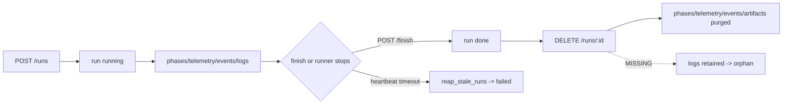

# 03_feature_implementation_map — Prompt 03 - Feature Implementation and Gap Map

- Run: `bench-test-20261013-0819-full-main-b916709`
- Target: `bench-test` @ `b916709` (branch `main`)
- Domain: `03_feature_implementation_map.md` (area FEAT, prompt)

## Verification Performed

# Feature Implementation and Gap Map

## Audit Metadata

- Audit name: repo-deep-dive
- Run: 20261013-0426-main-b916709
- Repository: `C:\temp\bench-test` (MaineCyberTech/bench-test)
- Branch: main
- Commit SHA: b9167095b08c2f45a814e88e09d88decbd0ea885 (tag `v1.11.3`)
- Generated at: 2026-10-13T04:35:00-04:00
- Auditor: domain subagent `03_feature_implementation_map`
- Area code: FEAT
- Output path: docs/audits/{name}/{run}/03_feature_implementation_map.md
- Scope limitations: read-only; no lab, no live-USB boot, no real benchmark run. The working tree was **dirty**
  and changed during the audit (see FEAT finding 7), so line numbers for `server/benchd.py` / `import_results.py`
  describe the working tree at the timestamps noted, not necessarily the tagged commit. No secrets were read.

## Scope

Reviewed the full feature surface a "feature implementation map" covers: web UI pages/tabs
(`server/web/`), API routes (`server/benchd.py` `do_GET`/`do_POST`/`do_DELETE`), the control-plane client
(`bench/benchreport.py`), runners/agents (`bench/agent.py`, `gui.py`, `tui.py`, `run_win.py`,
`Run-*.ps1`/`Run-LinuxBench.sh`), workers/jobs (scheduler + reapers), database entities (SQLite schema),
permissions/auth tiers, audit/event logs, the test suite (`tests/`), docs (`docs/`, `README.md`,
`AGENTS.md`) and the committed audit artifacts under `docs/audits/`.

Not reviewed: the actual benchmark math in the GPU/CPU/RAM/disk phases beyond their group wiring; the
PowerShell-heavy sensor paths; the ISO build end-to-end; anything requiring hardware, the lab, or a
network. SaaS domains named in the brief (billing, multi-tenant RLS, webhook delivery, mobile/PWA
analytics) are **not applicable** — this is a stdlib workstation-benchmark + fleet control plane, no
web framework, no database ORM, no billing, and the web UI is a single vanilla-JS page.

## Evidence Reviewed

- `README.md`, `AGENTS.md`, `VERSION`, `docs/CONTROL_PLANE.md`, `docs/DATA.md`, `docs/FUTURE_WORK.md`
- `server/benchd.py` (routes, auth, schema, scheduler, reapers), `server/web/app.js` + `index.html` + `style.css`,
  `server/import_results.py`
- `bench/agent.py`, `bench/gui.py`, `bench/tui.py`, `bench/benchreport.py` (command dispatch, PRESETS,
  `extra_runner_args`, `GROUPS`)
- `tests/run_all.py`, `tests/harness.py`, `tests/test_control_plane.py`, `tests/test_presets.py`
- `.github/workflows/release.yml`, `.github/workflows/build-iso.yml`, `.github/workflows/build-app.yml`
- `docs/audits/repo-deep-dive/20261007-1731-main-4ecee97/findings.json`

## Verification Performed

| Evidence | Type | Why relevant | Notes |
|---|---|---|---|
| `git log -1`, `git status --porcelain` | command | Bind the audit to a revision | HEAD = b9167095; tree dirty (5 files) |
| `python tests/run_all.py` (system) | command | Reproduce README's `RESULT: PASS` | `RESULT: FAIL (2)` incl. `_curses` crash |
| `.\.venv\Scripts\python.exe tests/run_all.py` | command | Intended interpreter | `RESULT: PASS` |
| in-process benchd repro (POST run/log, DELETE run, GET logs) | command | Reproduce run-delete data loss | logs row survives delete (HTTP 200) |
| `preset_count.py` loading gui/tui/app.js | command | Count shipped presets | gui/tui/web = **13**, README table = **11** |
| `grep`/`Select-String` over routes, docs, tests | read | Map UI↔API↔docs | see Inventory |
| `git show HEAD:server/benchd.py` vs working tree | command | Self-consistency | HEAD lacks the working-tree fixes |

## Executive Summary

This is a **feature-complete, unusually well-wired** toolkit for its size. The three dashboards
(GUI, curses TUI, web) share one preset model and are kept in lock-step by `tests/test_presets.py`; the
control plane implements the documented REST+SSE+SQLite surface almost one-for-one; the agent handles
**every** command kind; and every documented reader (Runner identity, telemetry aliases, hardware
verdicts, derived stats) maps to real code. The stdlib test suite passes (`RESULT: PASS`) under the repo's
own `.venv` and covers API auth, per-runner keys, runs/phases/telemetry/logs/artifacts/stats, commands,
schedules, delete, reapers and SSE.

The gaps are at the seams, not in the core:

1. **One real functional defect** — `DELETE /api/v1/runs/<id>` purges phases/telemetry/events/artifacts
   but **not `logs`** (reproduced), contradicting `docs/CONTROL_PLANE.md:132` ("delete a run (+data)") and
   leaving orphaned rows that are still served by `/runs/<id>/logs`.
2. **Documentation drift** — the README preset table lists 11 of 13 presets and never mentions the
   `Graphics only (FurMark/Valley)` preset; the README's headline release is `v1.1.0` while `VERSION`
   and the HEAD tag say `1.11.3`; `CONTROL_PLANE.md` says the GUI/TUI fail `update`/`restart` when they
   in fact implement them; and a committed prior-audit finding claims the repo has no CI while three
   workflows exist.
3. **Repro/portability** — the documented `python tests/run_all.py` crashes on stock Windows Python
   (`No module named '_curses'`) unless run from the bootstrapped `.venv`.
4. **Revision binding** — the working tree at audit time contained uncommitted source + test changes not
   present at b9167095, so the audited commit and the artifact set disagree.

Recommended next actions: fix the run-delete purge (+ test), then a single docs-sync pass (README
presets, README release, CONTROL_PLANE command matrix, audit register), and make the test entrypoint
explicit for Windows.

## Inventory

| Item | Path / symbol | Purpose | Current state | Risk | Notes |
|---|---|---|---|---|---|
| Web dashboard | `server/web/index.html`, `app.js` (1749 L), `style.css` | Live/History/Trends/Compare/Fleet/Schedules + run detail | Implemented | Low | All 6 tabs present; responsive breakpoints + viewport meta |
| REST/SSE API | `server/benchd.py` `_api_get`/`_api_post`/`do_DELETE`, `_stream` | Runner + UI API | Implemented | Medium | See run-delete gap |
| Auth tiers | `benchd._is_operator`/`_runner_ok`/`_may_act_as`/`_may_write_run` | operator token vs per-runner key | Implemented | Low | Runner scoping correct |
| Scheduler (worker) | `benchd.scheduler_tick` | fire due schedules | Implemented | Low | skips offline/busy runners |
| Reapers (workers) | `reap_stale_runs`, `reap_ephemeral_runners`, `reap_stale_commands` | never-stuck runs / ephemeral cleanup | Implemented | Low | per-kind ack budgets present |
| SQLite entities | `runners, runs, phases, telemetry, logs, commands, events, schedules, artifacts` | state | Implemented | Medium | no FK/cascade; `logs` orphaned on delete |
| Command kinds | `benchd._issue_command`; `agent.py`, `gui.py`, `tui.py` | remote control | Implemented | Low | agent=all; dashboards=all but `power_limit` |
| Presets | `gui.PRESETS`, `tui.PRESETS`, `app.js PRESETS` | run profiles | Implemented | Low | 13 presets, parity-tested |
| Tests | `tests/run_all.py` + 10 modules | validation | Implemented | Low | PASS under `.venv` |
| Docs | `README.md`, `docs/*.md`, `AGENTS.md` | operator/dev guide | Implemented | Medium | 4 stale claims (findings 2-5) |
| Live-USB build | `live/`, `Build-LiveUSB.sh`, `bench/live_update.py` | bootable stick | Implemented | Low | A/B slot update handled by agent |
| Packaging | `packaging/build_app.py`, `launcher.py`, CI | install-free bundles | Implemented | Low | — |
| Observability | `/health`, `/api/v1/metrics`, SSE stream, per-run events | status | Partial | Low | no Prometheus/alerting (declared roadmap) |

## Domain Scorecard

| Category | Score | Evidence | Gap | Recommended action |
|---|---:|---|---|---|
| Pages/routes | 4 | 6 web tabs (`index.html:27-33`), detail view (`app.js:1433+`) | `Downloads` only lives in run detail (documented) | Keep; no action |
| Components | 4 | Shared `benchreport.DASH_FIELDS`/`hardware_line()` used by GUI+TUI; `app.js` renderer set | no JS unit tests | Optional JS smoke test |
| API endpoints | 4 | Every documented route exists (`benchd.py:614-759`, `:963-1149`); `/health` public | `delete run` misses `logs` | Fix purge + test |
| Server actions | 4 | `_register`, `_issue_command`, `_create_schedule`, `_run_stats`, `_trends` | — | — |
| Workers/jobs | 4 | scheduler + 3 reapers, per-kind ack budgets (`benchd.py:1305-1389`) | — | — |
| Database entities | 3 | 9 tables, WAL (`CONTROL_PLANE.md:254`) | no FKs/cascades; orphaned `logs` | Add cascade or explicit purge |
| Permissions | 4 | operator vs runner; per-run ownership (`_may_write_run`) | — | — |
| Audit logs | 4 | `events` + `logs` tables, `logger_public` SSE, run events in detail | delete leaves `logs` | see DB row |
| Tests | 4 | suite PASS (`.venv`); parity + control-plane coverage | Windows-system-python crash; no delete-orphan test | Doc venv; add test |
| Docs | 2 | `README`, `CONTROL_PLANE`, `DATA`, `AGENTS` all exist | 4 stale claims (presets, version, command matrix, CI) | Single docs-sync pass |
| Workflow states | 4 | runner idle/busy/ephemeral, run running/done, schedule enabled/skipped | — | — |
| Failure states | 4 | reapers (stale run/command/runner), soft-fail client (`AGENTS.md:25`) | — | — |
| Mobile behavior | 3 | viewport meta + 4 `@media` breakpoints (`style.css:244-281`) | not mobile-first, untested | Low priority |

## Detailed Review

### Item: Run deletion (`DELETE /api/v1/runs/<id>`)

- Evidence: `server/benchd.py:661-663`; `docs/CONTROL_PLANE.md:132`; `tests/test_control_plane.py:285-287`.
- What it does: removes `phases`, `telemetry`, `events`, `artifacts` for the run, then the `runs` row.
- How it appears to work: `for t in ("phases","telemetry","events","artifacts")` then `DELETE FROM runs`.
- Dependencies: schema has no FK/cascade; nothing else deletes `logs`.
- Current controls: run row 404s after delete; SSE publishes a `run deleted` event.
- Missing controls: `logs` (and `commands` keyed by `run_id`) are not purged; response is still 200.
- Risks: unbounded DB growth; deleted-run console history remains retrievable.
- Recommended improvement: include `logs` (and run-scoped `commands`) in the purge, or add a cascading FK.
- Suggested tests: assert `logs` count = 0 and `/runs/<id>/logs` is empty after DELETE.
- Suggested docs: align `CONTROL_PLANE.md:132` with the chosen semantics.

### Item: Preset / feature documentation

- Evidence: `README.md:210-220` (11 rows) vs `server/web/app.js:14-27` and `gui.PRESETS`/`tui.PRESETS` (13),
  `tests/test_presets.py:12-28`.
- What it does: three surfaces ship the same 13 presets; README documents 11.
- Risks: operators miss `Graphics only (FurMark/Valley)`; docs are treated as the feature contract.
- Recommended improvement: sync/generate the README table from `gui.PRESETS`.

### Item: Version identity

- Evidence: `README.md:12` (`v1.1.0`) vs `VERSION` (`1.11.3`) and tag `v1.11.3`; `.github/workflows/release.yml:81-94`
  updates only `VERSION`.
- Recommended improvement: stop hard-coding, or have the release job update README too.

### Item: GUI/TUI command support

- Evidence: `docs/CONTROL_PLANE.md:139-142` vs `bench/gui.py:647-655`, `bench/tui.py:296-304`.
- What it does: dashboards implement `update*`/`iso_*` and `restart`; only `power_limit` is unsupported.
- Recommended improvement: correct the matrix in `CONTROL_PLANE.md`.

## Scenario / Control Matrix

| ID | Scenario or control | Evidence | Current control | Gap | Severity | Recommendation |
|---|---|---|---|---|---|---|
| FEAT-001 | Pages/routes | `index.html:27-33` | 6 tabs render | — | — | — |
| FEAT-002 | Components | `benchreport.DASH_FIELDS` shared | GUI/TUI cannot drift | JS untested | P3 | JS smoke test |
| FEAT-003 | API endpoints | `benchd.py:614-759` | documented routes exist | delete misses logs | P2 | fix purge + test |
| FEAT-004 | Server actions | `_register`, `_issue_command`... | present | — | — | — |
| FEAT-005 | Workers/jobs | `scheduler_tick`, reapers | present | — | — | — |
| FEAT-006 | Database entities | `SCHEMA` 9 tables | present | no FK/cascade | P2 | cascade or purge |
| FEAT-007 | Permissions | `_may_write_run`, `_runner_ok` | per-run scoping | — | — | — |
| FEAT-008 | Audit logs | `events`, `logs`, SSE | present | orphaned on delete | P2 | see FEAT-003 |
| FEAT-009 | Tests | `run_all.py` PASS (.venv) | good coverage | Windows system-python crash; no orphan test | P3 | doc venv + test |
| FEAT-010 | Docs | `README`, `CONTROL_PLANE`, `DATA` | exist | 4 stale claims | P3 | docs-sync pass |
| FEAT-011 | Workflow states | runner/run/schedule status | present | — | — | — |
| FEAT-012 | Failure states | reapers, soft-fail | present | — | — | — |

## Findings

### Finding ID: `FEAT-P2-001` - Deleting a run orphans its logs rows

- Severity: P2
- Confidence: High
- Area: FEAT
- Evidence:
  - `server/benchd.py:661` `for t in ("phases", "telemetry", "events", "artifacts"):` (no `logs`)
  - `server/benchd.py:663` `DELETE FROM runs WHERE id=?` leaves `logs.run_id` dangling
  - no FOREIGN KEY / cascade in `SCHEMA`; no `PRAGMA foreign_keys`
  - `docs/CONTROL_PLANE.md:132` claims "delete a run (+data)"
  - reproduced: after DELETE, `GET /api/v1/runs/<id>/logs` → 200 with the line; table count stayed 1
- What is happening: the delete path purges four child tables but not `logs`.
- Why it matters: the documented contract is false and data is retained after the UI says it is gone.
- Recommended fix: add `logs` (and run-scoped `commands`) to the purge, or add a cascading FK.
- Suggested validation: `DELETE` a run with logs and assert `logs` is empty and the route returns no lines.
- Effort estimate: S
- Status: open

### Finding ID: `FEAT-P3-001` - README preset table lists 11 of 13 presets

- Severity: P3 · Confidence: High · Area: FEAT
- Evidence: `README.md:210-220` (11 rows) vs `server/web/app.js:14-27` (13), `tests/test_presets.py:12-28` (13);
  `Graphics only` absent from README.
- Recommended fix: sync the table with the 13 presets. Effort: S. Status: open.

### Finding ID: `FEAT-P3-002` - README release claim is stale

- Severity: P3 · Confidence: High · Area: FEAT
- Evidence: `README.md:12` "Release `v1.1.0`"; `VERSION`=1.11.3; tag `v1.11.3`; `release.yml:81-94` updates only `VERSION`.
- Recommended fix: derive or update README from `VERSION` in the release job. Effort: S. Status: open.

### Finding ID: `FEAT-P3-003` - CONTROL_PLANE command-support matrix is stale

- Severity: P3 · Confidence: High · Area: FEAT
- Evidence: `docs/CONTROL_PLANE.md:139-142` vs `bench/gui.py:647-655`, `bench/tui.py:296-304`.
- Recommended fix: correct the matrix; optionally add a parity test. Effort: S. Status: open.

### Finding ID: `FEAT-P3-004` - Committed audit finding CI-P3-001 contradicts the tree

- Severity: P3 · Confidence: High · Area: FEAT
- Evidence: `docs/audits/repo-deep-dive/20261007-1731-main-4ecee97/findings.json:120` ("No .github/ directory")
  vs three workflows tracked at HEAD.
- Recommended fix: close/annotate CI-P3-001. Effort: S. Status: open.

### Finding ID: `FEAT-P3-005` - Documented test command fails on stock Windows Python

- Severity: P3 · Confidence: Medium · Area: FEAT
- Evidence: `README.md:310-312` + `bench/tui.py:15` (`import curses`) + `tests/test_presets.py:40-41`;
  observed `RESULT: FAIL (2)` (`No module named '_curses'`) with system Python, `RESULT: PASS` with `.venv`.
- Recommended fix: document the venv and/or skip-on-ImportError in the test. Effort: S. Status: open.

### Finding ID: `FEAT-P3-006` - Working tree diverges from the recorded commit

- Severity: P3 · Confidence: Medium · Area: FEAT
- Evidence: `git status --porcelain` (5 modified files) at 2026-10-13T04:26 while `git log -1` = b9167095;
  `git show HEAD:server/benchd.py` lacks `MAX_BODY`/`compare_digest`/`commonpath` present on disk.
- Recommended fix: audit a pinned clean checkout; land in-flight changes. Effort: S. Status: open.

## Risks

| Risk | Severity | Likelihood | Impact | Evidence | Mitigation |
|---|---|---|---|---|---|
| Deleted-run console history retained + unbounded `logs` growth | Medium | High | Data hygiene / DB bloat | `benchd.py:661-663` | Purge or cascade |
| Operators misled by stale docs (presets/version/commands) | Low | High | Wasted effort, wrong expectations | README/CONTROL_PLANE | Docs-sync pass |
| Audit register untrustworthy (CI claim) | Low | Medium | Rework | `findings.json:120` | Close stale finding |
| Windows contributor sees red suite | Low | Medium | Onboarding friction | `_curses` crash | Doc venv / skip |

## Recommendations

### Immediate / Release Blocking
- None (no P0/P1).

### This Week
- Fix `DELETE /runs/<id>` to purge `logs` (+ run-scoped `commands`) and add the regression test (FEAT-P2-001).

### This Month
- Docs-sync pass: README presets table, README release line, `CONTROL_PLANE.md` command matrix, audit register
  (FEAT-P3-001..004).
- Make the Windows test entrypoint explicit and robust (FEAT-P3-005).

### Later / Platform Evolution
- Add a CI check that validates doc claims against the tree (preset counts, version equality, workflow presence).
- Add a lightweight JS smoke test for `app.js` tab rendering.

## Quick Wins

| Quick win | Why it helps | Files likely involved | Validation |
|---|---|---|---|
| Add `logs` to the delete loop | Removes orphan + honours the doc | `server/benchd.py` | new test in `test_control_plane.py` |
| List all 13 presets in README | Docs match the UI | `README.md` | compare to `gui.PRESETS` |
| Fix the release line | Truthful version identity | `README.md` | diff vs `VERSION` |
| Correct the command matrix | Accurate capability docs | `docs/CONTROL_PLANE.md` | compare to `gui.py`/`tui.py` |
| Note the venv in the test command | Red suite avoided on Windows | `README.md`, `AGENTS.md` | run from `.venv` |

## Hardening Backlog

| Backlog item | Priority | Owner suggestion | Effort | Dependency |
|---|---|---|---|---|
| Purge `logs`/`commands` on run delete (+ test) | P2 | control-plane owner | S | none |
| Docs-sync pass (README/CONTROL_PLANE/audit register) | P3 | docs owner | S | none |
| Windows test entrypoint guard | P3 | test owner | S | `windows-curses` |
| Doc-claim lint in CI | P3 | CI owner | M | existing workflows |
| JS smoke test for `app.js` | P3 | web owner | M | node availability |

## Suggested Tests

- **Unit/integration:** delete a run with logs/events/artifacts and assert all four+`logs` tables are empty
  (`tests/test_control_plane.py`).
- **Regression:** assert `GET /runs/<id>/logs` returns no rows after the run is deleted.
- **Parity:** extend `test_presets.py` to also assert the README preset table names (or generate it).
- **Portability:** make `tests/run_all.py` emit `SKIP (needs windows-curses)` instead of crashing.
- **Manual:** open the web UI, start a schedule, delete a finished run, confirm the console endpoint is empty.

## Suggested Documentation Updates

- `README.md` — preset table (13 rows; add `Graphics only`), release line, Windows test-invocation note,
  `results/` tracking note.
- `docs/CONTROL_PLANE.md` — command-support matrix (`:139-142`) and delete semantics (`:132`).
- `docs/audits/.../follow_up_register.md` — close/annotate CI-P3-001.

## Open Questions

| Question | Why it matters | Evidence needed |
|---|---|---|
| Is retaining `logs` after run-delete intentional (forensics) or a bug? | Determines fix (purge vs document) | control-plane design note / issue |
| Are `commands` rows expected to be purged with their run? | Completeness of delete semantics | schema/decision record |
| Should README be generated from code or hand-maintained? | Prevents recurring drift | maintainer decision |
| Is the dirty working tree the intended review state? | Binds the audit to a revision | clean checkout / branch tip |

## Appendix

- **Route ↔ UI wiring** (all present, one backend each): `/state`, `/stream` (SSE), `/runs`, `/runs/<id>`,
  `/runs/<id>/telemetry`, `/runs/<id>/logs`, `/runs/<id>/stats`, `/runs/<id>/artifact/<name>`,
  `/runs/<id>/telemetry.csv`, `/trends`, `/runners`, `/runners/<id>/commands`, `/schedules`, `/health`,
  `/metrics`. No orphaned route found; `/api/v1/metrics` is consumed via `/state.metrics`.
- **Command kinds**: declared in `benchd._issue_command` (14 kinds) and implemented by `agent.py`
  (all) and `gui.py`/`tui.py` (all but `power_limit`).
- **Preset counts**: gui=13, tui=13, web=13, README table=11, `test_presets.CANON`=13.
- **Reproduction command** (logs orphan), read-only, temp DB:
  start in-process `benchd` → `POST /runs` → `POST /runs/<id>/log` → `DELETE /runs/<id>` →
  `GET /runs/<id>/logs` returned HTTP 200 with the line; `SELECT COUNT(*) FROM logs WHERE run_id=?` = 1.
- **Mermaid — run lifecycle / failure states**

## Findings

| ID | Severity | Title |
|---|---|---|
| FEAT-P2-001 | P2 | Deleting a run orphans its logs rows (control plane documents delete as '+data') |
| FEAT-P3-001 | P3 | README preset table documents 11 of the 13 shipped presets; 'Graphics only (FurMark/Valley)' is undocumented |
| FEAT-P3-002 | P3 | README advertises 'Release v1.1.0' while VERSION and the HEAD tag are 1.11.3 |
| FEAT-P3-003 | P3 | CONTROL_PLANE.md's command-support matrix is stale: it says the GUI/TUI fail update/restart, but they implement them |
| FEAT-P3-004 | P3 | Committed prior-audit finding CI-P3-001 claims there are no CI workflows, but three exist at HEAD |
| FEAT-P3-005 | P3 | Documented test command (python tests/run_all.py) fails on stock Windows Python because curses is unguarded |
| FEAT-P3-006 | P3 | Working tree at audit time diverges from the recorded commit (uncommitted source + test changes) |
