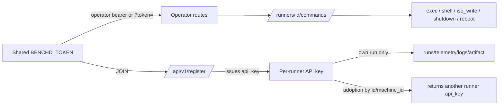

# 06_security_authz_tenancy_audit — Prompt 06 - Security, Authorization, and Tenancy Audit

- Run: `bench-test-20261013-0819-full-main-b916709`
- Target: `bench-test` @ `b916709` (branch `main`)
- Domain: `06_security_authz_tenancy_audit.md` (area SEC, prompt)

## Verification Performed

# Security, Authorization, and Tenancy Audit (06)

## Audit Metadata

- Audit name: repo-deep-dive
- Run: bench-dive full-domain (subagent)
- Repository: `C:\temp\bench-test`
- Branch: `main`
- Commit SHA: `b9167095b08c2f45a814e88e09d88decbd0ea885`
- Generated at: 2026-10-13
- Auditor: domain subagent `06_security_authz_tenancy_audit` (area code SEC)
- Output: `docs/audits/{name}/{run}/06_security_authz_tenancy_audit.md` (this pack writes the JSON+MD under the bench-dive domains folder)
- Scope limitations: read-only audit of the repository source only; no live lab, no running control plane, no network
  calls to the target. Severity/line citations for `server/benchd.py` are pinned to the commit above.

> **Working-tree drift observed.** `git status` at `C:\temp\bench-test` shows `server/benchd.py` and
> `server/import_results.py` modified relative to `b9167095` (mtime during this session). The uncommitted diff
> adds `MAX_BODY`, `secrets.compare_digest` on the operator compare, an operator/credential guard on explicit-id
> registration, and an `os.path.commonpath` static-path check. This audit targets the **pinned commit**; findings
> 7 and 8 note where a local uncommitted edit already addresses the code. The target is documented as read-only,
> so this drift is flagged as an unattributed change, not treated as the audited state.

## Scope

Reviewed: the stdlib control plane (`server/benchd.py`), its config/service units, the web dashboard
(`server/web/*`), the runner client (`bench/benchreport.py`), the headless agent (`bench/agent.py`), the GitHub
upload client (`bench/upload.py`), packaging (`packaging/build_app.py`), the live-USB build (`live/Build-LiveUSB.sh`,
`live/ci-build.sh`), the three workflows (`.github/workflows/*`), `.gitignore`, `docs/CONTROL_PLANE.md`, and the
control-plane tests (`tests/test_control_plane.py`).

Not reviewed / not applicable (with evidence): JWT validation, session cookies, database RLS policies,
per-tenant/org/workspace isolation, webhooks, and mass-assignment against an ORM — none of these constructs exist
in the repository (`git ls-files` shows no ORM, no JWT/cookie library, no tenant/org model, no webhook receiver;
auth is a shared bearer token plus per-runner API keys in SQLite — `server/benchd.py:14-17,89-138`). No third-party
runtime dependencies are declared (stdlib-only by design, `docs/CONTROL_PLANE.md:24-25`), so dependency risk is
limited to the CI/packaging toolchain (PyInstaller, actions) rather than application libraries.

## Evidence Reviewed

| Evidence | Type | Why relevant | Notes |
|---|---|---|---|
| `server/benchd.py:14-26,89-138,545-608,676-686,1147-1208,1224-1237,1382-1416` | Server source | Auth model, token compare, register/key issuance, static serving, config | Single shared `BENCHD_TOKEN` = join token AND operator bearer |
| `server/benchd.service:11-18`, `server/bench-agent.service:7-12` | systemd units | Bind address + service hardening | benchd binds `0.0.0.0`; agent reads `/etc/bench-agent.conf` |
| `server/benchd.conf.example:1-9`, `live/airootfs/etc/bench-agent.conf.example:1-11` | Config | Default/placeholder credentials | `BENCHD_TOKEN=change-me`, `BENCHD_SERVER=http://lab:8722` |
| `server/web/app.js:101,152-159,179` | Web UI | Token storage, CORS/SSE usage | Token in `localStorage` and `?token=` SSE URL |
| `bench/benchreport.py:811-843,1166-1189,1316-1403,1729-2145` | Runner client | `exec` (shell=True), tar extract, toolkit/ISO update + verification | Remote-command + supply-chain surface |
| `bench/agent.py:241-349` | Agent | Command dispatch (start/stop/update/fan/power/shutdown/reboot/exec/iso) | Implements the operator command surface |
| `bench/upload.py:10-13,64-83,86-235` | Upload client | `GITHUB_TOKEN` PAT handling | Contents: Read/Write token |
| `packaging/build_app.py:66-84` | Packaging | Bakes `bench-agent.conf` into bundles | Explicitly public-release aware |
| `.github/workflows/build-app.yml:59-64,92-108`, `build-iso.yml:62-82,114-124` | CI | Secret handling into released artifacts | `BENCH_AGENT_CONF`, `BENCH_UPLOAD_CONF` baked then released |
| `live/Build-LiveUSB.sh:127-140,163-178`, `live/ci-build.sh:40-86` | Live build | Bakes private confs into the ISO | Guard at :170-178 checks only `opt/bench-test/...`, not `/etc/*` |
| `tests/test_control_plane.py:17-49,154-168,291-299` | Tests | Proves intended authz (per-runner scoping, SSE) | No test asserts an api_key is never re-issued to another caller |

## Verification Performed

| Evidence | Type | Why relevant | Notes |
|---|---|---|---|
| `git log -1`, `git rev-parse HEAD` | Command | Pin the audited commit | `b9167095…` |
| `git status --porcelain`, `git diff --stat`, `git --no-pager diff` | Command | Detect drift from the pinned commit | benchd.py + import_results.py modified |
| `git grep -n -iE "rate.?limit|429|lockout|too many requests" -- .` | Command | Rate-limit presence | No rate-limit implementation anywhere |
| `git show HEAD:server/benchd.py` (line-numbered dump) | Command | Get accurate line citations for the pinned commit | HEAD file = 1416 lines |
| Read `server/benchd.py` (all), `benchreport.py` (all), `agent.py`, `upload.py`, workflows, `build_app.py`, `index.html`, `app.js`, `CONTROL_PLANE.md`, tests, `.gitignore`, live scripts | File reads | Evidence inventory and strengths/risks | Recorded above and below |

Reproduction status of headline claims: the secret-baking flow (workflow secret → `build_app.py` / `Build-LiveUSB.sh`
→ release upload) is **supported** by reading each step in-tree; it was not executed (no CI run). The fail-open auth,
key-disclosure and CORS claims are **supported** by direct source reading at the pinned commit. No claim here is
based on running the target.

## Executive Summary

`bench-test` is a Windows/Linux workstation benchmark toolkit whose control plane (`server/benchd.py`) is a
dependency-free HTTP+SSE server with SQLite storage. It has real, above-average hardening habits for its size:
parameterised SQL everywhere, length/format validation (`safe_id`, `safe_filename`, `int_arg`), `Cache-Control:
no-store`, a path-traversal intent check on static serving, `runner_public()` strips API keys from responses,
per-runner write scoping for runs, per-runner command ack scoping, tar-extraction escape protection
(`bench/benchreport.py:1166-1189`), and no secrets committed to the tree (`.gitignore:26-28`).

Against that, the **auth model is a single shared bearer** that is simultaneously the runner join token, the
operator token, and the web/SSE token — and it is deliberately baked into **publicly published release artifacts**
(the app bundles and the live ISO), together with an optional GitHub PAT that can write to the repository. That is
the dominant risk: it converts "download the tool" into "obtain fleet-wide remote command execution as an
operator". Secondary risks are fail-open startup without a token, a registration path that returns other runners'
API keys, the token travelling in URLs and cleartext logs, wildcard CORS, no rate limiting, and an unbounded
request body. The many SaaS-only domains in this prompt (JWT, cookies, RLS, tenants, webhooks) are genuinely not
applicable.

## Inventory

| Item | Path / symbol | Purpose | Current state | Risk | Notes |
|---|---|---|---|---|---|
| Auth provider | `server/benchd.py:545-584` | Authenticate operators/runners | Shared static bearer + per-runner keys | High | No IdP, no per-user accounts (roadmap item) |
| Session tokens/cookies | — | Session management | Absent | N/A | No cookies/sessions; UI token in `localStorage` |
| Operator token exposure | workflows + `build_app.py:66-84`, `Build-LiveUSB.sh:127-140` | Bake config into artifacts | Present | Critical | Public release artifacts carry the token |
| JWT validation | — | Token verification | Absent | N/A | Opaque random tokens only |
| CSRF/CORS | `server/benchd.py:521,602-607,947` | Cross-origin policy | Wildcard `*` | Medium | No cookies, so classic CSRF is limited, but reads are exposed |
| Rate limits | `server/benchd.py` (none) | Abuse control | Absent | Medium | No 429/lockout/backoff |
| Security headers | `server/benchd.py:515-533,963-965` | Response hardening | Only `Cache-Control: no-store` | Low | No CSP/XCTO/frame options |
| Input/output validation | `server/benchd.py:382-401,1031-1033,1110-1123` | Validate client input | Good | Low | `safe_id`, `safe_filename`, `int_arg`, 4000-char log cap |
| File handling | `server/benchd.py:894-906,1224-1237`; `benchreport.py:1166-1189` | Artifacts/static/tar | Download safe; static prefix check | Low–Med | Tar extract is escape-safe |
| API permissions | `server/benchd.py:586-608,633-644,966-976,999-1017` | Per-runner scoping | Reasonable | Medium | But `/register` returns other keys (SEC-P1-002) |
| Admin/operator permissions | `server/benchd.py:556-564,1191-1203` | Operator-only routes | Single token | High | No role separation |
| Tenant/org/workspace isolation | — | Multi-tenancy | Absent | N/A | Single fleet, no tenant model |
| RLS policies | — | DB row security | Absent | N/A | SQLite, no RLS engine |
| Public/internal routes | `server/benchd.py:613-618,610-644` | `/health`, static | Public | Low | `/health` leaks commit/version/count |
| Webhooks | — | Inbound webhooks | Absent | N/A | Outbound GitHub API calls only |
| API keys | `server/benchd.py:543-554,1147-1208` | Runner credentials | Plaintext in SQLite; re-issued on register | High | No hashing, no revocation UX |
| Secrets | workflows, `Build-LiveUSB.sh`, `.gitignore` | Secret handling | Baked into released artifacts | Critical | Tree itself is clean |
| Reset/invite/account lifecycle | — | Account lifecycle | Absent | N/A | No accounts; key rotation only via delete |
| Audit/security logging | `server/benchd.py:510-513` | Log auth/privileged events | Request line only; no actor | Medium | No authn/authz event log, no `who` on commands |
| Dependency risk | `docs/CONTROL_PLANE.md:24-25`; workflows | Supply chain | Stdlib runtime; CI tools unpinned by SHA | Low–Med | `actions/*` and PyInstaller not SHA-pinned |
| IDOR | `server/benchd.py:586-608` | Object authorization | Runs scoped | Low | Runs are scoped by `runner_id` |
| SSRF | `bench/benchreport.py:1337-1343,1714-1747` | Outbound fetches | Fixed GitHub hosts; `BENCH_TOOLKIT_URL` override | Low | Operator-settable but trusted |
| Mass assignment | `server/benchd.py:1182-1204` | Field ingestion | Explicit columns | Low | No ORM |
| Sensitive logs | `server/benchd.py:510-513,1110-1123` | Data in logs | Token in request line | Medium | Runner stdout stored up to 4000 chars |

## Findings

### Finding ID: `SEC-P0-001` - Operator token (and a repo-write GitHub PAT) baked into public release artifacts

- Severity: P0
- Confidence: High
- Area: SEC (secrets / build & release)
- Evidence:
  - `.github/workflows/build-app.yml:63` — `BENCH_BAKE_AGENT_CONF: ${{ secrets.BENCH_AGENT_CONF }}`
  - `packaging/build_app.py:66-84` — writes `bench-agent.conf` into each bundle; docstring at :70-72 says the
    releases are public and the token becomes "world-readable"
  - `.github/workflows/build-app.yml:104-108` and `build-iso.yml:114-124` — the archives/ISO are attached to GitHub releases
  - `.github/workflows/build-iso.yml:62-82`, `live/Build-LiveUSB.sh:130-140` — `BENCH_UPLOAD_CONF` / `BENCH_AGENT_CONF` → `/etc/bench-upload.conf` and `/etc/bench-agent.conf`
  - `bench/upload.py:10-13` — `GITHUB_TOKEN` is a Contents: Read/Write fine-grained PAT
  - `server/benchd.py:14-26` — one `BENCHD_TOKEN` is both join token and operator bearer
- What is happening: secrets are intentionally baked into downloadable artifacts, and the same token is the operator credential.
- Why it matters: downloading a release grants fleet-wide operator capability, and (optionally) a repo-write PAT.
- User / business impact: anyone with a released artifact can control every bench machine and read all results.
- Security / privacy / reliability impact: full RCE on runners via `exec`/`shell`, destructive `iso_write`, and repository write access.
- Recommended fix: separate registration vs operator credentials; never bake the operator token/PAT into artifacts; rotate published credentials; add a release-time secret scan.
- Suggested validation: a CI test that asserts no shipped file matches a token/PAT pattern; a unit test that a registration token cannot access operator routes.
- Owner suggestion: release/CI owner + control-plane owner.
- Effort estimate: M
- Dependencies: credential-model change mirrored in `bench/benchreport.py`, `bench/agent.py`, dashboards.
- Status: open
- Endpoint / data path: `workflow secret → build_app.py/Build-LiveUSB.sh → released .zip/.iso → any downloader → BENCHD_TOKEN → /api/v1/runners/<id>/commands (exec/shell/iso_write)`
- Attack path: SEC-P0-001 → SEC-P1-002 (fail-open/no role split amplifies); enables full-fleet compromise.

### Finding ID: `SEC-P1-001` - Fail-open authentication when no token is configured

- Severity: P1
- Confidence: High
- Area: SEC (authn)
- Evidence:
  - `server/benchd.py:556-564` (`_is_operator` → `True` when `self.token is None`), `:566-568`, `:577-580`
  - `server/benchd.py:1402-1405` — only a stdout warning
  - `server/benchd.service:11` — `--host 0.0.0.0`
- What is happening: a missing/mistyped token disables authentication rather than blocking startup.
- Why it matters: the safe configuration is the default; a mistake fails open over the LAN.
- Recommended fix: refuse to start (or bind loopback) unless a non-placeholder token is set; add `--allow-anonymous` for dev.
- Suggested validation: start with no token → expect refusal; binding test.
- Effort estimate: S
- Status: open
- Endpoint / data path: `main() (benchd.py:1392-1405) → HTTP server with Handler.token=None`.
- Attack path: `none identified` (configuration-dependent).

### Finding ID: `SEC-P1-002` - /api/v1/register discloses other runners' API keys

- Severity: P1
- Confidence: High
- Area: SEC (authz / IDOR)
- Evidence:
  - `server/benchd.py:676-686`, `:1147-1160`, `:1169-1171`, `:1186-1188`, `:1161-1168`
- What is happening: identity is keyed on an identifier string; the default branch returns the matched row's `api_key`.
- Why it matters: a runner (or, without a token, anyone) can take over another runner's identity and control its run data/commands.
- Recommended fix: never return an existing key; require the matching credential or the operator token to adopt a row.
- Suggested validation: test that registering with another runner's `runner_id`/`machine_id` without its key returns no api_key.
- Effort estimate: S
- Status: open
- Endpoint / data path: `POST /api/v1/register → _register() → SELECT runners → response.api_key`.
- Attack path: `SEC-P1-002 → drain/ack the victim's queued commands → inject run data`.

### Finding ID: `SEC-P2-001` - Operator token in the URL query + cleartext logs over HTTP

- Severity: P2
- Confidence: High
- Area: SEC (session/secret handling)
- Evidence: `server/benchd.py:562`, `:510-513`; `docs/CONTROL_PLANE.md:54,206-210`; `server/web/app.js:101,179`.
- Recommended fix: short-lived single-use SSE/download tickets; redact query strings in logs; require TLS.
- Suggested validation: assert `?token=` no longer authenticates and logs contain no token.
- Effort estimate: M
- Status: open

### Finding ID: `SEC-P2-002` - Wildcard CORS on authenticated endpoints and SSE

- Severity: P2
- Confidence: High
- Area: SEC (CORS)
- Evidence: `server/benchd.py:521`, `:947`, `:602-607`.
- Recommended fix: same-origin/allow-list; drop wildcard OPTIONS.
- Suggested validation: cross-origin fetch test asserting no ACAO for unknown origins.
- Effort estimate: S
- Status: open

### Finding ID: `SEC-P2-003` - No rate limiting or lockout

- Severity: P2
- Confidence: High
- Area: SEC (rate limits / abuse)
- Evidence: no implementation (`git grep`); `server/benchd.py:556-575,676-686,1147-1208`.
- Recommended fix: per-credential + per-IP throttling with backoff/lockout and 429; alert on failures.
- Suggested validation: burst-auth test asserting 429/lockout.
- Effort estimate: M
- Status: open

### Finding ID: `SEC-P2-004` - Unbounded request body (DoS)

- Severity: P2
- Confidence: High
- Area: SEC (input validation / DoS)
- Evidence: `server/benchd.py:538-543` and `:676-686` at `b9167095`.
- Recommended fix: hard cap + 413 + socket timeouts. (An uncommitted local edit adds `MAX_BODY`.)
- Suggested validation: POST with a large declared Content-Length → expect 413, not a hung thread.
- Effort estimate: S
- Status: open

### Finding ID: `SEC-P3-001` - Static-handler path-prefix check can be bypassed by a sibling dir

- Severity: P3
- Confidence: Medium
- Area: SEC (path traversal)
- Evidence: `server/benchd.py:1224-1231` at `b9167095`; reachable unauthenticated via `:610-644`.
- Recommended fix: `os.path.commonpath` on real paths + extension allow-list. (An uncommitted local edit does this.)
- Suggested validation: request `/../webX/file` and assert 404.
- Effort estimate: S
- Status: open

## Risks

| Risk | Severity | Likelihood | Impact | Evidence | Mitigation |
|---|---|---|---|---|---|
| Public artifact leaks operator token | Critical | High | Full fleet control + repo PAT | SEC-P0-001 | Credential split, no baking, rotate, CI scan |
| Unauthenticated control plane | High | Medium | Fleet-wide RCE/data loss | SEC-P1-001 | Fail closed |
| Runner identity takeover | High | Medium | Cross-runner data/command abuse | SEC-P1-002 | Bind adoption to credentials |
| Token in logs/URL/plaintext | High | High | Credential disclosure | SEC-P2-001 | Tickets + TLS + log redaction |
| No abuse controls | Medium | Medium | Brute force / flooding | SEC-P2-003 | Rate limits + lockout |
| DoS via huge body | Medium | Low | Control-plane outage | SEC-P2-004 | Body cap |
| Repo-write PAT in ISO | Critical | Medium (if secret set) | Supply-chain compromise | SEC-P0-001 | Fetch at runtime / App token |

## Recommendations

### Immediate / Release Blocking
- Stop baking `BENCH_AGENT_CONF` / `BENCH_UPLOAD_CONF` into any released artifact; rotate any credential already shipped (SEC-P0-001).
- Fail closed when `BENCHD_TOKEN` is unset (SEC-P1-001).
- Stop returning existing `api_key`s from `/register` (SEC-P1-002).

### This Week
- Replace URL-token auth with short-lived tickets; redact query strings in logs; require TLS (SEC-P2-001).
- Constrain CORS to the dashboard origin (SEC-P2-002).
- Add auth/registration rate limits and lockout (SEC-P2-003).

### This Month
- Body-size cap and socket timeouts (SEC-P2-004); static-path fix (SEC-P3-001).
- Add actor attribution to `commands`/`events` and an authn/authz event log.
- Add security headers (CSP, X-Content-Type-Options, frame-ancestors) and pin CI actions by SHA.

### Later / Platform Evolution
- Per-user operator accounts with roles (already a roadmap item, `docs/CONTROL_PLANE.md:275`) to remove the shared token entirely.
- Hash runner API keys at rest and add rotation/revocation.

## Quick Wins

| Quick win | Why it helps | Files likely involved | Validation |
|---|---|---|---|
| Fail closed on missing token | Removes the worst misconfiguration | `server/benchd.py:1382-1405` | Start without token → refuses |
| Never echo `api_key` on register | Stops trivial key disclosure | `server/benchd.py:1147-1208` | Cross-runner register test |
| Redact `?token=` in logs | Stops credential logging | `server/benchd.py:510-513` | Log has no token |
| Remove wildcard ACAO | Restores origin isolation | `server/benchd.py:521,947,602-607` | Cross-origin test |

## Hardening Backlog

| Backlog item | Priority | Owner suggestion | Effort | Dependency |
|---|---|---|---|---|
| Registration vs operator credential split | P0 | release + control-plane | M | Credential model change |
| CI secret-scan gate on release artifacts | P0 | CI owner | S | pattern list |
| TLS/ticket auth for SSE + downloads | P1 | control-plane | M | reverse proxy |
| Rate limiting + lockout | P1 | control-plane | M | none |
| Per-user operator accounts + roles | P2 | platform | L | roadmap item |
| Hash runner keys at rest | P2 | control-plane | M | migration |

## Suggested Tests

- Unit: `/register` with another runner's `runner_id`/`machine_id` and no key must not return an `api_key`.
- Unit: start with no `BENCHD_TOKEN` → process refuses (or binds loopback only).
- Security: burst-auth and burst-register tests assert 429/lockout.
- Security: cross-origin fetch asserts no `Access-Control-Allow-Origin` for unknown origins.
- Regression: large declared `Content-Length` → 413, thread not pinned.
- Regression: `GET /../webX/file` and `/../benchd.conf` → 404.
- CI: release-artifact secret scan fails the build if a token/PAT pattern is present.
- Manual: verify a downloaded app bundle / ISO contains no `BENCHD_TOKEN` or `GITHUB_TOKEN`.

## Suggested Documentation Updates

- `docs/CONTROL_PLANE.md` "Security" — rewrite for the registration/operator credential split; state TLS as a
  prerequisite, not optional; document the fail-closed startup and rate limits.
- `docs/CONTROL_PLANE.md` API reference — remove `?token=` from documented usage; document tickets.
- A `SECURITY.md` with the credential model, rotation runbook, and the "no secrets in artifacts" invariant.
- `live/README.md` — document that `live/private/*` must never be baked into a released image.

## Open Questions

| Question | Why it matters | Evidence needed |
|---|---|---|
| Are the GitHub releases actually public? | Determines exploitability of SEC-P0-001 | Repo visibility settings; workflow comments say "public" |
| Is `BENCH_UPLOAD_CONF` configured in CI? | A repo-write PAT would ship in the ISO | Repo secret presence (unverifiable from source) |
| Are the released tokens already rotated? | Whether exposure is live | Deployment/ops records |
| Was the working-tree edit authorized? | Target is documented read-only | Commit/PR for the uncommitted diff |

## Appendix

Auth tiers and reachable command surface (from `server/benchd.py`):

Evidence that some SaaS-only areas are genuinely N/A: `git ls-files` contains no ORM/migrations, no JWT or cookie
library, no tenant/org tables (schema is `runners/runs/phases/telemetry/logs/commands/events/artifacts/schedules`,
`server/benchd.py:89-138`), and no webhook receiver; the only outbound calls are to `api.github.com`/`codeload`
(`server/benchd.py:285-286`, `bench/benchreport.py:876-880`).

## Findings

| ID | Severity | Title |
|---|---|---|
| SEC-P0-001 | P0 | Operator control-plane token (and optionally a repo-write GitHub PAT) is baked into publicly published release artifacts |
| SEC-P1-001 | P1 | Control plane fails open (no authentication) when BENCHD_TOKEN is unset, while binding 0.0.0.0 |
| SEC-P1-002 | P1 | Any authenticated runner can obtain another runner's API key via POST /api/v1/register |
| SEC-P2-001 | P2 | Operator token is accepted as a URL query parameter and written to logs in cleartext over plaintext HTTP |
| SEC-P2-002 | P2 | Wildcard CORS (Access-Control-Allow-Origin: *) on every authenticated API response and the SSE stream |
| SEC-P2-003 | P2 | No rate limiting, lockout, or per-account throttling on authentication or registration |
| SEC-P2-004 | P2 | Unbounded request-body read allows an authenticated client to pin a handler thread and its memory |
| SEC-P3-001 | P3 | Static file handler uses a raw path-prefix test that a sibling directory named like the web root can bypass |
