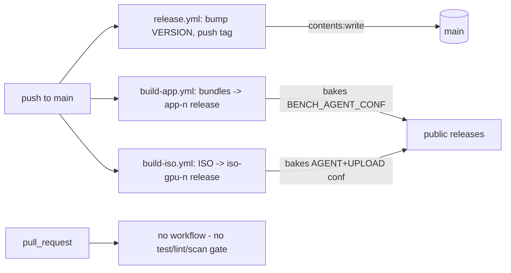

# 10_github_actions_cicd_governance — Prompt 10 - GitHub Actions, CI/CD, and Governance Audit

- Run: `bench-test-20261013-0819-full-main-b916709`
- Target: `bench-test` @ `b916709` (branch `main`)
- Domain: `10_github_actions_cicd_governance.md` (area CI, prompt)

## Verification Performed

# GitHub Actions, CI/CD, and Governance Audit

## Audit Metadata

- Audit name: repo-deep-dive (bench-test full-domain)
- Run: 20261013-bench-test-full-domain
- Repository: `C:\temp\bench-test` (remote `https://github.com/MaineCyberTech/bench-test.git`, public)
- Branch: `main`
- Commit SHA: brief target `b9167095b08c2f45a814e88e09d88decbd0ea885`; audited working tree at `72c18734aea2e5b3381254b74205d0b2944bafab` (`.github/` is byte-identical between the two: `git diff --stat b9167095 HEAD -- .github` is empty; `.github/` clean)
- Generated at: 2026-10-13
- Auditor: domain subagent (prompt 10)
- Area code: CI
- Output path: `docs/audits/repo-deep-dive/{run}/10_github_actions_cicd_governance.md` (intended; written here to the bench-dive domains folder per brief)
- Scope limitations: GitHub-side settings (branch protection, required checks, environments, Dependabot/secret-scanning toggles) are not stored in the repo and cannot be read from a clone - those are marked `Unknown` and treated as gaps to confirm.

## Scope

Reviewed all `.github/**` (3 workflow files - the only files tracked under `.github/`), the packaging/live build paths that the workflows drive, the test suite they do *not* run, and every doc that asserts CI behavior (`README.md`, `AGENTS.md`, `docs/`, prior audit under `docs/audits/`). Not reviewed: host/bench runtime code except where a workflow depends on it, and any GitHub organization-level policy.

## Evidence Reviewed

- `.github/workflows/build-app.yml`, `.github/workflows/build-iso.yml`, `.github/workflows/release.yml` (full reads)
- `packaging/build_app.py` (bake path), `bench/upload.py` (upload-credential format), `live/ci-build.sh`, `live/Build-LiveUSB.sh` (secret install path)
- `README.md:140-254`, `AGENTS.md` (whole), `tests/run_all.py`
- Prior audit: `docs/audits/repo-deep-dive/20261007-1731-main-4ecee97/lens_focused_security_supply_chain_ci.md` (CI-P3-001)

## Verification Performed

| Evidence | Type | Why relevant | Notes |
|---|---|---|---|
| `git ls-files .github` | command | Enumerate CI surface | Only 3 workflow files; no `dependabot.yml`, `CODEOWNERS`, `SECURITY.md` |
| `git grep -nE 'run_all\|tests/\|py_compile\|pytest\|actionlint\|gitleaks' -- .github` | command | Does CI run the documented gates? | No matches - nothing runs tests/lint/scan |
| `git grep -nE 'pull_request\|pull_request_target' -- .github` | command | PR trigger / `pull_request_target` danger | No matches - no PR triggers, so no `pull_request_target` exposure |
| `git grep -nE 'environment:\|id-token\|oidc' -- .github` | command | Environment/OIDC protection | No matches - no protected environments, no OIDC |
| `git diff --stat b9167095 HEAD -- .github` | command | Bind evidence to the brief's commit | Empty (`workflows/` unchanged across the commits) |
| `git ls-files | Select-String 'CODEOWNERS\|dependabot\|SECURITY.md'` | command | Governance files | No matches |
| `python -c "import yaml"` | command | YAML parse check | PyYAML unavailable in the audit env - not run (workflows read directly) |

## Executive Summary

The repository has three focused GitHub Actions workflows: an auto-tagger/release job (`release.yml`), a Windows+Linux PyInstaller bundle builder that attaches an `app-<n>` release (`build-app.yml`), and a self-hosted/runner-selectable live-ISO builder that attaches an `iso-<gpu>-<n>` release (`build-iso.yml`). They are tidy: explicit top-level `permissions: contents: write`, `concurrency` groups, timeouts, stdlib-only archiving. **Strengths:** every workflow declares a permissions block (none rely on the default write-all token), all three support `workflow_dispatch`, and the ISO path ships a `SHA256SUMS` + reassembly note.

**Major risks:** (1) the build workflows deliberately bake a live control-plane token and a GitHub **repo-write PAT** into artifacts that are published on *public* releases - a world-readable credential exposure; (2) there is **no CI test/lint/secret-scan gate at all** - the suite documented as mandatory in `AGENTS.md` is never run, and nothing triggers on `pull_request`; (3) CI is tag-pinned (not SHA-pinned), `release.yml` self-pushes to `main` with `contents: write` and no environment/reviewer gate, and there is no Dependabot, CodeQL, secret scanning, CODEOWNERS, or documented branch protection. Recommended next actions: add a required `ci.yml`; stop baking credentials into public artifacts (provision at first boot / make artifacts private); SHA-pin actions; gate the release push behind a protected environment; add Dependabot + secret scanning + CODEOWNERS.

## Inventory

| Item | Path / symbol | Purpose | Current state | Risk | Notes |
|---|---|---|---|---|---|
| Auto-release/version | `.github/workflows/release.yml` | Derive bump from commit subjects, commit `VERSION`, push tag | Implemented | P2 | Self-pushing to main; `contents: write` |
| App bundle build | `.github/workflows/build-app.yml` | PyInstaller GUI/TUI/agent bundles → `app-<n>` release | Implemented | P1 | Bakes `BENCH_AGENT_CONF` into public bundles |
| Live ISO build | `.github/workflows/build-iso.yml` | Build ISO → `iso-<gpu>-<n>` release | Implemented | P1 | Bakes `BENCH_AGENT_CONF`+`BENCH_UPLOAD_CONF`; runner-selectable |
| PR validation | (absent) | Run the test/lint gate on PRs | **Absent** | P1 | No `pull_request` trigger anywhere |
| Lint/typecheck/test/build gate | `tests/run_all.py` (exists), no workflow | Enforce `AGENTS.md:164-174` | **Absent from CI** | P1 | Documented as required, never run |
| Deploy/release flow | `release.yml` + `softprops/action-gh-release@v2` | Tag → public release | Implemented | P2 | No environment/manual approval |
| Migration workflows | n/a | - | N/A | - | No DB migrations in this repo |
| Docker build/push | `live/ci-build.sh` (docker *used* for Arch container) | Build ISO in-container | Implemented, not a publish job | P3 | No image is pushed to a registry |
| Badge/report generation | `$GITHUB_STEP_SUMMARY` in `release.yml:109-112` | Step summary only | Minimal | P3 | No badges |
| Secrets | `BENCH_AGENT_CONF`, `BENCH_UPLOAD_CONF` | Control-plane + upload creds | Baked into artifacts | P1 | See findings |
| Permissions blocks | all 3 workflows | Token scope | Top-level `contents: write` only | P2 | No job-level least-privilege |
| OIDC | (absent) | Keyless cloud auth | N/A | - | No cloud deploy targets |
| Environment protection | (absent) | Reviewer gate | **Absent** | P2 | `environment:` appears nowhere |
| Pin discipline | `uses:` tags | Supply chain | Tag-pinned | P2 | Not SHA-pinned |
| Dependabot / CodeQL / secret scanning | (absent) | Dependency/secret safety | **Absent** | P2 | No `.github/dependabot.yml` |
| CODEOWNERS | (absent) | Review ownership | **Absent** | P2 | - |

## Domain Scorecard

| Category | Score | Evidence | Gap | Recommended action |
|---|---:|---|---|---|
| .github/workflows | 3 | 3 workflows, permissions+concurrency+timeouts | No PR trigger; no build/test workflow | Add `ci.yml`; keep structure |
| PR validation | 0 | no `pull_request` trigger (`git grep`) | Nothing validates a PR | Add required PR check |
| Lint/typecheck/test/build | 0 | `tests/run_all.py` exists, no workflow runs it | Gate is policy-only | Wire suite + `py_compile` + `bash -n` into CI |
| Deploy workflows | 2 | `release.yml` tags/pushes; `action-gh-release@v2` | No approval/environment; provenance gaps | Environment gate; SHA tags/attestation |
| Migration workflows | 0 | none | N/A for this repo | N/A |
| Docker build/push | 2 | `live/ci-build.sh` uses docker locally | No image build/push pipeline | Purpose-built; acceptable |
| Releases | 2 | auto-tag + release assets | Baked secrets; no attestation | Private artifacts + attest |
| Badge/report generation | 2 | `$GITHUB_STEP_SUMMARY` only | No badges/report artifacts | Optional |
| Secrets | 1 | secrets baked into public artifacts | Live credentials world-readable | Provision at boot; rotate |
| permissions blocks | 3 | explicit `contents: write` on all 3 | Not job-scoped; no `id-token` | Least-privilege per job |
| OIDC | 0 | n/a | No keyless deploys | N/A |
| Environment protection | 0 | `environment:` absent | No reviewer gate | Add protected env for tag/push |

## Findings

### Finding ID: `CI-P1-001` - Build workflows bake live credentials into public release artifacts

- Severity: P1
- Confidence: High
- Area: CI
- Evidence:
  - `.github/workflows/build-iso.yml:64-67` - `printf '%s\n' "${{ secrets.BENCH_UPLOAD_CONF }}" > live/private/bench-upload.conf`
  - `.github/workflows/build-iso.yml:75-78` - `secrets.BENCH_AGENT_CONF` → `live/private/bench-agent.conf`
  - `.github/workflows/build-app.yml:59-64` - `BENCH_BAKE_AGENT_CONF: ${{ secrets.BENCH_AGENT_CONF }}` into `packaging/build_app.py`
  - `bench/upload.py:11` - baked upload config is `GITHUB_TOKEN=github_pat_xxx  fine-grained PAT with Contents: Read/Write`
  - `live/Build-LiveUSB.sh:130-131`, `packaging/build_app.py:67-82` - baked configs land inside the shipped image/bundle
  - `README.md:158-163`, `AGENTS.md:178-182` - releases are public, the token is "world-readable"
- What is happening: CI intentionally writes a live control-plane join token and a GitHub PAT into the ISO and app bundles, then attaches those to **public** releases.
- Why it matters / impact: anyone downloading a public artifact obtains a repo-write credential and a fleet control-plane token.
- Recommended fix: do not bake long-lived credentials; provision at first boot/registration or fetch a short-lived per-device token; make artifacts private if they must carry secrets; rotate the current secrets.
- Suggested validation: download a release asset and grep the extracted tree for `BENCHD_TOKEN`/`GITHUB_TOKEN`; a CI check that fails if the bundle contains a `bench-agent.conf`/`bench-upload.conf`.
- Owner suggestion: release/platform owner. Effort: M. Status: open.

### Finding ID: `CI-P1-002` - No test/lint/secret-scan CI gate; nothing runs on pull_request

- Severity: P1
- Confidence: High
- Area: CI
- Evidence:
  - `git ls-files .github` → only `build-app.yml`, `build-iso.yml`, `release.yml`
  - `git grep -nE 'run_all|tests/|py_compile|pytest|actionlint|gitleaks' -- .github` → no matches
  - triggers: `build-app.yml:10-17`, `build-iso.yml:17-42`, `release.yml:14-23` (dispatch/`push` only; no `pull_request`)
  - `AGENTS.md:164-174` - `python tests/run_all.py` + `py_compile` + `bash -n` are documented as required; `tests/run_all.py:1-30` exists
- What is happening: the documented pre-commit gate exists only as policy; CI builds artifacts but validates nothing.
- Why it matters / impact: regressions and committed secrets reach `main` unchecked, including in code that executes downloaded binaries and drives a privileged control plane.
- Recommended fix: add `.github/workflows/ci.yml` on `pull_request`+`push` running the documented commands plus gitleaks/actionlint; make it a required status check.
- Suggested validation: open a PR introducing a failing `tests/run_all.py` case and confirm the required check blocks merge.
- Owner suggestion: CI owner. Effort: S. Status: open.

### Finding ID: `CI-P2-001` - Actions pinned to mutable tags, not commit SHAs

- Severity: P2
- Confidence: High
- Evidence: `build-app.yml:39,41,87,96,100,104`; `build-iso.yml:56,116`; `release.yml:36` (`actions/checkout@v4`, `setup-python@v5`, `upload-artifact@v4`, `download-artifact@v4`, `softprops/action-gh-release@v2`).
- What is happening: tags are mutable and run here with `contents: write` + secrets.
- Recommended fix: pin full SHAs with `# vX.Y.Z` comments; add Dependabot `github-actions`.
- Effort: S. Status: open.

### Finding ID: `CI-P2-002` - release.yml self-pushes to main with contents:write and no environment/reviewer gate

- Severity: P2
- Confidence: High
- Evidence: `release.yml:22-23` (push trigger), `:25-26` (`permissions: contents: write`), `:81-94` (`git commit` + `git push`), `:96-107` (`git tag` + `git push origin`); `git grep 'environment:' .github` → none.
- Recommended fix: gate the push/tag job behind a protected environment with required reviewers; prefer a PR for the VERSION bump; document bot branch-protection exceptions.
- Effort: S. Status: open.

### Finding ID: `CI-P2-003` - runner_labels input allows arbitrary/self-hosted runners; secrets inline in shell

- Severity: P2
- Confidence: High
- Evidence: `build-iso.yml:30-32` (free-text JSON input), `:53` (`runs-on: fromJSON(inputs.runner_labels ...)`), `:64-67,75-78` (`"${{ secrets.* }}"` inside `run:`).
- Recommended fix: allowlist/choice the labels; pass secrets via `env:` and reference the shell variable.
- Effort: S. Status: open.

### Finding ID: `CI-P2-004` - No Dependabot/secret scanning/SBOM/CODEOWNERS; branch protection undocumented

- Severity: P2
- Confidence: High
- Evidence: `git ls-files .github` (no `dependabot.yml`, no `CODEOWNERS`); no scan step in any workflow (only `sha256sum dist/*.iso`, `build-iso.yml:102`); `git ls-files | Select-String 'CODEOWNERS|dependabot|SECURITY.md'` → none; prior audit `lens_focused_security_supply_chain_ci.md:108` (CI-P3-001).
- Recommended fix: enable Dependabot (pip+actions), secret scanning + push protection, CodeQL; add CODEOWNERS for `.github/**`, `live/**`, `packaging/**`; document required checks.
- Effort: S. Status: open (partially addresses prior CI-P3-001).

### Finding ID: `CI-P3-001` - Release tags do not map to a commit

- Severity: P3
- Confidence: Medium
- Evidence: `build-iso.yml:118` (`tag_name: iso-<gpu>-<run_number>`), `:128` (release note warns the tag does not map to a commit), `build-app.yml:106` (`app-<run_number>`).
- Recommended fix: tag with version+short SHA; add build provenance attestations.
- Effort: S. Status: open.

## Risks

| Risk | Severity | Likelihood | Impact | Evidence | Mitigation |
|---|---|---|---|---|---|
| Public artifacts carry repo-write PAT + control-plane token | High | High (whenever the secrets are set) | Repo compromise; fleet access | build-iso.yml:64-78, build-app.yml:63, upload.py:11 | Don't bake; private releases; rotate |
| Untested code merges to main | High | High | Regressions in privileged tooling | no PR/test workflow | Required CI check |
| Compromised action tag runs with write+secrets | Medium | Low-Med | Supply-chain code exec | tag-pinned `uses:` | SHA-pin + Dependabot |
| Unreviewed release tag / main write by CI | Medium | Medium | Unsigned release, main rewrite | release.yml:81-107 | Environment gate |
| Unknown branch protection | Medium | Unknown | Bypass of any future gate | repo setting not in git | Confirm + document |

## Recommendations

### Immediate / Release Blocking
- Stop publishing artifacts that contain `BENCH_AGENT_CONF`/`BENCH_UPLOAD_CONF`; rotate both secrets (CI-P1-001).
- Add the required `ci.yml` test/lint/secret-scan gate (CI-P1-002).

### This Week
- SHA-pin all actions; add Dependabot `github-actions` + `pip` (CI-P2-001/004).
- Gate `release.yml` push/tag behind a protected environment (CI-P2-002).
- Allowlist `runner_labels`; move secrets to `env:` (CI-P2-003).

### This Month
- Enable secret scanning + push protection and CodeQL; add CODEOWNERS (CI-P2-004).
- Add version/SHA-based release tags + provenance attestation (CI-P3-001).

### Later / Platform Evolution
- OIDC/keyless where a cloud target appears; SBOM for bundles; documented release runbook.

## Quick Wins

| Quick win | Why it helps | Files likely involved | Validation |
|---|---|---|---|
| Add `ci.yml` running `tests/run_all.py` + `py_compile` + `bash -n` | Enforces existing documented gate | new `.github/workflows/ci.yml` | CI job green on a good PR, red on a seeded failure |
| SHA-pin `uses:` and add Dependabot | Closes mutable-tag supply chain | all 3 workflows, `.github/dependabot.yml` | `git grep '@v'` shows only SHA+comment |
| Add `.github/CODEOWNERS` | Forces review ownership | `.github/CODEOWNERS` | GitHub shows "review required" |
| Pass secrets via `env:` | Avoids shell interpolation of secrets | `build-iso.yml` | Lint/review |

## Open Questions

| Question | Why it matters | Evidence needed |
|---|---|---|
| Is branch protection / required-checks enabled on main? | Determines whether any gate can be enforced | GitHub repo settings (not in git) |
| Are `BENCH_AGENT_CONF` / `BENCH_UPLOAD_CONF` currently set as repo secrets? | Actual exposure of baked credentials | GitHub Secrets list |
| Is the repo intended to be public given artifacts carry credentials? | Drives the fix (private vs provision-at-boot) | `README.md:158-163`, `AGENTS.md:178-182`, product intent |
| Is `self-hosted` a real registered runner here? | Leverage of the runner_labels input | GitHub runner list |

## Appendix - CI gate map (as-is)

## Findings

| ID | Severity | Title |
|---|---|---|
| CI-P1-001 | P1 | Build workflows bake live credentials into public release artifacts (control-plane token + GitHub repo-write PAT) |
| CI-P1-002 | P1 | No test/lint/secret-scan CI gate; workflows trigger only on push to main and nothing runs the documented test suite |
| CI-P2-001 | P2 | GitHub Actions are pinned to mutable version tags, not commit SHAs |
| CI-P2-002 | P2 | release.yml commits and pushes to main on every push (self-modifying CI) with contents:write and no environment/review gate |
| CI-P2-003 | P2 | workflow_dispatch runner_labels input allows arbitrary/self-hosted runner selection and secrets are interpolated straight into shell |
| CI-P2-004 | P2 | No Dependabot, secret scanning, SBOM/container scan, or CODEOWNERS; branch protection/required checks undocumented |
| CI-P3-001 | P3 | Release tags do not map to a commit, weakening provenance for shipped artifacts |
