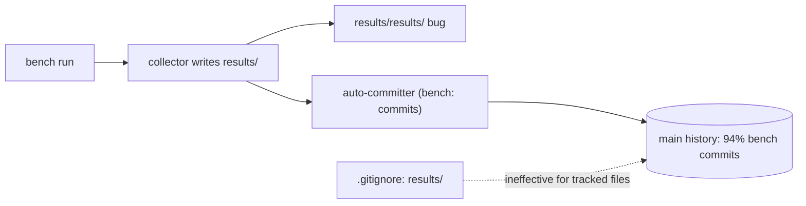

# 21_repo_hygiene_maintainability — Prompt 21 - Repository Hygiene, Maintainability, and Code Health Audit

- Run: `bench-test-20261013-0819-full-main-b916709`
- Target: `bench-test` @ `b916709` (branch `main`)
- Domain: `21_repo_hygiene_maintainability.md` (area HYGIENE, prompt)

## Verification Performed

# Repository Hygiene, Maintainability, and Code Health Audit

## Audit Metadata

- Audit name: repo-deep-dive (bench-test full-domain)
- Run: 20261013-bench-test-domain21
- Repository: `C:\temp\bench-test` (`MaineCyberTech/bench-test`), branch `main`
- Commit SHA audited: `b9167095b08c2f45a814e88e09d88decbd0ea885` (VERSION 1.11.3)
- Generated at: 2026-10-13
- Auditor: domain subagent (21_repo_hygiene_maintainability)
- Area code: HYGIENE
- Output path (prompt convention): `docs/audits/{name}/{run}/21_repo_hygiene_maintainability.md`
- Scope limitations:
  - The checkout was **moving during the audit** (a parallel process advanced HEAD
    from `72c18734` to `60ab90eb` while this ran). All evidence below is pinned to
    the commit named in the brief, `b9167095`, read via `git show`/`git grep`/`git ls-tree`.
  - No mutating commands were run against the target; the audit is read-only.
  - Test execution (below) ran against the live checkout, which is why the working-tree
    HEAD is recorded at run time rather than the pinned commit.

## Scope

Reviewed for repository hygiene / maintainability: folder & file naming, duplicate/dead/
unused code, generated & build artifacts, imports, large files, type safety, error handling,
TODO/FIXME, logging consistency, config sprawl, competing patterns, package scripts,
dependency boundaries, test utilities, docs drift, and changelog/ADRs.

Not reviewed in depth (owned by other domains): auth/authz, secret scanning, supply chain,
CI security posture, and runtime correctness of the benchmark itself.

## Evidence Reviewed

- Tracked tree at `b9167095`: 9,811 files total — **9,555 under `results/`**, 256 outside it.
- `.gitignore`, `.gitattributes`, `AGENTS.md`, `README.md`, `VERSION`.
- Source: `bench/**` (25 Python + PowerShell + 1 Bash runner), `server/**`, `tests/**`,
  `packaging/**`, `live/**`, `docs/**`, `.github/workflows/*`.
- History: `git log`, `git rev-list --count`, `git log --format=%s`.

## Verification Performed

| Evidence | Type | Why relevant | Notes |
|---|---|---|---|
| `git ls-tree -r b9167095 -- results/` | command output | Count/size of committed generated output | 9,555 files, 57,767,706 bytes |
| `git ls-tree -r -l b9167095` (non-results) | command output | Source vs artifact split | non-results ≈ 1.1 MB; examples ≈ 16.7 MB |
| `git rev-list --count b9167095` = 4,962 | command output | History size | — |
| `git log --format=%s` filtered `^bench:` = 4,659 | command output | History composition | 94% auto-generated |
| `git ls-tree -r --name-only` vs `CHANGELOG`/`adr` | command output | Changelog/ADR presence | none found |
| `git ls-files --eol` (`.sh`, `.ps1`) | command output | Line-ending policy | matches `.gitattributes` |
| `git ls-tree -r ... *.sh` modes | command output | Exec bits | all `100755` |
| `git grep -n TODO/FIXME/XXX/HACK` | command output | TODO debt | none (only placeholder `XXX` in usage/example text) |
| `python tests/run_all.py` | executed | Reproduce claimed PASS | **FAIL (1)** — `test_presets: crashed (No module named '_curses')` |
| `.venv/Scripts/python.exe tests/run_all.py` | executed | Isolate cause | **RESULT: PASS** (venv has windows-curses) |
| `git grep -c ') -> '`, `except Exception`, `print(` | command output | Typing / error handling / logging | 3 annotations, 238 broad excepts, 111 prints |
| `git grep` for `rawlog` references | command output | Dead-file check | `rawlog.py` is referenced by README/live docs → not dead |

## Executive Summary

The **code** in this repository is tidy: naming is consistent per language (PascalCase
PowerShell, snake_case Python, lowercase launchers), imports are a clean acyclic layering with
`benchreport.py` as the shared core, there are **no TODO/FIXME markers**, no bare `except:`,
shell scripts are executable (`100755`) and line endings follow `.gitattributes`, and preset
parity across GUI/TUI/web plus telemetry-field validity are enforced by tests.

The **repository** is not tidy. The dominant problem is generated output: `results/` is
declared ignored in `.gitignore:2` yet **9,555 generated files (~55 MB) are tracked**, the
history is **94% auto-generated `bench:` commits (4,659 of 4,962)**, a duplicate
`results/results/` tree is committed, and committed run logs embed host fingerprints (CPU/GPU/
disk models). Regeneration is not enforced and nothing in CI rejects result output on `main`.
Secondary issues: stale README release text (`v1.1.0` while `VERSION` is `1.11.3`), a documented
"stdlib-only" test suite that fails on Windows system Python, very large unsplit modules, no
CHANGELOG/ADRs, and no type annotations.

Recommended next actions: (1) untrack `results/` and stop the per-file auto-committer;
(2) delete `results/results/` and guard against it; (3) fix README version drift; (4) make the
parity test independent of `curses`.

## Inventory

| Item | Path / symbol | Purpose | Current state | Risk | Notes |
|---|---|---|---|---|---|
| Generated runs | `results/**` | Committed benchmark output | 9,555 files tracked despite ignore | High | ~55 MB; grows per run |
| Auto-committer | `bench:` commit series | Commits result files to main | 4,659 / 4,962 commits | High | per-file subjects |
| Nested dup | `results/results/**` | Path-bug copy | 116 files, 3 runs | Medium | misleading |
| README release | `README.md:12,15,17` | User-facing version | `v1.1.0` | Medium | VERSION is `1.11.3` |
| Test entry | `tests/run_all.py` | Suite runner | FAIL on Windows system Python | Medium | `_curses` |
| Big module | `bench/benchreport.py` | Shared core | 2,811 lines | Medium | no split |
| Big module | `server/web/app.js` | Web dashboard | 1,822 lines | Low/Med | no split |
| Changelog | — | Release notes | absent | Low | derived from commits |
| Typing | `bench/*.py`, `server/*.py` | Static safety | 3 annotations / 35 files | Low | gradual typing absent |

## Domain Scorecard

| Category | Score | Evidence | Gap | Recommended action |
|---|---:|---|---|---|
| Folder/file naming | 4 | Consistent PascalCase `.ps1`, snake_case `.py`; single anomaly `results/results/` | Nested dup tree | Remove/guard `results/results` |
| Duplicate/dead/unused code | 3 | Preset + field sync enforced by tests; telemetry field lists duplicated by design (`benchreport.CSV_ALIASES:54`, `telemetry_log.py:30`, `run_win.py:78`) | Cross-file field lists drift-prone | Generate/validate from one source |
| Generated/build artifacts | 1 | 9,555 tracked under `results/`; ignore rule ineffective; no CI guard | Major, growing | Untrack + CI guard + artifacts |
| Imports and circular deps | 4 | `benchreport` shared core imported by gui/tui/agent/import_results; no cycle found | Not exhaustively proven (no cycle tool) | Add a cheap import-cycle check |
| Large files/components | 2 | `benchreport.py` 2,811; `app.js` 1,822; `tui.py` 1,445; `gui.py` 1,424; `benchd.py` 1,417 | No module split | Split along clean seams |
| Type safety/any usage | 2 | 3 annotated defs / 35 Python files | No typing | Gradual typing on public APIs |
| Error handling | 3 | 238 `except Exception`; intentional fail-soft per AGENTS.md; no bare `except:` | Over-broad off the fail-soft path | Narrow handlers |
| TODO/FIXME | 5 | `git grep` found none (only example `XXX` placeholders) | — | Keep it clean |
| Logging consistency | 3 | No `logging`; 111 `print(` + ad-hoc `self.log` | Hard to level/redirect | Small stdlib logging helper |
| Config sprawl | 3 | `benchd.conf(.example)`, `bench-agent.conf.example`, `~/.config/bench-agent.{conf,json}`, `live/private/` — documented in AGENTS.md | Many locations | Document a precedence table |
| Competing patterns | 3 | 3 preset copies (gui/tui/app.js) + 2 sampler field lists; parity tests exist | Manual triple-sync | Generate presets from one manifest |
| Package scripts | 4 | `bench-*.cmd`, `packaging/build_app.py`, 3 workflows | No results-path guard | Add PR guard |

## Detailed Review

### Item: Generated result tree (`results/`)

- Evidence: `.gitignore:2`; `git ls-tree -r b9167095 -- results/` → 9,555 files / 57,767,706 bytes;
  `results/.../sys-info.log:1` embeds host inventory; `AGENTS.md:59`.
- What it does: stores every run's JSON/MD/CSV/logs in git.
- How it appears to work: the ignore rule was added after the files were committed, so it stops
  *new* files from being staged by casual `git add`, but tracked files remain and the external
  auto-committer re-adds run folders anyway.
- Missing controls: no CI guard; docs understate the volume ("a few runs").
- Risks: bloat, slow clones, noisy history, exposed machine fingerprints on a public repo.
- Recommended improvement: `git rm -r --cached results/`, publish runs as artifacts, add a guard.
- Suggested tests: CI step failing when `results/**` is staged.

### Item: History composition

- Evidence: `git rev-list --count` = 4,962; `bench:`-prefixed subjects = 4,659; sample subjects
  `ac83ffbc bench: ... (699 files)` and per-file `87847e32 bench: .../summary-error.txt (...)`.
- Risks: `git blame`/`log --path` and bisect are unusable; unbounded growth.
- Recommended improvement: one squashed commit per run, or push runs outside `main`.

### Item: Duplicate nested tree

- Evidence: `results/results/` (116 files, runs `20261011-135440/154845/200043`).
- Recommended improvement: delete and assert the collector never writes `results/results`.

### Item: README / VERSION drift

- Evidence: `README.md:12,15,17` (`v1.1.0`, `1.1.0+<commit>`, `ISO <gpu> v1.1.0`); `VERSION`=1.11.3.
- Recommended improvement: derive or synchronise the README release token; add a check.

### Item: Test suite portability

- Evidence: `tests/test_presets.py:41` imports `bench/tui.py`; `bench/tui.py:15 import curses`;
  reproduced `RESULT: FAIL (1) … No module named '_curses'` (system Python 3.12.10, Windows) vs
  `RESULT: PASS` under `.venv`.
- Recommended improvement: lazy `curses` import / graceful skip; document windows-curses.

## Scenario / Control Matrix

| ID | Scenario or control | Evidence | Current control | Gap | Severity | Recommendation |
|---|---|---|---|---|---|---|
| HYGIENE-001 | Generated artifacts tracked | 9,555 tracked `results/` files | `.gitignore` only | Ineffective for tracked files | P1 | Untrack + CI guard |
| HYGIENE-002 | History hygiene | 4,659 `bench:` commits | None | Per-file auto-commit | P2 | Batch/park runs |
| HYGIENE-003 | Duplicate trees | `results/results/` 116 files | None | Path bug | P2 | Delete + assert |
| HYGIENE-004 | Docs drift | `README.md:12,15,17` | None | Stale version | P2 | Synchronise/check |
| HYGIENE-005 | Test portability | `tui.py:15`, reproduced FAIL | `.venv` workaround | curses hard dep | P2 | Lazy import/skip |
| HYGIENE-006 | Large files | `benchreport.py` 2,811 lines | None | No split | P3 | Modularise |
| HYGIENE-007 | Changelog/ADR | no CHANGELOG/adr | commit subjects | No human notes | P3 | Add CHANGELOG + ADRs |
| HYGIENE-008 | Typing/error/logging | 3 annotations, 238 broad excepts, 111 prints | Fail-soft convention | No typing, broad handlers | P3 | Gradual typing + logging |
| HYGIENE-009 | Naming | consistent per language | conventions | None material | — | — |
| HYGIENE-010 | Imports | `benchreport` core | stdlib-only rule | no cycle tool | — | Add cycle check |
| HYGIENE-011 | Config | documented locations | AGENTS.md | No precedence table | P3 | Document precedence |
| HYGIENE-012 | Package scripts | `.cmd`, `build_app.py`, 3 workflows | CI | No results guard | P3 | Add guard |

## Findings

### Finding ID: `HYGIENE-P1-001` - 9,555 generated result files (~55 MB) committed under results/

- Severity: P1 · Confidence: High · Area: HYGIENE
- Evidence: `.gitignore:2`; `git ls-tree -r b9167095 -- results/` (9,555 files / 57,767,706 bytes);
  `results/bench-live-linux-20261011-135440/.../sys-info.log:1`; `AGENTS.md:59`.
- What is happening: a `results/` ignore rule coexists with 9,555 tracked result files.
- Why it matters: bloat, slow clones, misleading `.gitignore`, host fingerprint exposure.
- Recommended fix: untrack `results/`, publish runs as artifacts, add a CI guard.
- Effort: S · Status: open

### Finding ID: `HYGIENE-P2-001` - History is 94% auto-generated `bench:` commits

- Severity: P2 · Confidence: High · Area: HYGIENE
- Evidence: 4,962 commits total, 4,659 `bench:` (e.g. `ac83ffbc`, `87847e32`).
- Recommended fix: squash per run / park output off `main`; document the mechanism.
- Effort: M · Status: open

### Finding ID: `HYGIENE-P2-002` - Duplicate nested `results/results/` tree

- Severity: P2 · Confidence: High · Area: HYGIENE
- Evidence: 116 tracked files across 3 duplicated runs.
- Recommended fix: delete; assert collector output path.
- Effort: S · Status: open

### Finding ID: `HYGIENE-P2-003` - README release drift (v1.1.0 vs VERSION 1.11.3)

- Severity: P2 · Confidence: High · Area: HYGIENE
- Evidence: `README.md:12,15,17`; `VERSION`=`1.11.3`.
- Effort: S · Status: open

### Finding ID: `HYGIENE-P2-004` - Stdlib-only test suite fails on Windows system Python

- Severity: P2 · Confidence: High · Area: HYGIENE
- Evidence: reproduced `RESULT: FAIL (1) … '_curses'`; `.venv` → PASS.
- Effort: S · Status: open

### Finding ID: `HYGIENE-P3-001`..004

Large unsplit modules (`benchreport.py` 2,811 / `app.js` 1,822 / `tui.py` 1,445 / `gui.py` 1,424 /
`benchd.py` 1,417); no CHANGELOG/ADRs; no type annotations with 238 broad `except Exception`
and print-based logging. See JSON for full detail.

## Risks

| Risk | Severity | Likelihood | Impact | Evidence | Mitigation |
|---|---|---|---|---|---|
| Repo bloat / slow clone | High | High | Dev velocity | 55 MB results tracked | Untrack + artifacts |
| Unusable history | High | High | Debuggability | 94% bench commits | Batch commits |
| Machine fingerprint exposure | Medium | Medium | Privacy | `sys-info.log` | Don't commit logs |
| Contributor confusion | Medium | Medium | Onboarding | README/version drift, Windows test FAIL | Fix docs + test |

## Recommendations

### Immediate / Release Blocking
- Untrack `results/` and stop the per-file auto-committer (HYGIENE-P1-001, P2-001).
- Delete `results/results/` (HYGIENE-P2-002).

### This Week
- Fix README release drift and add a check (HYGIENE-P2-003).
- Make `test_presets` independent of `curses`; document windows-curses (HYGIENE-P2-004).

### This Month
- Split `benchreport.py` / `app.js` along clean seams (HYGIENE-P3-001).
- Add a CHANGELOG + `docs/adr/` (HYGIENE-P3-002).

### Later / Platform Evolution
- Gradual typing on public APIs; stdlib logging helper; config precedence table.

## Quick Wins

| Quick win | Why it helps | Files likely involved | Validation |
|---|---|---|---|
| `git rm -r --cached results/` | Stops new result files being tracked | `.gitignore`, index | `git status` shows results untracked |
| Delete `results/results/` | Removes misleading duplicate | `results/results/**` | tree no longer present |
| Fix README release token | Correct user-facing version | `README.md:12,15,17` | matches `VERSION` |
| Lazy `import curses` | Windows suite passes | `bench/tui.py:15` | `python tests/run_all.py` PASS |

## Hardening Backlog

| Backlog item | Priority | Owner suggestion | Effort | Dependency |
|---|---|---|---|---|
| Untrack generated results | P1 | Repo maintainer | S | — |
| Batch/park run auto-commits | P2 | CI/ops | M | artifact storage |
| Curve-collector path guard | P2 | bench maintainer | S | — |
| README version check | P2 | docs owner | S | — |
| TUI import decoupling | P2 | dashboards owner | S | — |
| Module split | P3 | core maintainer | M | test coverage |

## Suggested Tests

- **CI policy test:** fail if `git diff --cached --name-only` matches `results/**`.
- **Path guard test:** assert the collector never emits a `results/results` path.
- **Docs test:** parse `README.md` release token and compare to `VERSION`.
- **Portability test:** run `python tests/run_all.py` in CI on Windows *without* windows-curses to
  prove the suite skips/degrades gracefully.
- **Import-cycle test:** a small stdlib check that no `bench/*.py` module import cycle exists.

## Suggested Documentation Updates

- `README.md` — correct the release string; point at `VERSION`.
- `AGENTS.md` — state the real `results/` policy (currently "a few runs"); document the
  auto-commit behaviour and the windows-curses prerequisite for the test suite.
- New `CHANGELOG.md` and `docs/adr/0001-*.md` (stdlib-only, single-writer telemetry, fail-soft).

## Open Questions

| Question | Why it matters | Evidence needed |
|---|---|---|
| Who/what performs the `bench:` auto-commits? | Owner + fix path | Script or workflow outside this repo (not present in the tracked tree) |
| Are committed run logs intended to be public? | Privacy exposure | Maintainer intent / redaction policy |
| Is `results/` history meant to remain in `main`? | Determines `git rm --cached` vs filter-repo | Maintainer decision |
| Does the suite run in CI on Windows at all? | Windows is first-class | Workflow YAML (only 3 workflows, none run tests) |

## Appendix

- Command outputs summarised in *Verification Performed* above; raw values:
  - total tracked files @ `b9167095`: 9,811 (results 9,555; non-results 256)
  - results bytes: 57,767,706 (~55.1 MB); examples bytes: ~16.7 MB; source bytes: ~1.1 MB
  - commits: 4,962 total; `bench:` 4,659; `bench: … (N files)` 17
  - large files: `benchreport.py` 2,811, `app.js` 1,822, `tui.py` 1,445, `gui.py` 1,424, `benchd.py` 1,417
  - typing: 3 annotated defs / 35 Python files; 238 `except Exception`; 111 `print(`; 0 bare `except:`
  - `.sh` modes all `100755`; `.gitattributes` LF for sh/py/js/md, CRLF for ps1/cmd
- mermaid (artifact flow):

## Findings

| ID | Severity | Title |
|---|---|---|
| HYGIENE-P1-001 | P1 | 9,555 generated result files (~55 MB) are committed under results/ despite a results/ ignore rule |
| HYGIENE-P2-001 | P2 | Repository history is 94% auto-generated `bench:` commits (4,659 of 4,962) |
| HYGIENE-P2-002 | P2 | Duplicate nested results/results/ tree committed (116 files across 3 runs) |
| HYGIENE-P2-003 | P2 | README release/version drift: README advertises v1.1.0 while VERSION is 1.11.3 |
| HYGIENE-P2-004 | P2 | Documented stdlib test suite fails on Windows system Python (`_curses` missing) |
| HYGIENE-P3-001 | P3 | Large monolithic modules with no internal split (benchreport.py 2,811 lines; app.js 1,822) |
| HYGIENE-P3-002 | P3 | No CHANGELOG or ADRs; release notes are implicit in commit subjects |
| HYGIENE-P3-003 | P3 | No type annotations and 238 broad `except Exception` handlers across the Python codebase |
