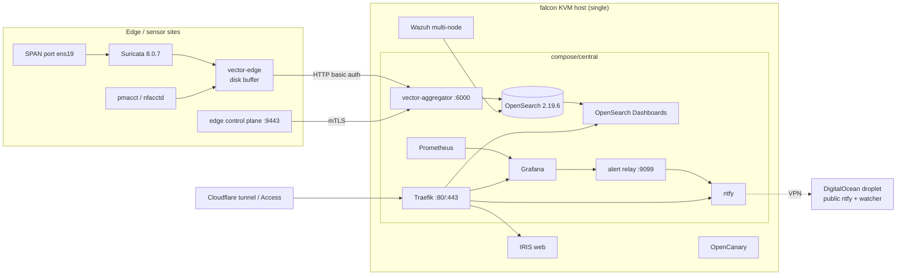
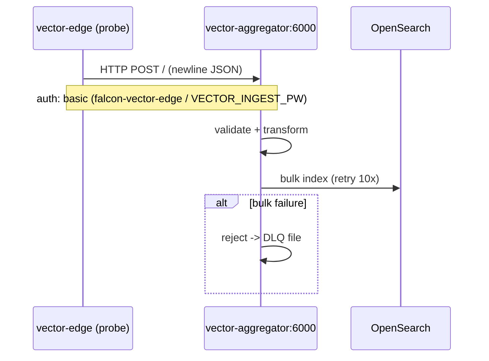
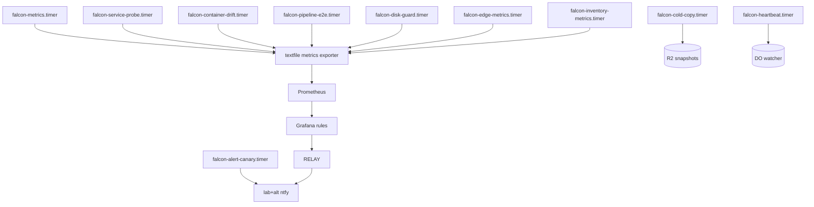

# 02_architecture_runtime_topology — Prompt 02 - Architecture and Runtime Topology Audit

- Run: `falcon-20261011-0416-full-f5cb7c9`
- Target: `falcon` @ `f5cb7c9` (branch `main`)
- Domain: `02_architecture_runtime_topology.md` (area ARCH, prompt)

## Verification Performed

## Audit Metadata

- Audit name: repo-deep-dive (falcon)
- Run: `falcon-20261011-0416-full-f5cb7c9`
- Repository: `MaineCyberTech/falcon` @ `f5cb7c96cacefb2e8b1dedc1f15e633d9072264b` (branch `main`)
- Generated at: 2026-10-11T04:45Z
- Auditor: repo-deep-dive full-pass subagent (ARCH)
- Area code: ARCH
- Output path: `docs/audits/repo-deep-dive/falcon-20261011-0416-full-f5cb7c9/02_architecture_runtime_topology.md` (intended)
- Scope limitations: live inspection was read-only (2026-10-11 04:19-04:35 UTC); no restarts, reconfigurations or deployments. One host was inspected; the edge fleet was seen only through its exported metrics.

## Scope

Reviewed: the single-host topology (KVM host `falcon`, Ubuntu 24.04) and its containers, the central/probe data path, auth/session surfaces, tenant boundaries (single owner; zone isolation), request lifecycle, background jobs/timers, notifications, external integrations, deployment topology, environment parity and runtime validation. Evidence: repository topology docs + compose/config, plus live read-only checks (docker, systemd, journal, nft, wireguard, textfile metrics, Grafana API, GitHub API). The `mct/compose` staged services were reviewed as declarations only (none running).

## Evidence Reviewed

| Evidence | Type | Why relevant | Notes |
|---|---|---|---|
| `README.md:23-36` | doc | documented topology and data path | SPAN -> Suricata/pmacct -> Vector edge -> aggregator -> OpenSearch; Prometheus/Grafana side-channel |
| `docs/architecture/{TARGET_ARCHITECTURE,DATA_FLOW_AND_CLASSIFICATION,PORT_PROTOCOL_MATRIX,TRUST_BOUNDARIES,IDENTITY_AND_SECRETS,STORAGE_CAPACITY_MODEL}.md` | docs | topology, ports, trust, data classes | live-bind reconciliation 2026-10-01 |
| `compose/central/docker-compose.yml`, `compose/probe/docker-compose.yml`, `compose/mct/*`, `automation/wazuh/multi-node/*.yml` | source | deployment sources | digest-pinned (tag@digest) |
| `config/vector/aggregator.yaml`, `config/vector/edge.yaml` | source | transport/auth/buffering | edge disk buffer; HTTP basic-auth ingest |
| `config/traefik/*`, `config/prometheus/*`, `config/nftables/*`, `config/wireguard/*` | source | ingress, scrape, firewall, VPN | |
| `bootstrap/30-firewall.sh`, `60-central-deploy.sh`, `70-probe-deploy.sh`, `90-alerting.sh`, `93-alert-canary.sh` | source | enforcement + provisioning | alert rules provisioned by API |
| `pins/images.lock` (24 entries), `pins/supply-chain-waivers.json` | source | image pinning + waivers | blanket `mct/compose` waiver; per-ref Wazuh waivers |
| `docs/threat-model/THREAT_MODEL.md` | doc | trust boundaries | |
| live `docker ps/inspect/stats`, `systemctl list-timers`, `journalctl -k`, `nft list`, `wg show`, textfile metrics, Grafana API, GitHub API | live | as-built state | timestamped below |

## Verification Performed

| Evidence | Type | Why relevant | Notes |
|---|---|---|---|
| `docker ps` | live | as-built topology | 27 containers: central (10), probe (2), Wazuh (7), IRIS (5), OpenCanary (1), forwarder (1), cloudflared (1) |
| `docker inspect` (10 central/probe containers) | live | declared-vs-running hardening | all `no-new-privileges:true`; `cap_drop:[ALL]` on grafana/prometheus/ntfy; healthchecks present |
| `docker inspect falcon-central-vector-aggregator-1` | live | ARCH-P1-003 closure | `Memory=1073741824`, `RestartCount=0`, started 2026-10-11T02:28Z (post-reboot), `SecurityOpt=[no-new-privileges:true]`, `CapDrop=[ALL]` |
| `docker stats --no-stream` | live | memory headroom | aggregator 93.72 MiB / 1 GiB (~9%) |
| `journalctl -k --since '2026-10-09 22:00' \| grep -c "Memory cgroup out of memory"` | live | OOM recurrence | 0 kills since the 1 GiB change (23 restarts / 18 kills before) |
| `falcon_container_drift` textfile | live | continuous drift check | all kinds `0` (fresh run 2026-10-11T04:18:03Z); `falcon_container_undeclared 1` (script-installed forwarder) |
| `falcon_live_image_drift` textfile | live | live image pin check | `0` |
| `falcon_runtime_source_info` / `_dirty` / `_behind_remote` | live | deployment binding | `commit="f5cb7c9"`, `dirty="0"`, `behind_remote 0`, commit age 1,294 s at capture |
| `git -C /home/user/falcon-build status --porcelain` / `rev-parse` | live | ARCH-P1-002 closure | clean; HEAD = `f5cb7c9`; `origin/main` tracking ref stale at `584e1a3` |
| GitHub API `GET /repos/MaineCyberTech/falcon/commits/main` | live | remote binding | remote `main` = `f5cb7c9` (pushed 2026-10-11T04:04:15Z) = HEAD |
| `falcon_pipeline_e2e` textfile | live | end-to-end path | last failure 2026-10-09T20:40:10Z; last success 2026-10-11T04:15:04Z |
| `falcon_disk_guard` textfile | live | capacity guard | root free 21.19 GB (>20 GiB), data free 102.88 GB (>10 GiB), 50 reclaims |
| `nft list chain inet falcon_filter input` | live | enforcement | default drop; per-port `iifname "wg0"` set (9443; 15140/15141; 514/1514/1515; udp 514/2055); no blanket wg0 accept |
| `wg show` | live | VPN topology | wg0 :5182; peers handshaking (seconds) |
| `systemctl list-timers` | live | background jobs | falcon-metrics, service-probe, container-drift, disk-guard, pipeline-e2e, edge-metrics, inventory, cold-copy, heartbeat, diagnostics, edge-cleanup, enrollment-closure, alert-canary all active |
| Grafana API `/api/v1/provisioning/alert-rules` | live | live rule set | 86 rules, all re-provisioned 2026-10-11T03:16-03:18Z |
| `falcon_service_up` / `falcon_relay` textfiles | live | notification path | 10/10 services up; relay path successes lab 9 / alt 9, failures 0 |
| `falcon_alert_canary` textfile | live | alert-path proof | weekly timer (Mondays 06:00 UTC); last success 2026-10-05T06:00:15Z; next 2026-10-12 |
| `falcon_edge_inventory` textfile | live | edge fleet | 72 hosts / 109 services, daily scan (age ~23.7 h) |

## Executive Summary

The documented topology matches the running system structurally: 27 containers, a single Traefik entry point, internal Docker networks, WireGuard on 5182, a default-deny host firewall with the per-port wg0 set, and a continuous running-vs-declared container drift check at zero. Both P1 findings from the 2026-10-09 run are verified fixed at `f5cb7c9`: the live source tree is clean at the audited commit and equals remote `main` (GitHub API), and the central Vector aggregator runs under a 1 GiB limit with `RestartCount=0` and zero cgroup OOM kills since 2026-10-09T22:00Z (93.7 MiB in use). The remaining architecture-level gaps are the previously filed ones: single-host concentration (owner-accepted), the vendored `mct/compose` tree under a blanket pin waiver (the live Wazuh/IRIS/OpenCanary stacks are now tag@digest and lock-covered), shared-credential ingest (HTTP basic auth, not mTLS/signing), and the port-matrix N-08 wording. One new residual: the ARCH-P1-003 failure mode is no longer monitored at the container level — `falcon_container_mem_bytes` is exported but no rule uses it, and the only restart-loop rule is Suricata-specific. A status contradiction exists in the prior run's own artifacts for ARCH-P2-001 (report says verified-fixed, register says open; live evidence supports fixed) — filed under ORCH-P3-002.

## Inventory

| Item | Path / symbol | Purpose | Current state | Risk | Notes |
|---|---|---|---|---|---|
| Central stack | `compose/central/docker-compose.yml` | traefik, opensearch(+dashboards), vector-aggregator, prometheus, grafana, redis, ntfy, ntopng, node-exporter | running, drift 0 | medium | 10 services |
| Probe stack | `compose/probe/docker-compose.yml` | suricata (SPAN), vector-edge | running | medium | 2 services |
| MCT live | `compose/mct/` | IRIS (5 containers), OpenCanary | running, digest-pinned | medium | first-party |
| Wazuh multi-node | `automation/wazuh/multi-node/` | 3 indexers, manager, worker, dashboard, nginx, cloudflared | running, tag@digest | medium | 3 helper waivers (certs-generator, flow-collector, python:3-alpine) |
| Data path | SPAN ens19 -> suricata/pmacct -> vector-edge -> aggregator:6000 -> OpenSearch | telemetry | running; e2e success 04:15Z | low | OOM loop closed |
| Metrics path | node-exporter textfile + direct scrapes | platform health | running | low | OpenSearch not scrapable (documented) |
| Alerting path | Grafana 86 rules -> relay -> ntfy (+ independent + dead-man) | alerting | running; rules re-provisioned 03:16Z | low | catalogue lags by one rule (FEAT report) |
| Ingress | Traefik 80/443 + Cloudflare tunnel | access | running | medium | public routes: grafana/dash/ntop/ntfy/iris/soc/enroll |
| VPN | wg0 5182 (8 peers) + enroll service | telemetry/enrollment | running | low | per-port firewall set |
| Backups | falcon-backup.timer, offsite, R2 cold copy, Wazuh snapshots | recovery | cold copy Oct 10; Wazuh backup Oct 11 03:06 | medium | DR domain owns details |
| Source tree | `/home/user/falcon-build` | ops source | clean, HEAD = remote main = `f5cb7c9` | low | `origin/main` local ref stale (cosmetic) |
| Staged MCT | `mct/compose/` | archive-only | not running | medium | 29 unpinned refs under blanket waiver |

### System context (as-built)

### Auth / request sequence (edge ingest)

### Worker / job flow

### Tenant boundary map

Single owner/operator; no tenant data plane. Boundaries that matter: (1) host nftables default-deny with per-port wg0 set; (2) Docker network separation (frontend/backend; probe -> central only via :6000); (3) Cloudflare Access + per-service logins on operator UIs; (4) Wazuh/IRIS data on the same host (retention owner-gated; SEARCH/PRIV domains).

## Domain Scorecard

| Category | Score | Evidence | Gap | Recommended action |
|---|---:|---|---|---|
| Monorepo structure | 4 | single ops repo; compose/config/automation trees | none found | keep |
| Frontend/backend/worker boundaries | 4 | compose services + systemd timers; drift 0 | staged MCT tree policy | FEAT report |
| Auth/session flow | 3 | Traefik + Cloudflare Access + per-service logins | public routes origin auth (SEC/ADMIN open) | owner |
| Authorization and tenant boundaries | 3 | single owner; nft per-port wg0; internal docker nets | shared-credential ingest | ARCH-P2-003 |
| Request lifecycle | 4 | edge->aggregator->OpenSearch; e2e success | none found | keep |
| Data flow | 4 | vector DLQ; retention; R2 cold tier | Wazuh/IRIS retention owner-gated | owner |
| Background jobs | 4 | 13 active falcon timers; canary weekly proof | none found | keep |
| Queues | 3 | edge disk buffer 2 GiB; DLQ; aggregator sink buffers | no explicit aggregator source-side bound | monitor |
| Webhooks | 4 | Grafana -> relay -> ntfy; per-path metrics | none found | keep |
| Realtime | 4 | OpenSearch/OSD near-real-time; e2e 15 min cadence | none found | keep |
| Notifications | 4 | lab + independent + dead-man watcher | owner-side watcher residual (NOTIF) | owner |
| External integrations | 4 | Cloudflare tunnel, Wazuh, IRIS, R2, DigitalOcean | 3 Wazuh helper waivers | SC domain |

## Detailed Review

### Item: Central data path and the aggregator

- Evidence: `compose/central/docker-compose.yml:145-160` (memory 1G with the audit comment); `config/vector/aggregator.yaml`; live inspect/stats/OOM counts; `falcon_pipeline_e2e`.
- What it does: receives edge + syslog telemetry, validates, and bulk-indexes to OpenSearch.
- How it appears to work: `edge_ingest` HTTP source with basic auth; sink retry 10x; invalid/rejected events to a DLQ route; metrics exported on 127.0.0.1:9598.
- Dependencies: probe buffer replay; OpenSearch availability; 1 GiB cgroup.
- Current controls: 1 GiB limit, drop-log counter + rules (OBS-P1-001/PERF-P2-003), e2e timer, container drift.
- Missing controls: no container-level memory-near-limit or generic restart-count alert (ARCH-P3-002); no explicit source-side queue bound.
- Risks: recurrence under a different load shape would again be invisible at the container level.
- Recommended improvement: add a rule on `falcon_container_mem_bytes` (e.g., >85% of the declared limit for 15m) and a policy-restart-count rule for central services.
- Suggested tests: fixture with a high memory gauge asserts the rule fires; replay load test stays under 1 GiB.
- Suggested docs: runbook section for aggregator memory/backlog (prior recommendation, still useful).

### Item: Deployment binding and environment parity

- Evidence: live git state (clean, HEAD = remote main = `f5cb7c9`); `falcon_runtime_source_*` metrics; `falcon_container_drift` all-zero; GitHub API.
- What it does: binds the running scripts and containers to the audited commit.
- How it appears to work: the deploy tree is the repo worktree; timers run scripts from it; drift check compares live containers to compose.
- Dependencies: manual merge/publish discipline; timers.
- Current controls: runtime-source metric, drift check, `falcon-container-drift-stale` rule, `falcon-live-source-not-reviewable` rule (dirty/behind).
- Missing controls: none material; the local `origin/main` ref can be stale (cosmetic).
- Risks: low.
- Recommended improvement: fetch/prune in the metrics timer (optional).
- Suggested tests: none required.
- Suggested docs: none.

### Item: VPN and firewall enforcement

- Evidence: live `nft list chain inet falcon_filter input`; `wg show`; repo `config/nftables/falcon.nft` (byte-identical per the 2026-10-11 verification); INFRA/SEC register rows.
- What it does: restricts host ingress to management/admin subnets plus the per-port wg0 set.
- How it appears to work: policy drop; established/related; explicit service ports; counter on the final drop.
- Dependencies: nftables.service at boot; wg0.
- Current controls: per-port set (9443; 15140/15141; 514/1514/1515; udp 514/2055); no blanket wg0 accept.
- Missing controls: none identified in this domain (SEC/CHAIN own the residual analysis).
- Risks: low after the narrowing.
- Recommended improvement: none.
- Suggested tests: `automation/validation/boot_order_check.sh` (already exists) + nft diff against repo.
- Suggested docs: keep the N-08 wording fix (ARCH-P3-001).

### Item: Background jobs and notifications

- Evidence: `systemctl list-timers`; `falcon_relay.prom`; `falcon_alert_canary.prom`; `bootstrap/93-alert-canary.sh`.
- What it does: metrics, probes, drift, e2e, disk guard, edge metrics/inventory, cold copy, heartbeat, diagnostics, weekly alert-path canary.
- How it appears to work: systemd timers -> scripts -> textfile metrics -> Prometheus/Grafana -> relay -> ntfy.
- Dependencies: Grafana API provisioning; ntfy ACLs; DO watcher.
- Current controls: per-path relay metrics; weekly canary; dead-man contract test.
- Missing controls: none identified.
- Risks: low.
- Recommended improvement: none.
- Suggested tests: keep the canary; add a container-level memory fixture (ARCH-P3-002).
- Suggested docs: none.

## Scenario / Control Matrix

| ID | Scenario or control | Evidence | Current control | Gap | Severity | Recommendation |
|---|---|---|---|---|---|---|
| ARCH-001 | Monorepo structure | repo tree | documented ops repo | none | — | keep |
| ARCH-002 | Frontend/backend/worker boundaries | compose + timers | drift check | staged MCT policy | P2 | FEAT report |
| ARCH-003 | Auth/session flow | Traefik/Access configs | TLS + per-service logins | public origin auth (SEC-P2-001) | P2 | SEC owner |
| ARCH-004 | Authorization and tenant boundaries | single owner; nft; docker nets | default-deny + internal nets | shared-credential ingest | P2 | ARCH-P2-003 |
| ARCH-005 | Request lifecycle | edge -> aggregator -> OS | e2e timer + DLQ | none | — | keep |
| ARCH-006 | Data flow | vector configs; R2 | DLQ + retention | Wazuh/IRIS retention owner-gated | P1 | owner (DATA/PRIV) |
| ARCH-007 | Background jobs | 13 timers | systemd + textfile metrics | container-level OOM/restart alert | P3 | ARCH-P3-002 |
| ARCH-008 | Queues | edge buffer 2 GiB; DLQ | disk buffer + DLQ | aggregator source-side bound absent | P2 | monitor/design |
| ARCH-009 | Webhooks | relay | per-path metrics + rules | none | — | keep |
| ARCH-010 | Realtime | OSD; e2e 15 min | e2e + freshness rules | none | — | keep |
| ARCH-011 | Notifications | ntfy paths | lab + independent + dead-man | owner watcher residual | P2 | NOTIF owner |
| ARCH-012 | External integrations | tunnel, Wazuh, IRIS, R2, DO | pins + waivers | 3 Wazuh helper waivers | P3 | SC owner |

## Findings

### ARCH-P1-001 - Single-host concentration: host loss is total pipeline loss (owner-accepted)

- Severity: P1
- Confidence: High
- Area: ARCH
- Evidence:
  - `README.md:5-6` — one Ubuntu 24.04 KVM host (`falcon`)
  - `compose/central/docker-compose.yml` — single central stack; no warm standby
  - register: `runs/falcon-20261011-0400-verify-main-584e1a3/follow_up_register.md:10` — `ARCH-P1-001 owner-accepted (unchanged)`
- What is happening: all capture, storage, metrics, alerting and delivery run on one host; there is no warm standby.
- Why it matters: host loss is total monitoring loss (the edge buffers ~2 GiB, then blocks).
- User / business impact: monitoring outage until the host is rebuilt.
- Security / privacy / reliability impact: high availability risk, accepted by the owner.
- Recommended fix: warm standby or a tested RTO/RPO acceptance (already recorded).
- Suggested validation: restore rehearsal results + owner sign-off artifact.
- Owner suggestion: owner.
- Effort estimate: L.
- Dependencies: hardware.
- Status: owner-accepted (unchanged).
- Endpoint / data path: host-level.
- Attack path: none identified.

### ARCH-P2-002 - Vendored MCT tree remains tag-only under a blanket pin waiver; live stacks are now tag@digest and lock-covered (partially fixed)

- Severity: P2
- Confidence: High
- Area: ARCH
- Evidence:
  - live `docker inspect`: `wazuh-cloudflared` image `cloudflare/cloudflared:latest@sha256:e39ee8da...`; `multi-node-nginx-1` `nginx:stable@sha256:46ccc48f...`; Wazuh manager/indexer/dashboard `4.14.7@sha256:...` — declared in `automation/wazuh/multi-node/*.yml` with the same tag@digest refs
  - `pins/images.lock` — 24 entries include `wazuh/*:4.14.7`, `cloudflare/cloudflared:latest`, `nginx:stable`
  - `pins/supply-chain-waivers.json` — blanket waiver `root: mct/compose, ref: *` (review_by 2026-12-31) + 3 narrow `automation/wazuh` helper waivers
  - `mct/VENDORING.md` — `mct/compose/` 37 refs: 8 pinned, 29 unpinned, 11 floating; P4 enforcement unimplemented
  - live `falcon_live_image_drift 0`; fast gate `PASS compose image pinning`
- What is happening: the live Wazuh/IRIS/OpenCanary stacks are digest-pinned and lock-covered; the vendored `mct/compose` tree (staged, not deployed) remains tag-only under a blanket waiver.
- Why it matters: a revived staged service or a moved tag would bypass the pin policy; silent edits to vendored files stay invisible.
- User / business impact: supply-chain exposure limited to non-deployed services.
- Security / privacy / reliability impact: pin/SBOM coverage gap for the archive tree.
- Recommended fix: scope the waiver per ref (as the Wazuh waivers already do), implement P4 (import manifest + vendor-drift check), or make `mct/compose` non-deployable (FEAT report).
- Suggested validation: `check_compose_digests.py` over `mct/compose` with no blanket waiver.
- Owner suggestion: supply-chain.
- Effort estimate: M.
- Dependencies: owner decision (waiver review_by 2026-12-31).
- Status: partially-fixed.
- Endpoint / data path: compose -> image pull.
- Attack path: none identified (staged services not running).

### ARCH-P2-003 - Live ingest authentication is an HTTP basic-auth shared credential, not mTLS or request signing (open)

- Severity: P2
- Confidence: High
- Area: ARCH
- Evidence:
  - `config/vector/aggregator.yaml:25-28` — `auth: strategy: basic` (`falcon-vector-edge` / `${VECTOR_INGEST_PW}`)
  - `config/vector/edge.yaml:245-246` — sink to `vector-aggregator:6000` with the same basic auth
  - `docs/architecture/PORT_PROTOCOL_MATRIX.md:27` (N-08) — described as "shared secret header" (see ARCH-P3-001)
- What is happening: edge->central ingest is authenticated by a shared credential over the internal network; no per-device certificate identity and no replay/idempotency protection.
- Why it matters: any holder of the shared credential can inject telemetry; a replay is not distinguishable.
- User / business impact: telemetry integrity depends on credential custody.
- Security / privacy / reliability impact: injection/replay surface on the ingest path.
- Recommended fix: certificate/mTLS identity for ingest (the edge control plane already uses mTLS on 9443), or request signing + idempotency keys.
- Suggested validation: negative test — ingest without a client cert is rejected; a replayed request is rejected/flagged.
- Owner suggestion: ops/edge.
- Effort estimate: L.
- Dependencies: edge program.
- Status: open (unchanged).
- Endpoint / data path: `POST vector-aggregator:6000` -> transform -> OpenSearch.
- Attack path: credential theft -> forged/replayed telemetry into `falcon-eve-*`.

### ARCH-P3-001 - Port matrix describes ingest auth as a shared secret header while the implementation is HTTP basic auth

- Severity: P3
- Confidence: High
- Area: ARCH
- Evidence:
  - `docs/architecture/PORT_PROTOCOL_MATRIX.md:27` (N-08) — authentication column: "shared secret header"
  - `config/vector/aggregator.yaml:25-28` — `auth: strategy: basic`
  - `config/vector/edge.yaml:245-246` — `auth: strategy: basic`
- What is happening: the authoritative port/auth matrix names a mechanism that is not implemented.
- Why it matters: operators/reviewers reason about the wrong control; both mechanisms are shared-secret based but differ in implementation and rotation.
- User / business impact: minor; review accuracy.
- Security / privacy / reliability impact: documentation drift.
- Recommended fix: correct the N-08 row (and any negative-test wording) to "HTTP basic auth (shared credential)".
- Suggested validation: doc review against config; optional CI check comparing the matrix auth column to the vector configs.
- Owner suggestion: maintainer.
- Effort estimate: S.
- Dependencies: none.
- Status: open (unchanged).
- Endpoint / data path: documentation.
- Attack path: none identified.

### ARCH-P3-002 - Container-level memory and policy-restart alerting for central services is still absent

- Severity: P3
- Confidence: High
- Area: ARCH
- Evidence:
  - `automation/validation/export_monitor_metrics.sh:697` — exports `falcon_container_mem_bytes{name="..."}`
  - `bootstrap/90-alerting.sh` — no rule references `falcon_container_mem_bytes` (`grep` -> only the exporter); live rule set (86) contains only host-level memory rules ("Memory pressure", "Host memory pressure (early warning)", "Site host memory low")
  - the only restart-loop rule is `falcon-suricata-restart-loop` (`bootstrap/90-alerting.sh:418`); `falcon-container-unhealthy` (line 389) does not catch a container that restarts and becomes healthy again
  - prior finding ARCH-P1-003 (now verified-fixed) recommended exactly this control; the 2026-10-09 failure mode was 23 restarts / 18 OOM kills with no container-level alert
- What is happening: the memory limit was raised and drop visibility added, but the container-level early-warning/restart signals remain unalerted; the next container OOM would again surface only downstream (e2e failures / host pressure).
- Why it matters: the specific failure mode that caused a 41-hour class of pipeline loss is still not monitored at its source.
- User / business impact: slower detection of a recurring failure; operator time.
- Security / privacy / reliability impact: monitoring reliability of the pipeline itself.
- Recommended fix: add a rule on `falcon_container_mem_bytes` vs the declared limit (e.g., >85% for 15m) and a policy-restart-count rule for central services; include a synthetic proof.
- Suggested validation: fixture gauge at 90% of the limit fires the rule; a restart-count fixture fires the restart rule.
- Owner suggestion: ops.
- Effort estimate: S.
- Dependencies: exporter (exists).
- Status: open.
- Endpoint / data path: node-exporter textfile -> Prometheus -> Grafana -> ntfy.
- Attack path: none identified.

## Prior-Run Comparison

| Prior finding | Status now | Evidence |
|---|---|---|
| ARCH-P1-001 | owner-accepted (unchanged) | single host; register |
| ARCH-P1-002 | verified-fixed | live tree clean at `f5cb7c9`; GitHub API confirms remote main = HEAD; remediation artifacts present (`compose/central/docker-compose.yml:154` 1G; `bootstrap/90-alerting.sh:252` proxy rule) |
| ARCH-P1-003 | verified-fixed | live `Memory=1073741824`, `RestartCount=0`, 0 OOM kills since 2026-10-09T22:00Z, 93.7 MiB in use; e2e success 04:15Z |
| ARCH-P2-001 | not reproducible as titled; report/register contradict | live hardening parity + `falcon_container_drift{security}=0`; report says verified-fixed, register says open -> ORCH-P3-002 |
| ARCH-P2-002 | partially-fixed | live stacks tag@digest + lock; `mct/compose` blanket waiver + 29 unpinned refs remain |
| ARCH-P2-003 | open | basic-auth ingest unchanged |
| ARCH-P3-001 | open | N-08 wording unchanged |
| — (new) | ARCH-P3-002 | no container-level memory/restart alert |

## Risks

| Risk | Severity | Likelihood | Impact | Evidence | Mitigation |
|---|---|---|---|---|---|
| Single host | P1 | Low | Critical | one host | owner-accepted |
| Shared-credential ingest / replay | P2 | Medium | Medium | basic auth configs | mTLS or signing |
| Staged MCT service revived under blanket waiver | P2 | Low | Medium | `mct/compose` waiver | per-ref waiver / P4 |
| Container OOM/restart invisible until downstream failure | P3 | Medium | Medium | no rule on `falcon_container_mem_bytes` | ARCH-P3-002 |
| Doc drift on ingest auth | P3 | Medium | Low | N-08 wording | ARCH-P3-001 |

## Recommendations

### Immediate / Release Blocking
- None (the two prior P1s are verified fixed).

### This Week
- Add the container memory/restart rules (ARCH-P3-002).
- Correct the N-08 wording (ARCH-P3-001).

### This Month
- Move ingest to certificate identity or signing (ARCH-P2-003).
- Scope the `mct/compose` waiver per ref (ARCH-P2-002).

### Later / Platform Evolution
- Warm standby / tested RTO-RPO for the owner-accepted single-host risk.
- Consider an explicit source-side queue bound on the aggregator.

## Quick Wins

| Quick win | Why it helps | Files likely involved | Validation |
|---|---|---|---|
| Rule on `falcon_container_mem_bytes` >85% | catches the OOM class before the kill | `bootstrap/90-alerting.sh` | rule fires on a fixture |
| Generic central restart-count rule | catches crash loops for all central services | `bootstrap/90-alerting.sh` | rule fires |
| Correct N-08 wording | removes doc drift | `PORT_PROTOCOL_MATRIX.md` | review |

## Hardening Backlog

| Backlog item | Priority | Owner suggestion | Effort | Dependency |
|---|---|---|---|---|
| mTLS ingest | P2 | ops/edge | L | edge program |
| Aggregator buffer/limit redesign (source-side bound) | P2 | ops | M | load evidence |
| MCT P4 enforcement + import manifest | P2 | maintainer | M | owner decision |
| Container memory/restart alerting for central services | P3 | ops | S | exporter |

## Suggested Tests

- Integration: live-rule set equals `bootstrap/90-alerting.sh` UIDs (provisioning drift check).
- Fixture: container memory gauge at 90% of limit fires the new rule; restart-count fixture fires the restart rule.
- Load/replay test: edge buffer replay against the aggregator with bounded memory; assert no OOM.
- CI: port matrix auth column matches vector configs.
- Manual: `git -C /home/user/falcon-build status --porcelain` empty (already true).

## Suggested Documentation Updates

- `PORT_PROTOCOL_MATRIX.md` N-08 auth wording.
- Runbook section for the aggregator memory/backlog loop (symptoms, bounds, replay behavior).
- `docs/CURRENT_STATE.md`: refresh the 2026-10-03 "live host now runs current main" wording with the current commit/date.

## Open Questions

| Question | Why it matters | Evidence needed |
|---|---|---|
| Should the container-memory rule key on bytes vs the declared limit or a fixed threshold? | rule design | exporter labels (limit not exported per container) |
| Is the live Wazuh tag@digest pinning enforced at deploy time or manual? | pin durability | deploy scripts |
| Is a source-side queue bound on the aggregator still planned? | recurrence prevention | ops statement |

## Limitations

- Live checks are point-in-time (2026-10-11 04:19-04:35 UTC) and read-only; no load tests or restarts were performed.
- One container (`falcon-wazuh-forwarder`) is script-installed and appears as `falcon_container_undeclared 1`; not treated as a finding (documented).
- The edge fleet was not directly inspected; its state is from exported metrics.
- The local `origin/main` ref is stale (`584e1a3`); remote main was confirmed via the GitHub API (`f5cb7c9`).

## Appendix

- Live counts: 27 containers; 10/10 probed services up; 86 Grafana rules re-provisioned 03:16-03:18Z; drift all-zero (04:18Z); live image drift 0.
- Aggregator: 1 GiB limit; 93.72 MiB in use; `RestartCount=0`; 0 OOM kills since 2026-10-09T22:00Z.
- Firewall: default drop; per-port wg0 set; no blanket accept; counter on final drop (2,722 packets at capture).
- Timers: 13 falcon timers active (metrics, service-probe, container-drift, disk-guard, pipeline-e2e, edge-metrics, inventory, cold-copy, heartbeat, diagnostics, edge-cleanup, enrollment-closure, alert-canary).

## Findings

| ID | Severity | Title |
|---|---|---|
| ARCH-P1-001 | P1 | Single-host concentration: host loss is total pipeline loss |
| ARCH-P2-002 | P2 | Vendored MCT tree remains tag-only under a blanket pin waiver; live stacks are now tag@digest and lock-covered |
| ARCH-P2-003 | P2 | Live ingest authentication is an HTTP basic-auth shared credential, not mTLS or request signing |
| ARCH-P3-001 | P3 | Port matrix describes ingest auth as a shared secret header while the implementation is HTTP basic auth |
| ARCH-P3-002 | P3 | Container-level memory and policy-restart alerting for central services is still absent |
