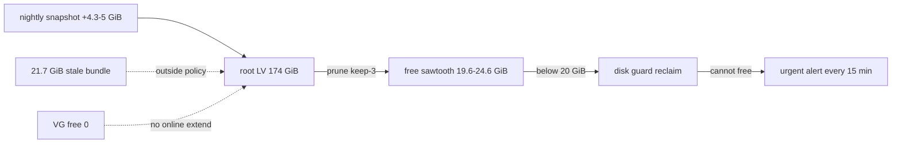

# 15_performance_scalability_cost — Prompt 15 - Performance, Scalability, and Cost Audit

- Run: `falcon-20261011-0416-full-f5cb7c9`
- Target: `falcon` @ `f5cb7c9` (branch `main`)
- Domain: `15_performance_scalability_cost.md` (area PERF, prompt)

## Verification Performed

# Performance, Scalability, and Cost Audit

## Audit Metadata

- Audit name: `repo-deep-dive`
- Run: `falcon-20261011-0416-full-f5cb7c9`
- Repository: `falcon` (single-host monitoring lab, KVM guest `falcon`; this host is the live deployment target)
- Branch: `main`
- Commit SHA: `f5cb7c96cacefb2e8b1dedc1f15e633d9072264b`
- Generated at: `2026-10-11T04:45:00Z`
- Auditor: subagent (area PERF), read-only repo inspection + read-only live host checks (df/du/vgs/docker/journalctl/curl/Prometheus/Grafana APIs)
- Area code: PERF
- Output path (repo convention): `docs/audits/repo-deep-dive/falcon-20261011-0416-full-f5cb7c9/15_performance_scalability_cost.md`
- Scope limitations:
  - No frontend application exists in this repository (verified at this commit): bundle size, SSR/client hot spots, images/client caching, pagination and N+1 categories are **not applicable**. Grafana / OpenSearch Dashboards / ntopng are third-party renderers provisioned from JSON.
  - Measurements were taken 2026-10-11 04:19-04:45Z; the audit harness itself runs on the host (root LV), so `/home` and `/tmp` scratch figures include harness noise (called out where relevant).
  - The live deployment tree is now clean at the audited commit (`falcon_runtime_source_info{commit="f5cb7c9",dirty="0"}`), so repo and live evidence are the same revision (improvement vs the prior full run).
  - Cost unit prices require provider invoices (owner-owned); only measured quantities and the billing basis are auditable here.

## Scope

Reviewed: root/data LV capacity and consumers; disk guard and alert thresholds; OpenSearch index growth, watermarks and cluster state; Vector aggregator/edge throughput, buffers and drop counters; Prometheus scrape/retention; container resources; notification/relay volume; rate limiting; CI caching/runtime; storage/log growth; cost register.

Not reviewed: provider invoices and unit costs (owner-side); third-party renderer performance; edge sensor hardware throughput (separate repo); external network paths.

## Evidence Reviewed

| Evidence | Type | Why relevant | Notes |
|---|---|---|---|
| `df -h`, `findmnt`, `vgs`, `lvs`, `tune2fs` | Live command | Capacity envelope of root/data LVs, VG free extents | root 171G/144G/20G 88%; data 221G/115G/96G 55%; VG free 0 |
| `du -x -d1 /var /opt /home /srv/falcon`, `find /var/tmp -size +100M` | Live command | Attribution of the root and data LV consumers | snapshots 68.3 GiB; wz-migration 21.7 GiB; docker 23 GiB; /opt/wazuh-backups 6.5 GiB |
| `journalctl -u falcon-disk-guard`, `journalctl -u falcon-alert-relay` | Live command | Guard reclaim attempts and alert delivery | 48 failed reclaims since 2026-10-10T10:00Z; urgent ntfy publish each run |
| Prometheus API (`node_filesystem_avail_bytes`, `node_memory_*`, `predict_linear`, `falcon_*`) | Live command | 7-day trends, projections, exporter metrics | root sawtooth 19.6-24.6 GiB; MemAvailable min 1.48 GiB |
| Grafana provisioning API (86 rules) | Live command | Alert coverage and rule state for disk/memory/swap | 1 firing: 'Disk space low' (>85%) since 03:24:10Z |
| `docker stats` / `docker inspect` | Live command | Container resource use and cgroup limits | aggregator 1G/82.4 MiB, RestartCount 0; Wazuh/IRIS Memory=0 |
| `curl 127.0.0.1:9598/metrics` (aggregator) | Live command | Vector component counters (received/sent/discarded/errors) | 1,661,121 edge_ingest received vs 1,661,088 sink sent; discards 0 |
| `curl /_snapshot/falcon-backup/_all`, `_cat/indices`, `_cluster/health/settings`, `_cat/nodes` | Live command | Snapshot retention, index growth, watermarks, heap | 3 SUCCESS snapshots; 14 indices / 117.1M docs / 57.7 GB; watermarks default |
| `/srv/falcon/textfile/*.prom` | Live artifact | Exported metrics (host, guard, spool, pipeline, feed) | disk guard root free 19.73 GiB; spool purged 2.146 GB |
| `compose/central/docker-compose.yml`, `config/vector/*.yaml`, `bootstrap/85-backup-job.sh`, `bootstrap/90-alerting.sh`, `automation/validation/disk_guard.sh`, `automation/validation/export_monitor_metrics.sh`, `automation/validation/edge_spool_metrics.sh` | Source | Resource limits, buffers, retention, alert thresholds, query patterns | See findings |
| `docs/phase5/PERFORMANCE_ENVELOPE.md`, `docs/architecture/STORAGE_CAPACITY_MODEL.md`, `docs/runbooks/CAPACITY_AND_TELEMETRY.md` | Doc | Documented envelope, capacity model, cost register | Envelope/model stale; cost register owner-blank |
| `.github/workflows/validate.yml` | Source | CI runtime and caching | No cache; pinned tool downloads per run |
| Prior run `falcon-20261009-2117-full-08e20d1/_domains/15_performance_scalability_cost.json`; `falcon-20261011-0400-verify-main-584e1a3/follow_up_register.md` | Prior reports | Reconciliation baseline | PERF-P1-001/P2-003 verified-fixed; P1-002 regressed (see below) |

## Verification Performed

| Evidence | Type | Why relevant | Notes |
|---|---|---|---|
| Prior PERF-P1-001 (aggregator OOM) | Live re-check | Was the OOM loop fixed? | `docker inspect`: Memory=1073741824, RestartCount=0, healthy since 02:28Z, 82.4 MiB; no kernel OOM lines this boot; discards 0 -> **verified-fixed** |
| Prior PERF-P2-003 (sink-only pipeline metrics) | Live re-check | Are source-side drops exported/alerted? | `falcon_pipeline_all_discarded_events_total` + `falcon_pipeline_aggregator_drop_logs_15m` exported (0); rules live (86 total) -> **verified-fixed** |
| Prior PERF-P1-002 (root-resident snapshot repo, no reclaim) | Live re-check | Is the fix holding? | Guard watches root but root is below the 20 GiB threshold and reclaim cannot free it -> **regressed** (re-filed as PERF-P1-002) |
| Prior PERF-P2-001 / P2-002 / P3-001 / P3-002 | Live re-check | Persistence | All four still observable (see findings); register shows them open |
| Root free 7-day series | Live query | Quantify the sawtooth and net growth | 53 GiB pre-relocation -> 19.6-24.6 GiB sawtooth; flat net growth, zero headroom |
| Guard reclaim outcome | Live query | Can the guard actually reclaim? | 48 failures since 10:00Z Oct 10; reclaims_total=50 but no root bytes freed in-loop |
| Live tree binding | Live metric | Are repo and host the same revision? | `falcon_runtime_source_info{commit="f5cb7c9",dirty="0"}`, commit age 1595 s |
| Snapshot retention | Live API | Does keep-3 bound the repo? | 3 SUCCESS snapshots; nightly prune observed (Oct 11 run pruned Oct 7 per register) |
| Rate limiting | Source + live | Edge flood protection exists? | Traefik `public-rate-limit` average 50 / burst 100 (config/traefik/dynamic.yml:36-42); keyed on X-Forwarded-For (SEC domain) |

## Executive Summary

The pipeline itself is healthy at this commit: the aggregator OOM loop is gone (1 GiB cap, RestartCount 0, no kernel OOM), source-side drop visibility is exported and alerted, the sink counters are balanced (1,661,121 received / 1,661,088 sent, 0 discards), OpenSearch heap sits at 30% of 2 GiB, and the data LV has 96 GiB free (55%) after the C7 retirement. The serious problem has moved to the **root LV**: the OpenSearch snapshot repository (68.3 GiB) lives there, root free has been at/below the guard's 20 GiB threshold since 2026-10-10T10:00Z, and the guard cannot reclaim anything — 48 failed reclaims in ~19 h, each publishing an urgent alert. A 21.7 GiB stale pre-migration bundle and 6.5 GiB of Wazuh migration backups sit on the same volume outside the reclaim policy, and the VG has no free extents, so the fix is a placement/cleanup decision, not an online extension. Secondary risks: persistent memory/swap pressure with uncapped Wazuh/IRIS stacks (no kernel OOM this boot), data-LV thresholds that no longer line up with the restored OpenSearch watermarks, and stale envelope/budget documentation. Recommended next actions: (1) remove or relocate the stale migration bundle (restores ~21.7 GiB, ends the alert loop); (2) decide the long-term placement of the snapshot repo (data LV has 96 GiB free) or expand root; (3) add an alert on the guard's own root threshold/reclaim failure and make the projection robust to sawtooth; (4) refresh the envelope/budget docs with this run's measurements.

## Inventory

| Item | Path / symbol | Purpose | Current state | Risk | Notes |
|---|---|---|---|---|---|
| Root LV | `/dev/mapper/ubuntu--vg-ubuntu--lv` (174 GiB) | OS, Docker, snapshot repo, backups | 84% used (df formula 88%), 19.6-20.1 GiB free | **High** | Below guard threshold since Oct 10 10:00Z |
| Data LV | `/dev/mapper/ubuntu--vg-falcon--data` (224 GiB) | OpenSearch data, Prometheus, probe, docker volumes | 55% used, 96 GiB free | Low | Stable after C7 retirement |
| Snapshot repo | `/var/lib/falcon-snapshots/opensearch` (68.3 GiB) | OpenSearch snapshots (keep 3) | 3 SUCCESS snapshots, nightly +~4.3-5 GiB | High (root) | Relocated here 2026-10-09 |
| Migration bundle | `/var/tmp/wz-migration/wazuh-stack.tar` (21.7 GiB) | Pre-migration rollback copy (Sep 27) | Stale, no expiry | Medium | Outside guard policy |
| Wazuh backups | `/opt/wazuh-backups` (6.5 GiB) | Migration-era fs snapshot | Stale | Low | Outside guard policy |
| Docker store | `/var/lib/docker` (23 GiB) | Images/containers (24 images) | `docker system df`: images 23.11 GB, 99% shared | Medium | No prune policy exercised |
| Disk guard | `automation/validation/disk_guard.sh` + timer | Reclaim + alert below thresholds | Failing every 15 min on root | High | Cannot free root |
| Aggregator | `falcon-central-vector-aggregator-1` | Ingest validation/route/sink | Healthy, 1 GiB cap, 82.4 MiB | Low | OOM loop fixed |
| OpenSearch | `falcon-central-opensearch-1` | Storage/search | 3.42/4 GiB, heap 30%, cluster yellow (45 unassigned) | Low-Med | Watermarks default |
| Prometheus | `falcon-central-prometheus-1` | Metrics | 1 GiB cap, 104 MiB, 30d retention, TSDB 649 MiB | Low | 15 s scrape |
| Edge buffer | `config/vector/edge.yaml:253-256` | Survive aggregator outage | 2 GiB disk, `when_full: block` | Low | Spool boundary counter noisy |
| Notification path | `falcon-alert-relay` + ntfy | Operator paging | 292 publishes / 48 h | Medium | Guard adds 4/h while failing |
| CI | `.github/workflows/validate.yml` | Static validation | Self-hosted runner; no caching | Low | Downloads tools per run |

## Domain Scorecard

| Category | Score | Evidence | Gap | Recommended action |
|---|---:|---|---|---|
| Bundle size indicators | 0 (N/A) | No frontend code at f5cb7c9 | N/A | None |
| SSR/client hot spots | 0 (N/A) | No frontend code | N/A | None |
| Heavy dependencies | 2 | 24 images / 23 GB on root; third-party stacks uncapped | No prune/limit policy for Wazuh/IRIS | Cap or schedule stack memory; prune unused images |
| Images/caching | 0 (N/A) | No first-party assets; dashboards are JSON | N/A | None |
| Pagination | 0 (N/A) | No list UI; OSD is third-party | N/A | None |
| N+1 risks | 0 (N/A) | No ORM/app queries | N/A | None |
| Indexes/query patterns | 3 | Whole-index per-minute aggregations; 14 indices/117M docs | No windowing/budget for the exporter | Bound freshness aggregation; export exporter runtime |
| Worker throughput | 3 | Aggregator ~250 events/s, balanced counters | Single instance, no explicit concurrency tuning | Document throughput budget; load-test catch-up |
| Queue concurrency | 2 | Edge disk buffer 2 GiB block; sink defaults | No end-to-end ack; sink DLQ gap (WH domain) | Bounded buffers + ack/DLQ design |
| Realtime scaling | 0 (N/A) | No realtime app; ntfy third-party | N/A | None |
| Webhook volume | 2 | 292 relay publishes/48 h; guard 4/h failing | Alert noise; no rate/budget metric | Silence/reduce guard alert until reclaim works |
| Rate limiting | 3 | Traefik public-rate-limit 50/100 per XFF | XFF-keyed (SEC domain) | Keep; per-account limits in SEC backlog |
| CDN/proxy | 3 | Cloudflare + Traefik in front | Third-party | None |
| Container resources | 3 | Central compose limits set; aggregator fixed | Wazuh/IRIS Memory=0 | Decide the memory contract |
| Build/test times | 3 | `ci/validate.py` 3.9 s; validate job timeout 20 min | Tool downloads per run | Add caching |
| CI caching | 1 | No cache in workflows | Unimplemented | Add actions/cache + setup-python cache |
| Storage/log growth | 2 | Root LV constrained; journal 1.3 GB, no SystemMaxUse | No root budget; sawtooth at threshold | Rebalance placement; set journal cap |
| Third-party API cost | 2 | Cost register structure only; owner blanks | No unit costs/budgets | Owner fills invoices |

## Detailed Review

### Item: Root LV and the snapshot repository

- Evidence: `df -h /` 171G/144G/20G 88%; `du -sh /var/lib/falcon-snapshots` 69G; guard journal and metrics; `vgs` VFree 0.
- What it does: carries the OS, Docker store, the relocated OpenSearch snapshot repository and migration-era artifacts.
- How it appears to work: the nightly job writes a new snapshot (+~4.3-5 GiB), then prunes the oldest (keep 3); root free sawtooths 19.6-24.6 GiB, i.e. straddling the 20 GiB guard threshold.
- Dependencies: OpenSearch snapshot API, disk guard timer, ntfy relay.
- Current controls: 20 GiB root threshold with snapshot/DLQ/config-archive reclaim; Grafana >85%/>90% rules; projection rule.
- Missing controls: reclaim policy does not cover the two largest stale artifacts; no alert on the guard's own threshold/reclaim failure; no root-free budget or projection robustness.
- Risks: any multi-GiB root write (image pull, restore staging, journal burst) can push root to 90-100%, failing snapshots/Docker and forcing manual intervention; alert fatigue from 4 messages/hour.
- Recommended improvement: owner decision on the 21.7 GiB bundle; move the snapshot repo back to the data LV (96 GiB free) or expand root; add the guard-state alert; refresh docs.
- Suggested tests: disk-pressure drill on root (documented in `docs/runbooks/CAPACITY_AND_TELEMETRY.md`) after each change; assert the guard ends 'ok' at >20 GiB.
- Suggested docs: CAPACITY_AND_TELEMETRY.md (root budget + placement), decision log entry for the bundle.

### Item: Aggregator / edge pipeline

- Evidence: compose memory 1G (line 154); live healthy 82.4 MiB; Vector counters; edge buffer 2 GiB block.
- What it does: validates and routes edge events to OpenSearch; buffers on the edge when central is down.
- How it appears to work: HTTP ingest with basic auth, remap/normalize, route valid/invalid, elasticsearch bulk sink, DLQ for invalid records.
- Current controls: 1 GiB cgroup cap, healthcheck, disk buffer on the edge, drop/error metrics + rules.
- Missing controls: no sink-side DLQ/replay (WH-P1-001 residual), no explicit request/batch tuning, no documented throughput budget.
- Risks: a future sustained overload above 1 GiB repeats the OOM class; sink failures still have no replay path.
- Recommended improvement: keep the 1 GiB cap under observation (alert on restarts/memory), add request.timeout/batch tuning and a sink DLQ per WH-P1-001.
- Suggested tests: catch-up replay drill with a backlog; assert counters stay balanced and memory < 80%.
- Suggested docs: pipeline throughput budget in the envelope.

### Item: Monitoring queries and exporter cost

- Evidence: export_monitor_metrics.sh:177-180; 117M docs; prior 1998 ms search.
- What it does: per-minute freshness/field/duplicate/mapping/retention queries for alerting.
- How it appears to work: un-windowed max aggregation per feed plus scoped counts.
- Current controls: metrics + freshness rules; textfile staleness rules.
- Missing controls: no windowing for the max aggregation; no exporter runtime metric/budget.
- Risks: avoidable load on the single-node cluster during catch-up, unmeasured.
- Recommended improvement: bound `latest` to a recent window with a periodic full validation; export exporter runtime.
- Suggested tests: measure `took` before/after windowing; assert exporter runtime < 5 s.
- Suggested docs: budget in CAPACITY_AND_TELEMETRY.md.

### Item: Cost model and budgets

- Evidence: CAPACITY_AND_TELEMETRY.md:64-79; PERFORMANCE_ENVELOPE.md:10-11; STORAGE_CAPACITY_MODEL.md:7-8,14-21.
- What it does: records measured quantities and billing bases per component.
- How it appears to work: table with owner-blank unit costs.
- Current controls: measured quantities, quantity sources cited.
- Missing controls: unit costs, budget thresholds, envelope refresh.
- Risks: spend and capacity decisions lack a baseline; stale docs mislead operators.
- Recommended improvement: owner fills invoices; append this run's measurements; define budgets.
- Suggested tests: doc-lint check that envelope numbers match the live snapshot on the audit host.
- Suggested docs: the three docs above.

## Scenario / Control Matrix

| ID | Scenario or control | Evidence | Current control | Gap | Severity | Recommendation |
|---|---|---|---|---|---|---|
| PERF-001 | Bundle size indicators | No frontend at f5cb7c9 | N/A | N/A | N/A | None |
| PERF-002 | SSR/client hot spots | No frontend | N/A | N/A | N/A | None |
| PERF-003 | Heavy dependencies | 24 images / 23 GB; uncapped stacks | Compose limits for central only | Wazuh/IRIS unlimited | P2 | Decide the memory contract |
| PERF-004 | Images/caching | JSON dashboards only | Provisioned JSON | N/A | N/A | None |
| PERF-005 | Pagination | No list UI | N/A | N/A | N/A | None |
| PERF-006 | N+1 risks | No app queries | N/A | N/A | N/A | None |
| PERF-007 | Indexes/query patterns | export_monitor_metrics.sh:177-180 | Scoped counts; un-windowed max | No budget | P3 | Window + runtime metric |
| PERF-008 | Worker throughput | 1.66M events since 02:28Z | Aggregator + edge buffer | No documented budget | P3 | Add budget + drill |
| PERF-009 | Queue concurrency | edge.yaml:253-256; sink defaults | 2 GiB disk buffer block | No ack/DLQ | P2 | WH-P1-001 remediation |
| PERF-010 | Realtime scaling | No realtime app | N/A | N/A | N/A | None |
| PERF-011 | Webhook volume | 292 publishes/48 h | Relay + ntfy | Guard adds 4/h failing | P2 | Reduce until reclaim works |
| PERF-012 | Rate limiting | traefik dynamic.yml:36-42 | 50/100 per XFF | XFF-keyed | P2 | SEC backlog |

## Findings

### PERF-P1-002 - Root LV below the guard threshold: reclaim loop, alert every 15 min

- Severity: P1
- Confidence: High (reproduced live)
- Area: PERF
- Evidence: guard journal 2026-10-10T10:00Z onward; `falcon_disk_guard_root_free_bytes` 19.73 GiB; relay publishes; `vgs` VFree 0; 3 snapshots / 69 GB repo.
- What is happening: root free sits at/below the 20 GiB guard threshold; the guard's reclaim policy cannot free root (keep-3 snapshots already at 3, DLQ tiny, EVE on data LV); each run alerts.
- Why it matters: no headroom for any multi-GiB root write; persistent paging; the 2026-10-09 fix is not holding.
- User / business impact: operator alert fatigue; risk of a root-full event disrupting Docker/snapshots/journald.
- Security / privacy / reliability impact: reliability degradation; snapshots are the backup path (offsite remains authoritative).
- Recommended fix: remove/relocate the stale 21.7 GiB bundle (P2-006); decide snapshot-repo placement (data LV has 96 GiB free) or expand root; add guard-state alerting (P2-007).
- Suggested validation: guard run ends 'ok: above thresholds' at >20 GiB free for 24 h; no 'still below threshold' lines.
- Owner suggestion: ops owner + capacity owner.
- Effort estimate: S (bundle) / M (repo relocation or LV change).
- Dependencies: owner decision on the bundle and repo placement.
- Status: regressed (prior PERF-P1-002 marked verified-fixed on 2026-10-11).
- Endpoint / data path: snapshot PUT `/ _snapshot/falcon-backup/<snap>` -> root LV `/var/lib/falcon-snapshots/opensearch`; guard timer -> `df -k /` -> reclaim -> ntfy relay.
- Attack path: none identified.

### PERF-P2-001 - Memory/swap pressure, uncapped Wazuh/IRIS, stale envelope

- Severity: P2
- Confidence: High (live)
- Area: PERF
- Evidence: free/MemAvailable/SwapFree 7d; HostConfig.Memory=0; docs.
- What is happening: 5.6 GiB available, 3.9-4.2 GiB swap used; the consolidated security stacks are uncapped; the documented envelope/budget predate the consolidation.
- Why it matters: swap pressure correlates with storage latency and raises OOM recurrence risk.
- User / business impact: degraded ingest latency under bursts; documentation misleads capacity planning.
- Security / privacy / reliability impact: reliability.
- Recommended fix: cap or move Wazuh/IRIS per the 2026-10-09 memory contract decision; refresh envelope/budget docs with this run's numbers.
- Suggested validation: 7-day MemAvailable > 2 GiB, swap < 50%; docs updated.
- Owner suggestion: ops owner.
- Effort estimate: M.
- Dependencies: owner memory-contract decision.
- Status: still-open.
- Attack path: none identified.

### PERF-P2-002 - Data-LV thresholds vs OpenSearch watermarks

- Severity: P2
- Confidence: High (live settings + source constants)
- Area: PERF
- Evidence: 90-alerting.sh:538-540; disk_guard.sh:22; live cluster settings default watermarks.
- What is happening: warning 15 GiB (93.3%), reclaim 10 GiB (95.5%) vs low/high/flood 85/90/95%.
- Why it matters: the engine refuses writes before the guard acts; no early warning band.
- Recommended fix: express thresholds as percentages below the watermarks (e.g. warn 80 / act 85 / reclaim 90) or derive GiB from volume size; CI check.
- Suggested validation: unit test comparing guard/alert thresholds with the configured watermarks.
- Effort estimate: S.
- Status: still-open.

### PERF-P2-006 - Stale root-resident migration artifacts

- Severity: P2
- Confidence: High (files + docs + decision log)
- Area: PERF
- Evidence: tarball 23,273,175,040 bytes Sep 27; README:17-19; decision log 2026-10-01.
- What is happening: the rollback bundle and Wazuh backups stay on root with no expiry and outside the guard policy.
- Recommended fix: owner decision to delete/relocate (root -> ~75%); record the PVE re-verification outcome.
- Suggested validation: df -h / shows > 35 GiB free; guard 'ok'.
- Effort estimate: S.
- Status: open (new).

### PERF-P2-007 - Projection blind; no guard-state alert

- Severity: P2
- Confidence: High (live rule states + expression)
- Area: PERF
- Evidence: 90-alerting.sh:542-543; predict_linear = +103 GiB; rule inactive; 'Disk space low' firing.
- What is happening: the projection rule cannot see the sawtooth; the guard's own emergency threshold has no rule.
- Recommended fix: alert on `falcon_disk_guard_root_free_bytes < 20 GiB` and on guard reclaim failure (counter/log); make projection robust (e.g. min_over_time or 24 h window).
- Suggested validation: rule fires in a sanctioned drill below the threshold; unit test for the expression.
- Effort estimate: S.
- Status: open (new).

### PERF-P3-001 - Stale envelope/model; no budgets

- Severity: P3; Confidence: High; Evidence: docs above.
- Status: still-open.

### PERF-P3-002 - Whole-cluster per-minute queries

- Severity: P3; Confidence: High; Evidence: export_monitor_metrics.sh:177-180; live index stats.
- Status: still-open.

### PERF-P3-008 - CI caching absent

- Severity: P3; Confidence: High; Evidence: validate.yml; no cache step.
- Status: open (new).

### PERF-P3-009 - Edge spool purge attribution

- Severity: P3; Confidence: Medium (central-side evidence only); Evidence: spool metrics/state, mount scan, rule threshold.
- Status: open (new).

## Prior-Run Comparison

| Prior finding | Prior severity | Status now | Evidence |
|---|---|---|---|
| PERF-P1-001 aggregator OOM loop | P1 | verified-fixed | 1 GiB cap live; RestartCount 0; no kernel OOM; discards 0 |
| PERF-P1-002 root LV / snapshot repo | P1 | **regressed** (re-filed) | root below 20 GiB; 48 failed reclaims; see PERF-P1-002 |
| PERF-P2-001 host memory/swap + stale envelope | P2 | still-open | re-filed PERF-P2-001 |
| PERF-P2-002 / PERF-P2-004 data-LV thresholds | P2 | still-open | re-filed PERF-P2-002 (register carried a duplicate PERF-P2-004) |
| PERF-P2-003 / PERF-P2-005 sink-only pipeline metrics | P2 | verified-fixed | all-component discard + drop-log metrics exported; rules live (register carried a duplicate PERF-P2-005) |
| PERF-P3-001 / PERF-P3-006 stale envelope + budgets | P3 | still-open | re-filed PERF-P3-001 |
| PERF-P3-002 / PERF-P3-007 whole-cluster queries | P3 | still-open | re-filed PERF-P3-002 |
| New: PERF-P2-006, PERF-P2-007, PERF-P3-008, PERF-P3-009 | - | open | see findings |

## Risks

| Risk | Severity | Likelihood | Impact | Evidence | Mitigation |
|---|---|---|---|---|---|
| Root LV full | High | Medium | Snapshots/Docker/journald fail; manual cleanup | 19.6-20.1 GiB free, no reclaim path | Cleanup + placement + alerts |
| Alert fatigue from guard loop | Medium | High | Missed real alerts | 4 urgent publishes/h since Oct 10 10:00Z | Silence until reclaim works; fix root |
| Host memory/swap exhaustion | Medium | Medium | OOM kills, latency | 5.6 GiB avail, 3.9-4.2 GiB swap | Cap stacks; refresh budget |
| Data-LV watermark collision | Medium | Low | Write refusal before reclaim | 93.3%/95.5% vs 85/90/95% | Percentage thresholds |
| Monitoring query load | Low | Medium | Catch-up slowdowns | Un-windowed per-minute aggregation | Window + budget |

## Recommendations

### Immediate / Release Blocking
- Remove or relocate `/var/tmp/wz-migration/wazuh-stack.tar` (21.7 GiB) after the owner's PVE re-verification; record the decision.
- Add an alert on the guard's root threshold/reclaim failure so the state cannot be invisible if the guard stops publishing.

### This Week
- Decide the snapshot-repo placement (data LV has 96 GiB free) or expand root; document the root budget.
- Cap or schedule the Wazuh/IRIS stacks per the memory-contract decision.

### This Month
- Convert data-LV thresholds to percentages below the OpenSearch watermarks; add a CI consistency check.
- Window the per-minute freshness aggregation; export exporter runtime with a budget.
- Refresh `PERFORMANCE_ENVELOPE.md` / `STORAGE_CAPACITY_MODEL.md` with the 2026-10-11 measurements; fill cost-register budgets.
- Add CI caching (`actions/cache`, `setup-python cache: pip`).

### Later / Platform Evolution
- Reconsider split retention/snapshot placement as a first-class capacity decision; add a root-free budget panel.

## Quick Wins

| Quick win | Why it helps | Files likely involved | Validation |
|---|---|---|---|
| Remove/relocate the 21.7 GiB bundle | Ends the below-threshold loop instantly | `/var/tmp/wz-migration/`, decision log | `df -h /` > 35 GiB free; guard 'ok' |
| Add guard-state alert | Closes the alert-coverage gap | `bootstrap/90-alerting.sh` | Rule fires in a drill |
| Silence the guard alert until reclaim works | Cuts 4 urgent messages/h | `automation/validation/disk_guard.sh` | Relay count drops |
| Journal cap | Bounds a root consumer | `/etc/systemd/journald.conf` (host) | `journalctl --disk-usage` |
| CI cache | Faster validate runs | `.github/workflows/validate.yml` | Run time down |

## Hardening Backlog

| Backlog item | Priority | Owner suggestion | Effort | Dependency |
|---|---|---|---|---|
| Root budget + placement decision | P1 | ops/capacity | M | Owner decision |
| Wazuh/IRIS memory contract | P2 | ops | M | Owner decision |
| Threshold/watermark CI consistency | P2 | ops | S | - |
| Exporter windowing + runtime budget | P3 | observability | S | - |
| Envelope/budget refresh | P3 | docs/ops | S | This report |
| Sink DLQ/replay (WH-P1-001 residual) | P2 | pipeline | M | - |

## Suggested Tests

- Guard drill: force root below threshold (sanctioned override), assert reclaim + exactly one alert + 'ok' after cleanup.
- Threshold consistency unit test: parse `90-alerting.sh`/`disk_guard.sh` constants and compare with the cluster watermark settings.
- Exporter budget test: measure `took` of the freshness aggregation with/without windowing; assert < 1 s.
- Capacity doc-lint: fail if `PERFORMANCE_ENVELOPE.md` values differ from the live snapshot recorded by the audit host.
- CI: assert validate job uses cache on the second run (cache-hit step output).

## Suggested Documentation Updates

- `docs/phase5/PERFORMANCE_ENVELOPE.md`: append the 2026-10-11 measured envelope (6 vCPU / 15.07 GiB / 171 GiB root / 224 GiB data; ~250 events/s; snapshot 454-528 s; 3-12 GB/day).
- `docs/architecture/STORAGE_CAPACITY_MODEL.md`: replace the Phase-0 plan with the live LV layout and the snapshot-repo placement decision.
- `docs/runbooks/CAPACITY_AND_TELEMETRY.md`: root budget, guard-state alert, threshold policy vs watermarks, performance budgets.
- `automation/wazuh/migration/README.md`: record the rollback-bundle disposition and expiry.

## Open Questions

| Question | Why it matters | Evidence needed |
|---|---|---|
| Can the PVE copy at 192.168.222.148 be re-verified so the 21.7 GiB bundle can be removed? | Unblocks the fastest root reclaim | Owner/PVE access |
| Should the snapshot repo return to the data LV (96 GiB free) or should root be expanded (VG has no free extents)? | Fixes placement permanently | Owner capacity decision |
| What is the intended consumer of `/home/user/falcon-edge-secrets/ingest`? | Determines whether the purge counter is real loss | Edge-side confirmation |
| What memory contract applies to the consolidated Wazuh/IRIS stacks? | Caps the largest uncapped consumers | Owner decision |

## Appendix

Live command excerpts (2026-10-11 04:19-04:45Z):

```
df -h /            -> 171G 144G 20G 88% /
df -h /srv/falcon  -> 221G 115G 96G 55%
free -h            -> Mem 15Gi/9.6Gi/5.6Gi; Swap 3.9Gi/8Gi
vgs                -> ubuntu-vg 397.99g VFree 0
du -sh /var/lib/falcon-snapshots -> 69G; /opt/wazuh-backups -> 6.5G
journalctl -u falcon-disk-guard    -> 44 failures Oct 10, 4 Oct 11 (first 2026-10-10T10:00:11Z)
falcon_disk_guard_root_free_bytes  -> 21189922816 (19.73 GiB)
prom predict_linear root 7d        -> +111153227080 bytes (~103 GiB)  [rule inactive]
curl :9598 metrics                 -> edge_ingest received 1661121; opensearch sent 1661088; discards 0
docker inspect aggregator          -> Memory=1073741824 Restarts=0 healthy
curl _cat/indices falcon-*         -> 14 indices, 3-12 GB/day, 2026.10.08 = 0 docs
falcon_edge_spool_purged_bytes_total -> 2146154182 (16 purges / 26 rotations)
```

Mermaid (root LV pressure):



## Findings

| ID | Severity | Title |
|---|---|---|
| PERF-P1-002 | P1 | Root LV sits below the guard's 20 GiB threshold: 48 failed reclaims in ~19 h, alerting every 15 min, and no effective reclaim path for the root-resident snapshot repo |
| PERF-P2-001 | P2 | Persistent host memory/swap pressure with uncapped Wazuh/IRIS stacks; measured capacity envelope and memory budget remain stale |
| PERF-P2-002 | P2 | Data-LV warning/reclaim thresholds remain GiB constants that sit above OpenSearch's default watermarks on a 224 GiB volume |
| PERF-P2-006 | P2 | 21.7 GiB stale migration bundle (plus 6.5 GiB Wazuh backup dir) sits on the root LV outside the guard's reclaim policy with no expiry |
| PERF-P2-007 | P2 | Root-disk projection rule is blind to the current below-threshold state; no alert on the guard's own root threshold or reclaim failure |
| PERF-P3-001 | P3 | Measured performance envelope and capacity model remain stale; the cost register still has no unit costs and no performance budgets exist |
| PERF-P3-002 | P3 | Per-minute whole-cluster monitoring queries still run against the single-node OpenSearch cluster with no exporter runtime budget |
| PERF-P3-008 | P3 | CI has no dependency or tool caching: every validate run re-downloads pinned tools and reinstalls hash-pinned Python deps |
| PERF-P3-009 | P3 | Edge ingest-spool purge counter advances ~268 MB/day, its data-loss meaning is unverified, and no live consumer of the spool is configured |
