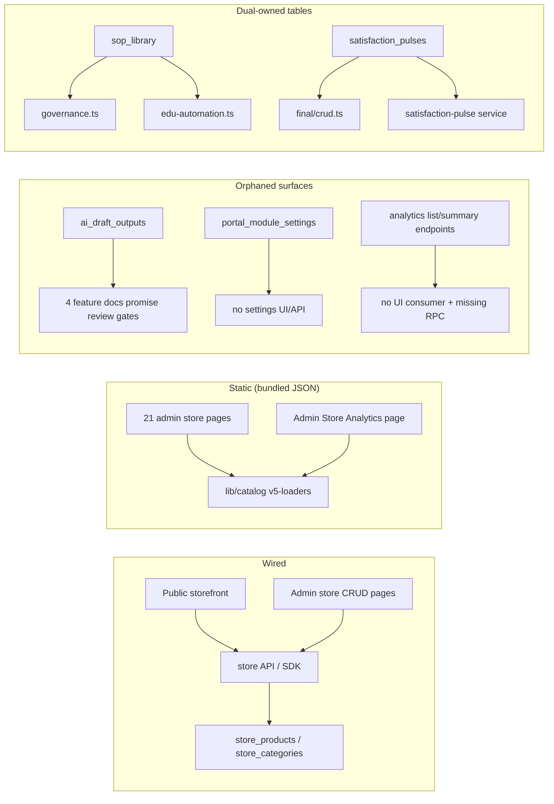

# 03_feature_implementation_map — Prompt 03 - Feature Implementation and Gap Map

- Run: `mainecybertech-20261011-0426-full-main-8d299b8`
- Target: `mainecybertech` @ `8d299b8` (branch `main`)
- Domain: `03_feature_implementation_map.md` (area FEAT, prompt)

## Verification Performed

# Feature Implementation and Gap Map

## Audit Metadata

- Audit name: repo-deep-dive
- Run: `mainecybertech-20261011-0426-full-main-8d299b8`
- Repository: `mainecybertech` (MaineCyberTech portal monorepo)
- Branch: `main`
- Commit SHA: `8d299b8d`
- Generated at: 2026-10-11
- Auditor: domain subagent `03_feature_implementation_map` (area `FEAT`)
- Output path: `docs/audits/repo-deep-dive/mainecybertech-20261011-0426-full-main-8d299b8/03_feature_implementation_map.md`
- Scope limitations: read-only audit; no `pnpm install`/build/test (host is a 1 vCPU droplet and Node is not installed in the audit environment). Static reading, grep, git, and file inventories only. Live runtime behaviour is inferred from code/config, not exercised.

## Scope

Reviewed (fresh at `8d299b8d`):

- Pages/routes: all 319 `page.tsx` files under `apps/web/app` (203 admin / 86 portal / 29 public / 1 forbidden), plus nav catalogs (`apps/web/lib/navigation/admin-nav.ts`, `portal-nav.ts`).
- Components: `apps/web/components/**` (admin generic CRUD components, portal, store, marketing).
- API endpoints: all 75 route files under `apps/api/src/routes` (62 top-level + 13 sub-routers), mounted in `apps/api/src/app.ts`.
- Server actions: `apps/web/lib/module-actions.ts`, `module-record-actions.ts`, and per-page `actions.ts` files.
- Workers/jobs: `apps/worker/src/tasks/**` (28 registered tasks), `schedule-config.ts`, `main.ts`.
- Database entities: 134 migrations under `supabase/migrations` (table ownership, orphans, duplicate surfaces).
- Permissions: `requirePermission`/`requireOrgAccess` usage, route-authorization guard test.
- Audit logs: `logAuditEvent` usage across route files.
- Tests: API (132 test files), web (272), worker (13), SDK (3), Playwright e2e (90 spec files).
- Docs: 61 feature docs, 61 runbooks, 75 module docs, `module-matrix-mapping.md`, dated audit docs.
- Workflow states, failure states, mobile behaviour, observability hooks: sampled per module.

Not reviewed: runtime behaviour of external integrations (Stripe/Jira/JSM/M365/Cloudflare), live database contents, deployed configuration, and anything requiring execution (see Scope limitations).

## Evidence Reviewed

| Evidence | Type | Why relevant | Notes |
|---|---|---|---|
| `apps/api/src/app.ts:153-236` | code | Canonical mount table: 62 routers under `/api/v1` + `/health`, `/metrics` | All route files are mounted; no orphan routers found |
| `apps/web/app/**/page.tsx` (319 files) | code | Page inventory; admin 203 / portal 86 / public 29 / forbidden 1 | `find apps/web/app -name page.tsx` |
| `apps/web/lib/navigation/*.ts` (164 hrefs) | code | Nav ↔ page reconciliation | Every nav href resolves to an existing page |
| `packages/sdk/src/index.ts` + 62 SDK modules | code | SDK ↔ API ↔ UI mapping | Every API module has an SDK wrapper; only `analytics` has no UI consumer |
| `apps/web/lib/catalog/data/*.json` (2.6 MB, 29 files) | data | Bundled catalog behind 24 static admin store pages | Imported by `apps/web/lib/catalog/v5-loaders.ts:1-19` |
| `apps/worker/src/tasks/index.ts` + `schedule-config.ts` | code | Worker task inventory and scheduling | 28 registered tasks; 17 scheduled scans + 6 fixed intervals; jira/jsm/m365 syncs intentionally unscheduled |
| `supabase/migrations/*.sql` (134 files) | schema | Table ownership/orphans | `ai_draft_outputs`, `portal_module_settings` orphaned; 3 tables dual-owned |
| `docs/module-matrix-mapping.md` (60 modules) | docs | Feature → API → SDK → UI mapping claims | All referenced feature/runbook files exist; counts verified (62/75/49) |
| `docs/MODULE_AUDIT.md`, `docs/MODULE_SPECS_GAP_AUDIT_2026-08-05.md`, `docs/MODULE_BUILD_PROMPT_VERIFICATION_2026-08-05.md` | docs | Claimed status of every module at 2026-08-05 | Several claims stale/fixed; bug G still open |
| `docs/modules/*.md` (75 files) | docs | Per-module API/data-model claims | `scoreboard-gamification.md` documents a nonexistent API |
| `apps/web/e2e/**` (~90 specs), `a11y.spec.ts` (25 base pages) | tests | E2E coverage breadth | Broad coverage; static store pages not e2e-covered |
| Previous run `mainecybertech-20261004-full-main-9c0b88c` FEAT rows | records | Verification duty | 3 rows: FEAT-P2-001, FEAT-P2-002, FEAT-P3-001 |

## Verification Performed

| Evidence | Type | Why relevant | Notes |
|---|---|---|---|
| `find apps/web/app -name "page.tsx" \| wc -l` | command | Page count | 319 (matches AGENTS.md-style counts; check-docs-counts not runnable) |
| `ls apps/api/src/routes/*.ts \| wc -l` / `find … -name "*.ts" \| wc -l` | command | Route count vs matrix claim | 62 top-level / 75 total, matching `docs/module-matrix-mapping.md:5-6` |
| `grep -n "app.use(" apps/api/src/app.ts` | command | Mount completeness | 62 router mounts; no route file left unmounted |
| nav href ↔ page reconciliation loop | command | Orphaned pages / dead nav | 0 nav hrefs without a page; sub-pages linked from section pages |
| `grep -rn 'title="Coming soon"' apps/web/app/(admin)/admin/store` | command | UI-without-backend | 11 pages |
| store page classification (API vs `lib/catalog`) | command | UI/backend mismatch | 9 API-backed vs 24 catalog-based pages (33 total) |
| `grep -rn "analytics/track" apps packages scripts` | command | Analytics call sites | Only the unused helper, SDK wrapper and OpenAPI spec — no production caller |
| `grep -rn "get_analytics_summary" supabase/migrations` | command | Broken RPC | 0 matches; endpoint `apps/api/src/routes/analytics.ts:84` calls an undefined function |
| `grep -rn "ai_draft_outputs" apps/ packages/ scripts/` | command | Orphaned table | Only generated `database.types.ts`; no read/write path |
| `grep -rn "portal_module_settings\|module_settings" apps/ packages/ scripts/` | command | Orphaned table | 0 application references |
| `grep -rn "scoreboard_scores\|api/v1/scoreboard" supabase apps packages` | command | Doc vs reality | 0 matches; doc `docs/modules/scoreboard-gamification.md:24-35` is aspirational |
| `grep -rn "updateProjectBasics" .` | command | Dead code | Definition `actions.ts:297` + jest mock only |
| `grep -n seed_demo supabase/migrations/*.sql` | command | Demo seeding gate | All 7 demo migrations gate on `app.seed_demo` |
| `git log --oneline 9c0b88c..8d299b8d \| wc -l` | command | Delta since previous run | 113 commits; route/web deltas are remediations, no new feature surfaces |
| `git diff --stat 9c0b88c..8d299b8d -- apps/api/src/routes apps/web` | command | Delta detail | API routes +242/−52; web +44/−2 (env guard only) |
| `python3 -c "json.load(...)"` on the findings JSON | command | Output validity | Parsed; 12 findings, all with title/severity/status/evidence |
| `node scripts/check-docs-counts.mjs` | command | Docs-count guard | **Not run** — `node` is not installed in the audit environment; no installs permitted. Counts were spot-verified manually instead. |
| CI test suites (`pnpm test`, `openapi-audit`, `check-rls-predicate`) | command | Reproduce gates | **Not run** — same environment limitation; gates reviewed statically in `.github/actions/unit-tests/action.yml:27,33` |

### Previous-run FEAT rows re-verified at `8d299b8d`

- **FEAT-P2-001 (API keys cannot authenticate; the feature is dead)** — `verified-fixed`.
  `apps/api/src/middleware/api-key.ts:1-101` resolves `mct_` keys (indexed prefix lookup, SHA-256 + `crypto.timingSafeEqual`, inactive/expired rejected at lines 81-82); `apps/api/src/middleware/auth.ts:8,68-85` wires it into `requireAuth` and pins the key's org; `apps/api/src/routes/api-keys.ts:25-29` mints/stores hash + prefix; `supabase/migrations/5302042_api_keys.sql` defines the table; `apps/api/src/__tests__/api-key-auth.test.ts:63-138` covers valid/revoked/expired/mismatch/unknown/no-cookie-fallback.
- **FEAT-P2-002 (Demo/test data can be seeded into a fresh production database)** — `verified-fixed`.
  `5302119:25`, `5302120:27`, `5302121:26`, `5302123:31`, `5302126:30`, `5302128:297`, `5302406:57` all return early unless `app.seed_demo='true'` (default unset); the file comments state local resets use `supabase/seeds/` instead.
- **FEAT-P3-001 (OpenAPI/Swagger surface is public and its UI is blocked by the API CSP)** — `verified-fixed`.
  `apps/api/src/routes/docs.ts:25-35` 404s both `/openapi.json` and `/docs` in production; `:47-58` injects the per-response CSP nonce (`security-headers.ts:18-36`); Swagger UI is version-pinned with SRI (`docs.ts:12-16`); `.github/actions/unit-tests/action.yml:27,33` runs `validate-openapi.ts` + `scripts/openapi-audit.js` (fails on missing routes); `docs/openapi.yaml` has 418 paths, matching `docs/INDEX.md:210`.

## Executive Summary

The monorepo is feature-dense and internally mapped: 319 web pages, 75 API route files all mounted, 62 SDK modules with near-complete UI wiring, 28 worker tasks with explicit scheduling, and a 60-module matrix (`docs/module-matrix-mapping.md`) whose file references all resolve. Navigation is coherent — every nav href resolves to a real page and old routes were converted to redirects rather than left 404.

The gaps are concentrated in four areas:

1. **Documented-but-unwired features.** Store analytics is dead end-to-end (no client call sites, no admin consumer, undefined summary RPC). `ai_draft_outputs` review gates are promised by four feature docs but the table has no write path. `portal_module_settings` is RLS-maintained and seeded but never read or written.
2. **Duplicate ownership.** `sop_library`, `insurance_evidence` and `satisfaction_pulses` are each served by two routers with divergent validators (2026-08-05 bug G, still reproducible).
3. **Static admin surfaces presented as live features.** 24 of 33 admin Store pages render or validate bundled JSON; 11 of them show a disabled "Coming soon" primary action while appearing as ordinary nav entries.
4. **Documentation accuracy.** A duplicate scorecard doc documents a nonexistent `/api/v1/scoreboard` API and four nonexistent tables; the 2026-08-05 module audit still lists fixed bugs (A, B, C, E, F) and dead navigation as current.

Workflow-state rigour is thin: only proposals have a real guard (`publish` requires `approved`); ticket status is a free-form enum with no transition validation. Failure states are handled at group level (admin/portal/public error boundaries, not-found pages, retries); loading skeletons exist for only 26 routes.

Recommended next actions: (1) decide implement-or-remove for analytics, AI drafts and portal module settings; (2) retire one of each duplicate table surface with a guard; (3) mark or hide the static store pages and fix the contradictory scorecard docs; (4) add a ticket transition map.

## Inventory

| Item | Path / symbol | Purpose | Current state | Risk | Notes |
|---|---|---|---|---|---|
| Admin pages | `apps/web/app/(admin)/admin/**` | MSP operator console | Implemented (203 pages) | Medium | 11 static store pages with dead actions; 3 legacy routes redirect |
| Portal pages | `apps/web/app/(portal)/portal/**` | Client portal | Implemented (86 pages) | Low | Reply form now wired (previously dead action) |
| Public pages | `apps/web/app/(public)/**` | Marketing/storefront/auth | Implemented (29 pages) | Low | Store is DB-first with JSON fallback |
| API routers | `apps/api/src/routes/**` (75 files) | REST surface | Implemented; all mounted | Medium | Duplicate table ownership; analytics summary RPC missing |
| SDK | `packages/sdk/src/**` (62 modules) | Typed API client | Implemented | Low | `analytics.list/summary` unused |
| Server actions | `apps/web/lib/module-actions.ts`, `module-record-actions.ts`, page actions | Mutations from forms | Implemented | Low | `updateProjectBasics` dead |
| Worker tasks | `apps/worker/src/tasks/**` | Scans, syncs, retention | Implemented (28 tasks) | Low | 17 scheduled scans + 6 intervals; 3 integration syncs on-demand by design |
| DB tables | `supabase/migrations/**` (134) | Schema | Implemented | Medium | `ai_draft_outputs`, `portal_module_settings` orphaned; 3 dual-owned tables |
| Permissions | `middleware/permissions.ts`, `lib/roles.ts` | RBAC | Implemented | Low | Route-authorization guard test present |
| Audit logs | `services/audit.ts`, route calls | Audit trail | Implemented | Low | Export audit added in the delta |
| E2E | `apps/web/e2e/**` (~90 specs) | Browser coverage | Implemented | Low | Static store pages uncovered |
| Docs | `docs/features` (61), `docs/runbooks` (61), `docs/modules` (75) | Feature/module docs | Mixed | Medium | Contradictory scorecard docs; stale dated audits |

## Domain Scorecard

| Category | Score | Evidence | Gap | Recommended action |
|---|---:|---|---|---|
| Pages/routes | 4 | 319 pages; nav reconciliation clean; legacy routes redirect (`vendors/page.tsx:1-5`) | 11 store pages are static shells in nav | Mark/hide static store pages; document store page status |
| Components | 4 | Generic `ModuleDetailPage`/`RecordDetail` + `module-config` give list/detail/edit/delete across final/edu-automation modules | Store static pages use bespoke read-only shells | Reuse the generic CRUD pattern where features get endpoints |
| API endpoints | 4 | 75 route files all mounted; OpenAPI coverage gate in CI | Duplicate table surfaces; `/analytics/summary` RPC undefined | De-duplicate surfaces; add the RPC migration or drop the endpoint |
| Server actions | 3 | Module actions wired broadly; portal ticket reply now wired | `updateProjectBasics` exported but unused | Delete or wire it |
| Workers/jobs | 4 | 28 registered tasks; staggered schedule config; locks per replica | Some scans are bookkeeping-only (endpoint-security rollup; m365 requires Graph creds) | Document which scans are live vs rollup-only per module |
| Database entities | 3 | 134 migrations; generated types checked | 2 orphaned tables; 3 dual-owned tables with divergent validators | Drop or wire orphans; single owner per table + guard |
| Permissions | 4 | `requirePermission` on mutations; route-authorization guard test | Action-mismatch and other authz details tracked in ACM/SEC domains | See ACM/MT domains; keep guard test current |
| Audit logs | 4 | `logAuditEvent` on create/update/delete/export across routes | Transition events not distinct (ticket status) | Record status transitions as their own audit events |
| Tests | 4 | API/web/worker/SDK suites + ~90 e2e specs; tests assert placeholders too | Static store pages have no e2e; some routers covered indirectly via factories | Add a store-pages e2e smoke; keep indirect coverage documented |
| Docs | 3 | 61 feature + 61 runbook + 75 module docs; module matrix accurate on file paths | Contradictory scorecard docs; aspirational AI-draft claims; stale dated audits | Doc-link/route-existence guard; reconcile the scorecard docs; add stale banners |
| Workflow states | 2 | Proposals publish guard (`proposals.ts:784`); approvals approve/reject services | Ticket status any→any; most modules accept any enum value | Per-module transition maps + 409 on invalid transition |
| Failure states | 4 | Group-level `error.tsx`, `not-found.tsx`, `global-error.tsx`; `withRetry`; API error contract | Loading skeletons for only 26 routes; static pages cannot fail (no data fetch) | Add skeletons where server fetches dominate; document error semantics |

## Detailed Review

### Item: Admin Store pages (static catalog)

- Evidence: `apps/web/app/(admin)/admin/store/**` (33 pages), `apps/web/lib/catalog/v5-loaders.ts:1-19`, `apps/web/lib/navigation/admin-nav.ts:334-374`.
- What it does: 9 pages are DB-backed via SDK (products, categories, promotions, campaigns, quotes, quote-requests, leads, operations, visuals); 24 render or validate the bundled catalog (audit included); 11 show a disabled "Coming soon" action.
- How it appears to work: nav presents all pages as first-class features; the disabled buttons are the only signal.
- Dependencies: bundled JSON requires a deploy to change; the DB-backed pages depend on `store_*` tables.
- Current controls: `requireAdminAccess()` on each page; store module entitlement gates nav.
- Missing controls: no API/DB for the static pages; no UI status marker beyond a hover title.
- Risks: admin confusion; content changes require deploys; feature-completeness claims overstated.
- Recommended improvement: badge/flag static pages, document per-page status in `docs/modules/store.md`, implement minimal CRUD for high-value pages.
- Suggested tests: e2e smoke per store admin page asserting the disabled state or working action; unit test that nav badges match page capability.
- Suggested docs: `docs/modules/store.md` inventory of DB-backed vs bundled pages.

### Item: Analytics (storefront → admin)

- Evidence: `apps/web/lib/catalog/analytics.ts:15-30`; `apps/api/src/routes/analytics.ts:27-90`; `packages/sdk/src/analytics.ts:35-47`; `apps/web/app/(admin)/admin/store/analytics/page.tsx:6-33`.
- What it does: API records events; SDK wraps track/list/summary; admin page shows a static registry.
- How it appears to work: docs claim aggregation and admin dashboards (`docs/modules/analytics.md:9-11`).
- Dependencies: `store_analytics_events` table; `get_analytics_summary` RPC (missing).
- Current controls: track is public; list/summary admin-gated.
- Missing controls: no call sites, no consumer, no RPC.
- Risks: false confidence in analytics; broken endpoint.
- Recommended improvement: wire or remove; the RPC gap is separately tracked (SEC-P2-006).
- Suggested tests: an integration test asserting a storefront view emits a tracked event; a summary test that fails if the RPC is absent.
- Suggested docs: correct `docs/modules/analytics.md`.

### Item: Duplicate table surfaces

- Evidence: `governance.ts:542` + `edu-automation.ts:178`; `insurance-binder.ts:60` + `edu-automation.ts:179`; `final/crud.ts:172` + `services/satisfaction-pulse-widget.ts:123-286`; validators `final.ts:51` vs `satisfaction-pulse-widget.ts:13`.
- What it does: same rows writable via two namespaces with different schemas/lifecycle.
- How it appears to work: each module reads/writes its own slice; both "work".
- Dependencies: table columns must satisfy both validators.
- Current controls: permission gates on both paths.
- Missing controls: no single owner; no drift guard.
- Risks: divergent validation, bypassed lifecycle (e.g. generic CRUD vs scheduled-pulse logic).
- Recommended improvement: one owner per table + guard script.
- Suggested tests: schema-parity test; a guard that fails when two route files reference the same table.
- Suggested docs: note the canonical surface per table in `docs/module-matrix-mapping.md`.

### Item: Worker scan reality vs module claims

- Evidence: `apps/worker/src/tasks/module-tasks.ts:162-230` (m365 does real Graph scan when configured), `:1127-1180` (endpoint-security computes coverage from stored rows), `schedule-config.ts:30-73`.
- What it does: 17 scheduled scans + 6 fixed intervals; integration syncs on demand.
- Risks: module docs that promise live scanning (e.g. endpoint security) may overstate; state this per module.
- Recommended improvement: document "live scan vs rollup vs credential-gated" per worker task.
- Suggested tests: worker tests asserting credential-gated paths return `ok:true` with the stamp and real paths compute scores.

### Item: Workflow states

- Evidence: `validators/ticket.ts:18-21`; `routes/tickets.ts:229-235`; `AdminTicketCenterClient.tsx:14-21`; contrast `routes/proposals.ts:784` (publish requires `approved`).
- What it does: proposals guard one transition; tickets/incidents accept any enum.
- Risks: unreliable status history; SLA semantics.
- Recommended improvement: transition maps + 409s + transition audit events.
- Suggested tests: API tests rejecting invalid transitions; UI tests showing only allowed next states.

## Scenario / Control Matrix

| ID | Scenario or control | Evidence | Current control | Gap | Severity | Recommendation |
|---|---|---|---|---|---|---|
| FEAT-001 | Pages/routes | 319 pages; nav ↔ page reconciliation | Auth gates per group; redirects for legacy routes | 11 static store pages in nav | P3 | Badge/hide; document status |
| FEAT-002 | Components | `ModuleDetailPage`, `RecordDetail`, `module-config` | Generic list/detail/edit/delete | Store pages bypass the pattern | P3 | Reuse generic CRUD when endpoints exist |
| FEAT-003 | API endpoints | `app.ts:153-236`; openapi gate | All routers mounted; coverage gate | Duplicate surfaces; undefined RPC | P2 | De-duplicate; add RPC or drop endpoint |
| FEAT-004 | Server actions | `module-actions.ts`; page actions | Wired broadly | `updateProjectBasics` dead | P3 | Delete or wire |
| FEAT-005 | Workers/jobs | `tasks/index.ts`; `schedule-config.ts` | 28 tasks; staggered schedule; locks | Scan liveness varies per module | P3 | Document live vs rollup per task |
| FEAT-006 | Database entities | 134 migrations | RLS + generated types | 2 orphans; 3 dual-owned tables | P2 | Drop/wire orphans; single owner + guard |
| FEAT-007 | Permissions | `requirePermission` usage; guard test | Mutation gates + guard test | See ACM/MT domains | — | Keep guard test current |
| FEAT-008 | Audit logs | `logAuditEvent` usage | Create/update/delete/export audited | Transitions not distinct | P3 | Emit transition events |
| FEAT-009 | Tests | API/web/worker/SDK/e2e suites | Broad; placeholder assertions | Static store pages not e2e | P3 | Add store e2e smoke |
| FEAT-010 | Docs | feature/runbook/module docs + matrix | Matrix file paths accurate | Contradictory scorecard docs; stale audits | P2 | Doc guards + reconciliation |
| FEAT-011 | Workflow states | `validators/ticket.ts:18`; `proposals.ts:784` | Proposals publish guard only | No ticket transitions | P3 | Transition map + 409 |
| FEAT-012 | Failure states | group `error.tsx`; `withRetry`; API errors | Boundaries + retries | Sparse skeletons | P3 | Add skeletons on fetch-heavy routes |

## Findings

> Finding IDs (`FEAT-<severity>-NNN`) are assigned by the aggregator; structured rows are in `03_feature_implementation_map.json`. The shared finding format is used below.

### Finding: API keys cannot authenticate; the feature is dead (P2, verified-fixed)

- Severity: P2
- Confidence: High
- Area: FEAT
- Evidence:
  - `apps/api/src/middleware/api-key.ts:1-101` — resolves `mct_<64hex>` by indexed key_prefix, SHA-256 + `crypto.timingSafeEqual`, rejects inactive (line 81) and expired (line 82) keys
  - `apps/api/src/middleware/auth.ts:8,68-85` — `requireAuth` detects `isApiKeyToken` and pins `req.orgId` + `req.query.organization_id` to the key's org
  - `apps/api/src/routes/api-keys.ts:25-29` — mints `mct_${raw}`, stores only `key_hash` + `key_prefix`; `supabase/migrations/5302042_api_keys.sql`
  - Symbol / route: `authenticateApiKey`, `requireAuth`, `POST/GET /api/v1/api-keys`
  - `apps/api/src/__tests__/api-key-auth.test.ts:63-138` — valid/revoked/expired/mismatch/unknown/no-cookie-fallback cases
- What is happening: the previous run's finding is fixed and unchanged at `8d299b8d`; API-key auth works end-to-end.
- Why it matters: machine credentials are usable and regression-tested.
- User / business impact: integrations can authenticate without a user session.
- Security / privacy / reliability impact: timing-safe compare, revocation and expiry all enforced.
- Recommended fix: none; keep the tests when touching auth middleware.
- Suggested validation: run `api-key-auth.test.ts`.
- Owner suggestion: @owner
- Effort estimate: S
- Dependencies: none
- Status: verified-fixed
- Endpoint / data path: `Authorization: Bearer mct_*` → `requireAuth` → `api_keys` (hash lookup) → `req.authUser`/`req.apiKey`
- Attack path: none identified (this closes the prior dead-feature path)

### Finding: Demo/test data can be seeded into a fresh production database (P2, verified-fixed)

- Severity: P2
- Confidence: High
- Area: FEAT
- Evidence:
  - `supabase/migrations/5302119_demo_test_data.sql:25-27` — returns early unless `current_setting('app.seed_demo', true) = 'true'`
  - `5302120:27`, `5302121:26`, `5302123:31`, `5302126:30`, `5302128:297`, `5302406:57` — same gate on every later demo migration
  - Symbol / migration: `app.seed_demo` custom setting
- What is happening: demo seeding is opt-in and off by default at this commit.
- Why it matters: a fresh production database cannot receive demo tenants/users.
- User / business impact: no accidental demo data in production.
- Security / privacy / reliability impact: prevents fabricated tenants/users in production.
- Recommended fix: none; keep the gate on new demo migrations (no CI guard enforces it).
- Suggested validation: `grep -n seed_demo supabase/migrations/*.sql`.
- Owner suggestion: @owner
- Effort estimate: S
- Dependencies: none
- Status: verified-fixed
- Endpoint / data path: migration-time only
- Attack path: none identified

### Finding: OpenAPI/Swagger surface is public and its UI is blocked by the API CSP (P3, verified-fixed)

- Severity: P3
- Confidence: High
- Area: FEAT
- Evidence:
  - `apps/api/src/routes/docs.ts:25-35` — `docsDisabled()` 404s `/openapi.json` and `/docs` in production
  - `apps/api/src/routes/docs.ts:47-58` — inline bootstrap carries the per-response CSP nonce
  - `apps/api/src/middleware/security-headers.ts:18-36` — nonce in `script-src`; production CSP drops `unsafe-inline`
  - `apps/api/src/routes/docs.ts:12-16` — Swagger UI pinned to 5.33.1 with sha384 SRI
  - `.github/actions/unit-tests/action.yml:27,33` — `validate-openapi.ts` + `scripts/openapi-audit.js` gate
  - Symbol / route: `docsDisabled`, `GET /api/v1/docs`, `GET /api/v1/openapi.json`
- What is happening: production fails closed; docs render outside production; coverage drift fails CI.
- Why it matters: the schema is not a public reconnaissance surface.
- User / business impact: none negative; developers keep usable docs locally/staging.
- Security / privacy / reliability impact: removes a schema-disclosure surface.
- Recommended fix: none; residual commit-binding tracked as API-P3-002.
- Suggested validation: `docs.test.ts` production-404 and nonce assertions.
- Owner suggestion: @owner
- Effort estimate: S
- Dependencies: none
- Status: verified-fixed
- Endpoint / data path: `GET /api/v1/openapi.json` / `GET /api/v1/docs`
- Attack path: none identified

### Finding: Store analytics is unwired end-to-end: no client call sites, no admin UI consumer, and the summary RPC is undefined (P2, open)

- Severity: P2
- Confidence: High
- Area: FEAT
- Evidence:
  - `apps/web/lib/catalog/analytics.ts:15-30` — `track()` POSTs `/api/v1/analytics/track`; no importers in `apps/web` (only its own unit test)
  - `apps/api/src/routes/analytics.ts:27-62` — `POST /track` inserts `store_analytics_events`; `packages/sdk/src/analytics.ts:35-37` wraps it, unused
  - `apps/api/src/routes/analytics.ts:64-90` — admin `GET /` and `GET /summary`; `packages/sdk/src/analytics.ts:40-47` wraps `list()`/`summary()`, no web consumer
  - `apps/api/src/routes/analytics.ts:84` — `supabase.rpc('get_analytics_summary')`; no migration defines it (grep over 134 migrations returns 0)
  - `apps/web/app/(admin)/admin/store/analytics/page.tsx:6-18,33` — renders bundled JSON event registry, not live data
  - `docs/modules/analytics.md:9-11` — claims admin dashboards for tracked events
  - Symbol / route: `track`, `AnalyticsApi.list/summary`, `GET /api/v1/analytics/summary`
- What is happening: the documented analytics feature has no producer, no consumer and a broken aggregation endpoint.
- Why it matters: the module's documented purpose is unfulfilled; the endpoint 500s when called.
- User / business impact: admins see a registry page but never any live event data; conversion/funnel reporting does not exist.
- Security / privacy / reliability impact: `store_analytics_events` receives no writes; `POST /track` is an unauthenticated write path with no consumer (abuse surface with no benefit).
- Recommended fix: wire the feature (storefront call sites, live admin view, `get_analytics_summary` migration) or remove the helper/endpoints and correct the doc.
- Suggested validation: integration test asserting a storefront render emits a tracked event; summary test failing when the RPC is absent.
- Owner suggestion: @web + API platform
- Effort estimate: M
- Dependencies: product decision; RPC aspect overlaps SEC-P2-006
- Status: open
- Endpoint / data path: `POST /api/v1/analytics/track` → `store_analytics_events`; `GET /api/v1/analytics/summary` → `get_analytics_summary` (undefined)
- Attack path: none identified beyond the unauthenticated insert endpoint

### Finding: Feature docs promise AI draft review gates, but `ai_draft_outputs` has no write path (P2, open)

- Severity: P2
- Confidence: High
- Area: FEAT
- Evidence:
  - `supabase/migrations/5302058_shared_module_tables.sql:123-146` — table + RLS + indexes
  - `docs/features/compliance-readiness-lite.md:85`, `docs/features/client-asset-warranty-tracker.md:124`, `docs/features/internal-msp-business-os.md:83`, `docs/features/backup-disaster-recovery.md:93` — claim AI outputs are stored with `status='draft'` for review
  - `apps/api/src/routes/ai.ts:181,219,242,273` — AI drafts persist in `ticket_triage_drafts`
  - grep `ai_draft_outputs` over `apps/ packages/ scripts/` — only generated `database.types.ts`
  - Symbol / table: `ai_draft_outputs`
- What is happening: documented review-gate table has no reader or writer in application code.
- Why it matters: a promised control (human review of AI drafts) does not exist.
- User / business impact: reviewers may trust a gate that is not implemented.
- Security / privacy / reliability impact: unreviewed AI content is not tracked as the docs describe.
- Recommended fix: persist/review drafts in `ai_draft_outputs` (with tests) or correct the four docs and drop the table.
- Suggested validation: route test asserting a draft row is written with `status='draft'`; or docs check that no doc references a table without a writer.
- Owner suggestion: AI/backend module owner
- Effort estimate: M
- Dependencies: product decision
- Status: open
- Endpoint / data path: AI routes → (intended) `ai_draft_outputs`
- Attack path: none identified

### Finding: Three tables are served by two divergent API surfaces (sop_library, insurance_evidence, satisfaction_pulses) (P2, open)

- Severity: P2
- Confidence: High
- Area: FEAT
- Evidence:
  - `apps/api/src/routes/governance.ts:542-548` vs `apps/api/src/routes/edu-automation.ts:178` — `sop_library` registered twice with different Zod validators
  - `apps/api/src/routes/insurance-binder.ts:60,108,133,168` vs `apps/api/src/routes/edu-automation.ts:179` — `insurance_evidence` twice
  - `apps/api/src/routes/final/crud.ts:172` vs `apps/api/src/services/satisfaction-pulse-widget.ts:123-286` — `satisfaction_pulses` twice
  - `apps/api/src/validators/final.ts:51-59` vs `apps/api/src/validators/satisfaction-pulse-widget.ts:13-48` — divergent fields (`sourceEntityId` uuid vs string; scheduling fields missing on the generic path)
  - `docs/MODULE_AUDIT.md:35` — bug G, recorded 2026-08-05
  - Symbol / route: `crudRoute('sop-library')`, `schemas.sop`, `registerCrud('satisfaction')`, `SatisfactionPulseService`
- What is happening: two write paths with different validators and lifecycle rules target the same rows.
- Why it matters: schema drift and bypassed module logic; docs/tests disagree on the authoritative surface.
- User / business impact: inconsistent behaviour depending on which page/namespace is used.
- Security / privacy / reliability impact: a generic CRUD path can mutate rows outside the dedicated module's lifecycle checks.
- Recommended fix: single owner per table; remove/deprecate the duplicate registration; add a same-table guard.
- Suggested validation: guard script failing when two route files register one table; schema-parity test.
- Owner suggestion: API principal engineer
- Effort estimate: M
- Dependencies: product decision on the canonical surface
- Status: open
- Endpoint / data path: `/api/v1/governance/sop-library` and `/api/v1/edu-automation/sop` → `sop_library`; `/api/v1/final/satisfaction` and `/api/v1/satisfaction-pulse` → `satisfaction_pulses`
- Attack path: none identified (permission gates remain)

### Finding: Eleven admin Store pages are static JSON views with disabled "Coming soon" actions but appear as first-class admin-nav features (P3, open)

- Severity: P3
- Confidence: High
- Area: FEAT
- Evidence:
  - `apps/web/lib/navigation/admin-nav.ts:334-374` — nav entries for SEO Pages, Lead Magnets, Nurture, Fulfillment, Content Audit, Dependencies (plus Lifecycle, Profitability, Case Studies, FAQs, Proposals)
  - The 11 pages and their disabled action line: `case-studies:35`, `content-audit:32`, `dependencies:41`, `faqs:32`, `fulfillment:32`, `lead-magnets:32`, `lifecycle:46`, `nurture:32`, `profitability:32`, `proposals:32`, `seo-pages:32` (all under `apps/web/app/(admin)/admin/store/`)
  - `apps/web/lib/catalog/v5-loaders.ts:1-19` — data from bundled JSON; no API/DB read
  - Store page classification: 9 API-backed vs 24 catalog-based (33 total)
  - `apps/web/__tests__/app/(admin)/admin/store/pages.test.tsx:60-132` — tests assert the disabled buttons
  - Symbol / route: `AdminStoreSEOPagesPage`, `AdminStoreLeadMagnetsPage`, etc.
- What is happening: nav implies management; pages are read-only JSON with dead primary actions.
- Why it matters: admins cannot manage the advertised content; changes require a deploy.
- User / business impact: wasted admin effort; misleading feature inventory.
- Security / privacy / reliability impact: none direct (read-only).
- Recommended fix: badge/hide the nav entries, document per-page status in `docs/modules/store.md`, implement minimal CRUD for high-value pages.
- Suggested validation: e2e smoke per store page asserting action or visible read-only state.
- Owner suggestion: @web + store module owner
- Effort estimate: M
- Dependencies: product decision
- Status: open
- Endpoint / data path: none (bundled JSON)
- Attack path: none identified

### Finding: Duplicate scorecard docs; one documents a nonexistent /api/v1/scoreboard API and four tables (P3, open)

- Severity: P3
- Confidence: High
- Area: FEAT
- Evidence:
  - `docs/modules/scoreboard-gamification.md:24-31` — documents `/api/v1/scoreboard/*` endpoints; no such router exists (`app.ts` has no mount; no `routes/scoreboard.ts`)
  - `docs/modules/scoreboard-gamification.md:35` — `scoreboard_scores`, `scoreboard_events`, `scoreboard_badges`, `scoreboard_challenges`; none in `supabase/migrations`
  - `docs/modules/scoreboards-gamification.md:41` — claims `cyber_scorecards.domain_scores jsonb/overall_score/last_evaluated_at` and `badges_earned.badge_type/tier/evaluation_notes`
  - `supabase/migrations/5302073_edu_automation.sql:60` — actual `cyber_scorecards(category, score, max_score, badge, last_updated)`
  - `supabase/migrations/5302085_scorecards_gamification.sql:3-27` — actual `score_history`/`badges_earned(badge_name, category, earned_at, points)`
  - `apps/api/src/routes/edu-automation.ts:836-1080` — real endpoints `/scorecards[/summary|/overview|/leaderboard|/evaluate]`
  - `docs/INDEX.md:163-164` — both docs listed, no stale marker
  - Symbol / doc: module 39 scorecards
- What is happening: two contradictory module docs; neither matches the implementation.
- Why it matters: agents may build against a nonexistent API/tables; module status is unreliable.
- User / business impact: implementation churn.
- Security / privacy / reliability impact: none direct.
- Recommended fix: delete/rewrite the duplicate doc; correct the schema list; add a doc-route/table existence guard.
- Suggested validation: doc guard test that referenced route paths exist in mounts and referenced tables exist in migrations.
- Owner suggestion: docs owner + edu-automation module owner
- Effort estimate: S
- Dependencies: none
- Status: open
- Endpoint / data path: `GET /api/v1/edu-automation/scorecards*` (real)
- Attack path: none identified

### Finding: `portal_module_settings` is an orphaned table: per-org module configuration is never read or written (P3, open)

- Severity: P3
- Confidence: High
- Area: FEAT
- Evidence:
  - `supabase/migrations/5302058_shared_module_tables.sql:7-50` — table + RLS + unique(organization_id, module_key)
  - `supabase/migrations/5302112_fix_rls_approved_membership.sql:89-112` — policies re-hardened (maintained as if live)
  - `supabase/migrations/5302120_demo_module_data.sql:166`, `5302123_demo_expanded_test_data.sql:429` — seeded
  - grep `portal_module_settings` / `module_settings` over `apps/ packages/ scripts/` — zero application references
  - `apps/api/src/lib/entitlements.ts:52-111`, `apps/api/src/routes/client-portal.ts:88` — module enablement derives from subscription instead
  - Symbol / table: `portal_module_settings`
- What is happening: maintained/seeded schema with no feature reading or writing it.
- Why it matters: dead schema misleads operators/agents; per-org module toggles do not exist.
- User / business impact: no per-tenant module configuration capability despite the table implying one.
- Security / privacy / reliability impact: none direct; dead RLS surface.
- Recommended fix: implement the settings API/UI on the table or drop it and its seeding.
- Suggested validation: guard that every migration table has at least one code reference (allowlist exceptions).
- Owner suggestion: API platform + data governance
- Effort estimate: S
- Dependencies: product decision
- Status: open
- Endpoint / data path: none
- Attack path: none identified

### Finding: Dead server action `updateProjectBasics` remains exported but is never imported (P3, open)

- Severity: P3
- Confidence: High
- Area: FEAT
- Evidence:
  - `apps/web/app/(admin)/admin/projects/[projectId]/actions.ts:297` — `export async function updateProjectBasics(formData: FormData)`
  - grep `updateProjectBasics` repo-wide — only other match is the jest mock `apps/web/__tests__/app/(admin)/admin/projects/[projectId]/page.test.tsx:83`
  - `apps/web/app/(portal)/portal/support/[ticketId]/TicketReplyForm.tsx:4,16` — the other 2026-08-05 dead action is now wired
  - `docs/MODULE_AUDIT.md:37`
  - Symbol / action: `updateProjectBasics`
- What is happening: dead exported server action; half of the 2026-08-05 dead-code list was fixed, this half was not.
- Why it matters: misleading capability; duplicate-work risk.
- User / business impact: none functional; maintenance noise.
- Security / privacy / reliability impact: none direct.
- Recommended fix: delete the action and its mock, or wire it into the project detail page.
- Suggested validation: typecheck + jest after removal.
- Owner suggestion: @web
- Effort estimate: S
- Dependencies: none
- Status: open
- Endpoint / data path: none
- Attack path: none identified

### Finding: Ticket status has no transition validation; any state can jump to any other (P3, open)

- Severity: P3
- Confidence: Medium
- Area: FEAT
- Evidence:
  - `apps/api/src/validators/ticket.ts:18-21` — flat status enum, no transition map
  - `apps/api/src/routes/tickets.ts:229-235` — `PATCH /:id` applies `updateTicketSchema.status` directly
  - `apps/api/src/validators/ticket.ts:39-50` — bulk update equally unguarded
  - `apps/web/components/admin/AdminTicketCenterClient.tsx:14-21` — full status list offered for any ticket
  - Contrast: `apps/api/src/routes/proposals.ts:784` — publish requires `status === 'approved'`
  - Symbol / route: `updateTicketSchema`, `PATCH /api/v1/tickets/:id`
- What is happening: status is a free-form label; no workflow enforcement or transition audit event.
- Why it matters: status history and SLA signals are unreliable.
- User / business impact: tickets can appear resolved/closed without the corresponding workflow.
- Security / privacy / reliability impact: weakens audit evidence of ticket lifecycle.
- Recommended fix: transition map per module, 409 on invalid transitions, distinct audit events for transitions.
- Suggested validation: API tests rejecting new→closed or closed→in_progress jumps; UI tests showing only allowed next states.
- Owner suggestion: API principal engineer + product
- Effort estimate: M
- Dependencies: product decision on allowed transitions
- Status: open
- Endpoint / data path: `PATCH /api/v1/tickets/:id` → `tickets.status`
- Attack path: none identified

### Finding: 2026-08-05 module audit docs still list fixed bugs and dead navigation as current (P3, open)

- Severity: P3
- Confidence: High
- Area: FEAT
- Evidence:
  - `docs/MODULE_AUDIT.md:25-37` — bugs A-F + Broken UI + Dead code rows
  - Fixed and still claimed: `apps/api/src/routes/search.ts:138-140` (A), `apps/api/src/routes/tickets.ts:191-193` (B), `apps/api/src/routes/documents.ts:146-186,206` (C), `apps/api/src/routes/batch.ts:108-116` (E), `apps/api/src/routes/file-requests.ts:110` (F)
  - Broken UI resolved: `apps/web/app/(admin)/admin/vendors/page.tsx:1-5`, `security-ops/page.tsx:1-5`, `security-suite/page.tsx:1-5` redirect; proposals new/edit, qbr detail, portal new-onboarding/new-form/fill-form pages exist
  - Still open: bug G (separate FEAT finding) and `updateProjectBasics` (separate FEAT finding)
  - `apps/worker/src/tasks/module-tasks.ts:162-230,561-565,1464` — worker fixes (m365 Graph scan, uptime columns, sla_logs write)
  - `docs/INDEX.md:202` — listed without a stale marker
  - Symbol / doc: MODULE_AUDIT.md, MODULE_SPECS_GAP_AUDIT_2026-08-05.md
- What is happening: dated audits are presented as current; fixed items mix with open ones.
- Why it matters: duplicated remediation and misprioritisation; agents may re-fix closed bugs.
- User / business impact: engineering time wasted.
- Security / privacy / reliability impact: none direct.
- Recommended fix: add dated status banners (or move under `docs/audits/`) and reconcile per-row status.
- Suggested validation: docs index/link check; review of per-row status against HEAD.
- Owner suggestion: docs owner + repo maintainer
- Effort estimate: S
- Dependencies: none
- Status: open
- Endpoint / data path: none
- Attack path: none identified

## Risks

| Risk | Severity | Likelihood | Impact | Evidence | Mitigation |
|---|---|---|---|---|---|
| Documented controls that do not exist (AI draft gates, analytics, module settings) | P2 | High | Agents/reviewers build on dead schema or trust absent controls | `ai_draft_outputs` orphaned; analytics unwired | Implement-or-remove decisions; doc guards |
| Duplicate table ownership drifts | P2 | Medium | Data integrity bugs, bypassed lifecycle | bug G reproduced | Single owner + guard script |
| Static admin surfaces presented as live | P3 | High | Admin confusion; deploy-bound content | 11 pages with dead actions | Badge/hide; status doc |
| Stale audit docs drive rework | P3 | Medium | Wasted remediation; false open-item lists | MODULE_AUDIT bugs A-F fixed | Stale banners; reconcile tables |
| Unguarded status transitions | P3 | Medium | Unreliable workflow/audit signals | `validators/ticket.ts:18` | Transition maps |

## Recommendations

### Immediate / Release Blocking

None. No P0/P1 was found in this domain at `8d299b8d`.

### This Week

- Decide implement-or-remove for store analytics and correct `docs/modules/analytics.md` (the endpoint currently 500s).
- Decide implement-or-remove for `ai_draft_outputs` and align the four feature docs.
- Add dated status banners to `docs/MODULE_AUDIT.md` and `docs/MODULE_SPECS_GAP_AUDIT_2026-08-05.md` (or move them under `docs/audits/`).

### This Month

- Retire one surface per dual-owned table and add a same-table guard to CI.
- Mark/hide the 11 static store pages (or implement CRUD for the highest-value ones) and document store page status.
- Fix the scorecard docs and add a doc-route/table existence check to `scripts/check-docs-links.mjs`-style tooling.
- Delete or wire `updateProjectBasics`.

### Later / Platform Evolution

- Per-module workflow transition maps with 409 responses and transition audit events.
- Drop `portal_module_settings` or implement the per-org module settings feature it implies.
- Extend e2e smoke coverage to the static store pages.

## Quick Wins

| Quick win | Why it helps | Files likely involved | Validation |
|---|---|---|---|
| Add "Read-only / Coming soon" badges to nav entries | Removes admin confusion immediately | `admin-nav.ts`, `AdminSubnav` | Unit test on nav badge map |
| Delete `updateProjectBasics` + mock | Removes dead surface | `projects/[projectId]/actions.ts`, test | Typecheck + test run |
| Add stale banner to dated audits | Prevents re-remediation | `docs/MODULE_AUDIT.md`, gap audit | Docs link check |
| Fix `docs/modules/scoreboards-gamification.md:41` schema | One-line doc accuracy | doc file | Manual review vs migrations |
| Add transition-map stub for tickets with tests | First step to workflow rigour | `validators/ticket.ts`, `routes/tickets.ts` | API tests for invalid transitions |

## Hardening Backlog

| Backlog item | Priority | Owner suggestion | Effort | Dependency |
|---|---|---|---|---|
| Wire or remove store analytics (tracker call sites, live admin view, RPC migration) | P2 | @web + API | M | Product decision |
| Wire or remove `ai_draft_outputs` review gates | P2 | AI/backend | M | Product decision |
| Single owner per dual-registered table + CI guard | P2 | API principal | M | None |
| Static store pages: flag/hide + status doc (+ minimal CRUD where wanted) | P3 | @web + store owner | M | Product decision |
| Scorecard docs reconciliation + doc-route guard | P3 | docs owner | S | None |
| Drop/wire `portal_module_settings` | P3 | API platform | S | Product decision |
| Ticket transition map + transition audit events | P3 | API + product | M | None |
| Reconcile 2026-08-05 audit docs | P3 | docs owner | S | None |

## Suggested Tests

- **Unit:** analytics `track()` called from a storefront component; SDK `list/summary` consumer test; doc guard test that every module doc's referenced route path exists in `app.ts` mounts.
- **Integration:** `GET /api/v1/analytics/summary` fails the suite when `get_analytics_summary` is absent; dual-table guard test enumerating route files per table; ticket transition rejection (409) tests.
- **E2E:** admin store smoke spec asserting each page either performs its action or exposes a visible "read-only" state; portal ticket status flow using only allowed transitions.
- **CI:** add the same-table registration guard next to `scripts/openapi-audit.js`; add a docs-claims check for orphaned tables (`ai_draft_outputs`, `portal_module_settings`).
- **Security/regression:** route-authorization guard test extended to the store static pages' admin gate.
- **Manual validation:** verify in a dev environment that `POST /api/v1/analytics/track` receives events from the public storefront after wiring.

## Suggested Documentation Updates

- `docs/modules/analytics.md` — mark implemented vs planned; remove the dashboard claim if not wired.
- `docs/modules/scoreboard-gamification.md` — delete or rewrite to the edu-automation scorecards surface; fix `scoreboards-gamification.md:41` schema.
- `docs/modules/store.md` — add a table of DB-backed vs bundled-JSON admin pages.
- `docs/MODULE_AUDIT.md`, `docs/MODULE_SPECS_GAP_AUDIT_2026-08-05.md` — dated status banner and per-row status.
- Four AI feature docs (`compliance-readiness-lite.md`, `client-asset-warranty-tracker.md`, `internal-msp-business-os.md`, `backup-disaster-recovery.md`) — correct or implement the `ai_draft_outputs` claim.
- `docs/module-matrix-mapping.md` — add the canonical owner surface per dual-registered table.

## Open Questions

| Question | Why it matters | Evidence needed |
|---|---|---|
| Is store analytics intended to ship, or is the static registry the product? | Determines whether to build or delete 3 surfaces | Product decision / roadmap |
| Are the 11 static store pages intentional read-only demos? | Determines nav treatment and doc updates | Product decision |
| Which surface owns `satisfaction_pulses` long-term — `final` or `satisfaction-pulse`? | Blocks de-duplication | API/product decision |
| Was `portal_module_settings` superseded by entitlements, or is per-org module config still planned? | Drop vs implement | Product decision |
| Should ticket statuses be a workflow (transition map) or a free label? | Determines transition work | Product decision |

## Appendix

### Command outputs (key)

```
$ find apps/web/app -name "page.tsx" | wc -l
319
$ ls apps/api/src/routes/*.ts | wc -l           # 62 top-level
62
$ find apps/api/src/routes -name "*.ts" | wc -l # 75 incl. store/ + final/
75
$ grep -c "^  \"/" docs/openapi.yaml
418
$ grep -rn 'title="Coming soon"' "apps/web/app/(admin)/admin/store" --include="*.tsx" | wc -l
11
$ grep -rn "analytics/track" apps packages scripts | grep -v __tests__
apps/api/src/openapi/spec.ts:1329, apps/api/src/routes/analytics.ts:26,
apps/web/lib/catalog/analytics.ts:24, packages/sdk/src/analytics.ts:36
$ grep -rn "get_analytics_summary" supabase/migrations/ | wc -l
0
$ grep -rn "ai_draft_outputs" apps/ packages/ scripts/ | grep -v database.types
(no output)
$ grep -rn "portal_module_settings" apps/ packages/ scripts/ | grep -v database.types
(no output)
$ git log --oneline 9c0b88c..8d299b8d | wc -l
113
```

### Mermaid: feature wiring patterns found



### Evidence gaps

- `node` is not installed in the audit environment, so `check-docs-counts.mjs`, `openapi-audit.js`, `check-rls-predicate.mjs` and the test suites could not be executed; their wiring was verified statically.
- Live DB state (which tables actually contain rows in the deployed environment) is out of scope; orphan analysis is code-level.

## Findings

| ID | Severity | Title |
|---|---|---|
| FEAT-P2-001 | P2 | API keys cannot authenticate; the feature is dead |
| FEAT-P2-002 | P2 | Demo/test data can be seeded into a fresh production database |
| FEAT-P3-001 | P3 | OpenAPI/Swagger surface is public and its UI is blocked by the API CSP |
| FEAT-P2-003 | P2 | Store analytics is unwired end-to-end: no client call sites, no admin UI consumer, and the summary RPC is undefined |
| FEAT-P2-004 | P2 | Feature docs promise AI draft review gates, but `ai_draft_outputs` has no write path |
| FEAT-P2-005 | P2 | Three tables are served by two divergent API surfaces (sop_library, insurance_evidence, satisfaction_pulses) |
| FEAT-P3-002 | P3 | Eleven admin Store pages are static JSON views with disabled 'Coming soon' actions but appear as first-class admin-nav features |
| FEAT-P3-003 | P3 | Duplicate scorecard docs; one documents a nonexistent /api/v1/scoreboard API and four tables |
| FEAT-P3-004 | P3 | `portal_module_settings` is an orphaned table: per-org module configuration is never read or written |
| FEAT-P3-005 | P3 | Dead server action `updateProjectBasics` remains exported but is never imported |
| FEAT-P3-006 | P3 | Ticket status has no transition validation; any state can jump to any other |
| FEAT-P3-007 | P3 | 2026-08-05 module audit docs still list fixed bugs and dead navigation as current |
