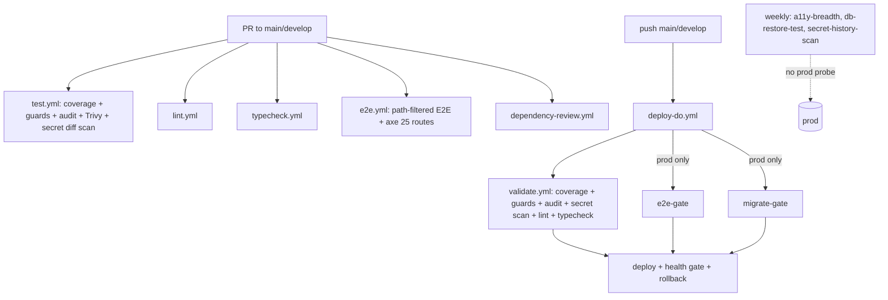

# 09_testing_quality_release_confidence — Prompt 09 - Testing, Quality, and Release Confidence Audit

- Run: `mainecybertech-20261011-0426-full-main-8d299b8`
- Target: `mainecybertech` @ `8d299b8` (branch `main`)
- Domain: `09_testing_quality_release_confidence.md` (area TEST, prompt)

## Verification Performed

# Testing, Quality, and Release Confidence Audit

## Audit Metadata

- Audit name: repo-deep-dive (full hardening, rerun)
- Run: `mainecybertech-20261011-0426-full-main-8d299b8`
- Repository: `MaineCyberTech/mainecybertech` (read-only target `/tmp/opencode/mct-audit-target`)
- Branch: `main`
- Commit SHA: `8d299b8d` (merge PR #168, 2026-10-11)
- Generated at: 2026-10-11
- Auditor: repo-deep-dive subagent, domain 09 (area TEST)
- Output path: `docs/audits/repo-deep-dive/mainecybertech-20261011-0426-full-main-8d299b8/09_testing_quality_release_confidence.md`
- Scope limitations:
  - **No suite was executed.** Resource discipline for this run prohibits `pnpm install/test/build`; the audit host also has no `node`/`pnpm` on PATH. Every count is derived from tracked files and configs, not a live run. Execution-dependent claims are `not reproducible`.
  - **No CI history access.** "Green"/"passing" statements in AGENTS.md/review.md are self-attested; no committed run logs were found. They are recorded as `unverified` here.
  - Live GitHub branch-protection settings and environment secrets were not observable; `.github/branch-protection/*.json` is the only artifact.
  - Read-only: `git status --porcelain` on the target returned 0 lines after the audit.

## Scope

Reviewed at `8d299b8d`:

- Test estate: `apps/api/src/__tests__/` + co-located, `apps/web/__tests__/` + co-located, `apps/worker/src/__tests__/`, `packages/sdk/src/__tests__/`, `apps/web/e2e/`.
- Jest configs and coverage thresholds (`apps/*/jest.config.mjs`, `packages/sdk/jest.config.mjs`), web custom jsdom environment, setup/teardown files.
- Playwright config, fixtures, global setup, a11y spec; E2E workflow and the a11y breadth triage.
- CI test wiring: `test.yml`, `validate.yml`, `e2e.yml`, `a11y-breadth.yml`, `chromatic.yml`, `supabase-migrations.yml`, `db-restore-test.yml`, `secret-history-scan.yml`, the `.github/actions/{unit-tests,dependency-audit,secret-scan,setup-pnpm}` composites, and `deploy-do.yml` gate structure.
- Release-confidence guards: `scripts/check-docs-counts.mjs`, `openapi-audit.js`, `verify-rls.mjs`, `check-required-checks.mjs`, `sync-review-md.mjs`.
- Load tests (`scripts/load-testing/`), pre-commit hook, and the docs that state test/coverage facts (`AGENTS.md`, `README.md`, `review.md`, `docs/testing.md`, `docs/CI.md`, `docs/WEB_UI_CONVENTIONS.md`).
- Remediation-wave test additions between `9c0b88c` and `8d299b8d` (113 commits).

Not reviewed: runtime behavior/actual coverage percentages, CI run outcomes, the body of all 90 E2E specs beyond structure/patterns, and production systems.

## Evidence Reviewed

| Evidence | Type | Why relevant | Notes |
|---|---|---|---|
| `apps/api/jest.config.mjs` | Config | API coverage gate | branches 45 / functions 70 / lines 74 / statements 70 (ratcheted 2026-10-03) |
| `apps/web/jest.config.mjs` | Config | Web coverage gate | 39 / 39 / 47 / 47 (ratcheted); custom jsdom env |
| `apps/worker/jest.config.mjs` | Config | Worker coverage gate | 5 / 15 / 12 / 12 (unchanged) |
| `packages/sdk/jest.config.mjs` | Config | SDK coverage gate | 33 / 38 / 40 / 40 |
| Suite enumeration | Test source | Inventory | API 133, Web 272, Worker 14, SDK 3 = 422 suite files; docs declare 397 |
| `apps/web/e2e/**/*.spec.ts` (90) | Test source | E2E inventory | admin/portal/marketing/auth + `a11y.spec.ts` |
| `apps/web/e2e/a11y.spec.ts` | Test source | Accessibility gate | `BASE_PAGES` 25, `FULL_PAGES` 43 (68 total), tags include `wcag22aa`, critical/serious only |
| `apps/worker/src/__tests__/tasks/sla-business-os.test.ts`, `task-handlers.test.ts` | Test source | Worker task coverage | 12 of 17 `module-tasks.ts` handlers imported; 7 unreferenced |
| `apps/worker/src/__tests__/orphan-cleanup.test.ts` | Test source | Destructive-helper boundary tests | 456 lines: folder ids, pagination, chunking, fail-closed, unsafe-path aborts |
| `apps/api/src/__tests__/route-authorization-guard.test.ts` | Test source | Route-mount authz guard | Static guard over `routes/*.ts` with explicit allowlists |
| `.github/actions/unit-tests/action.yml` | CI composite | Coverage + guards | `pnpm test:coverage` + OpenAPI + docs counts/links + DB types + RLS + review.md sync |
| `.github/workflows/test.yml`, `validate.yml` | CI | PR + deploy gates | Same composite used in both; dependency audit + secret scan shared |
| `.github/workflows/e2e.yml`, `a11y-breadth.yml`, `deploy-do.yml` | CI | E2E wiring | PR path-filtered; prod-only deploy gate; weekly triage scan |
| `.github/workflows/chromatic.yml` | CI | Visual regression | `continue-on-error: true`; Storybook build known-broken |
| `.github/workflows/supabase-migrations.yml`, `db-restore-test.yml` | CI | Migration/restore validation | Dry-run plan artifact; restore assertions with floors + freshness canary |
| `scripts/load-testing/*` | Scripts | Load/failure | 5 k6 scripts, manual-only; README documents a workflow that does not exist |
| `scripts/check-docs-counts.mjs` | Script | Doc drift guard | a11y counts now guarded; test/suite counts and coverage thresholds are not |
| `AGENTS.md`, `README.md`, `review.md`, `docs/testing.md`, `docs/CI.md` | Docs | Claimed state | Stale suite totals; stale threshold table |

## Verification Performed

Read-only commands run against `/tmp/opencode/mct-audit-target` and their observed results:

| Command / method | Observed result |
|---|---|
| `git rev-parse HEAD` / `git log --oneline -3` | `8d299b8dc271...` — "Merge PR #168: promote develop to main" |
| `git log --oneline 9c0b88c..8d299b8d \| wc -l` | 113 commits since the previous full run |
| Python enumeration of tracked `*.test.ts(x)/*.spec.ts(x)` matching each jest `testMatch` (excluding `helpers.ts`, e2e) | API 133, Web 272, Worker 14, SDK 3 = **422** suite files vs **397** declared in AGENTS.md:80-87 |
| `git log --diff-filter=A --name-only 9c0b88c..8d299b8d -- '*test*'` | 6 new test files (API csv/email/notifications-sse-scope, web lib/env, worker shutdown; `env-smtp.test.ts` added then removed with the SMTP revert) |
| Python count of `path:` entries in `a11y.spec.ts` arrays | `BASE_PAGES` 25, `FULL_PAGES` 43 (68 total) — matches docs |
| `grep -n` thresholds in all four jest configs | API 45/70/74/70, Web 39/39/47/47, SDK 33/38/40/40, Worker 5/15/12/12 |
| `git blame -L 34,40 docs/testing.md` | Threshold table last changed `e32fd5d0c` (2026-09-29), before the `0a2e5331` ratchet (2026-10-03) — doc is stale |
| `git log -S "branches: 45"` / `-S "branches: 39"` | Both ratchets landed in `0a2e5331` (2026-10-03, ancestor of HEAD) |
| `grep` for `backupDrCheck/dmarcCoachCheck/statusMaintenanceCheck/websiteMonitorCheck/domainMonitorCheck/patchComplianceCheck/endpointSecurityCheck` in `apps/worker/src/__tests__` | 0 matches — 7 handlers untested |
| `grep -n` imports in `sla-business-os.test.ts` | 12 of 17 `module-tasks.ts` handlers covered indirectly |
| `git show --stat 8d299b8d` | PR #168 changed only `deploy-do.yml`, `CHANGELOG.md`, `docs/audits/**` — no path in `e2e.yml`'s PR filter |
| `grep toHaveScreenshot\|toMatchSnapshot` in web tests/e2e | 0 matches — no screenshot baselines |
| `grep -rn "blackbox\|healthchecks.io"` in `infra/` + scheduled workflows | No external prod probe; scheduled workflows never hit prod |
| `git status --porcelain` | 0 lines (target unmodified) |
| `pnpm test:coverage` at this SHA | **not run** (prohibited by run resource discipline; no node/pnpm on the audit host) — coverage percentages and "all passing" are `not reproducible` from repo evidence |

Self-consistency checks: the a11y page counts in four docs match the spec and are guarded; the workflow count (20) matches; the E2E spec count (90) matches; **test/suite totals and the coverage-threshold table do not match the tree** (findings below).

## Executive Summary

The test estate at `8d299b8d` is broad, layered, and — unusually for this size — partly self-guarding. 422 Jest suite files (API 133, Web 272, Worker 14, SDK 3) plus 90 Playwright specs run through shared CI composites; coverage thresholds are enforced in both the PR gate and the deploy gate; a 25-page axe gate with WCAG 2.2 tags runs on E2E; the a11y page count is now guarded by `check-docs-counts.mjs`; destructive helpers have genuine boundary/negative tests; and the remediation waves added targeted regression tests (CSV formula guard, SSE cross-org rejection, SMTP retry exhaustion, web env fail-fast, worker shutdown watchdog).

The release-confidence risks are concentrated in *verification of the claims*, not the breadth of the estate:

1. **Stale, unguarded claims.** AGENTS.md/README still say "3,490 tests, 397 suites" while the tree holds 422 suite files, and `docs/testing.md` still documents the pre-ratchet coverage thresholds. The docs-counts guard cross-checks documents against each other, not against the tree, despite claiming counts are "measured, not hand-maintained".
2. **The E2E gate is structurally shaky.** It is a required check on `main` yet its PR trigger is path-filtered (a docs/infra-only PR cannot report it — PR #168 merged without it), and the prod-only deploy gate that actually protects production has never been exercised (prod env has no secrets).
3. **The worker's scheduled scan handlers remain the weakest link.** 7 of 17 handlers have no test reference and the branch threshold is 5%.
4. **Visual, load and production smoke remain inert.** Chromatic cannot fail CI; k6 is manual-only; nothing probes prod between deploys.

Recommended next actions: reconcile the two stale docs and extend the docs-counts guard to the tree (suites + thresholds); fix the E2E required-check/path-filter contradiction; add the `module-tasks` suite and raise the worker branch gate; then turn on a scheduled k6 run and a prod smoke cron.

## Inventory

| Item | Path / symbol | Purpose | Current state | Risk | Notes |
|---|---|---|---|---|---|
| API unit/integration | `apps/api/src/__tests__/*` (133 suites) | Route/middleware/service via supertest | Implemented | Low | Declared 114 — stale |
| Web component/page | `apps/web/__tests__/*` (272 suites) | Pages, components, server actions | Implemented | Low | Declared 271 — stale |
| Worker | `apps/worker/src/__tests__/*` (14 suites) | Env schema + task handlers | Implemented, thin | Medium | Declared 9 — stale; 7 handlers untested |
| SDK | `packages/sdk/src/__tests__/*` (3 suites) | Mocked-fetch client | Implemented | Low | Matches docs |
| Shared UI | `packages/ui` | Component kit + 7 stories | No test/lint/typecheck script | Medium | Only 5 web suites import it |
| E2E | `apps/web/e2e/**/*.spec.ts` (90) | Full-stack Playwright chromium | Implemented | Medium | Prod-only gate never run; flaky specs documented |
| Accessibility | `apps/web/e2e/a11y.spec.ts` (25 default / 68 full) | axe WCAG A/AA/2.2 | Implemented + guarded | Low | Critical/serious only |
| Contract | `openapi-contracts.test.ts` + `openapi-audit.js` | Spec-vs-impl parity | Implemented | Low | ~19 curated routes; static audit fails on missing routes |
| Migration/restore | `supabase-migrations.yml`, `db-restore-test.yml`, `verify-rls.mjs` | Apply + drift + restore assertions | Implemented (indirect) | Low-Medium | Dry-run artifact; no SQL assertion suite |
| Security | `security*.test.ts`, `ssrf-guard`, `idempotency`, `webhook-signature`; CI audit/Trivy/license/secret scans/CodeQL | App + supply-chain | Implemented | Low | No DAST/fuzz; CodeQL CSRF alert pre-existing |
| Load/failure | `scripts/load-testing/*` (5 k6 scripts) | Load + spike | Manual only | Medium | No workflow, thresholds, or failure injection |
| Smoke | Deploy health gate (`deploy-do.yml`), E2E login setup | Deploy-time health | Implemented | Medium | No scheduled prod smoke |
| Pre-commit | `.husky/pre-commit` | Secret scan + lint-staged (eslint/prettier) | Implemented | Low | No tests in pre-commit (normal) |
| CI gates | `test.yml`, `validate.yml`, `e2e.yml`, `a11y-breadth.yml`, `chromatic.yml`, … (20 workflows) | Release safety | Implemented | Medium | E2E path filter vs required check |

## Domain Scorecard

| Category | Score | Evidence | Gap | Recommended action |
|---|---:|---|---|---|
| Unit tests | 4 | 422 suites; 4 thresholds; `pnpm test:coverage` in both gates (`.github/actions/unit-tests/action.yml:21-23`) | Not executed here; suite counts stale; worker gate 5% | Fix counts guard; worker suite + threshold |
| Integration tests | 4 | 133 API supertest suites; `createMockBuilder` (helpers.ts:8-42) | Supabase/Redis mocked; no Postgres-backed tier | Thin PostgREST-backed tier for critical CRUD |
| API tests | 4 | Security/idempotency/rate-limit/ssrf/webhook suites; route authz guard | Factory CRUD routes contract-thin | Extend contract matrix |
| E2E | 3 | 90 specs; full-stack `e2e.yml`; retries 2; bounded timeouts | Prod gate never run; flakiness unresolved; required-check/path-filter gap | Flake stats; dry-run prod gate; fix trigger |
| Component tests | 3 | 272 web suites; Testing Library | `packages/ui` has no runner/lint | Add UI tests + scripts |
| Visual regression | 1 | `chromatic.yml` non-blocking; broken Storybook build | Cannot fail CI; no Playwright screenshots | Fix build or screenshot baselines |
| Accessibility | 4 | 25/68 axe gate, `wcag22aa`, guarded by docs-counts | Only critical/serious fail; long tail triage-only | Promote routes deliberately |
| Contract tests | 4 | `openapi-contracts.test.ts` (667 lines) + `openapi-audit.js` in CI | Curated ~19 routes; responses only | Cover factory families + request schemas |
| Migration tests | 3 | `supabase db reset` in E2E; `verify-rls.mjs`; restore assertions; dry-run artifact | No SQL assertion suite | Fixture-based schema assertions |
| Security tests | 4 | App suites + audit-gate + Trivy + license + diff/full-history secret scans + CodeQL | No DAST/fuzz | Authenticated negative-path E2E set |
| Load/failure tests | 2 | 5 k6 scripts | Not run in CI; no thresholds; no failure injection | Scheduled k6 + Redis/queue/Supabase-down tests |
| Smoke tests | 3 | Deploy health gate (api/worker/web) | No scheduled prod smoke | Cron smoke workflow |

## Critical Workflow Coverage Matrix

| Critical workflow | Unit/API evidence | E2E evidence | Other evidence | Gap |
|---|---|---|---|---|
| Login / MFA / recovery | `auth.test.ts`, `mfa-*.test.ts`, `middleware-auth*` | `auth/login.spec.ts`, `global.setup.ts` | Contract tests for `/auth/*` (openapi-contracts.test.ts:479-577) | None material |
| Portal dashboard | `dashboard.test.ts` + web page suites | `portal/dashboard.spec.ts` | a11y gate page | — |
| Tickets CRUD | `tickets.test.ts`, `tickets-export.test.ts` | `admin/tickets.spec.ts`, `portal/*` | Contract `/tickets` | — |
| Documents / versions / uploads | `documents.test.ts`, `file-requests.test.ts` | `admin/documents.spec.ts`, `portal/document-preview.spec.ts` | Worker `orphan-cleanup.test.ts` (version reconciliation) | — |
| Admin users / roles | `users.test.ts`, `roles.test.ts`, `me-permissions.test.ts` | `admin/users.spec.ts`, `admin/roles.spec.ts` | Route authz guard | — |
| Notifications / SSE | `notifications*.test.ts`, `notifications-sse-scope.test.ts` (new) | `admin/notifications.spec.ts`, `portal/notifications*.spec.ts` | Worker `notification-store.test.ts` | Flake-prone specs named in AGENTS.md:93 |
| Webhooks inbound/outbound | `webhook-signature.test.ts`, `webhooks.test.ts`, `webhook-dead-letters.test.ts` | `admin/webhooks.spec.ts` | Worker `webhook-retry.test.ts`, `webhook-dispatcher.test.ts` | No per-provider payload caps (WH-P2-006) |
| Billing / Stripe | `billing.test.ts` | `portal/billing.spec.ts` | Worker `stripe-reconcile` covered in `task-handlers.test.ts` | — |
| Store quote / checkout | `store-*.test.ts` | `public-store.spec.ts` | Contract `/store/quotes` | — |
| Scheduled security scans | 12/17 handlers via `sla-business-os.test.ts` | none | — | **7 handlers untested; branch gate 5%** |
| Search | `search*.test.ts` (incl. tenant scope) | `admin/search.spec.ts` | — | — |
| Backup / restore | none (unit) | none | `db-restore-test.yml` assertions + RPO canary | Restore is weekly/scheduled, not per-PR |
| CSV / exports | `csv.test.ts`, `projects-export.test.ts`, `audit-export` E2E | `admin/audit-export.spec.ts` | — | — |

## Detailed Review

### Item: Unit estate and coverage gates

- Evidence: four `jest.config.mjs` files; 422 suite files; `.github/actions/unit-tests/action.yml:21-23`; ratchet commit `0a2e5331`.
- What it does: Jest + ts-jest; API node env + supertest; Web custom jsdom with `@mct/ui` mapped to source; worker exports `envSchema`/`parseWorkerTasks` for tests; SDK mocked fetch.
- How it appears to work: `testMatch` picks `__tests__/**` + `*.test|spec.ts(x)`; API ignores `helpers.ts`/`/openapi/`; web ignores `.next`/`e2e`.
- Current controls: global thresholds in all four configs; CI runs `pnpm test:coverage` in the shared composite used by `test.yml:39` and `validate.yml:53`.
- Missing controls: no coverage artifact; worker gate effectively minimal; counts guard doesn't count suites; docs table stale.
- Risks: Medium — headline numbers are wrong and the weakest package is ungated in practice.
- Recommended improvement: extend `check-docs-counts.mjs` to suites + thresholds; upload coverage summary; raise worker gate after the module-tasks suite.
- Suggested tests: `module-tasks.test.ts` (table-driven); docs-guard negative test (tamper a number → exit 1).
- Suggested docs: `docs/testing.md` threshold table; "what the gate does not cover" section.

### Item: E2E and accessibility

- Evidence: `playwright.config.ts` (retries 2, workers 1, 45s/15s/30s timeouts, html+list reporters), 90 specs, `fixtures.ts` (47 `visibleWithin` uses), `a11y.spec.ts` 25/68, `e2e.yml`, `a11y-breadth.yml`, `deploy-do.yml:525-529`.
- What it does: builds API/web against local Supabase, seeds via `db reset`, signs in once (`global.setup.ts`), runs chromium specs; axe gate on 25 routes with `wcag22aa`.
- Current controls: `forbidOnly` in CI; failure artifacts; prod-only deploy gate; weekly breadth triage; a11y counts guarded.
- Missing controls: flake-rate instrumentation; prod gate never exercised; required-check/path-filter contradiction; two `waitForTimeout` sleeps remain.
- Risks: Medium-High for release gating (see findings).
- Recommended improvement: JSON reporter + flake summary; fix trigger/protection mismatch; dry-run the prod gate.
- Suggested tests: keep breadth green; add screenshot baselines as a Chromatic substitute.
- Suggested docs: document dev-vs-prod gate asymmetry explicitly.

### Item: CI execution and gate wiring

- Evidence: `test.yml` (PR-only; no paths filter by design, lines 6-10), `validate.yml` (workflow_call deploy gate), composites, `deploy-do.yml` deploy condition requiring every ran job to succeed (lines 538-560), `check-required-checks.mjs` (names only).
- What it does: PRs run Test/Lint/TypeCheck (+E2E on matching paths, Dependency Review); pushes run `deploy-do` → `validate` (same coverage + guards + audit + secret scan + lint + typecheck + prompt provenance); prod deploys additionally require E2E + migrations; dev deploys skip them.
- Current controls: least-privilege permissions; hard audit/Trivy/secret gates; fail-closed deploy condition; guard that required check names resolve.
- Missing controls: path-filter modelling; coverage artifact; load/visual/prod-smoke gates.
- Risks: Medium — one required check can be structurally unreportable.
- Recommended improvement: align e2e.yml triggers with the required-check config; extend the guard to path-filter awareness.
- Suggested tests: planted-secret negative test; "docs-only PR to main" dry-run.
- Suggested docs: `docs/CI.md` required-check table update.

### Item: Worker scheduled tasks and destructive helpers

- Evidence: `module-tasks.ts` (17 handlers), `sla-business-os.test.ts` (12 imports), `task-handlers.test.ts` (other tasks), `orphan-cleanup.test.ts` (456 lines).
- What it does: BullMQ tasks mutate tenant data on schedules; orphan cleanup deletes storage objects.
- Current controls: orphan cleanup has strong boundary/negative tests; 12/17 scan handlers have indirect success/error-path tests.
- Missing controls: no direct suite for 7 handlers; 5% branch floor; no per-handler empty/mixed/concurrent-lock matrix.
- Risks: Medium (silent data mutation in unattended jobs).
- Recommended improvement: table-driven `module-tasks.test.ts`; raise branches to ~25%.
- Suggested tests: per-handler success/empty/error + scan-lock-held rows.
- Suggested docs: note worker coverage posture in `docs/testing.md`.

### Item: Load, smoke, and failure testing

- Evidence: 5 k6 scripts; `scripts/load-testing/README.md:48-79`; `deploy-do.yml:869-934` health gate; scheduled workflow inventory; `infra/digitalocean/alertmanager.tmpl.yml`.
- What it does: k6 scripts exist for smoke/CRUD/auth/SSE/spike; deploys verify api/worker/web health with rollback.
- Current controls: deploy-time health gate is thorough (API 200, worker over SSH, web login, rollback on failure).
- Missing controls: no CI execution, thresholds, baselines, or failure injection; no scheduled prod probe.
- Risks: Medium — capacity ceiling and outage detection unproven.
- Recommended improvement: dispatchable/scheduled k6 workflow against staging + cron prod smoke.
- Suggested tests: Redis-down/queue-down/Supabase-down injection.
- Suggested docs: replace the load README's fictional workflow snippet with the real one once added.

## Scenario / Control Matrix

| ID | Scenario or control | Evidence | Current control | Gap | Severity | Recommendation |
|---|---|---|---|---|---|---|
| TEST-001 | Unit tests | 422 suites; 4 thresholds; composite | CI coverage gate | Counts stale; worker floor 5%; no artifact | P2 | Guard counts/thresholds; raise worker gate |
| TEST-002 | Integration tests | 133 API suites, supertest | Router/service integration | Supabase mocked | P3 | Add DB-backed tier |
| TEST-003 | API tests | security/idempotency/ssrf/webhook suites | Strong | Factory contracts thin | P3 | Broaden contract matrix |
| TEST-004 | E2E | 90 specs; e2e.yml | Full-stack CI | Prod gate unexercised; flakiness; path-filter | P2 | Flake stats; dry-run; fix trigger |
| TEST-005 | Component tests | 272 web suites | Testing Library | `packages/ui` untested/unlinted | P3 | Add UI runner + tests |
| TEST-006 | Visual regression | chromatic.yml non-blocking | None effective | Broken build; exitZeroOnChanges | P3 | Fix Storybook or Playwright screenshots |
| TEST-007 | Accessibility | a11y.spec.ts 25/68; guard | axe gate | Only critical/serious | P2 | Keep guard; promote routes |
| TEST-008 | Contract tests | openapi-contracts + audit | Spec-vs-impl | ~19 curated routes | P3 | Extend to factory families |
| TEST-009 | Migration tests | db reset; verify-rls; restore assertions | Hygiene + restore | No SQL assertion suite | P3 | Fixture schema assertions |
| TEST-010 | Security tests | App suites + CI scans | Layered | No DAST/fuzz | P2 | Negative-path E2E |
| TEST-011 | Load/failure tests | 5 k6 scripts | Manual only | No CI/thresholds/injection | P2 | Scheduled k6 + chaos |
| TEST-012 | Smoke tests | Deploy health gate | Deploy-time | No scheduled prod smoke | P3 | Cron smoke workflow |

## Findings

Detailed finding records live in the companion `09_testing_quality_release_confidence.json` (severity/evidence/impact/recommendation/status). Summary:

| # | Severity | Title | Status |
|---|---|---|---|
| 1 | P2 | Accessibility gate width contradicts the code (docs say 19 pages, code scans 25) | verified-fixed |
| 2 | P2 | Worker data-mutating scan tasks still lack a dedicated test suite; branch threshold is a no-op | still-open |
| 3 | P2 | E2E flakiness is documented but unresolved, and the prod-only gate masks it | still-open |
| 4 | P2 | Load tests exist but are manual-only with no enforced thresholds or failure injection | still-open |
| 5 | P2 | Orphan-cleanup tests model `storage.list` incorrectly, masking the data-loss bug | verified-fixed |
| 6 | P2 | Route suites stub authorization middleware, so new routes can regress silently | verified-fixed |
| 7 | P3 | Visual regression is still non-blocking with a known-broken Storybook build | still-open |
| 8 | P3 | No scheduled production smoke check (health + login + critical read) | still-open |
| 9 | P3 | Coverage thresholds remain modest and cannot be confirmed met at this SHA | partially-fixed |
| 10 | P3 | Coverage thresholds are low and E2E stability is unproven on `main` | partially-fixed |
| 11 | P2 | docs/testing.md coverage-threshold table contradicts the ratcheted jest configs | open (new) |
| 12 | P2 | Test/suite totals in AGENTS.md and README are stale and never verified against the tree | open (new) |
| 13 | P2 | E2E is a required check on `main` but its PR path filter can leave it unreported | open (new) |
| 14 | P3 | Shared packages/ui has no test runner and no lint/typecheck script | open (new) |

Verification outcomes for the ten previous-run TEST rows: 3 `verified-fixed` (a11y docs, orphan-cleanup tests, route authz guard), 2 `partially-fixed` (coverage rows), 5 `still-open` (worker tasks, E2E flakiness, load tests, visual regression, prod smoke). The two coverage rows were carried with "ratcheted" notes in the previous register; both remain only partially addressed because the worker floor is unchanged, no coverage artifact exists, and the doc table was never updated (finding 11).

## Risks

| Risk | Severity | Likelihood | Impact | Evidence | Mitigation |
|---|---|---|---|---|---|
| Headline test numbers wrong; "all passing" unverifiable | P2 | High (already true) | Misstated release confidence | AGENTS.md:80 vs 422 suites; no CI capture | Finding 12: guard + re-measure |
| Docs understate the API/web coverage gate | P2 | High | Wrong release criteria in the canonical doc | docs/testing.md:36-37 vs configs | Finding 11: update + guard |
| Docs-only main PR cannot satisfy required E2E check (or gate unenforced) | P2 | Medium | Blocked release or silent gate loss | main.json:8; e2e.yml:14-22; PR #168 | Finding 13: fix trigger or protection |
| Worker scan-handler regression ships | P2 | Medium | Tenant data corruption | 7 handlers unreferenced; branches 5 | Finding 2: module-tasks suite |
| First prod deploy fails on E2E flake | P2 | Medium | Blocked release | AGENTS.md:93; prod gate never run | Finding 3: flake stats + dry-run |
| Capacity/outage behavior unknown | P2 | Medium | Outage under spike | k6 manual-only | Finding 4: scheduled k6 + chaos |
| UI/visual regressions ship | P3 | Medium | Cosmetic defects | chromatic non-blocking | Finding 7 |
| Outage between deploys undetected | P3 | Medium | Longer MTTR | no scheduled prod probe | Finding 8 |
| UI kit untested/unlinted | P3 | Medium | Shared-component regressions | packages/ui has no scripts | Finding 14 |

## Recommendations

### Immediate / Release Blocking

None verified as blocking from repository evidence at this SHA. Confirm before the next release (cannot be proven from here):

1. Run `pnpm test:coverage` at `8d299b8d` and record the four thresholds (findings 9/10).
2. Reconcile `docs/testing.md` thresholds and the AGENTS/README suite totals, then re-measure (findings 11/12).
3. Reconcile the E2E required check vs its path filter before relying on `main` protection (finding 13).

### This Week

4. Add a table-driven `apps/worker/src/__tests__/module-tasks.test.ts` for the 7 untested handlers and raise the worker branch threshold (finding 2).
5. Add a Playwright JSON reporter + flake summary and quarantine the named data-dependent specs with owner/expiry (finding 3).
6. Extend `scripts/check-docs-counts.mjs` to count suite files and parse `coverageThreshold` (findings 11/12).

### This Month

7. Add a manual/scheduled k6 workflow with enforced thresholds and a recorded baseline; add Redis/queue/Supabase failure-injection tests (finding 4).
8. Publish coverage artifacts from the unit-tests composite (finding 9).
9. Add a scheduled production smoke workflow (health + login + read-only authenticated request) (finding 8).

### Later / Platform Evolution

10. Fix the Storybook/Next build or replace Chromatic with Playwright `toHaveScreenshot()` baselines (finding 7).
11. Add a Postgres-backed integration tier and extend contract tests to the CRUD factory families (scorecard: integration/contract).
12. Add jest + lint/typecheck scripts to `packages/ui` and direct component tests (finding 14).
13. Add a small authenticated negative-path E2E set (authz/tenant isolation).

## Quick Wins

| Quick win | Why it helps | Files likely involved | Validation |
|---|---|---|---|
| Update `docs/testing.md` threshold table | Removes direct contradiction | `docs/testing.md` | `check-docs-counts.mjs` (extended) |
| Count suites in the docs guard | Makes "measured counts" true | `scripts/check-docs-counts.mjs` | Exit 1 on tampered number |
| Coverage summary to `$GITHUB_STEP_SUMMARY` | Makes the gate observable | `.github/actions/unit-tests/action.yml` | Job summary shows percentages |
| JSON reporter + flake line | Quantifies E2E flakiness | `apps/web/playwright.config.ts`, `e2e.yml` | Retry stats in CI |
| Remove/annotate the load README's fictional workflow | Stops a dead pointer | `scripts/load-testing/README.md` | Review |

## Hardening Backlog

| Backlog item | Priority | Owner suggestion | Effort | Dependency |
|---|---|---|---|---|
| `module-tasks` suite + worker threshold raise | P2 | Implementation agent (worker) | M | — |
| E2E trigger/required-check reconciliation | P2 | QA/release + repo admin | S | GitHub settings access |
| Docs-counts guard for suites + thresholds | P2 | Implementation agent | S | — |
| Flake instrumentation + quarantine policy | P2 | Frontend/platform | M | CI E2E access |
| k6 workflow + baseline + chaos tests | P2 | Platform engineer | M | Staging URL |
| Coverage artifact publication | P3 | Implementation agent | S | CI run |
| Visual regression enforcement | P3 | Frontend engineer | M | Storybook fix or Playwright baselines |
| `packages/ui` test/lint scripts | P3 | Frontend engineer | S | — |
| Postgres-backed integration tier | P3 | Platform engineer | L | Test DB setup |
| Prod smoke cron | P3 | Platform engineer | S–M | Prod URLs + read-only credential |

## Suggested Tests

- **Worker (unit, table-driven):** one row per uncovered `module-tasks` handler (`backupDrCheck`, `dmarcCoachCheck`, `statusMaintenanceCheck`, `websiteMonitorCheck`, `domainMonitorCheck`, `patchComplianceCheck`, `endpointSecurityCheck`) with success, empty, error, and scan-lock-held inputs.
- **Docs guard (CI):** tamper `docs/testing.md` or AGENTS.md counts and assert `check-docs-counts.mjs` exits 1; add a suite-count comparison against the filesystem.
- **CI wiring (negative):** a docs-only branch targeting `main` must either run E2E or fail the required-check resolution check — assert the chosen behaviour.
- **Failure injection (integration):** Redis-down → cache falls back; queue-down → `enqueueTask` returns false; Supabase-down → circuit breaker trips and `/health` reports unhealthy.
- **E2E (negative security):** unauthenticated/other-org user hitting a by-id endpoint gets 403/404.
- **Load:** schedule `tickets.load.js` + `health.spike.js` against staging; assert the README thresholds and record a baseline artifact.
- **Component:** render tests for `packages/ui` Button/Dialog/Badge/Input/Avatar plus a story-smoke test.
- **Manual validation:** the checklist in the Appendix, once per release.

## Suggested Documentation Updates

- `docs/testing.md` — fix the threshold table (lines 34-39); add a "what `pnpm test:coverage` does NOT cover" section (no E2E, load, visual, migration apply, or prod smoke); note the worker gate is intentionally low pending the module-tasks suite.
- `AGENTS.md` / `README.md` / `review.md` — re-measure test/suite totals from a CI run and state the commit they were measured at; fix the per-package suite rows.
- `docs/CI.md` — add the E2E required-check/path-filter caveat and the required-check table; document that load/visual/prod-smoke are not gated.
- `scripts/load-testing/README.md` — replace the example workflow with the real workflow name once it exists, and record baseline results.
- `packages/ui/README` (or `docs/ui-kit.md`) — state how the kit is tested and what gates it.

## Open Questions

| Question | Why it matters | Evidence needed |
|---|---|---|
| Do all four packages meet their thresholds at `8d299b8d`? | Release gate | CI run log or local `pnpm test:coverage` at this SHA |
| Why do AGENTS/README still say 397 suites? | Claims accuracy | A CI run measuring suites, or the count-guard extension |
| Does the live `main` branch protection actually require E2E? | Explains PR #168 merging without it | GitHub settings export or a docs-only PR experiment |
| Will the Storybook build be fixed or is Playwright the replacement? | Visual regression plan | Owner decision |
| Where do k6 runs get a staging target? | Load-test CI design | Staging URL/secret ownership |
| Is any external monitor already covering the prod-smoke gap? | Avoid duplicate work | `infra/` config + operator confirmation (none found in repo) |

## Appendix

### A. Suite-file counts vs declared (enumerated at 8d299b8d)

```
Package | Suite files (enumerated) | Declared (AGENTS.md:84-87) | Match
API     | 133                      | 114                        | no (+19)
Web     | 272                      | 271                        | no (+1)
Worker  | 14                       | 9                          | no (+5)
SDK     | 3                        | 3                          | yes
Total   | 422                      | 397                        | no (+25)
E2E     | 90 spec files            | 90                         | yes
```

### B. Remediation-wave test additions (9c0b88c → 8d299b8d)

- `apps/api/src/__tests__/csv.test.ts` — CSV formula-injection guard + quoting (FILE-P2-006).
- `apps/api/src/__tests__/email.test.ts` — inline email retry: first-attempt success, retry-then-success, exhausted attempts, no-transport skip (NOTIF-P2-006).
- `apps/api/src/__tests__/notifications-sse-scope.test.ts` — SSE row accepted/rejected across orgs and users (MT-P2-004).
- `apps/web/__tests__/lib/env.test.ts` — web env fails fast in production without `NEXT_PUBLIC_API_URL` (SECRET-P3-002).
- `apps/worker/src/__tests__/shutdown.test.ts` — drain, rejection tolerance, force-exit watchdog, timeout env (RES-P3-001).
- `apps/api/src/__tests__/env-smtp.test.ts` — added with the SMTP fail-closed change, removed with its revert (3f2a772c); no residue.

### C. Release-confidence scorecard

| Gate | Where | Blocking? | Verified at this SHA? |
|---|---|---|---|
| Unit/coverage + schema/docs guards | `test.yml` (PR), `validate.yml` (push) | Yes (required Test check) | Not executed here |
| Lint / TypeCheck | `lint.yml`, `typecheck.yml`; `validate.yml` | Yes (required) | Not executed here |
| E2E + a11y (25 routes) | `e2e.yml` PR (path-filtered), prod deploy gate | Required on main PRs; prod-only on deploy | No (prod gate never run) |
| Dependency audit / license / Trivy | `dependency-audit` composite | Yes | Static config verified |
| Secret scan (diff + full history) | `secret-scan` composite, `secret-history-scan.yml` | Yes (diff); weekly (history) | Static config verified |
| Contract (OpenAPI) | `openapi-contracts.test.ts`, `openapi-audit.js` | Yes (in unit composite) | Not executed here |
| Migration apply + drift | `supabase-migrations.yml` | Prod deploy gate | Dry-run artifact added; not executed here |
| Restore drill | `db-restore-test.yml` (weekly) | No (scheduled) | Assertions verified statically |
| Visual regression | `chromatic.yml` | No (`continue-on-error`) | Known-broken build |
| Load/failure | none in CI | No | Manual only |
| Prod smoke | none scheduled | No | Deploy-time only |

### D. Manual QA checklist (pre-release)

- [ ] `pnpm test:coverage` passes all four thresholds at the release SHA; record percentages.
- [ ] PR required checks green: Test/Lint/TypeCheck (+E2E when the PR touches web/packages/supabase paths).
- [ ] E2E green at the release SHA with a recorded spec count; flake/retry count reviewed.
- [ ] a11y gate green (25 routes); breadth scan (`A11Y_FULL=1`) not regressed.
- [ ] `openapi-audit.js` and `check-docs-counts.mjs` pass (no drift).
- [ ] `supabase db push` dry-run plan reviewed; post-push `db diff` clean.
- [ ] Deploy health gate: API `/health` 200, worker health 200, web `/login` reachable.
- [ ] Login → portal dashboard → create ticket → notification badge on the deployed environment.
- [ ] k6 smoke against the target environment within thresholds.
- [ ] Latest restore-drill run green (weekly evidence).

### E. Mermaid — test/release flow at 8d299b8d



## Findings

| ID | Severity | Title |
|---|---|---|
| TEST-P2-001 | P2 | Accessibility gate width contradicts the code (docs say 19 pages, code scans 25) |
| TEST-P2-002 | P2 | Worker data-mutating scan tasks still lack a dedicated test suite; branch threshold is a no-op |
| TEST-P2-003 | P2 | E2E flakiness is documented but unresolved, and the prod-only gate masks it |
| TEST-P2-004 | P2 | Load tests exist but are manual-only with no enforced thresholds or failure injection |
| TEST-P2-005 | P2 | Orphan-cleanup tests model `storage.list` incorrectly, masking the data-loss bug |
| TEST-P2-006 | P2 | Route suites stub authorization middleware, so new routes can regress silently |
| TEST-P3-001 | P3 | Visual regression is still non-blocking with a known-broken Storybook build |
| TEST-P3-002 | P3 | No scheduled production smoke check (health + login + critical read) |
| TEST-P3-003 | P3 | Coverage thresholds remain modest and cannot be confirmed met at this SHA |
| TEST-P3-004 | P3 | Coverage thresholds are low and E2E stability is unproven on `main` |
| TEST-P2-007 | P2 | docs/testing.md coverage-threshold table contradicts the ratcheted jest configs |
| TEST-P2-008 | P2 | Test/suite totals in AGENTS.md and README are stale and never verified against the tree |
| TEST-P2-009 | P2 | E2E is a required check on `main` but its PR path filter can leave it unreported |
| TEST-P3-005 | P3 | Shared packages/ui has no test runner and no lint/typecheck script |
