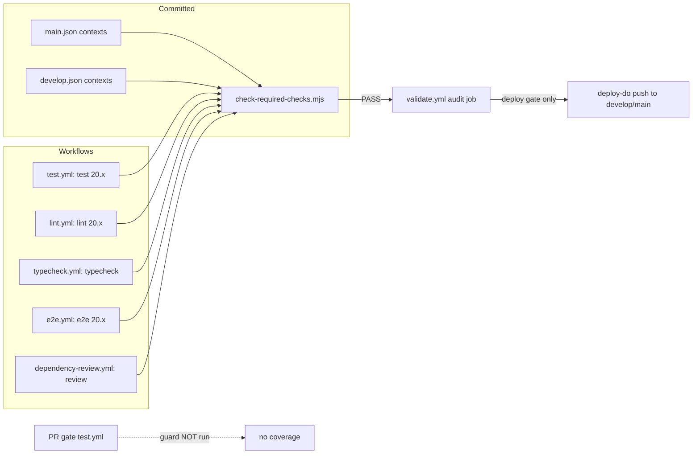

# 34_branch_protection_required_checks — Prompt 34 - Branch Protection and Required Checks Audit

- Run: `mainecybertech-20261011-0426-full-main-8d299b8`
- Target: `mainecybertech` @ `8d299b8` (branch `main`)
- Domain: `34_branch_protection_required_checks.md` (area BP, prompt)

## Verification Performed

# Branch Protection and Required Checks Audit

## Audit Metadata

- Audit name: repo-deep-dive (full hardening edition, base profile)
- Run: `mainecybertech-20261011-0426-full-main-8d299b8`
- Repository: `MaineCyberTech/mainecybertech` (read-only worktree `/tmp/opencode/mct-audit-target`)
- Branch: `main`
- Commit SHA: `8d299b8d` (`8d299b8dc271c410b9ae2ceeda3d2c6c997af8fd`)
- Generated at: 2026-10-11
- Auditor: domain subagent 34 (area code BP)
- Output path: `docs/audits/repo-deep-dive/mainecybertech-20261011-0426-full-main-8d299b8/34_branch_protection_required_checks.md`
- Scope limitations: no live GitHub API access. Everything about *applied* protection, environment reviewer lists, team membership, and the audit log is `Unknown` / `not reproducible`. This report audits the committed as-code configuration, the workflows' emitted check names, and the documented process. No GitHub settings were changed.

## Scope

Reviewed: all 20 `.github/workflows/*.yml`, the committed branch-protection JSON for `main`/`develop` and its README, `CODEOWNERS`, the PR template, `dependabot.yml`, the branch/release/hotfix docs (`RELEASING.md`, `RELEASE.md`, `ROLLBACK_PROCEDURES.md`, `technical-writing/migration-guide.md`, `RELEASE_GATE.md`, `GITHUB_SECRETS_AND_VARIABLES_MATRIX.md`, `CI.md`), the required-check guard (`scripts/check-required-checks.mjs`), and the previous run's BP findings for verification duty.

Not reviewed: live GitHub repository settings (protection, rulesets, environments, team membership, audit log), GitHub-side Dependabot security-update toggles, and anything that requires `pnpm install`/build/test execution (prohibited by the run rules).

## Evidence Reviewed

| Evidence | Type | Why relevant | Notes |
|---|---|---|---|
| `.github/branch-protection/main.json`, `develop.json` | Config (as code) | The protection payloads | Applied manually per README; live state Unknown |
| `.github/branch-protection/README.md` | Docs | Apply/inspect commands, required-check table | Manual `gh api` only |
| `scripts/check-required-checks.mjs` + `.github/workflows/validate.yml:33-39` | Guard | Required contexts must match emitted check-runs | Wired into deploy gate only |
| `.github/workflows/{test,lint,typecheck,e2e,dependency-review}.yml` | Workflows | Emit the required check-runs | E2E still path-filtered |
| `.github/workflows/deploy-do.yml`, `terraform-do.yml`, `supabase-migrations.yml` | Workflows | Prod mutation paths and environments | prod-approval vs prod split |
| `.github/CODEOWNERS` | Config | Ownership map for required owner reviews | No validator |
| `.github/PULL_REQUEST_TEMPLATE.md` | Template | Advisory checklist incl. required checks link | Not machine-enforced |
| `.github/dependabot.yml` | Config | Update coverage and routing | No security grouping/SLA |
| `docs/RELEASING.md`, `RELEASE.md`, `ROLLBACK_PROCEDURES.md`, `RELEASE_GATE.md`, `GITHUB_SECRETS_AND_VARIABLES_MATRIX.md`, `CI.md`, `technical-writing/migration-guide.md`, `AGENTS.md` | Docs | Documented process vs code | Hotfix stub; reviewer-checklist inconsistency |
| `docs/audits/repo-deep-dive/20261002-0344-develop-6286137/{34_branch_protection_required_checks.md,branch_protection_recommendation.md}` | Prior audit | Baseline for verification duty | Commit-bound, now partly stale |

## Verification Performed

| Command | Observed result |
|---|---|
| `git rev-parse HEAD` | `8d299b8dc271c410b9ae2ceeda3d2c6c997af8fd`; `git merge-base --is-ancestor 8b02f91a 8d299b8d` → yes (fix is on main) |
| `node scripts/check-required-checks.mjs` | not run — `node` is not installed on the audit host (exit 127). Replicated the script's logic in Python (read-only, `/tmp/opencode/bp-check.py`) |
| `python3 /tmp/opencode/bp-check.py` | `OK` for all 8 required contexts across 2 branch-protection files against 86 derived check-run names; `PASS` |
| `grep -rniE "break[- ]glass\|bypass"` (excl. prompts/node_modules) | No repository-governance emergency-merge procedure; only client-product content and RLS-bypass metrics |
| `grep -rn "branch-protection\|/protection" .github/workflows/*.yml` | Only `validate.yml:33-39` (static name check) and README manual commands — no live-drift job |
| `grep -n "environment:" .github/workflows/*.yml` | `deploy-do.yml:571` prod-approval (prod deploy), `terraform-do.yml:202` prod-approval (prod apply), `supabase-migrations.yml:34` `prod`, read-only jobs use `prod`/`dev` |
| `git log --oneline 9c0b88c..8d299b8d -- .github/ ...` | Since the previous run only `dependabot.yml`, backup workflows, `deploy-do.yml` (alerting/SSH pinning), `secret-history-scan.yml`, `supabase-migrations.yml` changed — no protection/workflow-name changes |
| `git show 8b02f91a -- .github/branch-protection/ scripts/check-required-checks.mjs` | contexts corrected, `enforce_admins` and `require_code_owner_reviews` flipped to true, guard added |
| `sed -n`/`grep` on e2e/test/lint/typecheck triggers | test/lint/typecheck unfiltered; **e2e pull_request still path-filtered** while required on main |

## Executive Summary

The governance layer is materially stronger than at the 20261002 baseline. The committed protection payloads now name the exact check-runs that workflows emit (`Test / test (20.x)` … `Dependency Review / review`), `enforce_admins` and `require_code_owner_reviews` are `true` on both branches, a static guard (`scripts/check-required-checks.mjs`) fails CI when a required context stops resolving, and the prod deploy/apply jobs share the `prod-approval` environment. Verification duty: three P1 rows and the P2 CODEOWNERS row are `verified-fixed` at `8d299b8d`.

The remaining risks are not in the JSON payload but around it:

1. **The BP–P2-004 class is only half fixed** — `E2E / e2e (20.x)` is required on `main` but its `pull_request` trigger is still path-filtered, so docs-only/API-only PRs to `main` leave the check unreported and cannot merge (admins included).
2. **No break-glass and no drift detection** — both previous P2 rows are still open; with `enforce_admins: true` a stuck check has no documented, audited escape, and nothing compares the committed JSON with live GitHub state.
3. **The new guard is not on the path that changes the guard's inputs** — it runs only via the deploy gate, not on PRs or branch-protection-only commits.
4. **Manual dispatch can target prod from any ref**, and security scans (secrets-scan, dependency audit, CodeQL) are not required checks, so their failures do not block merges.

Recommended next actions: un-filter E2E (or add an always-reporting companion), wire the guard into the PR gate, write the emergency-merge runbook, add the drift job, and apply the committed JSON with the reviewer lists — all owner/repo-admin actions except the first two.

## Inventory

| Item | Path / symbol | Purpose | Current state | Risk | Notes |
|---|---|---|---|---|---|
| Protection payload `main` | `.github/branch-protection/main.json` | 5 required contexts, strict, admin-enforced, 1 review + code owners, no force-push/deletions | Fixed as code | Live application Unknown | README apply command only |
| Protection payload `develop` | `.github/branch-protection/develop.json` | 3 required contexts, same review rules | Fixed as code | Live application Unknown | E2E intentionally not required |
| Required-check guard | `scripts/check-required-checks.mjs` | Static check contexts↔workflow jobs | Works; replicated PASS | Not run on PRs/bp-only changes | validate.yml:39 |
| CODEOWNERS | `.github/CODEOWNERS` | Team ownership map | Present; owner reviews required | Teams unverifiable; no validator | 5 team handles |
| PR template | `.github/PULL_REQUEST_TEMPLATE.md` | Review checklist | Links required-check table | Advisory only | line 20 |
| Dependabot | `.github/dependabot.yml` | npm/actions/docker/terraform updates → develop | Weekly, grouped | No security grouping/SLA | 8 update entries |
| Prod deploy gate | `deploy-do.yml:566-571` | Human approval env for prod | prod-approval attached | Reviewers not configured (docs) | CI-P1-001 residual |
| Prod apply gate | `terraform-do.yml:198-202` | Terraform prod apply | prod-approval | Same | Manual-only workflow |
| Prod migrations | `supabase-migrations.yml:34` | `supabase db push` to prod | `prod` environment | Reviewers on `prod` required but omitted from RELEASE_GATE checklist | CI-004 |
| Hotfix docs | `docs/technical-writing/migration-guide.md:153-160` | Emergency deploy | Stub | Ambiguous/stale | Only hotfix doc |
| Drift detection | — | Live vs committed protection | Absent | Silent divergence | No workflow |

## Domain Scorecard

| Category | Score | Evidence | Gap | Recommended action |
|---|---:|---|---|---|
| Workflows/jobs | 4 | Pinned SHAs, fail-closed gates, attestations (`deploy-do.yml:538-563`), PR-only dedup design | Guard not on PR path; security jobs non-required | Wire guard into `test.yml`; add security contexts |
| PR templates | 3 | `PULL_REQUEST_TEMPLATE.md:9-20` | Advisory, not enforced | Optional: PR-label/bot checks |
| CODEOWNERS | 3 | Map present; `require_code_owner_reviews: true` | No validator; teams unverifiable | Add CODEOWNERS CI check |
| Dependabot | 3 | 8 entries incl. digest-pinned docker dirs | No security grouping/SLA | Add SLA + routing |
| Release/deploy/migration/security workflows | 4 | Fail-closed deploy gate, prod-only e2e/migrate gates, attestation verify | Prod dispatch from any ref; CodeQL not blocking | Ref guard; required scanning |
| Branch/release/hotfix docs | 3 | `RELEASING.md`, `RELEASE.md`, `ROLLBACK_PROCEDURES.md` are strong | Hotfix stub; `prod` vs `prod-approval` checklist mismatch | Runbook + checklist fix |
| Environment approvals | 2 | `prod-approval` attached to prod deploy+apply | Reviewer lists not configured (docs); two prod envs | Configure reviewers; align checklist |
| Manual dispatch | 3 | Inputs documented; rollback path fail-closed | Prod target from arbitrary ref | Restrict prod dispatch to main |
| Workflow risks | 3 | E2E path-filter residual; guard coverage gap | See findings | See recommendations |

## Detailed Review

### Item: Required status checks vs emitted check-runs

- Evidence: `main.json:4-10` (`Test / test (20.x)`, `Lint / lint (20.x)`, `TypeCheck / typecheck`, `E2E / e2e (20.x)`, `Dependency Review / review`); `develop.json:4-8` (first three); workflow names/jobs as listed in the Appendix.
- What it does: pins merges to real check-runs.
- How it appears to work: GitHub matches each context string exactly to a reported check-run; the Python replication confirms every context has a producing job.
- Missing controls: the guard runs only in the deploy gate; E2E remains path-filtered on PRs.
- Risks: unreported required check on filtered PRs (blocked merges); unvalidated edits to the JSON.
- Suggested tests: assert each required context maps to a workflow whose `pull_request` trigger is unfiltered.

### Item: Review rules and CODEOWNERS

- Evidence: `main.json:13-17`, `develop.json:11-15` (1 approval, dismiss stale, require code owners, conversation resolution); `.github/CODEOWNERS:4-44`.
- Missing controls: no CODEOWNERS syntax/team validator; team membership Unknown.
- Risks: silent no-op owner enforcement on a typo.

### Item: Environments and approvals

- Evidence: `deploy-do.yml:571`, `terraform-do.yml:202`, `supabase-migrations.yml:34`, `docs/RELEASING.md:96-105`, `docs/GITHUB_SECRETS_AND_VARIABLES_MATRIX.md:7-21,140-153`, `docs/RELEASE_GATE.md:60-61`.
- What it does: attaches `prod-approval` to app deploy + terraform apply; `prod` to migrations.
- Missing controls: live reviewer lists (operator action); the consolidated checklist names only `prod-approval`.

### Item: Manual dispatch surfaces

- Evidence: `deploy-do.yml:4-15,69-84` (deploy_target/rollback_sha); `terraform-do.yml:14-21` (`apply` bool); `supabase-migrations.yml:4-10` (`allow_drift`); `build-push.yml`, backup/dispatch workflows.
- Risks: prod deploy from arbitrary ref; rollback dispatch intentionally skips e2e/migrate gates but still verifies attestations (`deploy-do.yml:436-492`).

### Item: Hotfix / emergency path

- Evidence: `docs/technical-writing/migration-guide.md:153-160`; no hotfix section in `RELEASING.md`/`RELEASE.md`; `AGENTS.md:58-62` requires approval but defines no exception path.
- Risks: undocumented, unaudited bypass-by-necessity when a required check is stuck.

## Scenario / Control Matrix

| ID | Scenario or control | Evidence | Current control | Gap | Severity | Recommendation |
|---|---|---|---|---|---|---|
| BP-001 | Workflows/jobs | `main.json:4-10`, workflows | Exact check-run names; static guard | Guard not on PR path | P2 | Wire guard into PR gate |
| BP-002 | PR templates | `PULL_REQUEST_TEMPLATE.md:20` | Checklist links required checks | Advisory only | P3 | Keep; optional enforcement |
| BP-003 | CODEOWNERS | `CODEOWNERS:4-44`; `main.json:15` | Owner reviews required | No validator; teams Unknown | P3 | CODEOWNERS CI check |
| BP-004 | Dependabot | `dependabot.yml:3-97` | Broad weekly coverage | No security grouping/SLA | P3 | SLA + routing |
| BP-005 | Release/deploy/migration/security workflows | `deploy-do.yml`, `validate.yml`, `codeql.yml` | Fail-closed deploy gate; attestation verify | CodeQL/secrets scans non-required; prod dispatch any ref | P2 | Required scans; ref guard |
| BP-006 | Branch/release/hotfix docs | `RELEASING.md`, `migration-guide.md:153` | Normal path documented | Hotfix stub; checklist mismatch | P3 | Runbook + checklist fix |
| BP-007 | Environment approvals | `deploy-do.yml:571`, `supabase-migrations.yml:34` | Environments attached | Reviewers not configured (docs) | P2 (operator) | Configure; align docs |
| BP-008 | Manual dispatch | `deploy-do.yml:4-15,72` | Inputs documented | Prod from arbitrary ref | P2 | Restrict prod to main |
| BP-009 | Workflow risks | `e2e.yml:12-22`, `main.json:8` | E2E required on main | Path-filtered required check | P2 | Un-filter or companion job |

## Findings

Verification duty rows keep the previous titles; IDs will be re-assigned by the aggregator (previous IDs shown for traceability).

| Prev ID | Severity | Title | Status at 8d299b8d |
|---|---|---|---|
| BP–P1-001 | P1 | `main` requires a context (`Dependency Review`) that no job emits | verified-fixed |
| BP–P1-002 | P1 | `enforce_admins:false` lets administrators bypass all required checks and reviews | verified-fixed |
| BP–P1-003 | P1 | Production deploy path uses the unguarded `prod` environment, not `prod-approval` | verified-fixed |
| BP–P2-001 | P2 | `require_code_owner_reviews:false` makes the committed CODEOWNERS advisory only | verified-fixed |
| BP–P2-002 | P2 | No break-glass / bypass process for branch protection, and no bypass audit trail | still-open |
| BP–P2-003 | P2 | No drift detection between committed branch-protection JSON and live GitHub settings | still-open |
| BP–P2-004 | P2 | Path-filtered required checks can leave `main`/`develop` protected by checks that never run | partially-fixed |
| BP–P3-001 | P3 | Hotfix and emergency-deploy documentation is a stub and partially stale | still-open |
| BP–P3-002 | P3 | Dependabot has no security-update separation or triage SLA, and PR template has no enforced link to required checks | partially-fixed |
| — | P2 | Required-check guard is not run on pull requests or on branch-protection-only changes | open (new) |
| — | P2 | `deploy-do` manual dispatch can target prod from an arbitrary ref, bypassing the develop→main promotion model | open (new) |
| — | P2 | Security scan jobs are not required checks, so failing scans do not block merges | open (new) |
| — | P3 | Operator checklists disagree on which prod environments need required reviewers (`prod` vs `prod-approval`) | open (new) |
| — | P3 | check-required-checks guard mis-models explicit job names combined with matrices | open (new) |
| — | P3 | No CODEOWNERS validation; invalid team handles silently disable owner-review enforcement | open (new) |

Full evidence, impact, and remediation for every row are in `_domains/34_branch_protection_required_checks.json`.

## Risks

| Risk | Severity | Likelihood | Impact | Evidence | Mitigation |
|---|---|---|---|---|---|
| Docs-only/API-only PR to `main` cannot merge (missing E2E check) | P2 | High | Delivery friction; incentive to bypass | `e2e.yml:12-22`, `main.json:8` | Remove paths filter / companion job |
| Committed protection silently diverges from live settings | P2 | Medium | Weakens gate without notice | No drift job | Scheduled drift workflow |
| Stuck check with no break-glass → ad-hoc unaudited bypass | P2 | Medium | Audit gap | `AGENTS.md:58-62`, no runbook | Emergency-merge runbook + audit-log capture |
| Unmerged code deployed to prod via dispatch | P2 | Low–Medium | Production change outside review trail | `deploy-do.yml:72` | Ref guard + reviewers |
| Failing secret/security scan merges | P2 | Medium | Secret or vulnerable dep reaches branches | required contexts omit scans | Add scans to required checks |
| Owner review silently no-op | P3 | Low | False sense of enforcement | No validator | CODEOWNERS CI check |

## Recommendations

### Immediate / Release Blocking

- Configure ≥1 required reviewer on `prod-approval` **and** `prod` (operator action; tracked as CI-P1-001/CI-004), then prove the prod deploy pauses.
- Apply the committed JSON to GitHub and confirm `enforce_admins`, contexts, and code-owner reviews live (`gh api .../branches/{main,develop}/protection`).

### This Week

- Un-filter `E2E / e2e (20.x)` on `pull_request` (or add an always-reporting companion) so the required check on `main` always reports.
- Add the required-check guard to the PR gate (`test.yml` or the shared `unit-tests` composite) and include `.github/branch-protection/**` in a validating trigger.
- Guard `deploy-do` against `deploy_target: prod` from non-`main` refs.

### This Month

- Add the drift-detection workflow (live protection vs committed JSON, artifact evidence).
- Write `docs/RUNBOOK_EMERGENCY_MERGE.md` with incident ticket, named approver, time-box, and audit-log capture; consider Rulesets with an explicit bypass list.
- Decide whether secrets-scan/dependency-audit/CodeQL should be required checks; align `docs/CI.md` either way.
- Add a CODEOWNERS validator and confirm the `@mainecybertech/*` teams exist with members.
- Fix the hotfix stub and the `prod`/`prod-approval` checklist inconsistency.

### Later / Platform Evolution

- Migrate classic branch protection to GitHub Rulesets (bypass actors, required workflows, code-scanning requirement, clearer audit).
- Fix the guard's matrix+name modeling and add a fixture test.

## Quick Wins

| Quick win | Why it helps | Files likely involved | Validation |
|---|---|---|---|
| Add `node scripts/check-required-checks.mjs` step to `test.yml` | Catches broken required contexts on the PR that changes them | `.github/workflows/test.yml` | Open a PR that renames a job; guard fails |
| Add `paths:`-free E2E or companion job | Required check always reports on `main` PRs | `.github/workflows/e2e.yml`, `main.json` | Docs-only PR to main shows E2E green |
| Ref guard in `deploy-do` setup | Blocks prod deploys from feature branches | `.github/workflows/deploy-do.yml` | Dispatch from a branch with `deploy_target: prod` fails |
| Checklist fix in `RELEASE_GATE.md` | Operators configure both prod envs | `docs/RELEASE_GATE.md` | Review of doc against matrix doc |
| Document the guard in `scripts/README.md` | Discoverability for operators | `scripts/README.md` | Doc link check passes |

## Hardening Backlog

| Backlog item | Priority | Owner suggestion | Effort | Dependency |
|---|---|---|---|---|
| Drift-detection workflow (protection + environments) | P2 | repo admin/platform | M | Token with administration:read |
| Emergency-merge runbook + bypass audit capture | P2 | repo admin/security | S | GitHub audit-log access |
| Required security contexts or ruleset | P2 | security/CI owner | S–M | Owner decision on blocking vs alerting |
| Prod-dispatch ref restriction | P2 | platform/CI owner | S | None |
| CODEOWNERS validator | P3 | platform/CI owner | S | Org team read token |
| Rulesets migration | P3 | repo admin | M | Owner decision |
| Guard matrix+name fix + fixture | P3 | platform/CI owner | S | None |

## Suggested Tests

- **CI (unit)**: fixture workflow with a name+matrix job; assert the guard's emitted-name expansion (regression for the mis-modeling finding).
- **CI (guard)**: assert every context in `.github/branch-protection/*.json` comes from a workflow whose `pull_request` trigger has no `paths:` filter.
- **CI (CODEOWNERS)**: parse and validate handles; fail when a team cannot be resolved.
- **Manual (protection)**: open a PR with a failing required check → merge blocked for non-admin and admin; PR touching `.github/workflows/` → owner review required; docs-only PR to `main` → E2E reports green.
- **Manual (approval)**: dispatch `deploy-do` `deploy_target: prod` → pauses at "Waiting for approval"; dispatch from a feature branch → fails before deploy.
- **Scheduled (drift)**: edit protection in the UI → drift job fails; restore → green.

## Suggested Documentation Updates

- `docs/RUNBOOK_EMERGENCY_MERGE.md` (new) — break-glass process and audit trail.
- `docs/CI.md` — E2E required-check/path-filter note; correct CodeQL gate wording.
- `docs/RELEASE_GATE.md` — reviewers on both `prod` and `prod-approval`.
- `docs/technical-writing/migration-guide.md` — replace the hotfix stub.
- `scripts/README.md` — document `check-required-checks.mjs`.
- `docs/DEPENDENCY_POLICY.md` — security-update triage SLA and owner.

## Open Questions

| Question | Why it matters | Evidence needed |
|---|---|---|
| Is the committed JSON actually applied to GitHub today, and does it match? | Determines whether any as-code finding is live | `gh api repos/.../branches/{main,develop}/protection` |
| Are required reviewers configured on `prod` and `prod-approval`? | The only human gate on prod mutations | `gh api repos/.../environments` or settings capture |
| Do the five `@mainecybertech/*` teams exist with members? | `require_code_owner_reviews` effectiveness | Org teams API |
| Is a live ruleset requiring code-scanning results present? | Whether CodeQL is truly blocking | Rulesets API |
| Are Dependabot security updates enabled repo-side? | Covers the security-update gap not expressible in config | Repo settings API |

## Appendix

### Workflow-to-required-check mapping (at 8d299b8d)

| Required context | Emitted by | Trigger coverage | Required on |
|---|---|---|---|
| `Test / test (20.x)` | `test.yml` job `test` (matrix 20.x) | PR main/develop (no paths filter) | main, develop |
| `Lint / lint (20.x)` | `lint.yml` job `lint` (matrix 20.x) | PR main/develop (no paths filter) | main, develop |
| `TypeCheck / typecheck` | `typecheck.yml` job `typecheck` | PR main/develop (no paths filter) | main, develop |
| `E2E / e2e (20.x)` | `e2e.yml` job `e2e` (matrix 20.x) | PR main/develop **with paths filter**; `workflow_call` on prod deploy | main |
| `Dependency Review / review` | `dependency-review.yml` job `review` | PR main/develop (no paths filter) | main |

Non-required PR jobs: `Test / security-scan`, `Test / secrets-scan`, `CodeQL / Analyze (javascript-typescript)`, Chromatic, SBOM. Deploy-gate jobs (reusable `validate.yml`): `Validate / audit` (incl. the required-check guard), `Validate / test`, `Validate / secrets-scan`, `Validate / lint`, `Validate / typecheck`, `Validate / prompt-provenance`.

### Key commands and outputs

- `python3 /tmp/opencode/bp-check.py` → 8/8 contexts OK, PASS (replication of `scripts/check-required-checks.mjs`; node unavailable).
- `git log --oneline -S "require_code_owner_reviews" -- .github/branch-protection/` → files introduced in `431692fc`; the true-flip is visible in `git show 8b02f91a`.
- `git log --oneline -S "prod-approval" -- .github/workflows/deploy-do.yml` → `de8d898c` (2026-10-02) "put production deploys behind the same approval gate as infrastructure".
- `grep -rn "check-required-checks" .github/workflows/ scripts/README.md` → only `validate.yml:39` (not in the PR path, not documented in scripts/README.md).

### Workflow inventory observations (adjacent to this domain, not filed as BP findings)

- `docs/CI.md:28`, `AGENTS.md:300` and `review.md:306` still document `wireguard-endpoint.yml`, which was removed from the repository in `52304944` ("chore(ci): remove one-time DO firewall workflow", 2026-10-04). CI/ docs domains own the correction; it matters here only because operators use CI.md as the workflow-to-check reference.
- `.github/workflows/secret-history-scan.yml` exists but is absent from the `docs/CI.md` workflow table (grep for the filename returns no row).
- The deploy-gate mapping above is derived from the committed files at `8d299b8d`; `docs/CI.md:10-22` matches it for the required checks.

### Mermaid: required-check resolution

## Findings

| ID | Severity | Title |
|---|---|---|
| BP-P1-001 | P1 | `main` requires a context (`Dependency Review`) that no job emits |
| BP-P1-002 | P1 | `enforce_admins:false` lets administrators bypass all required checks and reviews |
| BP-P1-003 | P1 | Production deploy path uses the unguarded `prod` environment, not `prod-approval` |
| BP-P2-001 | P2 | `require_code_owner_reviews:false` makes the committed CODEOWNERS advisory only |
| BP-P2-002 | P2 | No break-glass / bypass process for branch protection, and no bypass audit trail |
| BP-P2-003 | P2 | No drift detection between committed branch-protection JSON and live GitHub settings |
| BP-P2-004 | P2 | Path-filtered required checks can leave `main`/`develop` protected by checks that never run |
| BP-P3-001 | P3 | Hotfix and emergency-deploy documentation is a stub and partially stale |
| BP-P3-002 | P3 | Dependabot has no security-update separation or triage SLA, and PR template has no enforced link to required checks |
| BP-P2-005 | P2 | Required-check guard is not run on pull requests or on branch-protection-only changes |
| BP-P2-006 | P2 | `deploy-do` manual dispatch can target prod from an arbitrary ref, bypassing the develop->main promotion model |
| BP-P2-007 | P2 | Security scan jobs are not required checks, so failing scans do not block merges |
| BP-P3-003 | P3 | Operator checklists disagree on which prod environments need required reviewers (`prod` vs `prod-approval`) |
| BP-P3-004 | P3 | check-required-checks guard mis-models explicit job names combined with matrices |
| BP-P3-005 | P3 | No CODEOWNERS validation; invalid team handles silently disable owner-review enforcement |
