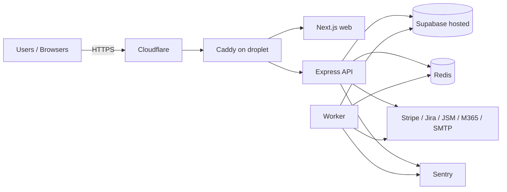
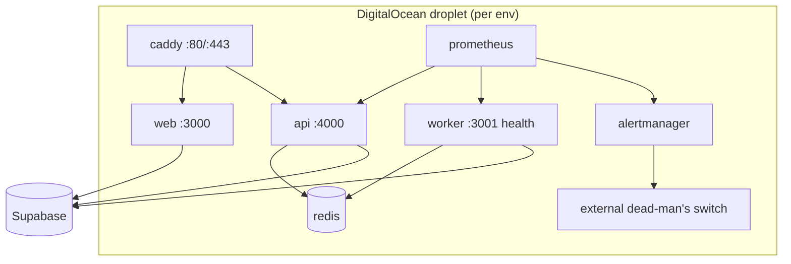
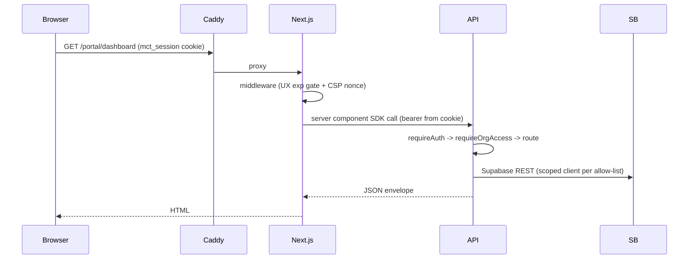
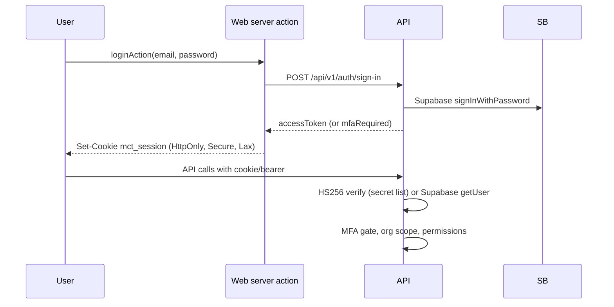
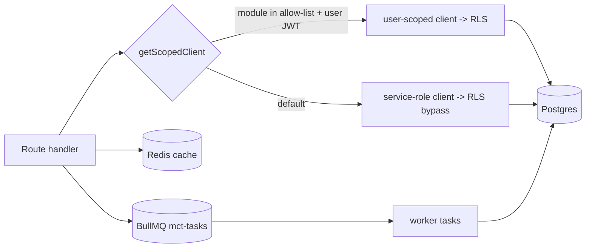
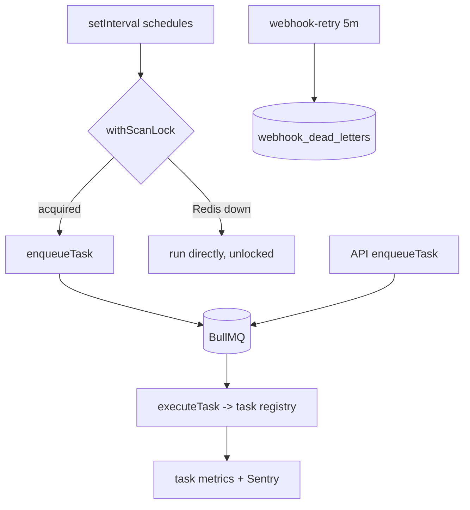
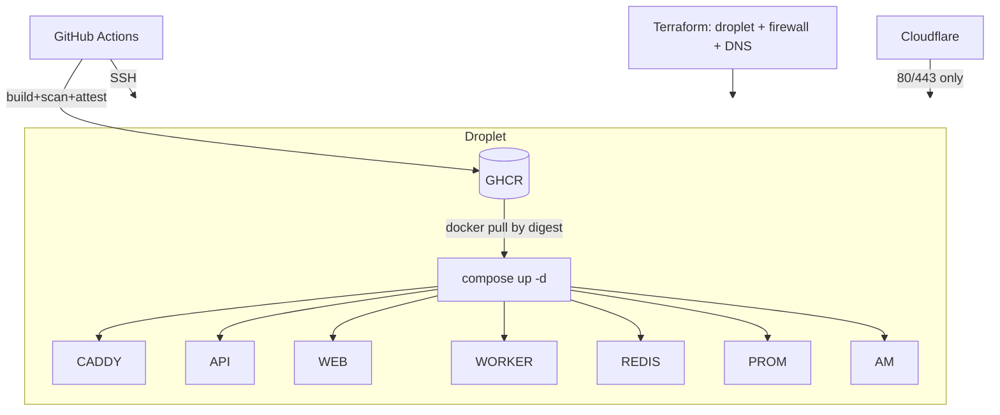
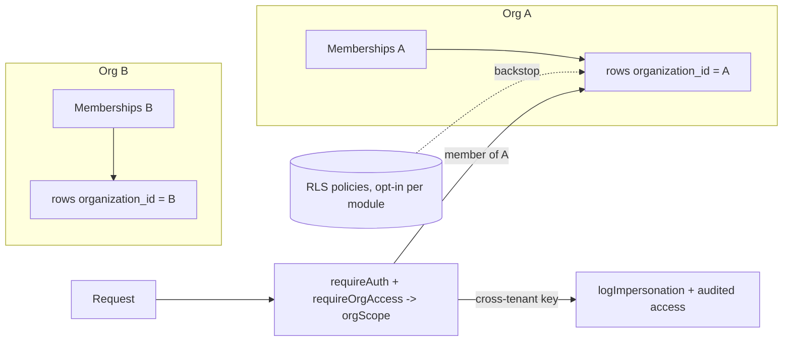

# Architecture and Runtime Topology Audit

## Audit Metadata

- Audit name: repo-deep-dive
- Run: `mainecybertech-20261011-0426-full-main-8d299b8`
- Repository: `https://github.com/MaineCyberTech/mainecybertech` (read-only worktree `/tmp/opencode/mct-audit-target`)
- Branch: `main`
- Commit SHA: `8d299b8dc271c410b9ae2ceeda3d2c6c997af8fd`
- Generated at: 2026-10-11 (subagent domain pass)
- Auditor: domain subagent `02_architecture_runtime_topology` (area ARCH)
- Output path: `docs/audits/repo-deep-dive/mainecybertech-20261011-0426-full-main-8d299b8/02_architecture_runtime_topology.md`
- Scope limitations: repository-only audit. No running stack, no droplet access, no GitHub environment secrets — live-dependent rows are marked `unverified`. No build/test commands were run (resource discipline).

## Scope

Reviewed: monorepo structure; frontend/backend/worker boundaries; auth/session flow; authorization and tenant boundaries; request lifecycle; data flow; background jobs; queues; webhooks; realtime; notifications; external integrations; deployment topology; environment parity; error handling; runtime validation.

Not reviewed (other domains): RLS policy SQL correctness (37), CI/CD governance (10), supply chain (11), infra drift (12), resilience drills (13), observability rules (14), performance (15), security exploitation (06/24/25/26).

## Evidence Reviewed

| Evidence | Type | Why relevant | Notes |
|---|---|---|---|
| `package.json`, `pnpm-workspace.yaml`, `turbo.json` | Monorepo config | Workspace layout + task graph | 3 apps, 3 packages, turbo build pipeline |
| `apps/api/src/app.ts`, `main.ts`, `middleware/*` | API runtime | Request lifecycle, error handling, boot checks | 60 routers mounted under `/api/v1` |
| `apps/worker/src/{main,consumer-bullmq,consumer-sqs,producer,task-registry,schedule-config,health-server}.ts` | Worker runtime | Job/queue topology, scheduling | BullMQ default; SQS and inline are alternatives |
| `apps/web/{middleware.ts,lib/api.ts,lib/client-api.ts,lib/auth/*,lib/cookie-domain.ts,next.config.mjs,Dockerfile}` | Web runtime | Session flow, SSR/client API paths | Cookie session; SSE client |
| `infra/digitalocean/{docker-compose.yml,prometheus.yml,prometheus.rules.yml,alertmanager.tmpl.yml,Caddyfile.prod}` | Deployment topology | As-built container graph + ingress | 7 always-on services (+ profile-gated e2e), internal-only observability |
| `infra/terraform/digitalocean/{droplet,firewall,variables}.tf`, `env/*` | Infrastructure | Host + network boundary | One droplet per env; Cloudflare-only 80/443 |
| `.github/workflows/deploy-do.yml`, `supabase-migrations.yml`, `validate.yml` | Deploy pipeline | Gates, env delivery, rollback | Digest-verified GHCR pull; stop-the-world deploy |
| `apps/api/src/{services/supabase.ts,lib/rls-startup-check.ts,config/env.ts}` | Data flow / runtime validation | DB client selection, fail-closed boot | Service-role default + per-module RLS allow-list |
| `apps/api/src/{lib/webhook-dispatcher.ts,routes/webhooks.ts}` + worker dispatcher/retry | Webhooks | Inbound auth + outbound delivery | Signature-verified inbound; DLQ + retry outbound |
| `apps/api/src/routes/notifications.ts`, `apps/web/components/NotificationBell.tsx` | Realtime/notifications | SSE stream + fallback polling | Supabase realtime channel per user |
| `docs/{ARCHITECTURE_DIAGRAM,ARCHITECTURAL_ANALYSIS,TROUBLESHOOTING,ONBOARDING,PLATFORM_FAILURE_RUNBOOKS,RLS-rollout,adr/README}.md` | Docs | Documented vs as-built | Diagram + ADR 004 drift (finding) |

## Verification Performed

| Evidence | Type | Why relevant | Notes |
|---|---|---|---|
| `git log -1` → `8d299b8d Merge PR #168` | Command | Bind findings to the audited commit | observed |
| `grep -n "alerting:" infra/digitalocean/prometheus.yml` → line 14 | Command | ARCH-P2-003 re-verification | alertmanager:9093 target present |
| `grep -n assertRlsStartupConfig apps/api/src/main.ts` → line 14 | Command | ARCH-P2-002 re-verification | guard called before listen |
| `grep -n "ARCH-P3-001" apps/web/middleware.ts` → line 6 | Command | ARCH-P3-001 re-verification | non-authoritative gate documented |
| `grep -rn QUEUE_BACKEND apps/api/src` → 0 hits | Command | Queue parity finding | API has no backend setting |
| `grep -n "docker save\|In-memory cache" docs/ARCHITECTURE_DIAGRAM.md` → 137,149 | Command | Doc drift finding | deploy + cache descriptions stale |
| `grep -n "pull_retry\|compose -p mct-portal down" deploy-do.yml` → 774,786-788,809 | Command | As-built deploy path | GHCR pull + stop-the-world down/up |
| `grep -n NEXT_PUBLIC_API_URL docker-compose.yml deploy-do.yml apps/web/lib/env.ts` | Command | Runtime/build-time URL split | runtime `http://api:4000` vs build `https://api.*` |

Commands and observed results (exact):

1. `git -C /tmp/opencode/mct-audit-target log -1 --format='%H %s'` → `8d299b8dc271c410b9ae2ceeda3d2c6c997af8fd Merge PR #168: promote develop to main (metrics scrape fixes + register sync)`.
2. `grep -n "alerting:" infra/digitalocean/prometheus.yml` → `14:alerting:` (block lines 14-17, target `alertmanager:9093`).
3. `grep -n "assertRlsStartupConfig" apps/api/src/main.ts apps/api/src/lib/rls-startup-check.ts` → `main.ts:14`, `rls-startup-check.ts:26,42`.
4. `grep -n "ARCH-P3-001\|ARCH-P2-002" apps/web/middleware.ts apps/api/src/lib/rls-startup-check.ts` → `middleware.ts:6`, `rls-startup-check.ts:5`.
5. `grep -rn "QUEUE_BACKEND" apps/api/src --include="*.ts" | wc -l` → `0`.
6. `grep -n "docker save\|In-memory cache" docs/ARCHITECTURE_DIAGRAM.md` → `137`, `149`.
7. `grep -n "pull_retry\|compose -p mct-portal down" .github/workflows/deploy-do.yml` → `774` (helper), `786-788` (image pulls), `809` (compose down).
8. `grep -n "NEXT_PUBLIC_API_URL" infra/digitalocean/docker-compose.yml .github/workflows/deploy-do.yml apps/web/lib/env.ts` → `docker-compose.yml:192`, `deploy-do.yml:333`, `env.ts:68`.

Live-dependent rows: deployed RLS allow-list contents, GitHub environment secrets, actual alert delivery, and the running web container's effective API URL are `unverified` (no read-only live access authorized in this pass).

## Executive Summary

The platform is a pnpm/Turbo monorepo (`apps/api`, `apps/web`, `apps/worker`, `packages/sdk|ui|config`) deployed as a single Docker Compose stack on one DigitalOcean droplet per environment, behind Caddy + Cloudflare, with hosted Supabase as the only data store and a single Redis for queue/cache/idempotency/locks. The request path is well-layered: helmet/CORS/body-parse → security headers → sanitizer → IP + per-user rate limits → request-id/logger → idempotency → CSRF → 30s timeout → routers → notFound/error handler. Tenant scope is resolved per request (`orgScope`) and audited; a per-module RLS client swap exists with a production fail-closed boot guard. Background work is BullMQ-backed with a worker task registry, staggered scheduled scans, Redis scan locks, webhook retry + dead letters, and an SSE notification stream.

Strengths: digest-verified GHCR deploys with provenance attestation; deploy health gate with auto-revert; fail-closed production boot checks (RLS reads, Turnstile, field encryption); Prometheus + Alertmanager with an off-box watchdog; documented failure runbooks; per-module RLS rollout with runtime bypass metrics.

Major risks: (1) the topology remains a hard SPOF — host loss or a failed deploy is a full outage, and every deploy is stop-the-world; (2) the API/worker queue contract is split across two unconnected settings, so drift silently drops tasks; (3) one non-replicated Redis silently changes delivery semantics on failure; (4) architecture docs/ADRs describe a superseded runtime.

Recommended next actions: verify the producer/consumer queue contract with a health assertion; document the deployed RLS allow-list; separate queue and cache (or replicate Redis); regenerate the architecture diagram and supersede ADR 004.

## Inventory

| Item | Path / symbol | Purpose | Current state | Risk | Notes |
|---|---|---|---|---|---|
| Monorepo | `pnpm-workspace.yaml`, `turbo.json` | 3 apps + 3 packages | Working, consistent | Low | `packages/sdk` consumed as TS source |
| API | `apps/api/src/app.ts` | Express app, 80+ routers | Functional, layered middleware | Med | Service-role DB default |
| Web | `apps/web` (Next 15 standalone) | App Router UI, cookie session | Functional | Low | SSR URL path ambiguous (finding) |
| Worker | `apps/worker` | BullMQ consumer + schedulers | Functional | Med | Backend config not shared with API |
| Queue | BullMQ on Redis, `mct-tasks` | Async tasks | Single instance | Med | SQS/inline alternatives present |
| Cache | `middleware/cache.ts` | GET response cache | Redis + memory fallback | Low | Invalidation by prefix |
| Idempotency | `lib/idempotency.ts` (API + worker) | Webhook/HTTP dedupe | Redis SET NX + per-process fallback | Med | Fallbacks don't dedupe across processes |
| Scan locks | `worker/src/lib/scan-lock.ts` | One replica runs each scan | Redis lock; unlocked fallback | Med | "single-replica assumed" |
| Webhooks in | `routes/webhooks.ts` | Stripe/Jira/JSM/M365 | Signature/clientState verified | Low | Raw-body HMAC; constant-time compare |
| Webhooks out | dispatcher + retry + DLQ | Tenant endpoint delivery | Atomic idempotency claim, SSRF-pinned | Low | Retry task every 5 min |
| Realtime | `routes/notifications.ts` SSE | Live notification stream | Org-scoped, auth re-check 5 min | Low | Polling fallback in UI |
| Observability | Prometheus/Alertmanager | Metrics + alerts + watchdog | Wired, internal-only | Low | Worker scrape unauthenticated (P3) |
| Deploy | `deploy-do.yml` | Build → attest → migrate → deploy | Digest-verified, auto-revert | Med | Stop-the-world per deploy |
| Infra | Terraform droplet + firewall | One host, Cloudflare-only ingress | Applied per env | Med | SSH fail-closed allowlist |

## Domain Scorecard

| Category | Score | Evidence | Gap | Recommended action |
|---|---:|---|---|---|
| Monorepo structure | 4 | `pnpm-workspace.yaml`; turbo task graph; 3 apps/3 packages | `packages/sdk` unbuilt TS source shared by all apps | Add a build step or document the coupling |
| Frontend/backend/worker boundaries | 4 | `apps/web/lib/api.ts` vs `client-api.ts`; worker task registry | SSR URL resolution ambiguous | Split server-only internal URL (finding) |
| Auth/session flow | 4 | `middleware/auth.ts:100-166`; cookie options; MFA step | Web middleware is a UX-only gate (accepted) | Keep documented; add assertion |
| Authorization and tenant boundaries | 3 | `org-access.ts`, `assertOrgScopeMatches`, RLS allow-list + startup guard | Service-role remains the default; rollout state not reviewable | Record the deployed allow-list |
| Request lifecycle | 4 | `app.ts:89-236` ordering; idempotency; CSRF; timeout | 408 does not cancel work | Abort signal or document semantics |
| Data flow | 3 | `services/supabase.ts` (REST, circuit breaker, metrics) | Single Redis semantics degrade silently | Separate/replicate Redis; alert |
| Background jobs | 4 | Worker registry, schedules, metrics, DLQ for webhooks | Generic task failures have no DLQ (RES-P2-002) | Add task DLQ or bounded retry reporting |
| Queues | 3 | BullMQ producer/consumer; queue-depth metric | Producer/consumer settings disconnected | Enforce a single backend contract |
| Webhooks | 4 | Signature verification; pinned fetch; retry + DLQ | None material found | Keep |
| Realtime | 4 | Org-scoped SSE + auth re-validation | One Supabase channel per connected user (single box) | Load-test connection count |
| Notifications | 4 | Preference gating, dedupe key, delivery metrics | Email still optional (NOTIF-P2-002) | Provision SMTP (operator) |
| External integrations | 3 | Stripe/Jira/JSM/M365/SMTP/Sentry/Turnstile | Env delivery verified by INFRA-P2-006; syncs not scheduled per-tenant by design | Keep integration checks in `/health` |

## Detailed Review

### Item: Monorepo structure

- Evidence: `pnpm-workspace.yaml` (`apps/*`, `packages/*`), `turbo.json` (build/dev/lint/test/typecheck/coverage tasks), `apps/{api,web,worker}`, `packages/{sdk,ui,config}`.
- What it does: pnpm workspace with Turbo task orchestration; apps build independently (Dockerfiles per app); `packages/sdk` is the typed API client + DB types shared by web/API/worker.
- Current controls: `pnpm-lock.yaml` frozen installs in CI; per-app Docker builds; turbo outputs cached.
- Missing controls: `packages/sdk` has `main: ./src/index.ts` (no build), so every consumer compiles it — a deliberate but undocumented coupling.
- Risks: Low.

### Item: Frontend/backend/worker boundaries

- Evidence: web calls the API through `@mct/sdk` (server: `apps/web/lib/api.ts`, browser: `lib/client-api.ts`); the worker never serves HTTP except its health server (`worker/src/health-server.ts`); the API never consumes the queue.
- What it does: browser → Caddy → web; SSR → API; async work → Redis → worker; observability internal.
- Missing controls: no runtime check that the web container's effective API URL matches the intended path (finding).
- Risks: Medium (hidden routing assumption).

### Item: Auth/session flow

- Evidence: `POST /api/v1/auth/*` issues Supabase JWTs; web sets `mct_session` (HttpOnly, Secure, SameSite=Lax, domain `.mainecybertech.com`) via `lib/cookie-domain.ts:14-26`; API `requireAuth` verifies HS256 with a comma-separated secret list then falls back to Supabase `getUser` with a 5s timeout (`middleware/auth.ts:100-166`); MFA step (`mfa.ts`); API-key path (`mct_*`) pins the key's org (`auth.ts:67-88`).
- Current controls: algorithm pinning, exp check, MFA gate, API-key org pinning, CSRF double-submit for cookie auth, SSE re-validation every 5 min.
- Missing controls: web middleware remains a non-authoritative exp gate (accepted, documented).
- Risks: Low.

### Item: Authorization and tenant boundaries

- Evidence: `requireOrgAccess` resolves `orgScope` (explicit query/body → active-org header/cookie → first approved membership), audits cross-tenant access (`logImpersonation`), and blocks body/query org mismatches (`assertBodyOrgMatches`); `assertOrgScopeMatches`/`assertSharesActiveOrg` for target checks; `getScopedClient` swaps to the RLS client per module allow-list; `assertRlsStartupConfig` refuses prod boot when reads are empty.
- Missing controls: no reviewable record of which modules are enabled in each environment; writes can still fall back to service-role.
- Risks: Medium.

### Item: Request lifecycle

- Evidence: `app.ts:89-151` (helmet → CORS reflect → 10MB JSON + rawBody capture → cookieParser → securityHeaders → inputSanitizer → 300/15min IP limiter with webhook skip → 600/15min user limiter → request-id/logger → idempotency → CSRF → 30s timeout) → routers → `notFoundHandler` → `errorHandler` (Sentry, generic 5xx message, `X-Request-ID`).
- Missing controls: 408 is advisory only; webhooks skip the IP limiter but are still covered by the per-user/IP limiter.
- Risks: Low-Medium.

### Item: Data flow

- Evidence: all DB access is Supabase REST with the service-role key by default (`services/supabase.ts:63-83`) through a circuit breaker + duration histogram; user-scoped client memoized per request (`:115-177`); Redis cache; audit writes retry 3× and log a gap on failure (`services/audit.ts`).
- Risks: Medium (see Redis and RLS findings).

### Item: Background jobs / queues / webhooks / realtime / notifications

- Evidence: `worker/src/main.ts` schedules 6 fixed tasks + 17 staggered module scans; `withScanLock` dedupes replicas; BullMQ job options `attempts:3` exponential backoff (`task-producer.ts:48-56`); webhook retry with DLQ (`tasks/webhook-retry.ts`); SSE stream (`routes/notifications.ts:47-173`); notification channels + dedupe key (`lib/notify.ts`, `notification-channels.ts`).
- Missing controls: task-level DLQ for non-webhook jobs; queue backend parity; worker metrics auth.
- Risks: Medium.

### Item: Deployment topology / environment parity

- Evidence: Terraform droplet (one per env, `prevent_destroy`), firewall (Cloudflare CIDRs only for 80/443; SSH allowlist required), compose stack (7 always-on services + profile-gated e2e, mem/PID limits, read-only roots, cap_drop ALL), deploy pipeline (validate → build+scan+attest → verify attestations → e2e+migrations for prod only → SSH deploy with auto-revert), Caddy prod/dev Caddyfiles, Alertmanager template with env substitution.
- Environment parity: dev and prod run the same NODE_ENV=production stack with production fail-closed checks; dev deploys skip e2e and migrations (prod gates only). Secrets are per-environment.
- Risks: Medium (stop-the-world deploys; dev/prod gate asymmetry is intentional).

## Scenario / Control Matrix

| ID | Scenario or control | Evidence | Current control | Gap | Severity | Recommendation |
|---|---|---|---|---|---|---|
| ARCH-001 | Monorepo structure | `pnpm-workspace.yaml`, `turbo.json` | Workspace + Turbo | SDK source coupling | P3 | Document or build SDK |
| ARCH-002 | Frontend/backend/worker boundaries | `lib/api.ts`, `health-server.ts` | Separate processes | SSR URL ambiguity | P3 | Server-only internal URL |
| ARCH-003 | Auth/session flow | `auth.ts:100-166`, `cookie-domain.ts` | HS256 + Supabase fallback + MFA | UX-only edge gate (accepted) | P3 | Keep + assert |
| ARCH-004 | Authorization and tenant boundaries | `org-access.ts`, `rls-startup-check.ts` | Per-request scope + audited cross-tenant | RLS default off | P2 | Record allow-list |
| ARCH-005 | Request lifecycle | `app.ts:89-236` | Ordered middleware + error envelope | 408 doesn't cancel | P3 | Abort signal |
| ARCH-006 | Data flow | `supabase.ts`, `cache.ts` | Service-role REST + cache | Silent degradation | P2 | Redis hardening |
| ARCH-007 | Background jobs | `worker/src/main.ts`, `task-registry.ts` | Registry + schedules + metrics | No generic DLQ | P2 | DLQ (RES-P2-002) |
| ARCH-008 | Queues | `task-producer.ts`, `consumer-*.ts` | BullMQ default | Producer/consumer split | P2 | Parity check |
| ARCH-009 | Webhooks | `routes/webhooks.ts`, dispatcher + retry | Signature + idempotent + DLQ | None material | P3 | Keep |
| ARCH-010 | Realtime | `notifications.ts` SSE | Org-scoped, re-validated | Connections per user on one box | P3 | Load test |
| ARCH-011 | Notifications | `notify.ts`, channels | Preferences + dedupe + metrics | SMTP optional | P2 | Provision SMTP |
| ARCH-012 | External integrations | Stripe/Jira/JSM/M365/health checks | Signature/secret gates | Syncs operator-driven | P3 | Keep |

## Findings

### Finding: Single-droplet, single-instance runtime is a hard SPOF (P2, partially-fixed)

- Severity: P2 · Confidence: high · Area: ARCH
- Evidence: `droplet.tf:1-20` (one droplet resource); `docker-compose.yml:68-184` (one api/worker/web), `:27-61` (one Redis), `:310-337` (one Caddy); `deploy-do.yml:809-815` (compose down before up).
- What is happening: no replication at any layer; deploys stop the stack before starting the new one.
- Why it matters: host/Redis/Caddy loss is a total outage; every deploy is an outage window.
- Recommended fix: keep runbooks; budget blue/green or at least an in-place `up -d` path; state the downtime window in `docs/SLO.md`.
- Status: partially-fixed (runbooks present, topology unchanged).

### Finding: API defaults to the service-role DB client (RLS bypass) (P2, partially-fixed)

- Severity: P2 · Confidence: high · Area: ARCH
- Evidence: `supabase.ts:198-226`; `rls-startup-check.ts:40-46`; `main.ts:12-14`; `deploy-do.yml:615-616,707-708`; `docs/RLS-rollout.md:19-23`.
- What is happening: RLS enforcement is opt-in per module; the guard only proves the list is non-empty.
- Why it matters: tenant isolation still depends on middleware for unlisted modules.
- Recommended fix: record the deployed allow-list in the runbook; extend the rollout; keep the bypass metrics/alert.
- Status: partially-fixed.

### Finding: Prometheus loads rules but has no alert routing (P2, verified-fixed)

- Severity: P2 · Confidence: high · Area: ARCH
- Evidence: `prometheus.yml:14-17`; `docker-compose.yml:239-307`; `alertmanager.tmpl.yml:63-100,105-152`; `deploy-do.yml:711-729`.
- Status: verified-fixed (no action required).

### Finding: Web middleware gates routes on an unverified JWT `exp` (P3, partially-fixed)

- Severity: P3 · Confidence: high · Area: ARCH
- Evidence: `apps/web/middleware.ts:5-16,17-26,115,134-138`; `apps/api/src/middleware/auth.ts:100-134`.
- Status: partially-fixed (documented UX gate; behavior intentionally unchanged).

### Finding: API always enqueues to BullMQ while the worker backend is a separate setting with no parity check (P2, open)

- Severity: P2 · Confidence: high · Area: ARCH
- Evidence: `task-producer.ts:76-104`; `worker/src/env.ts:11,44-65`; `consumer-sqs.ts:80-108`; `webhook-dispatcher.ts:147-153`; `notify.ts:215-221`; compose `:138`.
- Why it matters: drift silently loses webhooks, emails and scheduled scans while the API reports success.
- Recommended fix: one backend contract + fail-closed parity assertion + an enqueue/consume smoke check.
- Status: open.

### Finding: One non-replicated Redis backs queue, cache, idempotency and scan locks; failure degrades silently (P2, open)

- Severity: P2 · Confidence: high · Area: ARCH
- Evidence: compose `:27-61`; `task-producer.ts:97-104`; API `idempotency.ts:52,107-136`; worker `idempotency.ts:10,44-52`; `scan-lock.ts:43-50`; `cache.ts:35-52`; `PLATFORM_FAILURE_RUNBOOKS.md:60-64`.
- Why it matters: duplicates become possible and dedup/locks are lost without any alert.
- Recommended fix: split queue vs cache or replicate; make degradation loud; alert on OOM/queue depth.
- Status: open.

### Finding: Architecture diagram and ADR 004 contradict the as-built runtime (P3, open)

- Severity: P3 · Confidence: high · Area: ARCH
- Evidence: `ARCHITECTURE_DIAGRAM.md:137,149`; `adr/README.md:23`; `deploy-do.yml:776-788`; `cache.ts:27-60`; `PRODUCTION_VS_TESTING_DOMAINS.md:8-16,31`.
- Recommended fix: regenerate the diagram; supersede ADR 004; fix the domain doc (INFRA-P2-005 overlap).
- Status: open.

### Finding: `NEXT_PUBLIC_API_URL` runtime override is inert for server-side code (P3, open)

- Severity: P3 · Confidence: medium · Area: ARCH
- Evidence: compose `:192`; `deploy-do.yml:333`; `apps/web/lib/env.ts:66-68`; `TROUBLESHOOTING.md:22`; `ARCHITECTURE_DIAGRAM.md:116`; `ONBOARDING.md:74`.
- Why it matters: SSR traffic uses the public edge, and the docs claim otherwise; the runtime value is misleading.
- Recommended fix: server-only `API_INTERNAL_URL` read at runtime (or fix docs and remove the value).
- Status: open.

### Finding: Request timeout returns 408 but never cancels the handler (P3, open)

- Severity: P3 · Confidence: high · Area: ARCH
- Evidence: `request-timeout.ts:3-18`; `app.ts:151`.
- Recommended fix: thread an AbortSignal or document the advisory semantics + require Idempotency-Key on mutations.
- Status: open.

### Finding: Worker metrics/health are unauthenticated while the API gates /metrics (P3, open)

- Severity: P3 · Confidence: high · Area: ARCH
- Evidence: `worker/src/health-server.ts:8-56`; `app.ts:154-171`; `prometheus.yml:33-39`; compose `:130-184`.
- Recommended fix: gate worker /metrics with METRICS_TOKEN and add the scrape authorization block.
- Status: open.

## Risks

| Risk | Severity | Likelihood | Impact | Evidence | Mitigation |
|---|---|---|---|---|---|
| Droplet/Redis/Caddy loss = total outage | P2 | Medium | High | droplet.tf; compose | Runbooks; second host/blue-green (owner) |
| Deploy outage window on every release | P2 | High | Medium | deploy-do.yml:809-815 | In-place `up -d` or blue/green |
| Queue contract drift drops tasks silently | P2 | Low | High | task-producer vs worker env | Parity check + smoke task |
| Redis outage changes delivery semantics | P2 | Medium | High | idempotency/scan-lock fallbacks | Split/replicate Redis; alert |
| RLS not a backstop for unlisted modules | P2 | Medium | High | supabase.ts:198-226 | Rollout + reviewable allow-list |
| Docs/ADR mislead operators | P3 | High | Medium | ARCHITECTURE_DIAGRAM.md; adr/README.md | Regenerate docs |
| SSR depends on public edge | P3 | Medium | Medium | compose:192; env.ts:68 | Server-only internal URL |

## Recommendations

### Immediate / Release Blocking

- None identified in this domain at this commit (no P0/P1 ARCH findings).

### This Week

- Add a producer/consumer queue parity assertion (health check + startup log) — queue-contract finding.
- Record the deployed RLS allow-list contents/date in `docs/RLS-rollout.md` — RLS finding.

### This Month

- Harden Redis semantics: raise/review the 48 MB cap, separate queue vs cache (or replicate), make idempotency degradation loud, add OOM/queue-depth alerts — Redis finding.
- Decide and implement the server-side API URL strategy — SSR URL finding.

### Later / Platform Evolution

- Budget a second host / blue-green deploy to remove the SPOF and the deploy outage — SPOF finding.
- Regenerate the architecture diagram, supersede ADR 004, fix `PRODUCTION_VS_TESTING_DOMAINS.md` — docs finding.
- Gate worker metrics with the API's METRICS_TOKEN pattern; thread AbortSignal through the timeout middleware.

## Quick Wins

| Quick win | Why it helps | Files likely involved | Validation |
|---|---|---|---|
| Add queue parity startup log/assertion | Surfaces the silent-loss coupling | `apps/api/src/lib/task-producer.ts`, `apps/worker/src/env.ts` | Unit test + deploy log |
| Gate worker /metrics with METRICS_TOKEN | Consistent trust boundary | `worker/src/health-server.ts`, `prometheus.yml` | 404 without token; scrape green |
| Fix `ARCHITECTURE_DIAGRAM.md` deploy/cache lines | Removes operator confusion | `docs/ARCHITECTURE_DIAGRAM.md` | `scripts/check-docs-links.mjs` |
| Mark ADR 004 superseded | Stops agents citing stale decisions | `docs/adr/README.md` | doc review |

## Hardening Backlog

| Backlog item | Priority | Owner suggestion | Effort | Dependency |
|---|---|---|---|---|
| Queue backend parity contract | P2 | API principal engineer | S | Deploy env change |
| Record RLS allow-list state | P2 | API platform | S | Operator reads GitHub secrets |
| Redis semantics hardening + alerts | P2 | platform/backend + ops | M | Alert rules + compose change |
| Server-side internal API URL | P3 | @web + infra | M | Web Dockerfile + env schema |
| AbortSignal timeout | P3 | API principal engineer | M | Handler refactor |
| Docs/diagram regeneration | P3 | @docs | S-M | — |

## Suggested Tests

- Unit: `assertQueueBackendParity` (API backend vs worker backend), `requestTimeout` abort behavior, worker metrics token gate.
- Integration: enqueue a task through the API producer and assert the worker consumes it (compose CI); idempotency dedupe across API+worker with Redis down (documented degradation).
- E2E: SSE stream org scoping (exists, MT-P2-004); notification delivery on deploy restart.
- CI: fail the deploy when `QUEUE_BACKEND`/`REDIS_URL` differ between the API and worker service definitions (compose lint).
- Security: unauthenticated `/metrics` on worker returns 404 once gated.
- Manual: log the effective `getApiClient()` base URL inside the web container after deploy.

## Suggested Documentation Updates

- `docs/ARCHITECTURE_DIAGRAM.md` — regenerate from compose/terraform; add Prometheus/Alertmanager, worker health, metrics auth, RLS swap.
- `docs/adr/README.md` — supersede ADR 004; add an ADR for the queue backend contract.
- `docs/RLS-rollout.md` — record the currently deployed allow-list per environment.
- `docs/TROUBLESHOOTING.md`, `docs/ONBOARDING.md` — correct the server-side API URL claim.
- `docs/PLATFORM_FAILURE_RUNBOOKS.md` — document degraded-mode semantics (queue/inline, idempotency, scan locks).
- `docs/PRODUCTION_VS_TESTING_DOMAINS.md` — rewrite for the droplet topology (INFRA-P2-005).

## Open Questions

| Question | Why it matters | Evidence needed |
|---|---|---|
| What are the deployed `RLS_READS_ENABLED`/`RLS_WRITES_ENABLED` values? | Determines real RLS coverage | GitHub environment secrets (read-only operator) |
| Is the web container's effective API URL internal or public? | Confirms the SSR finding | One-shot runtime log in the container |
| Which `ALERTMANAGER_*` receivers are provisioned in prod? | Alert delivery assurance | GitHub environment secrets |
| Is a second host or blue/green funded? | Closes the SPOF | Owner decision |

## Appendix

### System context

### Container diagram (as-built compose)

### Request sequence

### Auth sequence

### Data flow

### Worker / job flow

### Deployment topology

### Tenant boundary map

### Cross-domain observations (not ARCH findings)

- `RES-P3-004` (deploy health gate ignores worker health) appears stale at this commit: `deploy-do.yml:906-923` fails the deploy when the worker probe fails (CTR-P2-004 verified-fixed). Left to the RES domain.
- `INFRA-P2-005` (operations docs vs pipeline) overlaps the docs-drift finding for `PRODUCTION_VS_TESTING_DOMAINS.md`; the diagram/ADR portion is filed here.
