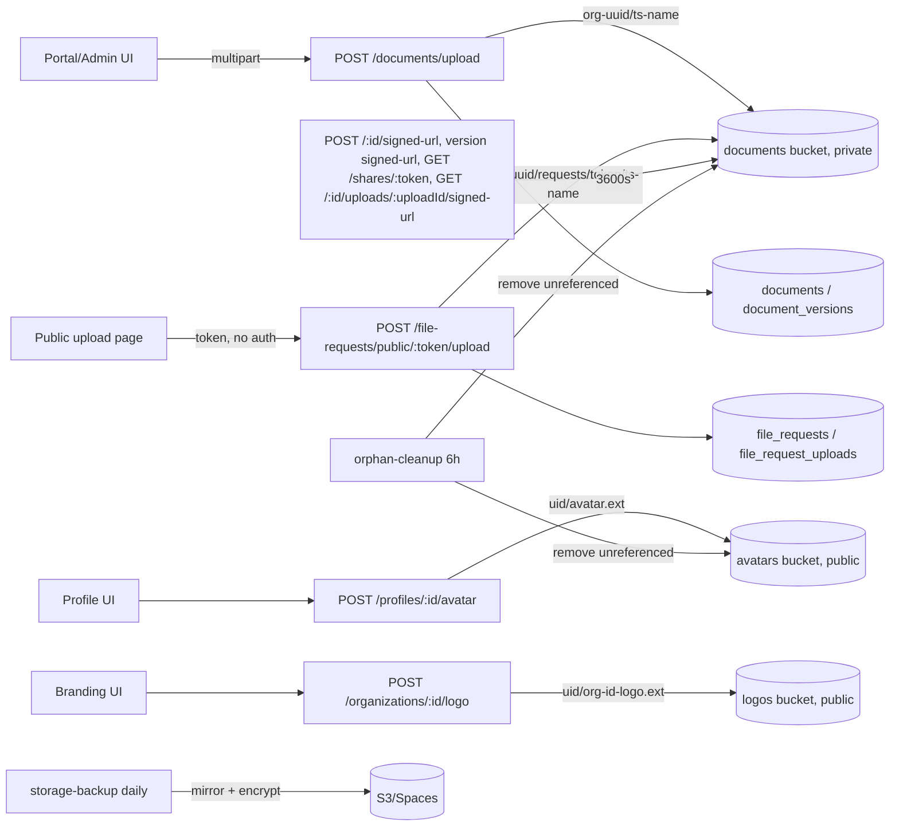

# File Upload and Download Security Audit

## Audit Metadata

- Audit name: repo-deep-dive
- Run: `mainecybertech-20261011-0426-full-main-8d299b8`
- Repository: `MaineCyberTech/mainecybertech` (read-only worktree `/tmp/opencode/mct-audit-target`)
- Branch: `main`
- Commit SHA: `8d299b8d`
- Generated at: 2026-10-11
- Auditor: OpenCode audit subagent (prompt 28, area code FILE)
- Area code: FILE
- Output path (pack): `docs/audits/repo-deep-dive/{run}/28_file_upload_download_security_audit.md`
- Scope limitations:
  - Static, repository-only review. No API was started, no bucket was contacted, no object was uploaded/downloaded. RLS behaviour, bucket `public` flags, and storage enforcement are read from committed SQL/config.
  - Live Supabase settings (`RLS_READS_ENABLED`/`RLS_WRITES_ENABLED`, bucket `file_size_limit`/`allowed_mime_types`, plan tier) are not in the repository → `Unknown`.
  - IDs are assigned later by the aggregator; verification rows keep the exact titles of the previous run's register rows.
  - Cross-referenced, not duplicated: SEC/ACM/RLS (prompt 06/24/37), DR (prompt 32), CHAIN (prompt 45).

## Scope

Reviewed: document upload/create/update/delete routes, version history and version signed URLs, share links (create/list/update/delete/public access), public file-request intake and its download endpoints, avatar/logo uploads, storage bucket declarations and `storage.objects` RLS policies, upload content validation, CSV/JSON exports, orphan cleanup, storage backup/restore, previews, rate limiting, and the corresponding tests/docs.

Not reviewed: live bucket state/CDN behaviour, Supabase dashboard settings, non-file exports beyond the shared CSV helper (owned by other domains), and billing/retention product modules (owned by prompts 07/29).

## Evidence Reviewed

| Evidence | Type | Why relevant | Notes |
|---|---|---|---|
| `apps/api/src/routes/documents.ts` | Source | Upload, signed URL, shares, versions, delete | Central file surface |
| `apps/api/src/routes/file-requests.ts` | Source | Public intake + org download endpoints | Token-authorized, org-prefixed |
| `apps/api/src/lib/upload-validation.ts` | Source | Markup reject + image/PDF byte sniffing | Shared by both upload paths |
| `apps/api/src/validators/document.ts` | Source | `storageBucket`/`storagePath` constraints | `z.literal("documents")` + path regex |
| `apps/api/src/routes/profiles.ts`, `organizations.ts` | Source | Avatar/logo uploads to public buckets | MIME→extension derivation |
| `apps/api/src/services/supabase.ts` | Source | `getScopedClient` service-role default | RLS bypass unless allow-listed |
| `apps/api/src/middleware/permissions.ts`, `org-access.ts` | Source | Permission + tenant gates | `documents:create` used for downloads |
| `apps/api/src/middleware/error.ts` | Source | MulterError not mapped | Oversized upload → 500 |
| `apps/api/src/middleware/rate-limit.ts`, `app.ts` | Source | Global IP 300/15m + user 600/15m | No token-keyed limiter |
| `apps/api/src/lib/csv.ts` + 10 export routes | Source | CSV formula guard + tenant scope | Verified |
| `supabase/migrations/5302026_...corrected.v3.sql` | Migration | `documents` bucket, `can_read_document`, `storage_path_org_id`, table policies | Lines 740-790, 799-825, 2181-2187, 2297-2334 |
| `supabase/migrations/5302129_supabase_rls_audit_fixes.sql` | Migration | Rewritten documents-bucket policies | 718-769 |
| `supabase/migrations/5302433_avatars_bucket_policies.sql` | Migration | `avatars` bucket + owner-scoped policies | 1-90 |
| `supabase/migrations/5302430_file_request_uploads.sql` | Migration | Intake upload rows + RLS | 1-60 |
| `apps/worker/src/tasks/orphan-cleanup.ts` | Source | Reconciles documents/versions/intake | Fail-closed |
| `scripts/backup-storage.sh`, `restore-storage.sh`, `.github/workflows/storage-backup.yml` | Scripts/CI | Storage durability | Daily 05:00 UTC |
| `apps/web/components/DocumentPreview.tsx`, `admin/OrgBrandingForm.tsx`, `(public)/upload/[token]/UploadForm.tsx` | Web | Preview + client accept lists | — |
| `apps/api/src/__tests__/{documents,file-requests,csv}.test.ts`, `apps/worker/src/__tests__/orphan-cleanup.test.ts`, `apps/web/e2e/**` | Tests | Coverage | Partial |
| `docs/modules/{documents,file-requests}.md`, `docs/runbooks/secure-file-request.md`, `docs/ARCHITECTURAL_ANALYSIS.md`, `docs/RTO_RPO.md`, `SECURITY.md` | Docs | Drift check | Partial |

## Verification Performed

| Evidence | Type | Why relevant | Notes |
|---|---|---|---|
| `git log --oneline 9c0b88c..8d299b8d` | Walk | Delta since previous run | 40+ commits; file-domain fixes are ancestors |
| `git merge-base --is-ancestor` on 9d1b5de7, a1f6ce55, 0dd81973, a0a39629, 08ad3d4d, e89f466c, eb805435, 0d948ac1 | Walk | Binding of fix commits | All ancestors of `8d299b8d` |
| `grep -rn "multer" apps packages` | Walk | Upload surface inventory | 4 routes (documents, file-requests, profiles, organizations) |
| `grep -rn "createSignedUrl\|getPublicUrl\|storage.from(" apps packages` | Walk | Download/sign surface | 4 signed-URL sites (all 3600s) |
| Read `documents.ts` (1068 lines) end to end | Walk | Authz/visibility/version checks | See findings |
| Read `file-requests.ts` (509 lines) end to end | Walk | Public intake + downloads | Token-only auth confirmed |
| `grep -ri "insert into storage.buckets"` | Walk | Bucket inventory | `documents`, `logos`, `avatars` declared |
| `grep -rn "file_size_limit\|allowed_mime_types" supabase/` | Walk | Bucket-level limits | Only `config.toml.*.example` global; no bucket row |
| `grep -rni "clamav\|virus\|malware\|antivirus\|quarantine" apps/` | Walk | AV/content scanning | No upload-scanning code |
| `grep -rn "sendExportResponse"` + read 10 export handlers | Walk | Export safety | All org-scoped; formula guard applied |
| `grep -rn "rateLimit" apps/api/src` + read `app.ts:125-146` | Walk | Share/upload throttling | Global only |
| Read `orphan-cleanup.ts` + `orphan-cleanup.test.ts` | Walk | Version/intake durability | Union reconciliation tested |
| Read `backup-storage.sh` / `restore-storage.sh` / `storage-backup.yml` / `db-restore-test.yml` / `docs/RTO_RPO.md` | Walk | Durability + drill evidence | Backup scheduled; no storage restore drill |
| Read `DocumentPreview.tsx`, `OrgBrandingForm.tsx`, `UploadForm.tsx`, admin/portal document pages | Walk | Preview + client/server mismatch | See findings |
| `ls apps/api/src/__tests__ | grep -i "upload\|csv\|valid"` | Walk | Test inventory | `csv.test.ts`, no `upload-validation.test.ts` |

### Command log (exact commands and observed results)

- `git log --oneline 9c0b88c..8d299b8d` → 40+ commits since the previous run; file-domain fixes intact.
- `git merge-base --is-ancestor {9d1b5de7,a1f6ce55,0dd81973,a0a39629,08ad3d4d,e89f466c,eb805435,0d948ac1} 8d299b8d` → all print `ancestor`.
- `grep -rn "multer" apps packages` → 4 upload routes (documents, file-requests, profiles, organizations).
- `grep -rn "createSignedUrl\|getPublicUrl\|storage.from(" apps packages` → signed URLs at `documents.ts:173,620,851` and `file-requests.ts:389` (all 3600s); public URLs at `profiles.ts:229`, `organizations.ts:568`.
- `grep -ri "insert into storage.buckets" supabase/` → `documents` (5302026:2297), `logos` (5302031), `avatars` (5302433:30).
- `grep -rn "file_size_limit\|allowed_mime_types" supabase/ infra/` → only `supabase/config.toml.*.example` (global) and the `file_requests` columns; no bucket-level limit.
- `grep -rni "clamav|virus|malware|antivirus|quarantine" apps/` → no upload-scanning code.
- `grep -rn "sendExportResponse" apps/api/src/routes` → 8 routes; plus 2 bespoke CSV exports (`satisfaction-pulse-widget.ts:78-107`, `client-onboarding-command-center.ts:66-110`), all org-scoped.
- `grep -n "documents_select_visibility_aligned\|can_read_document" 5302026...v3.sql` → 2181-2187 and 740-790.
- `grep -n "documents_bucket_insert_aligned" 5302129...sql` → 718-733 (authenticated insert allowed for members with `documents:create`).
- `grep -rn "rateLimit" apps/api/src` → global IP/user limiters in `app.ts`/`middleware/rate-limit.ts`; no route-level share limiter.
- `ls apps/api/src/__tests__ | grep -i "upload\|csv\|valid"` → `csv.test.ts`, `validators.test.ts`; no `upload-validation.test.ts`.
- Read `scripts/backup-storage.sh`, `restore-storage.sh`, `.github/workflows/storage-backup.yml`, `db-restore-test.yml`, `docs/RTO_RPO.md` → backup scheduled; no storage restore drill.

## Executive Summary

The file subsystem at `8d299b8d` is materially hardened. All three previous P1s and four of the previous P2s are fixed and re-verified with current-commit evidence: anonymous file-request uploads are token-authorized with org-prefixed paths and a persisted `file_request_uploads` row plus org-authorized list/signed-URL endpoints; document version objects are retained and reconciled by orphan cleanup; the `avatars` bucket is declared with owner-scoped policies; document `storageBucket`/`storagePath` are constrained and org-checked; and every CSV export now applies a formula-injection guard with a mandatory tenant scope.

Remaining risks concentrate in enforcement depth rather than feature gaps:

1. **Download authorization does not implement the document visibility model.** The DB defines `can_read_document` (private/internal/public + `document_permissions`) and the `documents` table/storage SELECT policies use it, but the API routes run on the service-role client by default and only check `documents:create` + org. Any org member with upload rights can list and sign `private`/`internal` documents. (New, P2.)
2. **No AV/content scanning and no bucket-level MIME/size limits** (still open FILE-P2-003); the documents-bucket RLS *allows* approved members to insert objects directly, so API validation is bypassable and oversized/markup content can be stored without ever touching `validateUploadContent`. (New, P2, plus still-open FILE-P2-005.)
3. **Durability is configured but unproven:** storage backup/restore scripts and a daily workflow exist (FILE-P2-004 fixed), yet no storage restore has ever been exercised and `db-restore-test` covers only Postgres. (New, P3.)

Strengths to preserve: shared byte-sniffing validator, pinned bucket, unique non-upsert paths, atomic file-request slot claim/release with slot tokens, retained version history with version signed URLs, avatars bucket policies, CSV guard + tenant scoping, fail-closed orphan cleanup with folder/recursion guards, OpenAPI coverage of the new endpoints, and real cross-tenant API tests for documents.

## Inventory

| Item | Path / symbol | Purpose | Current state | Risk | Notes |
|---|---|---|---|---|---|
| Document upload | `documents.ts` `POST /upload` (313-489) | Store file + metadata | Hardened | Med | 2MB multer cap, MIME allowlist, byte sniff, pinned bucket |
| Document create/update | `documents.ts:260-311,491-563` + `validators/document.ts` | Metadata rows | Constrained | Low | Bucket literal + `<orgId>/<file>` path + org check |
| Signed URL | `documents.ts:603-629` | 1h download URL | Implemented | Med | `documents:create`; visibility not checked |
| Version signed URL | `documents.ts:812-861` | Retained version download | Implemented | Low | Parent-doc org check; bucket from parent |
| Share links | `documents.ts:863-1064` | External sharing | Implemented | Med | Revocation/expiry/max-access; 1h URL outlives revocation |
| Public share access | `documents.ts:146-204` | Token download | Implemented | Low | Atomic access-count claim |
| Public file request intake | `file-requests.ts:109-281` | Anonymous upload | Fixed | Low | Token auth, org path, DB row, atomic slot claim |
| File-request downloads | `file-requests.ts:338-397` | Org list/sign | Implemented | Low | Org+request+upload triple check |
| Avatar upload | `profiles.ts:204-252` | Public avatar | Hardened | Low | MIME→extension; bucket declared |
| Logo upload | `organizations.ts:539-585` | Public logo | Hardened | Low | MIME→extension; client accept list still says SVG |
| Content validation | `lib/upload-validation.ts` | Markup reject + sniff | Partial | Med | Images/PDF only; 512-byte head |
| Storage buckets | `5302026:2297-2299`, `5302031`, `5302433:30-31` | Bucket declarations | Implemented | Med | No bucket-level MIME/size limits |
| Storage RLS | `5302026:2303-2375`, `5302129:718-769`, `5302433` | Object authz | Implemented | Med | Authenticated insert allowed (bypass path) |
| Orphan cleanup | `worker/tasks/orphan-cleanup.ts` | GC unreferenced objects | Hardened | Low | Union of documents/versions/intake |
| Exports | `lib/csv.ts` + 10 routes | CSV/JSON download | Fixed | Low | Formula guard + tenant scope + audit |
| Storage backup/restore | `scripts/backup-storage.sh`, `restore-storage.sh`, `storage-backup.yml` | Durability | Implemented, not exercised | Med | Daily 05:00 UTC; no restore drill |
| Previews | `DocumentPreview.tsx` | Inline render | Implemented | Med | No iframe sandbox; no disposition control |
| Tests | API/worker/web | Regression | Partial | Med | No upload-validation unit tests; no intake-download tests |

## Domain Scorecard

| Category | Score | Evidence | Gap | Recommended action |
|---|---:|---|---|---|
| Upload components | 4 | `documents.ts:118-133,313-489`; `file-requests.ts:109-281` | No AV; 2MB cap vs docs | Add scan hook + bucket limits; align docs |
| Download endpoints | 3 | `documents.ts:603-629,812-861`; `file-requests.ts:338-397` | Visibility model bypassed | Enforce `can_read_document`; use `documents:view` |
| Document routes | 4 | `documents.ts` router; org predicates | Visibility ignored on read paths | Replicate DB policy in API |
| Attachments | 4 | `file-requests.ts` + `5302430` | No tests for download endpoints | Add integration tests |
| Storage buckets | 4 | 3 buckets declared | No `allowed_mime_types`/`file_size_limit` | Bucket-level limits migration |
| Public/private files | 4 | `documents` private, `logos`/`avatars` public by design | Authenticated insert into private bucket | Restrict insert to service role |
| Signed URLs | 3 | 3600s everywhere; revocation/expiry/max-access | URLs outlive revocation; no disposition | Shorter TTL or re-checking download route |
| Metadata | 3 | `documents.metadata` jsonb; `toJson` | Free-form metadata | Shape/size limits |
| MIME/extension/size validation | 4 | `upload-validation.ts`; multer caps | Office/zip/text not sniffed; 512-byte head | Container + full-buffer checks |
| Content scanning hooks | 1 | No scan code | Entirely absent | ClamAV/scan service + quarantine |
| Image/PDF/document previews | 3 | `DocumentPreview.tsx` | Unsandboxed iframes; svg ext branch | Sandbox + disposition |
| Exports | 4 | `csv.ts:16-30` + 10 scoped routes | No `Cache-Control: private` on exports | Add no-store header |

## Detailed Review

### Item: Document upload (`POST /api/v1/documents/upload`)

- Evidence: `apps/api/src/routes/documents.ts:97-137,313-489`; `apps/api/src/lib/upload-validation.ts:8-81`.
- What it does: multer memory storage (2MB), blocked-extension set, MIME allowlist, `validateUploadContent` byte sniffing, bucket pinned to `documents`, path `<orgUuid>/<ts>-<safeName>`, `upsert:false`, then `documents` + `document_versions` rows and audit events.
- Current controls: extension + declared-MIME allowlists; markup rejection; image/PDF magic-byte agreement; unique paths; org-predicated version replace; failure rollback of the new object.
- Missing controls: no AV scan; no bucket-level limits; Office/zip/JSON/text contents unchecked; size errors surface as 500.
- Risks: malware redistribution; validation bypass via direct storage writes (see Finding 2).
- Suggested tests: padded markup past 512 bytes; mismatched image bytes; true `.docx`/`.zip`; >2MB → 4xx not 5xx.

### Item: Signed URLs, shares, and revocation

- Evidence: `documents.ts:146-204,603-629,812-861,863-1064`.
- What it does: mints 3600s URLs; share access checks revoked/expired/max-access then atomically claims a slot; versions are signed via the parent document.
- Missing controls: no visibility/ACL check on mint; no token-keyed rate limit; revocation does not invalidate already-issued URLs; no `download`/disposition option.
- Suggested tests: private-document sign as a non-granted member → 403; revoked share URL stops working within the TTL policy; per-token 429.

### Item: Public file-request intake and downloads

- Evidence: `file-requests.ts:75-281,332-397`; `supabase/migrations/5302430_file_request_uploads.sql`; `5302064_file_requests.sql:11-12`.
- What it does: token-authorized anonymous upload; per-request size/MIME checks; org-prefixed path; byte sniff; atomic `claim_file_request_slot` RPC with single-use release token; persisted upload row; org-scoped list + signed URL.
- Missing controls: no tests for the download endpoints; per-request `max_file_size_mb` default 50 exceeds the 25MB multer cap.
- Suggested tests: cross-org signed-url 404; cleanup spares intake objects (covered by worker test 308-323).

### Item: Buckets, RLS, and durability

- Evidence: `5302026:2297-2334`, `5302129:718-769`, `5302433`, `orphan-cleanup.ts:132-262`, `scripts/backup-storage.sh`, `storage-backup.yml`, `docs/RTO_RPO.md:11`.
- What it does: `documents` private with `can_read_document` SELECT and org-prefixed write gates; `logos`/`avatars` public with scoped writes; orphan cleanup reconciles all three reference tables; daily encrypted storage mirror to S3/Spaces.
- Missing controls: authenticated members can insert objects directly; no bucket MIME/size limits; storage restore never exercised.
- Suggested tests: direct storage insert of a disallowed type → rejected; restore drill into a scratch bucket.

## Scenario / Control Matrix

| ID | Scenario or control | Evidence | Current control | Gap | Severity | Recommendation |
|---|---|---|---|---|---|---|
| FILE-001 | Upload components | `documents.ts:118-133,313-489` | Allowlists + byte sniff + pinned bucket | No AV; no bucket limits | P2 | Scan hook + bucket limits |
| FILE-002 | Download endpoints | `documents.ts:603-629`; `supabase.ts:203-226` | `documents:create` + org | Visibility ACL bypassed | P2 | Enforce `can_read_document`; `documents:view` |
| FILE-003 | Document routes | `documents.ts:209-258` | Org scope | Private/internal metadata exposed | P2 | Apply visibility filter |
| FILE-004 | Attachments (intake) | `file-requests.ts:109-397` | Token + org + DB row + atomic claim | Download endpoints untested | P3 | Integration tests |
| FILE-005 | Storage buckets | `5302026:2297`; `5302433:30` | 3 declared | No bucket MIME/size limits | P2 | Migration adding limits |
| FILE-006 | Public/private files | `5302129:718-733` | Org-prefixed insert gate | Members write directly | P2 | Service-role-only insert or bucket limits |
| FILE-007 | Signed URLs | `documents.ts:173,620,851`; `file-requests.ts:389` | 3600s expiry | Outlive revocation; inline | P3 | Shorter TTL; re-check route; disposition |
| FILE-008 | Metadata | `documents.ts:289,534` | jsonb via `toJson` | Free-form | P3 | Shape/size limits |
| FILE-009 | MIME/extension/size | `upload-validation.ts:40-81` | Sniff images/PDF; 512B head | Office/zip/text/polyglot | P2 | Container sniff + full buffer |
| FILE-010 | Content scanning | no scan code | None | Absent | P2 | AV hook + quarantine |
| FILE-011 | Previews | `DocumentPreview.tsx:14,27-62` | Extension/mime branch | Unsandboxed iframes; svg ext | P3 | Sandbox; drop svg; disposition |
| FILE-012 | Exports | `csv.ts:16-30` + 10 routes | Formula guard + tenant scope | No `no-store` on export responses | P3 | `Cache-Control: private, no-store` |

## Findings

IDs are assigned by the aggregator; titles match the previous register for verification rows.

### Finding: Public file-request upload is permission-gated and unreachable for anonymous uploaders

- Severity: P1
- Confidence: High
- Area: FILE
- Evidence:
  - `apps/api/src/routes/file-requests.ts:109-118` — `POST /public/:token/upload` has no `requirePermission`; authorization is the token row.
  - `apps/api/src/routes/file-requests.ts:122-134` — token lookup + status/expiry/max_files checks.
  - `apps/api/src/routes/file-requests.ts:399,450,488` — management routes still require permissions.
  - `apps/api/src/__tests__/file-requests.test.ts:213-238` — anonymous upload test asserts 200.
- What is happening: the public intake is token-authorized as intended.
- Status: `verified-fixed` — re-verified at `8d299b8d` (fix commit `9d1b5de7` is an ancestor).

### Finding: File-request uploads have no tenant-scoped path and no download path; orphan cleanup will delete them

- Severity: P1
- Confidence: High
- Area: FILE
- Evidence:
  - `apps/api/src/routes/file-requests.ts:151-159` — path is `<org_uuid>/requests/<token>/<ts>-<name>`.
  - `apps/api/src/routes/file-requests.ts:208-237` — `file_request_uploads` row persisted; object removed on failure.
  - `apps/api/src/routes/file-requests.ts:338-397` — org-scoped list + signed-URL endpoints.
  - `supabase/migrations/5302430_file_request_uploads.sql:15-60` — table + org-member RLS.
  - `apps/worker/src/tasks/orphan-cleanup.ts:169-190` — intake rows included in the reference union.
- What is happening: uploads are tracked, org-parseable, downloadable, and protected from cleanup.
- Status: `verified-fixed` — re-verified at `8d299b8d` (fix commit `9d1b5de7`).

### Finding: Document version history objects are deleted at replace and by orphan cleanup

- Severity: P1
- Confidence: High
- Area: FILE
- Evidence:
  - `apps/api/src/routes/documents.ts:414-429` — prior-version bytes are explicitly retained; no `remove(previousPath)`.
  - `apps/api/src/routes/documents.ts:812-861` — version signed-URL endpoint (parent-doc org check).
  - `apps/worker/src/tasks/orphan-cleanup.ts:169-190` — reference union includes `document_versions`.
  - `apps/worker/src/__tests__/orphan-cleanup.test.ts:324-339` — test spares version-only objects.
- What is happening: version history is retrievable and not treated as orphaned.
- Status: `verified-fixed` — re-verified at `8d299b8d` (fix commit `a1f6ce55`).

### Finding: `avatars` bucket is used by code but declared nowhere with no storage RLS policy

- Severity: P2
- Confidence: High
- Area: FILE
- Evidence:
  - `supabase/migrations/5302433_avatars_bucket_policies.sql:30-31` — bucket declared `public=true`.
  - `supabase/migrations/5302433_avatars_bucket_policies.sql:38-84` — owner-prefixed insert/update/delete + authenticated select.
  - `apps/api/src/routes/profiles.ts:216-229` — uploads under `<userId>/avatar.<ext>` and uses `getPublicUrl`.
- What is happening: bucket and policies are now explicit.
- Status: `verified-fixed` — re-verified at `8d299b8d` (fix commit `08ad3d4d`).

### Finding: Free-form `storageBucket`/`storagePath` on create/update allows signing arbitrary in-bucket objects

- Severity: P2
- Confidence: High
- Area: FILE
- Evidence:
  - `apps/api/src/validators/document.ts:24-31` — bucket `z.literal("documents")`; path regex `<uuid>/<file>`.
  - `apps/api/src/routes/documents.ts:267-272,516-521` — path org segment must equal the document/caller org.
  - `apps/api/src/routes/documents.ts:346-352` — bucket pinned; path server-derived on upload.
  - `apps/web/app/(admin)/admin/documents/page.tsx:208-217` — admin path flow validates the org prefix.
- What is happening: arbitrary bucket/path targeting is closed; org-prefix spoofing is rejected.
- Status: `verified-fixed` — re-verified at `8d299b8d` (fix commit `a0a39629`).

### Finding: No content/AV scanning and no bucket-level MIME/size limits on the documents bucket

- Severity: P2
- Confidence: High
- Area: FILE
- Evidence:
  - `grep -rni "clamav|virus|malware|antivirus|quarantine" apps/` — no upload-scanning code (matches are DMARC/blog text).
  - `supabase/migrations/5302026_...v3.sql:2297-2299` — `insert into storage.buckets (id, name, public)` only; no `allowed_mime_types`/`file_size_limit`.
  - `supabase/config.toml.production.example:66` — global `file_size_limit = "25MiB"` only.
  - `apps/api/src/routes/documents.ts:118-133,324-333` — validation lives only in the Express process.
- What is happening: content validation is single-layered; storage accepts whatever the RLS path allows.
- Status: `still-open` — re-verified at `8d299b8d` (unchanged; see also new bypass finding).

### Finding: No backup or restore path for uploaded objects (durability for files)

- Severity: P2
- Confidence: High
- Area: FILE
- Evidence:
  - `scripts/backup-storage.sh:31,86-105` — mirrors `documents avatars logos` to S3/Spaces with a manifest and optional AES-256-CBC encryption.
  - `scripts/restore-storage.sh:43-121` — restore with `--dry-run`, `.enc` handling, upsert control.
  - `.github/workflows/storage-backup.yml:18-56` — daily 05:00 UTC + dispatch; failure notification.
  - `docs/RTO_RPO.md:11,19,25` — storage RPO ≤24h / RTO 1h documented.
- What is happening: backup + restore + schedule + docs exist (the previous finding is fixed).
- Status: `verified-fixed` — re-verified at `8d299b8d`. Residual: the restore path has never been exercised (tracked as a new P3 below); `db-restore-test.yml` covers only the database.

### Finding: Content sniffing does not cover Office, archive, text/JSON, or polyglot payloads

- Severity: P2
- Confidence: High
- Area: FILE
- Evidence:
  - `apps/api/src/lib/upload-validation.ts:8-18` — markup detection scans only the first 512 bytes.
  - `apps/api/src/lib/upload-validation.ts:40-81` — only `image/*` and `application/pdf` are sniffed.
  - `apps/api/src/routes/documents.ts:97-116` and `apps/api/src/routes/file-requests.ts:17-34` — allowlists include Office, zip/gzip, JSON, plain, CSV, RTF.
- What is happening: declared-type content for most allowed families is stored unverified; a leading-padding polyglot can evade the head check.
- Status: `still-open` — re-verified at `8d299b8d`.

### Finding: CSV exports do not neutralize formula injection and default to all rows when `organization_id` is omitted

- Severity: P2
- Confidence: High
- Area: FILE
- Evidence:
  - `apps/api/src/lib/csv.ts:16-30` — `= + - @ \t \r` prefixed with `'`; numeric values left intact.
  - `apps/api/src/routes/tickets.ts:60-71`, `projects.ts:62-69`, `audit.ts:72-78`, and the proposals/findings/domain-monitors/assets/approvals exports — `resolveAdminTenantScope` + `applyRequestedOrg` + `applyOrgScope`.
  - `apps/api/src/routes/satisfaction-pulse-widget.ts:93-100` and `client-onboarding-command-center.ts:86-96` — use `escapeCsvValue` and org-scoped services.
  - `apps/api/src/__tests__/csv.test.ts:4-35` — guard tests.
- What is happening: formula injection is neutralized and exports no longer default to all tenants.
- Status: `verified-fixed` — re-verified at `8d299b8d` (fix commit `0dd81973`).

### Finding: Share endpoint has no per-token rate limit

- Severity: P3
- Confidence: High
- Area: FILE
- Evidence:
  - `apps/api/src/routes/documents.ts:146-204` — public share route has no route-level limiter.
  - `apps/api/src/app.ts:125-146` — global IP limiter 300/15m applies.
  - `apps/api/src/middleware/rate-limit.ts` — no token-keyed limiter exists.
- What is happening: unchanged; the global IP limiter is the only throttle. Tokens are 32 random bytes, so enumeration is infeasible.
- Status: `still-open` — re-verified at `8d299b8d`.

### Finding: Client logo accept list still advertises SVG that the server rejects

- Severity: P3
- Confidence: High
- Area: FILE
- Evidence:
  - `apps/web/components/admin/OrgBrandingForm.tsx:102` — `accept="image/png,image/jpeg,image/svg+xml"`.
  - `apps/web/components/admin/OrgBrandingForm.tsx:113` — helper text "PNG, JPG, or SVG. 5MB max."
  - `apps/api/src/routes/organizations.ts:43-51` — server rejects `image/svg+xml`.
- What is happening: unchanged client/server mismatch.
- Status: `still-open` — re-verified at `8d299b8d`.

### Finding: Documentation drift on file types and size limits; no documents/upload runbook

- Severity: P3
- Confidence: High
- Area: FILE
- Evidence:
  - `docs/modules/documents.md`, `docs/modules/file-requests.md`, `docs/runbooks/secure-file-request.md`, `docs/features/secure-file-request.md` — module docs and a runbook now exist.
  - `docs/ARCHITECTURAL_ANALYSIS.md:274` — still claims "documents (private, 50MB)" vs the 2MB API cap (`documents.ts:120`).
  - `docs/modules/documents.md` endpoint table lists non-existent routes (`POST /:id/upload`, `GET /:id/download`, `POST /:id/share`, `POST /bulk`).
  - `apps/api/src/validators/file-requests.ts:7` default `maxFileSizeMb=50` exceeds the 25MB multer cap (`file-requests.ts:60`).
- What is happening: partially fixed (docs/runbook created) but limits and endpoint tables still drift.
- Status: `partially-fixed` — re-verified at `8d299b8d`.

### Finding: Document download authorization bypasses the `can_read_document` visibility model

- Severity: P2
- Confidence: Medium
- Area: FILE
- Evidence:
  - `supabase/migrations/5302026_...v3.sql:2181-2187` — `documents_select_visibility_aligned` uses `public.can_read_document(id)`.
  - `supabase/migrations/5302026_...v3.sql:740-790` — `can_read_document` gates `private` by uploader/`document_permissions`, `internal` by uploader/manage/roles.
  - `apps/api/src/routes/documents.ts:209-258` — list/get have no visibility check (service-role client).
  - `apps/api/src/routes/documents.ts:603-629` — signed URL requires `documents:create` + org only; no visibility/ACL check.
  - `apps/api/src/services/supabase.ts:203-226` — `getScopedClient` falls back to the service-role client unless the module is allow-listed; `infra/digitalocean/docker-compose.yml:108-109` defaults the allow-lists to empty.
- What is happening: the DB policy that restricts private/internal documents is not replicated by the API read/sign paths; any approved member (and any role with `documents:create`, e.g. `engineer` per `5302128_role_catalog_expansion.sql:76`) can list metadata and mint download URLs for documents they are not entitled to view.
- Why it matters: document-level ACLs (the reason `document_permissions` exists) are unenforced through the primary client path.
- Recommended fix: apply the `can_read_document` predicate to list/get/signed-url/version endpoints (SQL filter or RPC), switch download authorization to `documents:view`, and add `documents` to the RLS allow-lists once the user-scoped client is used. Add tests for private/internal documents across roles.
- Status: `open` (new). Runtime allow-list values are `Unknown`; if `documents` is enabled in both RLS lists the API paths would be RLS-enforced, but the repository default is empty.

### Finding: Members with `documents:create` can write objects straight to the documents bucket, bypassing upload validation

- Severity: P2
- Confidence: Medium
- Area: FILE
- Evidence:
  - `supabase/migrations/5302129_supabase_rls_audit_fixes.sql:718-733` — insert policy allows any approved member with `documents:create` to insert objects whose path starts with their org UUID.
  - `supabase/migrations/5302026_...v3.sql:2297-2299` — bucket created with no `allowed_mime_types`/`file_size_limit`.
  - `apps/api/src/routes/documents.ts:118-133,324-333` — MIME allowlist, 2MB cap and byte sniffing exist only in the API.
- What is happening: a member with a Supabase access token (plus the project URL/anon key, which are not published by this repo) can write arbitrary objects — including markup or oversized files — directly to the private `documents` bucket; the API's `validateUploadContent` never runs.
- Recommended fix: add bucket-level `allowed_mime_types`/`file_size_limit`, and/or drop the authenticated insert policy so all writes go through the API (service role). Keep the org-prefix check as defense in depth.
- Status: `open` (new; enforcement half of FILE-P2-003).

### Finding: Storage restore path exists but has never been exercised

- Severity: P3
- Confidence: High
- Area: FILE
- Evidence:
  - `.github/workflows/db-restore-test.yml` — weekly restore test covers the database only; no storage equivalent.
  - `.github/workflows/storage-backup.yml:18-56` — backup is scheduled; no restore verification.
  - `docs/RTO_RPO.md:11` claims a storage RTO of 1 hour; `docs/RTO_RPO.md:44-47` states targets are meaningful only when exercised.
- What is happening: the storage recovery path is configured but `not exercised` (no artifact proving a restore).
- Recommended fix: add a weekly/quarterly storage restore test (restore into a scratch bucket or validate the manifest object count + a sample checksum), or record a dated manual drill.
- Status: `open` (new; cross-ref DR-P1-001).

### Finding: Share revocation does not invalidate already-issued signed URLs

- Severity: P3
- Confidence: Medium
- Area: FILE
- Evidence:
  - `apps/api/src/routes/documents.ts:159-165` — revocation/expiry/max-access are checked only when the share endpoint is called.
  - `apps/api/src/routes/documents.ts:171-173` — a 3600s signed URL is minted at that moment; no revocation handle exists at the storage layer.
- What is happening: after revocation, a URL already handed out keeps working for up to one hour.
- Recommended fix: shorten share-URL lifetime (e.g. 5–15 minutes), serve shares through an API download endpoint that re-checks revocation, or document the residual window.
- Status: `open` (new).

### Finding: Oversized uploads return 500 instead of a validation error

- Severity: P3
- Confidence: High
- Area: FILE
- Evidence:
  - `apps/api/src/routes/documents.ts:118-121` — multer `fileSize: 2MB`.
  - `apps/api/src/routes/file-requests.ts:58-60` (25MB), `profiles.ts:14-16` (2MB), `organizations.ts:23-25` (5MB).
  - `apps/api/src/middleware/error.ts:46-50` — `MulterError` is not mapped, so it falls through to the generic 500 handler.
- What is happening: exceeding a size cap yields `500 INTERNAL_SERVER_ERROR` instead of 400/413.
- Recommended fix: map `MulterError` (`LIMIT_FILE_SIZE`, `LIMIT_UNEXPECTED_FILE`) to a 400/413 `VALIDATION` response.
- Status: `open` (new).

### Finding: File-domain test gaps: no upload-validation unit tests and no file-request download coverage

- Severity: P3
- Confidence: High
- Area: FILE
- Evidence:
  - `apps/api/src/__tests__/` — `csv.test.ts` and `validators.test.ts` exist; no `upload-validation.test.ts`; `grep validateUploadContent apps/api/src/__tests__` returns nothing.
  - `apps/api/src/__tests__/file-requests.test.ts:352-361` — the only markup-rejection test (route level); no image/PDF magic-byte cases.
  - `apps/api/src/routes/file-requests.ts:338-397` — download endpoints have no tests (including cross-org denial).
  - `apps/web/e2e/portal/document-preview.spec.ts:1-8` — render smoke test only.
- Recommended fix: unit-test `looksLikeMarkup`/`sniffImageType`/`validateUploadContent` (including padded payloads), integration-test the intake list/signed-URL endpoints with a foreign org (404), and extend the e2e preview test.
- Status: `open` (new).

### Finding: Previews render untrusted files inline without sandbox or disposition controls

- Severity: P3
- Confidence: Medium
- Area: FILE
- Evidence:
  - `apps/web/components/DocumentPreview.tsx:27-33` — PDF rendered in an `<iframe>` with no `sandbox`.
  - `apps/web/components/DocumentPreview.tsx:53-62` — text/CSV/JSON rendered in an `<iframe>` with no `sandbox`.
  - `apps/web/components/DocumentPreview.tsx:14` — extension list still treats `svg` as an image.
  - `apps/api/src/routes/documents.ts:618-620`, `file-requests.ts:387-389` — `createSignedUrl(path, 3600)` without a `download` option, so objects are served inline (Supabase default; not reproduced at runtime).
- What is happening: if content validation is bypassed (previous finding) or evaded (FILE-P2-005), markup can be rendered from the storage origin inside an unsandboxed frame.
- Recommended fix: add `sandbox` to the iframes, drop `svg` from the image branch, and pass `download`/`Content-Disposition` for non-previewable types.
- Status: `open` (new).

## Risks

| Risk | Severity | Likelihood | Impact | Evidence | Mitigation |
|---|---|---|---|---|---|
| Private/internal documents downloadable by any upload-capable member | P2 | Medium | Same-tenant data exposure | `documents.ts:603-629`; `supabase.ts:203-226`; `5302026:2181-2187` | Enforce `can_read_document` in API |
| Direct-to-storage writes bypass validation | P2 | Medium | Malware/markup stored, size bypass | `5302129:718-733`; `5302026:2297-2299` | Bucket limits; service-role-only insert |
| Malware propagation via downloads | P2 | Medium | Client infection | No scan code | AV hook + quarantine |
| Polyglot/padded markup stored | P2 | Low-Med | Stored XSS enabler | `upload-validation.ts:8-18` | Full-buffer + container sniffing |
| Storage restore untested | P3 | Low-Med | Extended recovery time | `db-restore-test.yml` only | Storage restore drill |
| Signed URL outlives revocation | P3 | Low | 1h exposure window | `documents.ts:159-173` | Shorter TTL / re-check route |
| Oversized upload returns 500 | P3 | High | UX/error contract | `error.ts:46-50` | Map MulterError |
| Preview inline without sandbox | P3 | Low | Defense-in-depth gap | `DocumentPreview.tsx:27-62` | Sandbox + disposition |

## Recommendations

### Immediate / Release Blocking

- None newly identified; the previous release-blocking file items are fixed.

### This Week

- Enforce the `can_read_document` visibility model on document list/get/signed-url/version routes; use `documents:view` for downloads.
- Add bucket-level `allowed_mime_types`/`file_size_limit` (or restrict `storage.objects` insert to the service role).

### This Month

- Add AV/content scanning with quarantine (FILE-P2-003).
- Extend sniffing to Office/zip/text and scan the full buffer (FILE-P2-005).
- Add a per-token share limiter (FILE-P3-001).
- Fix the logo accept list and reconcile documented limits/endpoints (FILE-P3-002/003).
- Map `MulterError` to 4xx responses.

### Later / Platform Evolution

- Storage restore drill + RPO/RTO evidence (joint with prompt 32).
- Signed-URL disposition/sandbox hardening and shorter share TTLs.
- Metadata shape/size validation and `Cache-Control: private, no-store` on exports.

## Quick Wins

| Quick win | Why it helps | Files likely involved | Validation |
|---|---|---|---|
| Bucket MIME/size limits migration | Closes the storage bypass | new `supabase/migrations/*_storage_bucket_limits.sql` | Direct upload of `.svg`/oversized object rejected |
| Enforce visibility on signed URL | Stops private-doc downloads | `apps/api/src/routes/documents.ts` | Non-granted member → 403/404 |
| Map MulterError | Correct 400/413 responses | `apps/api/src/middleware/error.ts` | >2MB upload → 400 with message |
| Logo accept list | Removes confusing SVG failures | `apps/web/components/admin/OrgBrandingForm.tsx` | Picker offers only PNG/JPG/WebP/GIF |
| Add `sandbox` to preview iframes | Defense in depth | `apps/web/components/DocumentPreview.tsx` | Sandbox attribute present |
| Storage restore drill | Proves the recovery path | `.github/workflows/storage-backup.yml` + docs | Dated drill artifact |

## Hardening Backlog

| Backlog item | Priority | Owner suggestion | Effort | Dependency |
|---|---|---|---|---|
| Visibility-aware document authorization | P2 | API/security | S–M | `can_read_document` |
| Bucket-level MIME/size limits | P2 | DB/RLS | S | — |
| AV/content scanning + quarantine | P2 | API + infra | L | storage pipeline |
| Extend content sniffing | P2 | API | S–M | — |
| Per-token share limiter | P3 | API | S | — |
| Storage restore drill | P3 | Platform/DR | S | prompt 32 |
| MulterError mapping | P3 | API | S | — |
| Upload-validation unit tests | P3 | API | S | — |
| Preview sandbox/disposition | P3 | Web/API | S | — |

## Suggested Tests

Unit: `upload-validation.test.ts` — markup (including padded beyond 512 bytes), image magic-byte mismatch/agreement, valid PDF, Office/zip declared content; `csv.test.ts` already covers formula cells.

Integration: signed URL for a private document as a non-granted member → 403/404; list excludes private/internal for non-owners; file-request uploads list/signed-url cross-org → 404; direct storage insert of a disallowed type → rejected (once limits land); >2MB upload → 400.

E2E/manual: portal upload + preview + download of PDF/image; revoked share URL after TTL policy; storage restore drill with checksum.

CI/security: extend `tenant-scoping-guard.test.ts` with a visibility assertion; add a storage-restore workflow; keep `orphan-cleanup` tests for versions/intake.

## Suggested Documentation Updates

- Reconcile `docs/ARCHITECTURAL_ANALYSIS.md:274` and `supabase/config.toml.production.example:64-66` with the enforced 2MB/25MB caps.
- Fix `docs/modules/documents.md` endpoint table (it lists routes that do not exist) and add the visibility/ACL model.
- Add file-request upload/download endpoints to `docs/modules/file-requests.md`; document the multer 25MB ceiling vs `max_file_size_mb`.
- Add a bucket matrix (visibility, limits, policies) and the signed-URL/revocation TTL semantics.
- Record the storage restore drill in `docs/RTO_RPO.md` / `docs/ROLLBACK_PROCEDURES.md`.

## Open Questions

| Question | Why it matters | Evidence needed |
|---|---|---|
| Are `RLS_READS_ENABLED`/`RLS_WRITES_ENABLED` populated with `documents` in any environment? | Determines whether the visibility bypass is live | Redacted runtime env / deployment config |
| Do the live buckets carry `allowed_mime_types`/`file_size_limit`? | API-only vs storage-enforced guarantees | Supabase storage config export |
| Is the Supabase project URL/anon key reachable by normal members? | Likelihood of the direct-write bypass | Client bundle / project settings review |
| Was any storage restore ever run manually? | Distinguishes configured from exercised recovery | CI run history / drill records |
| Are `private`/`internal` documents actually used in production tenants? | Impact sizing for the visibility finding | DB counts by visibility (read-only) |

## Appendix

### A. File surface inventory

### B. Verification command log

See the command log under `## Verification Performed` above.

### C. Status roll-up

| Status | Findings |
|---|---|
| verified-fixed | 7 (FILE-P1-001/002/003, FILE-P2-001/002/004/006) |
| partially-fixed | 1 (FILE-P3-003) |
| still-open | 4 (FILE-P2-003, FILE-P2-005, FILE-P3-001, FILE-P3-002) |
| open (new) | 7 |
